# TC5061 - Proyecto MiBici (Equipo 20)

# Entrega Final

[](https://github.com/ariosi86/TC5061-Proyecto-Equipo20/actions/workflows/ci.yml)

Sistema de Machine Learning para la bicicleta pública **MiBici** (Área Metropolitana de Guadalajara), con ciclo MLOps completo: datos versionados, experimentos y Model Registry en MLflow, tres APIs en contenedores, CI/CD, pruebas de carga, monitoreo de drift, A/B testing, análisis FinOps y Model Cards. 

**Contexto del problema:** El sistema de bicicleta pública **MiBici** en el Área Metropolitana de Guadalajara enfrenta desbalances operativos diarios: estaciones que se quedan sin bicicletas disponibles en horas de alta demanda o sin anclajes libres para devolverlas. Para apoyar la planeación de flota y las rutas de rebalanceo en tiempo real, este proyecto resuelve tres problemas complementarios sobre el historial de viajes y estaciones:

| Pregunta | Tarea | Línea base | Modelo champion |
|---|---|---|---|
| **P1**: viajes que iniciarán en una estación en la hora siguiente | Regresión temporal | StandardScaler + LinearRegression | LightGBM Tweedie |
| **P2**: riesgo de que una estación quede vacía o llena en la hora siguiente | Clasificación binaria | Persistencia | HistGradientBoostingClassifier |
| **P3**: grupos de estaciones con patrones de uso similares | Clustering | Agrupación por municipio | StandardScaler + KMeans (K=4) |

## Contenido

- [1. Inicio rápido](#1-inicio-rápido)
- [2. Estructura del repositorio y experimentación](#2-estructura-del-repositorio-y-experimentación)
- [3. Modelos y Model Registry](#3-modelos-y-model-registry)
- [4. Despliegue y operación](#4-despliegue-y-operación)
- [5. Pruebas, validación de datos y seguridad](#5-pruebas-validación-de-datos-y-seguridad)
- [6. Monitoreo: drift y A/B testing](#6-monitoreo-drift-y-ab-testing)
- [7. Análisis FinOps](#7-análisis-finops)
- [8. Model Cards y gobernanza responsable](#8-model-cards-y-gobernanza-responsable)


| Componente | Dónde se documenta |
|---|---|
| Código, ingeniería de características, MLflow Project y Tracking | [Sección 2](#2-estructura-del-repositorio-y-experimentación) |
| Selección del modelo, versionado, linaje y estado de producción | [Sección 3](#3-modelos-y-model-registry) |
| FastAPI, Docker Compose, GitHub Actions y Locust | [Sección 4](#4-despliegue-y-operación) |
| Pruebas, validación de datos y seguridad | [Sección 5](#5-pruebas-validación-de-datos-y-seguridad) |
| Drift con Evidently y A/B testing | [Sección 6](#6-monitoreo-drift-y-ab-testing) |
| Análisis FinOps | [Sección 7](#7-análisis-finops) |
| Model Cards y gobernanza responsable | [Sección 8](#8-model-cards-y-gobernanza-responsable) y [docs/model_cards.md](docs/model_cards.md) |
| Presentación ejecutiva | [TC5061_Presentacion_Equipo20.pdf](docs/TC5061_Presentacion_Equipo20.pdf) |
| Demostración en video (2–5 min) | [Ver demostración en YouTube](https://youtu.be/nHgbQKjlA6E) |

## 1. Inicio rápido

Para ejecutar el sistema completo **solo se necesita Docker con Compose v2** (o `podman-compose`); no hace falta crear un entorno virtual ni instalar `requirements.txt`. El entorno local ([sección 2.3](#23-entorno-local-desarrollo-y-análisis)) se usa para desarrollo, pruebas, monitoreo y análisis.

Todos los comandos se ejecutan desde la raíz del repositorio.

```bash
# 1. Construir imágenes (evita colisión paralela sobre el tag compartido mibici-api:latest)
docker compose -f docker/docker-compose.yml build api-p1 mlflow prep evidently

# 2. Levantar servicios principales + Locust (UI de pruebas de carga)
docker compose -f docker/docker-compose.yml --profile loadtest up -d --no-build

# 3. Verificar estado de los contenedores
docker compose -f docker/docker-compose.yml --profile loadtest ps
```

| Servicio | URL / Puerto | Descripción |
|---|---|---|
| MLflow UI & Registry | http://localhost:5001 | Experimentos y modelos `@champion` |
| Evidently UI | http://localhost:8000 | Consola de monitoreo y reportes de drift |
| API P1 (Swagger) | http://localhost:8001/docs | Demanda horaria (`LightGBM Tweedie`) |
| API P2 (Swagger) | http://localhost:8002/docs | Riesgo de desbalance (`GBM`) |
| API P3 (Swagger) | http://localhost:8003/docs | Clustering de estaciones (`KMeans K=4`) |
| Locust UI | http://localhost:8089 | Pruebas de carga (perfil `loadtest`) |

Para detener conservando los volúmenes (`mlruns` y `evidently_workspace`):
```bash
docker compose -f docker/docker-compose.yml --profile loadtest down
```
*(Agregar `-v` borra también los volúmenes persistentes de modelos y monitoreo).*

La primera vez, el servicio `prep` descarga los datos, entrena y registra los tres modelos (alrededor de 5 minutos con los datos ya descargados). Las APIs arrancan cuando `prep` termina con éxito. Si los tres `@champion` ya existen en el volumen, `prep` termina en segundos sin reentrenar. En el estado esperado, `prep` aparece como `Exited (0)` (para verlo, usar `ps -a`) y los demás servicios activos.

Prueba rápida:

```bash
curl http://localhost:8003/health
curl -X POST http://localhost:8003/predict -H "Content-Type: application/json" \
  -d '{"pct_manana":0.23,"pct_mediodia":0.33,"pct_tarde":0.29,"pct_noche":0.12,"pct_fin_de_semana":0.20,"duracion_media":11.12,"viajes_dia_log":3.23,"balance_neto":-0.02}'
```

## 2. Estructura del repositorio y experimentación

### 2.1 Organización del repositorio

La arquitectura del proyecto sigue la estructura estándar de **Cookiecutter Data Science** con modularización independiente por pregunta:

```text
├── LICENSE                      <- Licencia de código abierto del proyecto
├── Makefile                     <- Comandos automatizados de apoyo (make data, make train)
├── README.md                    <- Documentación principal del repositorio
├── pyproject.toml               <- Metadatos del paquete local y configuración de herramientas
├── requirements.txt             <- Librerías y versiones fijadas del entorno de ejecución
├── MLproject                    <- Entry points de MLflow Project (ingest, train_p1, train_p2, train_p3, train)
├── python_env.yaml              <- Entorno Python del MLflow Project
├── run_train.py                 <- Lanza las versiones candidatas por pregunta con mlflow run
├── run_mejor_modelo.py          <- Registra el modelo elegido y asigna el alias champion
├── .github/workflows/ci.yml     <- Pipeline de CI/CD
├── docker/                      <- docker-compose.yml, constraints.txt, .env.example y carpetas api/, mlflow/, prep/ y evidently/
├── locust/                      <- Escenario de carga, monitor de recursos, gráficas y FinOps
│
├── data/
│   ├── external/                <- Datos provenientes de fuentes externas secundarias
│   ├── interim/                 <- Datos intermedios en proceso de transformación
│   ├── processed/               <- Parquets procesados canónicos (trips.parquet y stations.parquet)
│   │   ├── train/               <- Partición de entrenamiento (Año 2025 completo)
│   │   └── test/                <- Archivo de viajes abril a septiembre de 2026 (ver particiones por pregunta)
│   ├── raw/                     <- Archivos CSV mensuales originales de MiBici (inmutables)
│   └── manifest.json            <- Registro criptográfico SHA-256 para validación de datos
│
├── docs/                        <- Documentación técnica extendida, model cards y guías metodológicas
├── models/                      <- Modelos y pipelines serializados en formato .pkl
├── notebooks/                   <- Jupyter Notebooks de análisis exploratorio (P1, P2 y P3)
├── references/                  <- Diccionarios de datos y manuales explicativos
├── reports/                     <- Tablas comparativas de métricas (.csv) y reportes generados
│   └── figures/                 <- Gráficas exportadas para reportes
├── tests/                       <- Suite de pruebas de integración y validación con pytest
└── proyecto_mibici/             <- Paquete principal de Python
    ├── __init__.py              <- Metadatos del módulo principal (__version__, __author__)
    ├── config.py                <- Rutas resueltas con pathlib, constantes, URLs y semillas
    ├── dataset.py               <- Pipeline CLI para descarga, limpieza inicial y exportación a Parquet
    ├── features.py              <- Fachada unificada que expone la API pública de características
    ├── features_p1.py           <- Malla horaria, rezagos (1h, 24h, 168h), ventanas móviles y variables cíclicas
    ├── features_p2.py           <- Balance por día operativo (inicio 03:00 hrs) y estrés relativo
    ├── features_p3.py           <- Perfiles anuales de uso, distribuciones horarias y balance neto
    ├── pipeline.py              <- Orquestador maestro End-to-End (Datos + Train + Predict + Testing)
    ├── plots.py                 <- Visualizaciones generadas sobre backend headless 'Agg'
    └── modeling/
        ├── __init__.py          <- Exposición de las clases POO de modelado
        ├── model_p1.py          <- Clase POO DemandaLinealP1 (StandardScaler + LinearRegression)
        ├── model_p2.py          <- Clase POO RiesgoLogisticoP2 (StandardScaler + LogisticRegression)
        ├── model_p3.py          <- Clase POO ClusterEstacionesP3 (StandardScaler + KMeans)
        ├── train_p1.py          <- Script CLI de entrenamiento, evaluación y registro en MLflow (P1)
        ├── train_p2.py          <- Script CLI de entrenamiento, evaluación y registro en MLflow (P2)
        ├── train_p3.py          <- Script CLI de entrenamiento, contraste baseline y MLflow (P3)
        ├── predict_p1.py        <- Script CLI para inferencia sobre demanda horaria (P1)
        ├── predict_p2.py        <- Script CLI para inferencia sobre riesgo de desbalance (P2)
        ├── predict_p3.py        <- Script CLI para inferencia de clusters funcionales (P3)
        ├── retrain_p1.py        <- Challenger de P1 (también retrain_p2.py y retrain_p3.py)
        └── tracking.py          <- Módulo de integración defensiva con MLflow Tracking
    └── monitoring/              <- Drift con Evidently y A/B testing de P1, P2 y P3
```

### 2.2 Módulos de código e ingeniería de características

- **`config.py`**: Centraliza rutas absolutas mediante `pathlib.Path`, URLs de descarga de datos abiertos, semillas aleatorias (`RANDOM_SEED`), hiperparámetros base (`P2_UMBRAL`, `P3_K_ELEGIDO`), nombres de columnas predictoras y configuración de conexión a MLflow (`URI_MLFLOW_TRACKING`, `MLFLOW_EXPERIMENT_NAME`).
- **`dataset.py`**: Ejecuta el flujo ETL primario. Descarga el catálogo de estaciones y los registros históricos de viajes, maneja codificaciones conflictivas (`utf-8` / `latin-1`), normaliza nombres de columnas, tipa identificadores y fechas, exporta los archivos maestros `trips.parquet`, `stations.parquet` junto con las particiones específicas de entrenamiento (`trips_train_2025.parquet`) y prueba (`trips_test_2026_04_09.parquet`), y construye el archivo `data/manifest.json` con hashes SHA-256.
- **`features.py` (Fachada) y `features_p1.py`, `features_p2.py`, `features_p3.py`**: Implementan transformadores orientados a objetos compatibles con scikit-learn (`BaseEstimator`, `TransformerMixin`) junto con sus funciones orquestadoras:
  * **`features_p1.py`**: `LimpiadorFiltroEstacionesP1` y `GeneradorDemandaLagsP1` construyen la serie horaria completa rellenando horas sin viajes con cero, calculan rezagos (`lag_1h`, `lag_24h`, `lag_168h`), promedios móviles (`rolling_3h`, `rolling_168h`) y codificación trigonométrica del ciclo diario (`sin`/`cos`).
  * **`features_p2.py`**: `LimpiadorFlujoP2` y `ConstructorSerieRiesgoP2` eliminan viajes anómalos (<10 segundos entre estaciones distintas), estructuran el día operativo con corte a las 03:00 hrs, calculan el balance acumulado respecto a la capacidad instalada (`dpcapacity`) y etiquetan el estado de riesgo para la hora $t+1$.
  * **`features_p3.py`**: `LimpiadorPerfilP3` depura duraciones fuera de rango (>180 min) y sintetiza el comportamiento anual de cada estación en proporciones de uso por bloque horario, porcentaje de viajes en fin de semana, duración media, volumen diario en escala logarítmica y balance neto relativo.
- **`pipeline.py`**: Orquestador maestro que automatiza todo el ciclo End-to-End del proyecto en secuencia (Ingesta ETL, entrenamiento de P1, P2 y P3 con registro en MLflow, inferencia CLI de prueba y suite de validación con `pytest`).
- **`plots.py`**: Módulo de visualización configurado con backend `Agg` (sin requerir monitor gráfico) que genera las gráficas de evaluación para MLflow: series temporales y dispersión real vs. predicho (P1), matrices de confusión y curvas Precision-Recall (P2), y mapas geográficos de estaciones coloreados por clúster o municipio (P3).
- **`modeling/model_p1.py`, `model_p2.py`, `model_p3.py`**: Clases POO (`DemandaLinealP1`, `RiesgoLogisticoP2`, `ClusterEstacionesP3`) que encapsulan objetos `sklearn.pipeline.Pipeline` uniendo el escalamiento `StandardScaler` con el estimador final, ofreciendo métodos estandarizados `.fit()`, `.predict()`, `.save()` y `.load()`.
- **`modeling/tracking.py`**: Gestiona la trazabilidad en MLflow registrando el hash SHA-256 de los datos, el hash del commit de Git, hiperparámetros, métricas desglosadas por partición (`Train`, `Validación`, `Test`), artefactos de figuras, tablas CSV y el modelo con su firma (`infer_signature`), guardando simultáneamente copias locales de las figuras en `reports/figures/`.

### 2.3 Entorno local (desarrollo y análisis)

#### Requisitos previos
- **Python 3.10 o 3.11** instalado en el sistema operativo.
- **Git** configurado en la terminal.

#### Paso 1: Clonar el proyecto
```bash
git clone https://github.com/ariosi86/TC5061-Proyecto-Equipo20.git
cd TC5061-Proyecto-Equipo20
```

#### Paso 2: Crear el entorno virtual
```bash
python -m venv .venv
```

#### Paso 3: Activar el entorno virtual

- **macOS y Linux:**
  ```bash
  source .venv/bin/activate
  ```

- **Windows (PowerShell):**
  ```powershell
  .venv\Scripts\Activate.ps1
  ```
  *(En caso de bloqueo por políticas de ejecución en PowerShell, ejecutar antes: `Set-ExecutionPolicy -ExecutionPolicy RemoteSigned -Scope CurrentUser`)*

- **Windows (Símbolo del sistema / CMD):**
  ```cmd
  .venv\Scripts\activate.bat
  ```

#### Paso 4: Instalar dependencias y montar el paquete local
```bash
# 1. Actualizar pip
pip install --upgrade pip

# 2. Instalar dependencias fijadas en requirements.txt
pip install -r requirements.txt

# 3. Instalar el paquete local proyecto_mibici en modo editable
pip install -e .

# 4. Registrar el kernel para uso en Jupyter Notebooks
python -m ipykernel install --user --name=mibici-venv --display-name="Python (MiBici .venv)"
```

> **macOS:** `lightgbm` requiere OpenMP: `brew install libomp`.

### 2.4 Datos, versionado y particiones

Con el entorno virtual activo `(.venv)`, ejecuta el módulo de ingesta desde la raíz del proyecto:

```bash
python -m proyecto_mibici.dataset
```

**Salidas generadas automáticamente:**
1. Descarga de los archivos CSV originales en `data/raw/`.
2. Generación de los conjuntos procesados en formato Apache Parquet:
   * Maestro general: `data/processed/trips.parquet`
   * Catálogo de estaciones: `data/processed/stations.parquet`
   * Entrenamiento (2025): `data/processed/train/trips_train_2025.parquet`
   * Viajes de abril a septiembre de 2026: `data/processed/test/trips_test_2026_04_09.parquet`
3. Creación de `data/manifest.json` con los hashes criptográficos SHA-256, conteo total de registros y rango de fechas.

Los archivos Parquet anteriores son cortes de datos. La **partición temporal que usa cada modelo** es la siguiente (se registra en MLflow y se puede consultar en `GET /health`):

| Pregunta | Entrenamiento | Validación | Prueba |
|---|---|---|---|
| P1 | 8 ene a 31 dic 2025 | ene a abr 2026 | may a sep 2026 |
| P2 | 2025 | ene a mar 2026 | abr a jun 2026 |
| P3 | 2025 | ene a abr 2026 | may a sep 2026 |

La versión de datos de los modelos desplegados es `datos_version = 23510f42a0a0`.

### 2.5 Entrenamiento y MLflow Tracking

Cada script de entrenamiento construye su tabla de características desde los archivos Parquet procesados, aplica la partición temporal correspondiente para evitar fuga de información (*data leakage*), ajusta el Pipeline, guarda el artefacto `.pkl` en `models/` y registra la corrida completa en MLflow.

#### Requisitos de MLflow
Antes de ejecutar los entrenamientos, inicia el servidor local de MLflow en una terminal secundaria con el entorno virtual activo:

```bash
mlflow server --backend-store-uri sqlite:///mlflow.db --default-artifact-root ./mlruns --port 5000
```

*La URI de seguimiento está definida en `proyecto_mibici/config.py` mediante `URI_MLFLOW_TRACKING` (`http://localhost:5000` o `sqlite:///mlflow.db`). Puedes consultar los experimentos en el navegador ingresando a `http://localhost:5000`.*

---

#### P1: Entrenamiento de Demanda Horaria (Regresión)
Ejecuta un modelo individual:

```bash
python -m proyecto_mibici.modeling.train_p1 --model <nombre> --lr <learning_rate> --alpha <alpha> --max_iter <max_iter>
```

Modelos disponibles:

| `--model` | Descripción | Etapa |
|---|---|---|
| `baseline` | Regresión Lineal con medias móviles (línea base) | Baseline |
| `poisson` | Regresión de Poisson | Candidato |
| `lgbm_poisson` | LightGBM objective=poisson | Candidato |
| `lgbm_p_search` | Búsqueda anidada de hiperparámetros (objective=poisson) | Search |
| `lgbm_tweedie` | LightGBM objective=tweedie (campeón) | Candidato |
| `lgbm_t_search` | Búsqueda anidada de hiperparámetros (objective=tweedie) | Search |

- **Parámetros registrados en MLflow:**
  * `pregunta`: `"P1"`
  * `modelo`: Nombre del modelo (`DemandaLinealP1`, `PoissonRegression`, `LightGBM_poisson`, `LightGBM_tweedie`, etc.)
  * `features`: Lista de rezagos (`lag_1h`, `lag_24h`, `lag_168h`), medias móviles (`rolling_3h`, `rolling_168h`) y variables de calendario (`target_hour_sin`, `target_hour_cos`, `target_is_weekend`).
  * `train_inicio`, `train_fin`, `validation_inicio`, `validation_fin`, `test_inicio`, `test_fin`: Límites cronológicos exactos de cada partición.
  * `datos_version`: Hash SHA-256 corto del dataset procesado.
- **Métricas registradas:** `train_mae`, `train_rmse`, `test_mae`, `test_rmse`, `test_wape`, `test_sesgo`.
- **Artefactos generados:**
  * Local: `models/p1_linear_model.pkl` (baseline) / `models/p1_poisson_model.pkl` / modelos LightGBM.
  * MLflow: Pipeline scikit-learn con firma de entrada/salida, `manifest.json`, gráfica de serie temporal y gráfico de dispersión global.

---

#### P2: Entrenamiento de Riesgo de Desbalance (Clasificación)
Ejecuta un modelo individual:

```bash
python -m proyecto_mibici.modeling.train_p2 --modelo <nombre> --umbral <umbral> --class-weight <peso> --max-iter <iter>
```

Modelos disponibles:

| `--modelo` | Descripción | Etapa |
|---|---|---|
| `baseline` | Persistencia ingenua (línea base) | Baseline |
| `logistic` | Regresión Logística (balanced / None) | Candidato |
| `logistic_search` | Búsqueda anidada de hiperparámetros (logística) | Search |
| `gbm` | `HistGradientBoostingClassifier` (campeón) | Candidato |
| `gbm_search` | Búsqueda anidada de hiperparámetros (GBM) | Search |

- **Parámetros registrados en MLflow:**
  * `pregunta`: `"P2"`
  * `modelo`: `LogisticRegression` o `HistGradientBoostingClassifier`
  * `umbral`: Umbral de decisión de riesgo (por defecto 0.5).
  * `class_weight`: Peso de clases para Regresión Logística (`balanced` o `None`).
  * `max_iter`: Iteraciones máximas.
  * `train_inicio`, `train_fin`, `validation_inicio`, `validation_fin`, `test_inicio`, `test_fin` y `datos_version`.
- **Métricas registradas:** `train_precision`, `train_recall`, `train_f1_score`, `train_pr_auc`, `test_precision`, `test_recall`, `test_f1_score`, `test_pr_auc`.
- **Artefactos generados:**
  * Local: `models/p2_logistic_model.pkl` / `models/p2_gbm_model.pkl`.
  * MLflow: Pipeline scikit-learn con firma de datos, `manifest.json`, matriz de confusión y curva Precision-Recall.

---

#### P3: Entrenamiento de Clustering de Estaciones (No Supervisado)
```bash
python -m proyecto_mibici.modeling.train_p3
```

- **Parámetros registrados en MLflow:**
  * `pregunta`: `"P3"`
  * `modelo`: Registra dos corridas para contraste directo: `"AgrupacionMunicipio"` (Línea Base geográfica) y `"ClusterEstacionesP3"` (KMeans funcional).
  * `n_clusters`: `4` ($K$ elegido).
  * `n_init`: `10`.
  * `semilla`: `RANDOM_SEED`.
  * `variables`: Las ocho variables de `P3_VARIABLES`: proporciones por bloque horario (`pct_manana`, `pct_mediodia`, `pct_tarde`, `pct_noche`), `pct_fin_de_semana`, `duracion_media`, `viajes_dia_log` y `balance_neto`.
  * `min_viajes_estacion`: `100`.
  * `duracion_max_min`: `180`.
- **Métricas registradas:** `train_silhouette`, `train_davies_bouldin`, `test_silhouette`, `test_davies_bouldin` en ambas corridas.
- **Artefactos generados:**
  * Local: `models/p3_kmeans_model.pkl` y tabla comparativa `reports/p3_comparacion.csv`.
  * MLflow: Pipeline scikit-learn con firma de datos, mapa de estaciones por clúster KMeans (`mapa_grupos_kmeans.png`) y mapa de la línea base municipal (`mapa_grupos_baseline.png`).


### 2.6 MLflow Project

El proyecto está empaquetado como un **MLflow Project** para reproducir la ingesta y los entrenamientos desde cualquier entorno.

**Archivos del proyecto MLflow:**
- `MLproject`: define los entry points `ingest`, `train_p1`, `train_p2`, `train_p3` y `train`, con sus parámetros y variables de entorno.
- `python_env.yaml`: definición del entorno Python con las dependencias fijas.
- `run_train.py`: orquestador CLI que lanza todas las versiones de una pregunta mediante `mlflow run`.

#### Levantar el servidor de MLflow

Desde la raíz del repositorio, con el entorno virtual activado:

```bash
mlflow server --backend-store-uri sqlite:///mlflow.db --default-artifact-root ./mlruns --port 5000
```

Accede a la interfaz en `http://localhost:5000`. En la terminal de trabajo define la URI:

```bash
export MLFLOW_TRACKING_URI=http://127.0.0.1:5000
```

> **Importante:** antes de ejecutar cualquier comando `mlflow run`, exporta la URI de tracking en tu shell:
> ```bash
> export MLFLOW_TRACKING_URI=http://127.0.0.1:5000
> ```
> O, si creaste el archivo `.env`, cárgalo antes:
> ```bash
> set -a && source .env && set +a
> ```
> Sin esta variable, `mlflow run` usa el file store local por defecto y los runs no quedan registrados en el servidor `http://127.0.0.1:5000`.
> Los hiperparámetros siempre se pasan como `-P clave=valor`. Los scripts usan `URI_MLFLOW_TRACKING` desde `config.py` para registrar parámetros, métricas y artefactos en MLflow.

#### Reproducir la ingesta de datos

```bash
mlflow run . -e ingest --env-manager local --experiment-name mibici-equipo20
```

Equivalente a `python -m proyecto_mibici.dataset`.

#### Entrenar modelos por pregunta

Hay dos formas equivalentes: con `run_train.py` o con `mlflow run` directamente. Ambos quedan registrados en MLflow con `source_type=PROJECT`.

**P1 — Demanda horaria (regresión):**

```bash
mlflow run . -e train_p1 --env-manager local --experiment-name mibici-equipo20 -P modelo=baseline
mlflow run . -e train_p1 --env-manager local --experiment-name mibici-equipo20 -P modelo=poisson -P lr=0.05 -P alpha=0.0001 -P max_iter=300
mlflow run . -e train_p1 --env-manager local --experiment-name mibici-equipo20 -P modelo=lgbm_tweedie
mlflow run . -e train_p1 --env-manager local --experiment-name mibici-equipo20 -P modelo=lgbm_t_search
mlflow run . -e train_p1 --env-manager local --experiment-name mibici-equipo20 -P modelo=lgbm_p_search
```

**P2 — Riesgo de desbalance (clasificación):**

```bash
mlflow run . -e train_p2 --env-manager local --experiment-name mibici-equipo20 -P modelo=baseline
mlflow run . -e train_p2 --env-manager local --experiment-name mibici-equipo20 -P modelo=logistic -P umbral=0.5 -P class_weight=balanced -P max_iter=1000
mlflow run . -e train_p2 --env-manager local --experiment-name mibici-equipo20 -P modelo=logistic -P umbral=0.5 -P class_weight=None -P max_iter=1000
mlflow run . -e train_p2 --env-manager local --experiment-name mibici-equipo20 -P modelo=logistic_search
mlflow run . -e train_p2 --env-manager local --experiment-name mibici-equipo20 -P modelo=gbm
mlflow run . -e train_p2 --env-manager local --experiment-name mibici-equipo20 -P modelo=gbm_search
```

**P3 — Clustering de estaciones (no supervisado):**

```bash
mlflow run . -e train_p3 --env-manager local --experiment-name mibici-equipo20 -P modelo=baseline
mlflow run . -e train_p3 --env-manager local --experiment-name mibici-equipo20 -P modelo=kmeans -P n_clusters=3 -P n_init=10
mlflow run . -e train_p3 --env-manager local --experiment-name mibici-equipo20 -P modelo=kmeans -P n_clusters=4 -P n_init=10
mlflow run . -e train_p3 --env-manager local --experiment-name mibici-equipo20 -P modelo=kmeans -P n_clusters=5 -P n_init=10
mlflow run . -e train_p3 --env-manager local --experiment-name mibici-equipo20 -P modelo=kmeans -P n_clusters=6 -P n_init=10
mlflow run . -e train_p3 --env-manager local --experiment-name mibici-equipo20 -P modelo=kmeans_search -P n_init=10
```

#### Flujo completo recomendado

```bash
# 1. Levantar MLflow (terminal aparte)
mlflow server --backend-store-uri sqlite:///mlflow.db --default-artifact-root ./mlruns --port 5000

# 2. En la terminal de trabajo
export MLFLOW_TRACKING_URI=http://127.0.0.1:5000

# 3. Ingesta de datos
mlflow run . -e ingest --env-manager local --experiment-name mibici-equipo20

# 4. Entrenar modelos para producción (campeones)
python run_train.py train --pregunta p1 --versiones baseline,lgbm_tweedie
python run_train.py train --pregunta p2 --versiones baseline,gbm
python run_train.py train --pregunta p3 --versiones baseline,kmeans_k4
```

Cada run queda registrado en MLflow con sus parámetros, métricas, etiquetas (git commit, versión de datos, equipo) y artefactos (modelo con firma, figuras, `manifest.json`). El campo `Source` es consistente (`source_type=PROJECT`) en todas las corridas lanzadas vía `mlflow run`.

### 2.7 Orquestador `run_train.py`

`run_train.py` es un **atajo CLI (Typer)** para ejecutar todos los entrenamientos de una pregunta en un solo comando, en lugar de lanzar cada `mlflow run` uno a uno. **No contiene lógica de entrenamiento**: solo despacha cada versión candidata como un proyecto MLflow independiente mediante `mlflow run . -e train_pX -P ...`.

El entry point de MLflow (`train_p1`, `train_p2`, `train_p3`) invoca directamente al módulo de entrenamiento correspondiente, evitando recursión.

**Comando:**

```bash
python run_train.py train --pregunta <p1|p2|p3> [--versiones <lista>]
```

`--versiones` acepta `todos` (por defecto) o una lista separada por comas.

**Versiones candidatas por pregunta:**

| Pregunta | Versiones |
|---|---|
| P1 | baseline, poisson, lgbm_poisson, lgbm_poisson_search, lgbm_tweedie, lgbm_tweedie_search |
| P2 | baseline, logistic_balanced, logistic_sin_peso, logistic_umbral_sensible, logistic_search, gbm, gbm_search |
| P3 | baseline, kmeans_search, kmeans_k3, kmeans_k4, kmeans_k5, kmeans_k6 |

**Ejemplos:**

```bash
# Todas las versiones de P2
python run_train.py train --pregunta p2

# Solo baseline y el mejor candidato de P2
python run_train.py train --pregunta p2 --versiones baseline,gbm

# Búsqueda anidada de P2
python run_train.py train --pregunta p2 --versiones logistic_search
```

**Requisitos previos:**
1. Servidor de MLflow levantado (terminal aparte).
2. Datos procesados en `data/processed/` (generados con `python -m proyecto_mibici.dataset` o `mlflow run . -e ingest`).
3. Dependencias instaladas (`pip install -r requirements.txt`).
4. Todos los comandos `mlflow run` requieren `--env-manager local --experiment-name mibici-equipo20` porque MLflow 3.x intenta crear un entorno aislado con pyenv; estas flags hacen que use el `.venv` existente.

### 2.8 Orquestador de punta a punta (`pipeline.py`)

El proyecto incluye un script orquestador maestro que automatiza todo el ciclo de vida del sistema en una sola ejecución. Se encarga de coordinar la ingesta ETL, los tres entrenamientos con registro en MLflow, las pruebas de inferencia CLI y la validación con `pytest`.

El script permite comprobar de principio a fin que el proyecto funciona con una configuración fija: descarga datos, entrena, ejecuta pruebas, genera reportes y registra en MLflow la configuración de los tres modelos.

#### Parámetros del Orquestador Maestro

| Bandera CLI | Tipo | Por defecto | Descripción |
|---|---|---|---|
| `--skip-data` | Booleano | `False` | Omite la descarga y el procesamiento inicial de datos si los archivos Parquet ya existen en `data/processed/`. |
| `--force-data` | Booleano | `False` | Vuelve a generar los archivos Parquet. |
| `--skip-tests` | Booleano | `False` | Omite la ejecución automática de las pruebas de inferencia y la suite de `pytest`. |

#### Comandos de Ejecución Integral

* **Ejecutar todo el flujo desde cero (Ingesta + Entrenamiento + Inferencia de prueba + Pytest):**
  ```bash
  python -m proyecto_mibici.pipeline
  ```


* **Ejecutar únicamente ingesta y entrenamiento (forzando regenerar los archivos parquet):**
  ```bash
  python -m proyecto_mibici.pipeline --force-data
  ```

* **Ejecutar únicamente entrenamiento, inferencia y tests (omitiendo la descarga de datos):**
  ```bash
  python -m proyecto_mibici.pipeline --skip-data
  ```

* **Ejecutar únicamente ingesta y entrenamiento (omitiendo las pruebas finales):**
  ```bash
  python -m proyecto_mibici.pipeline --skip-tests
  ```

### 2.9 Inferencia por línea de comandos

Los scripts de inferencia cargan los Pipelines serializados desde `models/` (aplicando internamente el `StandardScaler` ajustado en entrenamiento) y generan predicciones sobre nuevos datos mediante una interfaz CLI construida con **Typer**.

#### Parámetros de los Scripts de Inferencia

| Opción CLI | Tipo | Obligatorio | Aplica a | Descripción |
|---|---|---|---|---|
| `--input`, `-i` | `PATH` | **Sí** | P1, P2, P3 | Ruta al archivo `.parquet` o `.csv` con las variables de entrada del modelo. |
| `--output`, `-o` | `PATH` | No | P1, P2, P3 | Ruta de salida (`.parquet` o `.csv`) para guardar el DataFrame con las predicciones anexadas. Si se omite, imprime una vista previa de 10 filas en consola. |
| `--umbral`, `-u` | `FLOAT` | No | Solo P2 | Umbral de decisión entre `0.0` y `1.0` para clasificar una estación en riesgo a partir de la probabilidad predicha (valor por defecto: `0.5`). |

---

#### Ejemplos de Ejecución de Inferencia

##### 1. Inferencia de Demanda Horaria (P1)
Anexa la columna `demanda_predicha` sobre un archivo con la matriz de características horarias (rezagos y componentes temporales):

```bash
# Mostrar vista previa en terminal sin guardar archivo
python -m proyecto_mibici.modeling.predict_p1 \
  --input reports/predicciones_p1_test.parquet

# Guardar resultados en archivo Parquet
python -m proyecto_mibici.modeling.predict_p1 \
  --input reports/predicciones_p1_test.parquet \
  --output reports/mis_predicciones_p1.parquet
```

##### 2. Inferencia de Riesgo de Desbalance (P2)
Anexa las columnas `prob_riesgo` (probabilidad continua) y `pred_riesgo` (etiqueta booleana evaluada contra `--umbral`):

```bash
# Inferencia con umbral estándar (0.50) y vista previa en terminal
python -m proyecto_mibici.modeling.predict_p2 \
  --input reports/predicciones_p2_test.parquet \
  --umbral 0.5

# Inferencia con umbral sensible (0.35) exportando a CSV
python -m proyecto_mibici.modeling.predict_p2 \
  --input reports/predicciones_p2_test.parquet \
  --umbral 0.35 \
  --output reports/predicciones_p2_sensible.csv
```

##### 3. Inferencia de Clusters Funcionales (P3)
Escala las características y asigna la etiqueta de clúster a partir del catálogo procesado de estaciones:

```bash
# Asignar grupos funcionales y mostrar distribución en terminal
python -m proyecto_mibici.modeling.predict_p3 \
  --input reports/predicciones_p3_test.csv

# Exportar asignación final de grupos a una ruta personalizada
python -m proyecto_mibici.modeling.predict_p3 \
  --input reports/predicciones_p3_test.csv \
  --output reports/estaciones_clusterizadas.csv
```

## 3. Modelos y Model Registry

### 3.1 Comparación de candidatos

Las corridas se registran en el experimento `mibici-equipo20`.

#### P1 — Demanda horaria (Regresión)

Se selecciona por menor **MAE de validación**; la prueba se reporta una sola vez.
WAPE, RMSE y sesgo son complementarias. Sesgo = media(pred − real).
Métrica de negocio: subestimar la demanda deja estaciones sin bicicletas; sobreestimarla genera rebalanceos innecesarios.

| Modelo | Hiperparámetros clave | Val MAE | Val WAPE | Test MAE | Test RMSE | Test WAPE | Test sesgo | Mejora MAE test |
|---|---|---|---|---|---|---|---|---|
| Baseline (lineal + rolling, v2) | StandardScaler + LinearRegression, features V2 | 0.885 | 0.663 | 0.853 | 1.545 | 0.681 | +0.004 | referencia |
| Regresión de Poisson | PoissonRegressor(alpha=1e-4, max_iter=300) | 1.165 | 0.872 | 1.181 | 4.341 | 0.943 | +0.137 | −38.5 % |
| LightGBM Poisson (challenger) | objective=poisson, lr=0.1, num_leaves=127, n_estimators=600 | 0.819 | 0.614 | 0.792 | 1.422 | 0.632 | −0.018 | +7.2 % |
| LightGBM Tweedie (champion) | objective=tweedie, power=1.8, lr=0.1, num_leaves=127, n_estimators=600 | 0.816 | 0.611 | 0.789 | 1.409 | 0.630 | −0.027 | +7.5 % |

#### P2 — Riesgo de desbalance (Clasificación)

Métrica de negocio: el equipo de rebalanceo actúa sobre la predicción de riesgo. Un **falso negativo** (no predecir riesgo) deja usuarios sin bici o sin anclaje (impacto directo al servicio); un **falso positivo** genera un traslado innecesario (costo operativo). Se usa **F1** como resumen del equilibrio entre **Precisión** y **Recall** con el umbral de decisión de 0.5, y **PR-AUC** para medir qué tan bien ordena el modelo los casos de riesgo, independientemente del umbral. La exactitud no se usa porque solo cerca del 10 % de las horas-estación están en riesgo.

PR-AUC se calcula como *average precision* (`average_precision_score`).

| Modelo | Hiperparámetros clave | Val F1 | Test Precisión | Test Recall | Test F1 | Test PR-AUC | Mejora F1 vs baseline | Mejora PR-AUC vs baseline |
|--------|----------------------|--------|----------------|-------------|---------|-------------|-----------------------|---------------------------|
| **Baseline (persistencia)** | Regla `en_riesgo_t` → `en_riesgo_t+1` | 0.824 | 0.833 | 0.833 | 0.833 | 0.712 | — (referencia) | — (referencia) |
| Logística balanceada | `class_weight=balanced`, `C=1.0`, `max_iter=1000`, umbral 0.5 | 0.781 | 0.745 | 0.850 | 0.794 | 0.799 | −3.9 pts | +8.7 pts |
| Logística sin peso | `class_weight=None`, `C=1.0`, `max_iter=1000`, umbral 0.5 | 0.823 | 0.831 | 0.832 | 0.832 | 0.806 | −0.1 pts | +9.4 pts |
| Logística umbral 0.3 | `class_weight=balanced`, `C=1.0`, `max_iter=1000`, umbral 0.3 | 0.694 | 0.589 | 0.881 | 0.706 | 0.799 | −12.7 pts | +8.7 pts |
| Logística afinada (`logistic_search_tuned`) | Búsqueda anidada de 16 combinaciones (`C`, `max_iter`, `class_weight`; criterio F1 de validación) → `C=10`, `max_iter=500`, `class_weight=None` | 0.823 | 0.831 | 0.832 | 0.832 | 0.806 | −0.1 pts | +9.4 pts |
| **Gradient boosting (`gbm`, ELEGIDO)** | `HistGradientBoostingClassifier` con valores por defecto: `learning_rate=0.1`, `max_iter=100`, `max_leaf_nodes=31`, `min_samples_leaf=20` | **0.856** | **0.896** | 0.837 | **0.865** | **0.942** | **+3.2 pts** | **+23.0 pts** |
| Gradient boosting afinado (`gbm_tuned`) | Búsqueda anidada de 8 combinaciones (`learning_rate`, `max_leaf_nodes`, `min_samples_leaf`; criterio PR-AUC de validación) → `learning_rate=0.1`, `max_leaf_nodes=63`, `min_samples_leaf=100`, `max_iter=500` (se detuvo en 373) | 0.856 | 0.899 | 0.833 | 0.865 | 0.943 | +3.2 pts | +23.1 pts |

Todas las versiones usan la misma partición temporal (entrenamiento: 2025; validación: enero a marzo de 2026; prueba: abril a junio de 2026, sin estaciones nuevas) y las mismas 11 variables.

#### P3 — Clustering de estaciones (No supervisado)

Métrica de negocio: identificar grupos funcionales de estaciones para planeación urbana y expansión. Se valida la calidad de la partición con **Silhouette Score** (mayor = mejor separación) y **Davies-Bouldin** (menor = mejor). El baseline es la agrupación administrativa por municipio.

| Modelo | Hiperparámetros clave | Train Silhouette | Train Davies-Bouldin | Test Silhouette | Test Davies-Bouldin | Mejora Silhouette vs baseline |
|--------|----------------------|------------------|----------------------|-----------------|---------------------|-------------------------------|
| Baseline (municipio) | Agrupación por `municipality_code` | 0.050 | 3.348 | 0.019 | 3.712 | — (referencia) |
| KMeans K=3 | `n_clusters=3`, `n_init=10`, StandardScaler | — | — | 0.167 | 1.817 | +0.148 |
| KMeans K=4 (ELEGIDO) | `n_clusters=4`, `n_init=10`, StandardScaler | — | — | **0.182** | **1.535** | **+0.163** |
| KMeans K=5 | `n_clusters=5`, `n_init=10`, StandardScaler | — | — | 0.149 | 1.801 | +0.130 |
| KMeans K=6 | `n_clusters=6`, `n_init=10`, StandardScaler | — | — | 0.141 | 1.780 | +0.122 |

### 3.2 Justificación de la selección

#### P1 → LightGBM Tweedie (champion)
- **Regla:** menor MAE de validación (0.816 vs 0.819 de Poisson). Empate práctico; Poisson queda como challenger por menor sesgo (−1.4 % vs −2.1 %) y un hiperparámetro menos.
- **Desempeño:** MAE de prueba −7.5 % y RMSE −8.8 % frente al baseline.
- **Sesgo:** ambos subestiman levemente y de forma estable entre validación y prueba; Tweedie subestima más que Poisson (≈300 vs ≈200 viajes diarios en la red). El Poisson lineal sobreestima +11 %.
- **Estabilidad:** mejora en validación (7.7 %) y prueba (7.5 %) casi idéntica; el MAE es estable entre entrenamiento, validación y prueba (0.820, 0.816, 0.789).
- **Costo:** 17.7s por corrida completa, comparable al baseline (14.3s).

#### P2 — Riesgo de desbalance → **Gradient boosting (`gbm`)**
- **Desempeño vs. baseline:** La persistencia es un baseline exigente (F1 0.833 en prueba), porque el estado de riesgo cambia poco de una hora a la siguiente. Ninguna de las cuatro versiones logísticas lo supera en F1 (la mejor llega a 0.832), aunque sí ordenan mejor los casos de riesgo (PR-AUC 0.806 contra 0.712). La búsqueda anidada sobre la logística (16 combinaciones) no cambia el resultado: su límite está en ser un modelo lineal, no en sus hiperparámetros. El gradient boosting sí supera al baseline: F1 0.865, PR-AUC 0.942 y precisión 0.896, con un recall similar (0.837 contra 0.833).
- **Métrica ligada a la decisión:** Para el equipo de rebalanceo, el gbm detecta la misma proporción de estaciones en riesgo que la persistencia, pero con menos falsas alarmas (la precisión sube de 0.833 a 0.896), lo que significa menos traslados innecesarios. Bajar el umbral de la logística a 0.3 aumenta el recall a 0.881, pero la precisión cae a 0.589: alrededor de 4 de cada 10 alertas serían falsas, lo que no es operativamente viable.
- **Estabilidad:** El F1 del gbm es prácticamente igual en entrenamiento (0.856), validación (0.856) y prueba (0.865), sin indicios de sobreajuste. Con semilla fija, al volver a correrlo se obtienen exactamente los mismos resultados.
- **Costo:** El gbm entrena en unos 27 segundos sobre 3.2 millones de horas-estación (100 árboles de 31 hojas). La versión afinada por búsqueda rinde igual (F1 0.865, PR-AUC 0.943), pero necesita 373 árboles de 63 hojas y unos 64 segundos, y es más pesada al predecir. Ante un desempeño equivalente, se elige el modelo más simple. La búsqueda documenta además que los valores por defecto ya estaban prácticamente en el óptimo.

#### P3 — Clustering → **KMeans funcional con K=4**
- **Desempeño vs. baseline:** K=4 alcanza Test Silhouette 0.182 y Davies-Bouldin 1.535, muy superior al baseline municipal (Silhouette 0.019, DB 3.712), que refleja que la división administrativa no captura los patrones funcionales de uso.
- **Métrica ligada a la decisión:** Planeación urbana necesita grupos homogéneos en comportamiento (mañana/tarde/noche, fin de semana, duración, balance neto). K=4 es el que mejor separa estos perfiles (mayor Silhouette, menor DB) entre K=3,4,5,6.
- **Estabilidad:** Con `n_init=10` y semilla fija (42) el clustering es reproducible; K=4 es el valor configurado en `config.py` (`P3_K_ELEGIDO`).
- **Costo:** KMeans sobre ~371 estaciones de entrenamiento es computacionalmente barato; la asignación de nuevas estaciones es una predicción de proximidad a centroides, de bajo costo en producción.

### 3.3 Registro en el Model Registry (`run_mejor_modelo.py`)

`run_mejor_modelo.py` registra en el MLflow Model Registry el modelo elegido de cada pregunta, conservando su linaje (experimento, corrida de origen, commit y versión de datos) y agregando una descripción a cada modelo.

**Ciclo de vida:** el modelo en producción se identifica con el alias `champion`, que es la referencia que usan las APIs y los A/B testing. El script también asigna el stage `Production`, un mecanismo que MLflow marca como obsoleto. La carga se hace por nombre y alias:

```python
import mlflow

# P1
modelo_p1 = mlflow.pyfunc.load_model("models:/mibici-equipo20-p1-demanda@champion")
# P2
modelo_p2 = mlflow.pyfunc.load_model("models:/mibici-equipo20-p2-riesgo@champion")
# P3
modelo_p3 = mlflow.pyfunc.load_model("models:/mibici-equipo20-p3-grupos@champion")
```

**Modelos registrados (1 campeón por pregunta):**

| Pregunta | Nombre en el Registry | Modelo elegido | Métrica de decisión (Test) | Justificación |
|---|---|---|---|---|
| P1 | `mibici-equipo20-p1-demanda` | LightGBM Regresión Tweedie | MAE 0.789 | Mejor MAE de validación (0.816) y prueba (0.789); −7.5 % vs baseline lineal (0.853). |
| P2 | `mibici-equipo20-p2-riesgo` | HistGradientBoostingClassifier (GBM), umbral 0.5 | F1 0.865 / PR-AUC 0.942 | Único candidato que supera al baseline de persistencia (F1 0.833); Regresión Logística se queda en F1 0.832 (no supera al baseline). |
| P3 | `mibici-equipo20-p3-grupos` | KMeans funcional K=4 | Silhouette 0.182 | Mejor Silhouette de prueba (0.182) y menor Davies-Bouldin (1.535) entre k=3..6; supera al baseline municipal (0.019 / 3.712). |

**Ejecución:**

```bash
python run_mejor_modelo.py
```

El script es idempotente: si ya existe una versión para la misma corrida de origen, la reusa y actualiza su descripción y tags en lugar de duplicarla.

**Comandos `mlflow run` para reproducir cada campeón desde un clon limpio:**

```bash
# 1. Levantar MLflow (terminal aparte)
mlflow server --backend-store-uri sqlite:///mlflow.db --default-artifact-root ./mlruns --port 5000
export MLFLOW_TRACKING_URI=http://127.0.0.1:5000

# 2. Ingesta de datos
mlflow run . -e ingest --env-manager local --experiment-name mibici-equipo20

# 3. Entrenar campeones
mlflow run . -e train_p1 --env-manager local --experiment-name mibici-equipo20 -P modelo=lgbm_tweedie
mlflow run . -e train_p2 --env-manager local --experiment-name mibici-equipo20 -P modelo=gbm
mlflow run . -e train_p3 --env-manager local --experiment-name mibici-equipo20 -P modelo=kmeans -P n_clusters=4 -P n_init=10

# 4. Registrar campeones en el Model Registry
python run_mejor_modelo.py
```

**Verificación del alias champion en la UI de MLflow:**

Cada modelo registrado aparece en la sección **Models** de MLflow con:
- Alias `champion` → versión en producción.
- Tags de linaje: `run_origen`, `git_commit`, `datos_version`, `pregunta`, `metrica_test`, `valor_metrica_test`.
- Descripción con el rendimiento frente al baseline y el costo de entrenamiento/inferencia.

### 3.4 Linaje, versionado y estado de producción

El flujo de trazabilidad es: datos con hash SHA-256 (`data/manifest.json`) → corrida en MLflow Tracking (parámetros, métricas, etiquetas, artefactos y firma) → versión en el Model Registry → alias `champion` → API.

| Pregunta | Modelo registrado | Versión champion | Corrida de origen | `run_id` | Commit | `datos_version` |
|---|---|---|---|---|---|---|
| P1 | `mibici-equipo20-p1-demanda` | 1 | `P1_lgbm_tweedie` | `03ba9410107d4e6487a2619d6602ce6d` | `15c7add219` | `23510f42a0a0` |
| P2 | `mibici-equipo20-p2-riesgo` | 1 | `p2-gbm` | `025f42b7df7c4b5a91146ae3d2697f6c` | `15c7add219` | `23510f42a0a0` |
| P3 | `mibici-equipo20-p3-grupos` | 1 | `p3-kmeans-k4` | `66dc1ab7c9ac4a9f806e53564413ef4a` | `15c7add219` | `23510f42a0a0` |

El `run_id` y los números de versión son propios de cada instalación del Registry: al entrenar desde cero en otro equipo se generan identificadores nuevos. `GET /health` de cada API muestra la versión, el `run_id`, los parámetros de entrenamiento y las etiquetas del modelo que está sirviendo.

Las etiquetas v1 y v2 que aparecen en el baseline y en las pruebas de inferencia de P1 son nombres internos del código; no son versiones del Model Registry.

**Promoción y reversión**

- Cada reentrenamiento de monitoreo registra una versión con alias `challenger`. El alias `champion` solo cambia en el A/B testing si se agrega `--promover` y la regla de decisión lo permite.
- Para revertir, se reasigna el alias `champion` a la versión anterior; las APIs toman el cambio al vencer `CACHE_TTL_SEG`.
- Con `FORZAR_ENTRENAMIENTO=1`, `prep` vuelve a entrenar y registrar: hay que revisar el alias después para no reemplazar una elección previa.

## 4. Despliegue y operación

### 4.1 Arquitectura de servicios

```text
mlflow (healthy) ──┐
                   ├──> prep (Exited 0) ──> api-p1 · api-p2 · api-p3 (healthy) ──> locust (perfil loadtest)
evidently (healthy)┘
```

| Servicio | Imagen | Puerto host → interno | Función |
|---|---|---|---|
| `mlflow` | `mibici-mlflow` | 5001 → 5000 | Tracking y Model Registry (SQLite y artefactos en el volumen `mlruns`) |
| `prep` | `mibici-prep` | — | Ejecución única: ingesta, entrenamiento y registro de los tres champions |
| `evidently` | `mibici-evidently` | 8000 → 8000 | Evidently UI; guarda su workspace en el volumen `evidently_workspace` |
| `api-p1`, `api-p2`, `api-p3` | `mibici-api` | 8001, 8002, 8003 → 8000 | FastAPI con `/predict`, `/health` y `/docs` |
| `locust` | `locustio/locust:2.32.4` | 8089 → 8089 | Pruebas de carga, solo con el perfil `loadtest` |

Los servicios comparten la red `mibici-net`. Los servicios que permanecen activos (excepto Locust) tienen healthcheck, política de reinicio y límites de CPU y memoria; todos los construidos por el proyecto rotan sus logs. El puerto 5000 del host puede estar ocupado en macOS (Control Center), por eso MLflow se publica en el 5001. Los datos se montan desde `data/` del host, así la descarga ocurre solo la primera vez. `docker/constraints.txt` fija la misma versión de MLflow, scikit-learn y LightGBM en las imágenes para que el modelo entrenado en `prep` se deserialice sin errores en la API.

### 4.2 Detalle de los contenedores

#### mlflow — Servidor de tracking y Model Registry

| Aspecto | Detalle |
|---------|---------|
| **Qué es** | Servidor MLflow que expone la API de tracking y el Model Registry. |
| **Qué hace** | Recibe runs de entrenamiento (parámetros, métricas, tags, artefactos), almacena los modelos registrados y los pone a disposición de las APIs a través del alias `@champion`. |
| **Cómo lo hace** | Ejecuta `mlflow server --backend-store-uri sqlite:///mlflow.db --default-artifact-root ./mlruns --host 0.0.0.0 --port 5000 --serve-artifacts`. Los artefactos (modelos `.pkl`) se guardan en el volumen compartido `mlruns`. El healthcheck consulta `http://localhost:5000/health`. |

#### prep — Job de entrenamiento y registro de campeones

| Aspecto | Detalle |
|---------|---------|
| **Qué es** | Contenedor de un solo uso (job) que ejecuta todo el flujo de entrenamiento. |
| **Qué hace** | Si los tres `@champion` ya existen, termina sin reentrenar (`FORZAR_ENTRENAMIENTO=1` obliga a repetirlo). En caso contrario: 1) Espera a que MLflow esté disponible. 2) Ejecuta `proyecto_mibici.dataset` para descargar y procesar datos de MiBici. 3) Entrena los 3 modelos (P1, P2, P3). 4) Registra los campeones en el Model Registry con alias `@champion` mediante `run_mejor_modelo.py`. |
| **Cómo lo hace** | Su `entrypoint.sh` ejecuta secuencialmente: `python -m proyecto_mibici.dataset` → `train_p1.py` → `train_p2.py` → `train_p3.py` → `run_mejor_modelo.py`. Termina con código 0 cuando finaliza. Las APIs dependen de que este contenedor termine con éxito (`service_completed_successfully`). |

#### api-p1 — API de demanda horaria (P1)

| Aspecto | Detalle |
|---------|---------|
| **Qué es** | API REST con FastAPI para predicción de demanda horaria de bicicletas. |
| **Qué hace** | Expone `GET /health` (verifica que el modelo esté cargado) y `POST /predict` (recibe features de entrada y devuelve la demanda predicha). |
| **Cómo lo hace** | Obtiene el modelo del Model Registry con `mlflow.artifacts.download_artifacts()` + `joblib.load()` y lo reutiliza en caché durante `CACHE_TTL_SEG` segundos; ejecuta `modelo.predict(df)` con los datos de entrada y devuelve el resultado en JSON. Se sirve con `uvicorn app:app --host 0.0.0.0 --port 8000`. Variables de entorno: `PREGUNTA=p1`, `MODELO_REGISTRY=mibici-equipo20-p1-demanda@champion`, `MLFLOW_TRACKING_URI=http://mlflow:5000`. |

#### api-p2 — API de riesgo de desbalance (P2)

| Aspecto | Detalle |
|---------|---------|
| **Qué es** | API REST con FastAPI para predicción de riesgo de desbalance de estaciones. |
| **Qué hace** | Expone `GET /health` y `POST /predict`. Devuelve probabilidad de riesgo y clasificación binaria (0/1). |
| **Cómo lo hace** | Igual que api-p1 (modelo en caché), ejecuta `modelo.predict(df)` y `modelo.predict_proba(df)[:, 1]`, y devuelve `prob_riesgo` y `pred_riesgo`. Se sirve con `uvicorn app:app`. Variables de entorno: `PREGUNTA=p2`, `MODELO_REGISTRY=mibici-equipo20-p2-riesgo@champion`, `MLFLOW_TRACKING_URI=http://mlflow:5000`. |

#### api-p3 — API de clustering de estaciones (P3)

| Aspecto | Detalle |
|---------|---------|
| **Qué es** | API REST con FastAPI para clustering funcional de estaciones. |
| **Qué hace** | Expone `GET /health` y `POST /predict`. Devuelve el número de grupo (cluster) al que pertenece una estación. |
| **Cómo lo hace** | Igual que las demás APIs (modelo KMeans en caché), ejecuta `modelo.predict(df)` y devuelve `grupo_kmeans`. Se sirve con `uvicorn app:app`. Variables de entorno: `PREGUNTA=p3`, `MODELO_REGISTRY=mibici-equipo20-p3-grupos@champion`, `MLFLOW_TRACKING_URI=http://mlflow:5000`. |

#### evidently — Interfaz y API de monitoreo

| Aspecto | Detalle |
|---------|---------|
| **Qué es** | Servidor de **Evidently Platform (Evidently UI)** que expone tanto la consola web de visualización como su API REST de escritura. |
| **Qué hace** | Recibe y almacena proyectos de monitoreo, metadatos de datasets (`referencia` y `actual`) y *snapshots* de reportes de drift generados por `EvidentlyMonitor`, permitiendo consultarlos de forma centralizada en `http://localhost:8000`. |
| **Cómo lo hace** | Se construye con `docker/evidently/Containerfile`, publica el puerto interno `8000` y persiste su espacio de trabajo en el volumen nombrado `evidently_workspace`. Su healthcheck consulta `GET /api/version` y el cliente `RemoteWorkspace` interactúa con `POST /api/v2/projects`, `POST /api/datasets/upload` y `POST /api/v2/snapshots/{project_id}`. |

#### locust — Servicio de pruebas de carga

| Aspecto | Detalle |
|---------|---------|
| **Qué es** | Generador de tráfico concurrente basado en la imagen oficial `locustio/locust:2.32.4` bajo el perfil opcional `loadtest`. |
| **Qué hace** | Simula usuarios concurrentes enviando peticiones válidas e inválidas (`422`) a `api-p1`, `api-p2` y `api-p3`, y expone su consola web en `http://localhost:8089` (o reportes CSV/HTML en modo `--headless`). |
| **Cómo lo hace** | Monta `locust/locustfile.py` en modo solo lectura, exporta los resultados a `reports/locust/` y se conecta por la red interna `mibici-net` esperando a que las tres APIs estén saludables (`service_healthy`). |

### 4.3 Operación con Docker Compose

Requisitos: Docker con Compose v2 y los puertos 5001, 8000, 8001, 8002, 8003 y 8089 libres. Las tres APIs comparten la imagen `mibici-api:latest` y se diferencian por la variable `PREGUNTA`; por eso basta con construirla a través de `api-p1`. Para levantar el sistema ver el [inicio rápido](#1-inicio-rápido).

**Contenedores en ejecución**
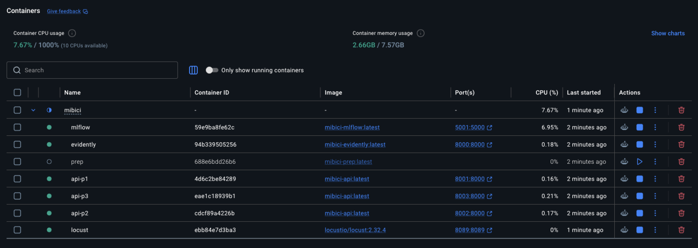

#### Ver logs

```bash
# Todos los servicios
docker compose -f docker/docker-compose.yml logs

# Un servicio específico
docker compose -f docker/docker-compose.yml logs mlflow
docker compose -f docker/docker-compose.yml logs prep
docker compose -f docker/docker-compose.yml logs api-p1
docker compose -f docker/docker-compose.yml logs api-p2
docker compose -f docker/docker-compose.yml logs api-p3
docker compose -f docker/docker-compose.yml logs evidently
```

#### Detener y eliminar

```bash
# Detener contenedores (mantiene volúmenes e imágenes)
docker compose -f docker/docker-compose.yml down

# Detener y eliminar también los volúmenes nombrados (borra datos de MLflow)
docker compose -f docker/docker-compose.yml down -v
```

#### Reconstruir después de cambios en el código

```bash
docker compose -f docker/docker-compose.yml build --no-cache api-p1
docker compose -f docker/docker-compose.yml up -d --no-build --force-recreate api-p1 api-p2 api-p3
```

#### Variables de entorno

Todas son opcionales y tienen valor por defecto. Para cambiarlas se copia `docker/.env.example` a `docker/.env`.

| Variable | Defecto | Uso |
|---|---|---|
| `API_P1_PUERTO`, `API_P2_PUERTO`, `API_P3_PUERTO` | 8001, 8002, 8003 | Puertos de las APIs |
| `MLFLOW_PUERTO`, `EVIDENTLY_PUERTO` | 5001, 8000 | Puertos de MLflow y Evidently |
| `API_CPUS`, `API_MEMORIA` | 1.0, 1g | Límites por API |
| `MLFLOW_CPUS`, `MLFLOW_MEMORIA` | 1.0, 2g | Límites de MLflow. Con 1 GB y sus workers por defecto, MLflow 3 se reiniciaba por falta de memoria. |
| `EVIDENTLY_CPUS`, `EVIDENTLY_MEMORIA` | 1.0, 1g | Límites de Evidently |
| `CACHE_TTL_SEG` | 60 | Segundos que cada API reutiliza el modelo antes de volver a consultar el Registry. Con 0 lo descarga en cada petición. |
| `FORZAR_ENTRENAMIENTO` | 0 | Con 1, `prep` reentrena y registra aunque los champions existan |

### 4.4 API REST con FastAPI

Todas las APIs están construidas con **FastAPI** y exponen los mismos endpoints:

| Método | Endpoint | Descripción |
|--------|----------|-------------|
| `GET` | `/health` | Estado del servicio y versión, `run_id`, parámetros y etiquetas del modelo cargado |
| `GET` | `/docs` | Documentación interactiva (Swagger UI) con el esquema de entrada y salida de la pregunta de ese contenedor |
| `POST` | `/predict` | Recibe JSON con features, devuelve predicción |

El modelo **no va empaquetado en la imagen**: se obtiene del Model Registry de MLflow y se mantiene en una **caché con candado** durante `CACHE_TTL_SEG` segundos (60 por defecto). Al vencer, la API vuelve a consultar el Registry, así un nuevo champion se toma sin reconstruir la imagen.

**Validación de entradas y salidas.** `POST /predict` valida el cuerpo con modelos Pydantic
(`docker/api/schemas.py`) **antes** de usar el modelo. Si la entrada no cumple el esquema,
responde `422 Unprocessable Entity` indicando el campo y el motivo en `detail`. La respuesta
también se valida contra el esquema de salida de la pregunta.

---

#### API P1 — Demanda horaria (puerto 8001)

Modelo: `mibici-equipo20-p1-demanda@champion` (LightGBM Tweedie). Predice la demanda de
viajes de la **hora siguiente** para una estación.

**Health:**
```bash
curl http://localhost:8001/health
```

**Parámetros de entrada (`POST /predict`):**

| Parámetro | Tipo | Restricción | Descripción | Ejemplo |
|-----------|------|-------------|-------------|---------|
| `target_hour` | datetime ISO 8601 | sin zona horaria | Hora a predecir (hora local) | `"2026-11-04T08:00:00"` |
| `lag_1h` | int | ≥ 0 | Demanda de la última hora observada | `5` |
| `lag_24h` | float | ≥ 0, finito | Demanda 24 h antes de la hora objetivo | `7.0` |
| `lag_168h` | float | ≥ 0, finito | Demanda 168 h (una semana) antes de la hora objetivo | `6.0` |
| `rolling_3h` | float | ≥ 0, finito | Media de la demanda de las últimas 3 horas | `4.67` |
| `rolling_168h` | float | ≥ 0, finito | Media de la demanda de las últimas 168 horas | `5.2` |

El modelo usa 8 variables. Las 3 restantes (`target_hour_sin`, `target_hour_cos` y
`target_is_weekend`) **no se envían**: la API las calcula a partir de `target_hour`. Así el
cliente no puede mandar valores de calendario incoherentes entre sí. Los campos que no
pertenecen al esquema se rechazan.

**Ejemplo de predicción P1:**
```bash
curl -X POST http://localhost:8001/predict \
  -H "Content-Type: application/json" \
  -d '{
    "target_hour": "2026-11-04T08:00:00",
    "lag_1h": 5,
    "lag_24h": 7.0,
    "lag_168h": 6.0,
    "rolling_3h": 4.67,
    "rolling_168h": 5.2
  }'
```

**Respuesta (200):**
```json
{
  "pregunta": "p1",
  "modelo": "mibici-equipo20-p1-demanda",
  "version": "1",
  "run_id": "<run_id>",
  "demanda_predicha": 8.521118180773497
}
```

`demanda_predicha` es el número esperado de viajes (≥ 0) en la hora objetivo.

---

#### API P2 — Riesgo de desbalance (puerto 8002)

Modelo: `mibici-equipo20-p2-riesgo@champion` (HistGradientBoostingClassifier)

**Health:**
```bash
curl http://localhost:8002/health
```

**Parámetros de entrada (`POST /predict`):**

Son las 11 variables del modelo, calculadas igual que en `features_p2.py`. La API rechaza con
`422` las combinaciones contradictorias entre ellas (ver las [pruebas de la API](#45-pruebas-de-la-api)).

| Parámetro | Tipo | Rango | Descripción | Ejemplo |
|-----------|------|-------|-------------|---------|
| `hora_del_dia` | int | 0–23 | Hora observada; se predice el riesgo de la hora siguiente | `8` |
| `dia_semana` | int | 0–6 | Día de la semana (lunes = 0) | `2` |
| `fin_de_semana` | int | 0/1 | 1 si `dia_semana` es 5 o 6 | `0` |
| `capacidad` | int | > 0 | Anclajes de la estación | `20` |
| `salidas` | int | ≥ 0 | Bicicletas que salieron en la hora observada | `6` |
| `llegadas` | int | ≥ 0 | Bicicletas que llegaron en la hora observada | `2` |
| `balance_acumulado_dia` | int | — | Llegadas menos salidas desde las 3:00 | `-9` |
| `acumulado_relativo` | float | — | `balance_acumulado_dia / capacidad` | `-0.45` |
| `balance_ult_3h_relativo` | float | — | Balance de las últimas 3 h (incluida la observada) / `capacidad` | `-0.35` |
| `riesgo_vacia` | int | 0/1 | 1 si `balance_acumulado_dia <= -0.5 × capacidad` | `0` |
| `riesgo_llena` | int | 0/1 | 1 si `balance_acumulado_dia >= 0.5 × capacidad` | `0` |

**Ejemplo de predicción P2:**
```bash
curl -X POST http://localhost:8002/predict \
  -H "Content-Type: application/json" \
  -d '{
    "hora_del_dia": 8,
    "dia_semana": 2,
    "fin_de_semana": 0,
    "capacidad": 20,
    "salidas": 6,
    "llegadas": 2,
    "balance_acumulado_dia": -9,
    "acumulado_relativo": -0.45,
    "balance_ult_3h_relativo": -0.35,
    "riesgo_vacia": 0,
    "riesgo_llena": 0
  }'
```

**Respuesta esperada:**
```json
{
  "pregunta": "p2",
  "modelo": "mibici-equipo20-p2-riesgo",
  "version": "1",
  "run_id": "<run_id>",
  "prob_riesgo": 0.2911,
  "pred_riesgo": 0
}
```

---

#### API P3 — Clustering de estaciones (puerto 8003)

Modelo: `mibici-equipo20-p3-grupos@champion` (Pipeline de sklearn: StandardScaler + KMeans K=4).
Asigna a una estación uno de los cuatro grupos funcionales según su perfil de uso.

**Health:**
```bash
curl http://localhost:8003/health
```

**Parámetros de entrada (`POST /predict`):**

| Parámetro | Tipo | Restricción | Descripción | Ejemplo |
|-----------|------|-------------|-------------|---------|
| `pct_manana` | float | 0–1, finito | Fracción de salidas entre 6 y 10 h | `0.23` |
| `pct_mediodia` | float | 0–1, finito | Fracción de salidas entre 10 y 16 h | `0.33` |
| `pct_tarde` | float | 0–1, finito | Fracción de salidas entre 16 y 20 h | `0.29` |
| `pct_noche` | float | 0–1, finito | Fracción de salidas entre 20 y 24 h | `0.12` |
| `pct_fin_de_semana` | float | 0–1, finito | Fracción de salidas en sábado o domingo | `0.20` |
| `duracion_media` | float | > 0 y ≤ 180, finito | Duración media del viaje en minutos | `11.12` |
| `viajes_dia_log` | float | ≥ 0, finito | log(1 + viajes promedio por día que salen de la estación) | `3.23` |
| `balance_neto` | float | −1 a 1, finito | (llegadas − salidas) / (llegadas + salidas) | `-0.02` |

La suma `pct_manana + pct_mediodia + pct_tarde + pct_noche` puede quedar por debajo de 1,
porque la madrugada (0 a 6 h) no entra al modelo, pero nunca pasar de 1. El tope de 180
minutos en `duracion_media` es el mismo que se aplicó en entrenamiento. Los campos que no
pertenecen al esquema se rechazan.

**Ejemplo de predicción P3** (estación mediana del conjunto de entrenamiento):
```bash
curl -X POST http://localhost:8003/predict \
  -H "Content-Type: application/json" \
  -d '{
    "pct_manana": 0.23,
    "pct_mediodia": 0.33,
    "pct_tarde": 0.29,
    "pct_noche": 0.12,
    "pct_fin_de_semana": 0.20,
    "duracion_media": 11.12,
    "viajes_dia_log": 3.23,
    "balance_neto": -0.02
  }'
```

**Respuesta (200):**
```json
{
  "pregunta": "p3",
  "modelo": "mibici-equipo20-p3-grupos",
  "version": "1",
  "run_id": "<run_id>",
  "grupo_kmeans": 1
}
```

`grupo_kmeans` es el grupo funcional asignado, entre 0 y 3.

### 4.5 Pruebas de la API

Se hicieron peticiones válidas e inválidas contra cada API en contenedores.

#### Pruebas de P1

Pruebas contra `http://localhost:8001/predict` con los contenedores levantados mediante
Docker Compose. Parten de la petición válida del ejemplo de P1 y cambian un solo dato.

##### Petición válida desde el contenedor

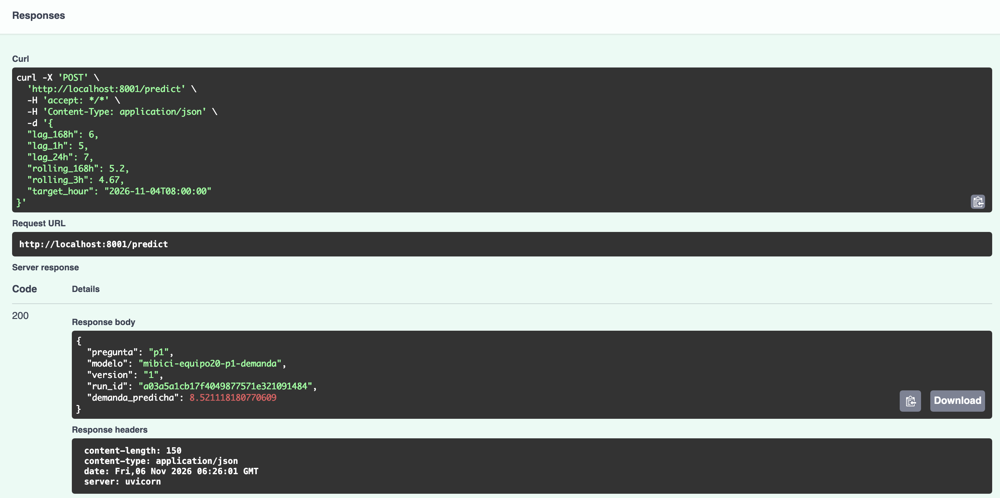

##### Validación de entradas

| # | Caso | Cambio al JSON válido | Código esperado | Evidencia |
|---|------|-----------------------|-----------------|-----------|
| 1 | Campo faltante | quitar `lag_24h` | 422 | [Ver captura](docs/images/API_prueba2_P1.png)|
| 2 | Valor negativo | `"lag_1h": -3` | 422 | [Ver captura](docs/images/API_prueba3_P1.png)|
| 3 | Entero con decimales | `"lag_1h": 5.7` | 422 | [Ver captura](docs/images/API_prueba4_P1.png)|
| 4 | Tipo incorrecto | `"lag_24h": "abc"` | 422 | [Ver captura](docs/images/API_prueba5_P1.png)|
| 5 | Hora con zona horaria | `"target_hour": "2026-11-04T08:00:00Z"` | 422 | [Ver captura](docs/images/API_prueba6_P1.png)|
| 6 | Campo desconocido | agregar `"campo_extra": 1` | 422 | [Ver captura](docs/images/API_prueba7_P1.png) |
| 7 | Valor `NaN` (con `curl`) | `"lag_24h": NaN` | 422 |[Ver captura](docs/images/API_prueba8_P1.png) |

Ejemplo de respuesta ante una entrada inválida (caso 2):

```json
{
  "detail": [
    {
      "type": "greater_than_equal",
      "loc": [
        "body",
        "lag_1h"
      ],
      "msg": "Input should be greater than or equal to 0",
      "input": -3,
      "ctx": {
        "ge": 0
      }
    }
  ]
}
```

#### Pruebas de P2

Pruebas contra `http://localhost:8002/predict` con los contenedores `mlflow`, `prep` y `api-p2`
levantados con Podman (mismas opciones que en `docker-compose.yml`). Parten de la petición
válida del ejemplo de P2 y cambian un solo dato.

Contenedores en ejecución (`podman ps`) y registro de las peticiones que atendió `api-p2`
(`podman logs api-p2`): el `200` de la petición válida y los siete `422` de la tabla de validación.

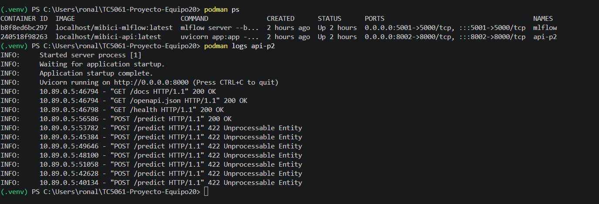

##### Petición válida desde el contenedor

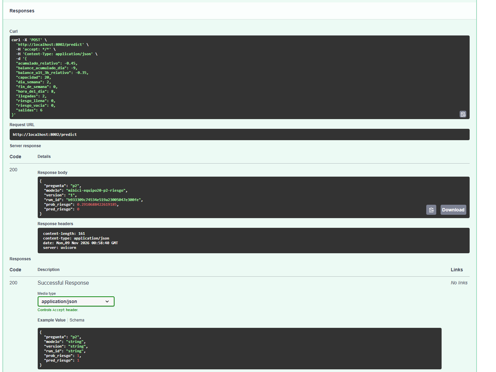

##### Validación de entradas

| # | Caso | Cambio al JSON válido | Código esperado | Evidencia |
|---|------|-----------------------|-----------------|-----------|
| 1 | Campo faltante | quitar `capacidad` | 422 | [Ver captura](docs/images/API_prueba2_P2.png) |
| 2 | Valor fuera de rango | `"hora_del_dia": 25` | 422 | [Ver captura](docs/images/API_prueba3_P2.png) |
| 3 | Variables contradictorias | `"balance_acumulado_dia": -12`, sin ajustar `acumulado_relativo` ni `riesgo_vacia` | 422 | [Ver captura](docs/images/API_prueba4_P2.png) |
| 4 | Tipo incorrecto | `"capacidad": "abc"` | 422 | [Ver captura](docs/images/API_prueba5_P2.png) |
| 5 | Campo desconocido | agregar `"campo_extra": 1` | 422 | [Ver captura](docs/images/API_prueba6_P2.png) |
| 6 | Valor `NaN` | `"acumulado_relativo": NaN` | 422 | [Ver captura](docs/images/API_prueba7_P2.png) |
| 7 | Capacidad en cero | `"capacidad": 0` | 422 | [Ver captura](docs/images/API_prueba8_P2.png) |

Ejemplo de respuesta ante una entrada inválida (caso 3). La regla de coherencia revisa que las
variables derivadas correspondan a `balance_acumulado_dia` y `capacidad`, igual que en
`features_p2.py`; por eso `loc` señala el cuerpo completo y el mensaje enumera cada problema:

```json
{
  "detail": [
    {
      "type": "value_error",
      "loc": [
        "body"
      ],
      "msg": "Value error, acumulado_relativo=-0.45 debería ser balance_acumulado_dia / capacidad = -0.6000; riesgo_vacia=0 no corresponde a balance_acumulado_dia=-12 con capacidad=20"
    }
  ]
}
```

#### Pruebas de P3

Pruebas contra `http://localhost:8003/predict` con los contenedores levantados mediante
Docker Compose. Parten de la petición válida del ejemplo de P3 y cambian un solo dato.

##### Petición válida desde el contenedor

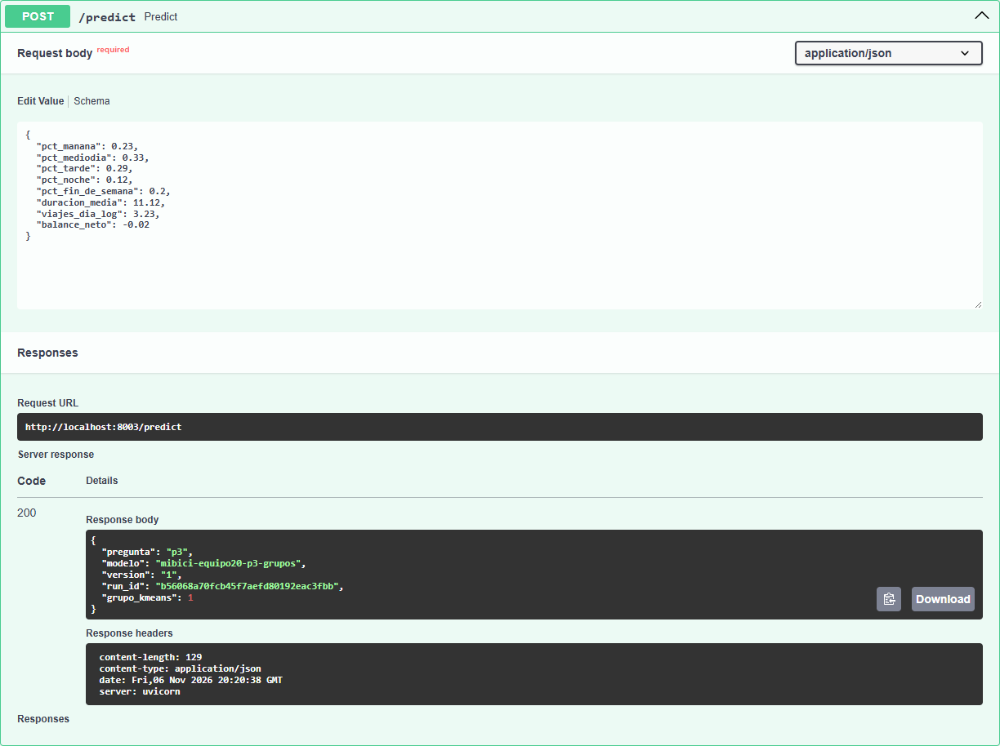

##### Validación de entradas

| # | Caso | Cambio al JSON válido | Código esperado | Evidencia |
|---|------|-----------------------|-----------------|-----------|
| 1 | Campo faltante | quitar `pct_tarde` | 422 | [Ver captura](docs/images/API_prueba2_P3.png) |
| 2 | Fracción fuera de rango | `"pct_noche": 1.5` | 422 | [Ver captura](docs/images/API_prueba3_P3.png) |
| 3 | Franjas horarias suman más de 1 | `"pct_manana": 0.5` | 422 | [Ver captura](docs/images/API_prueba4_P3.png) |
| 4 | Tipo incorrecto | `"duracion_media": "abc"` | 422 | [Ver captura](docs/images/API_prueba5_P3.png) |
| 5 | Campo desconocido | agregar `"campo_extra": 1` | 422 | [Ver captura](docs/images/API_prueba6_P3.png) |
| 6 | Valor `NaN` | `"viajes_dia_log": NaN` | 422 | [Ver captura](docs/images/API_prueba7_P3.png) |
| 7 | Duración fuera de rango | `"duracion_media": 500` | 422 | [Ver captura](docs/images/API_prueba8_P3.png) |

Ejemplo de respuesta ante una entrada inválida (caso 3). La regla revisa cuatro campos a la
vez, por eso `loc` señala el cuerpo completo y el mensaje indica la suma recibida:

```json
{
  "detail": [
    {
      "type": "value_error",
      "loc": [
        "body"
      ],
      "msg": "Value error, pct_manana + pct_mediodia + pct_tarde + pct_noche suman 1.240; no pueden pasar de 1"
    }
  ]
}
```

### 4.6 Decisiones de despliegue

**Inferencia en tiempo real.** La API responde una predicción por petición. El caso de uso
(anticipar la demanda de la próxima hora por estación) es sensible al tiempo, cada
predicción usa una sola fila de variables y el modelo es ligero. Una inferencia por lotes
sería preferible para planear todas las estaciones a la vez, y podría construirse sobre los
mismos modelos del Registry.

**P3: segmentación por lotes y asignación en tiempo real.** La segmentación completa de
las estaciones se calcula por lotes. El job `prep` reentrena el Pipeline (StandardScaler +
KMeans K=4) con el histórico y registra el nuevo campeón, y basta con repetirlo cada cierto
tiempo, porque los grupos cambian cuando cambian los patrones de uso de la red y eso ocurre
a lo largo de semanas o meses. La API de P3 atiende el caso de una estación nueva o de una
estación cuyo perfil se actualizó. Le asigna grupo en el momento con los centroides del
campeón vigente, y el reentrenamiento queda para el siguiente lote. Cada petición procesa
una sola fila de ocho variables.

**Modelo cargado desde el Model Registry (y no empaquetado en la imagen).** Las APIs
resuelven el alias `@champion` mediante `MLFLOW_TRACKING_URI` y `MODELO_REGISTRY`.
- Ventaja: el Registry es la única fuente de verdad. Si `prep` promueve un nuevo champion,
  las APIs lo toman sin reconstruir la imagen.
- Costo: el servicio depende de MLflow; si no puede obtener el modelo, responde `503`.
- Caché: consultar y descargar el modelo en cada petición saturaba MLflow ([resultados de carga](#48-pruebas-de-carga-con-locust)). La caché de 60 s con candado resolvió el cuello de botella, a cambio de que un cambio de champion tarde hasta `CACHE_TTL_SEG` en reflejarse.

**Una imagen, tres servicios.** `api-p1`, `api-p2` y `api-p3` usan la misma imagen y se
configuran con `PREGUNTA`, de modo que el código es único y cada contenedor documenta en
`/docs` el esquema de su pregunta.

**Docker Compose.** El flujo coordina MLflow, el job de
entrenamiento, Evidently y tres APIs (además de Locust en un perfil aparte), con orden de arranque (`healthcheck` y
`service_completed_successfully`) y un volumen compartido (`mlruns`) para los artefactos.
Compose lo reproduce con un solo comando en cualquier máquina.

**Esquemas Pydantic y validación.** FastAPI valida el cuerpo antes de usar el modelo:
rechaza campos faltantes, tipos incorrectos, valores negativos, `NaN`, horas con zona
horaria y campos desconocidos (`422`), y la respuesta se valida contra el esquema de salida
(`demanda_predicha ≥ 0`). En P1 el cliente envía `target_hour` y la API deriva las
variables de calendario, lo que evita entradas incoherentes.

En P3 el esquema exige además que las cuatro franjas horarias sumen como máximo 1 y que
`duracion_media` quede entre 0 y 180 minutos, el mismo tope usado en entrenamiento. La
salida restringe `grupo_kmeans` al rango de 0 a 3.

**Limitación actual.** El cliente debe enviar los rezagos y medias móviles recientes para P1. En un
entorno productivo, un servicio con acceso al historial de viajes (base de datos o feature
store) los calcularía a partir de solo la estación y la hora.

### 4.7 CI/CD con GitHub Actions

El workflow [`.github/workflows/ci.yml`](.github/workflows/ci.yml) corre en cada push a `main`, `feat/**` y `fix/**`, en cada pull request a `main` y de forma manual (pestaña **Actions → CI/CD MiBici → Run workflow**). Un push nuevo a la misma rama cancela la ejecución anterior.

`lint → test → build → smoke → publish`

| Job | Qué hace |
|---|---|
| `lint` | `ruff` con las reglas de errores que rompen la ejecución (sintaxis, comparaciones inválidas y nombres no definidos) |
| `test` | `pytest tests` en Python 3.10 y 3.11, con caché de pip. Sin datos en el runner, las pruebas que los necesitan se omiten. Publica el reporte JUnit. |
| `build` | Construye las imágenes `api`, `mlflow`, `prep` y `evidently` con caché de capas |
| `smoke` | Valida el compose; levanta MLflow y Evidently; registra tres **modelos mínimos sintéticos** como `@champion`; levanta las tres APIs; verifica `/health` de MLflow, `/api/version` de Evidently y `/docs` y `/health` de cada API; ejecuta Locust sin interfaz (6 usuarios, 15 s) y publica el artefacto `locust-smoke-report` |
| `publish` | En `main` (push o ejecución manual) publica las cuatro imágenes en GitHub Container Registry con las etiquetas del commit y `latest` |

**Alcance de la prueba de humo:** los modelos sintéticos permiten probar la integración y `/predict` sin descargar los datos de MiBici; no evalúan la calidad de los modelos reales. De Evidently se verifica que el servicio se construya, arranque y responda; los reportes de drift se generan con el flujo de [monitoreo](#6-monitoreo-drift-y-ab-testing). `proyecto_mibici/monitoring/test_evidently_registro.py` queda fuera del CI porque requiere un servidor de Evidently Platform con integración.

[Ver ejecuciones, logs y reportes](https://github.com/ariosi86/TC5061-Proyecto-Equipo20/actions/workflows/ci.yml)

#### Imágenes publicadas

```bash
# Si el paquete es privado, autenticar primero con un token con permiso read:packages:
# echo $GITHUB_TOKEN | docker login ghcr.io -u <tu_usuario> --password-stdin

docker pull ghcr.io/ariosi86/tc5061-proyecto-equipo20/mibici-api:latest
docker pull ghcr.io/ariosi86/tc5061-proyecto-equipo20/mibici-mlflow:latest
docker pull ghcr.io/ariosi86/tc5061-proyecto-equipo20/mibici-prep:latest
docker pull ghcr.io/ariosi86/tc5061-proyecto-equipo20/mibici-evidently:latest
```

El workflow también se puede ejecutar en local con [act](https://github.com/nektos/act):

```bash
act push -P ubuntu-latest=catthehacker/ubuntu:act-latest --artifact-server-path /tmp/act-artifacts
```

### 4.8 Pruebas de carga con Locust

La carpeta `locust/` contiene el escenario de carga y los scripts de análisis:

| Archivo | Uso |
|---|---|
| `locustfile.py` | Un tipo de usuario por API. Genera payloads aleatorios que respetan las validaciones de `schemas.py`, manda un 5 % de peticiones inválidas que deben responder 422 y consulta `/health` de vez en cuando. |
| `monitor_recursos.py` | Registra `docker stats` de cada contenedor en un CSV mientras corre la carga |
| `ejecutar_carga.sh` | Mide un minuto de reposo y corre los escenarios de 10, 50 y 100 usuarios de 3 minutos con el monitor en paralelo |
| `graficas.py` | Genera la tabla resumen y las gráficas de throughput, latencia, errores y recursos |
| `finops.py` | Calcula el costo por inferencia y el costo mensual de cada opción de despliegue |

#### Interfaz de Locust

Con el perfil `loadtest` activo, abrir http://localhost:8089 e indicar usuarios y tasa de arranque.

Versión corta sin interfaz (la misma que corre en CI):

```bash
docker compose -f docker/docker-compose.yml --profile loadtest run --rm --no-deps locust \
  -f /mnt/locust/locustfile.py --headless -u 6 -r 3 -t 15s --only-summary
```

#### Escenarios de 10, 50 y 100 usuarios

Con el sistema levantado, el entorno virtual activo y `locust` instalado (`pip install locust`). En Windows, los scripts `.sh` se corren desde Git Bash.

```bash
# Con caché (configuración por defecto, unos 11 minutos)
bash locust/ejecutar_carga.sh cache_

# Línea base: modelo descargado en cada petición
CACHE_TTL_SEG=0 docker compose -f docker/docker-compose.yml up -d --no-build
bash locust/ejecutar_carga.sh base_

# Restaurar la caché y comparar costos
docker compose -f docker/docker-compose.yml up -d --no-build
python locust/finops.py --prefijos base_ cache_
```

Para medir la capacidad máxima se quita el tiempo de espera entre peticiones:

```bash
LOCUST_ESPERA_MIN=0 LOCUST_ESPERA_MAX=0 locust -f locust/locustfile.py --headless -u 30 -r 10 -t 2m --csv reports/locust/estres_u30
```

Las salidas quedan en `reports/locust/`: CSV de Locust y de recursos, reportes HTML de Locust y figuras PNG.

#### Prueba de estrés completa

```bash
python locust/monitor_recursos.py --salida reports/locust/estres_u30_recursos.csv --duracion 125 &
LOCUST_ESPERA_MIN=0 LOCUST_ESPERA_MAX=0 locust -f locust/locustfile.py --headless -u 30 -r 10 -t 2m \
  --csv reports/locust/estres_u30 --html reports/locust/estres_u30.html --only-summary
python locust/graficas.py --escenarios estres_u30 --prefijo estres_
python locust/finops.py --prefijos base_ cache_
```

### 4.9 Resultados de carga

Medidos en un MacBook Pro con Apple M5 (10 núcleos, 32 GB), Docker Desktop con 10 CPU y 8 GB e imágenes `arm64`. Los valores absolutos dependen del equipo. El análisis completo con gráficas está en `TC5061_Operacion_FinOps_Equipo20.pdf`.

| Usuarios | Configuración | Inferencias/s | p95 | Errores | CPU de MLflow |
|---|---|---|---|---|---|
| 10 | Sin caché | 6.8 | 94 ms | 0.07 % | 21 % |
| 10 | Con caché | 7.2 | 13 ms | 0 % | 2 % |
| 50 | Sin caché | 18.0 | 2.5 s | 0.71 % | 96 % |
| 50 | Con caché | 35.6 | 14 ms | 0 % | 2 % |
| 100 | Sin caché | 14.0 | 7.1 s | 4.1 % | 99 % |
| 100 | Con caché | 70.9 | 14 ms | 0 % | 2 % |
| 30 sin espera | Con caché | 1,657 | 72 ms (`/predict`) | 0 % | 1 % |

- **Cuello de botella:** sin caché, casi cada petición consultaba el alias en MLflow (7,475 consultas para 7,647 peticiones). MLflow llegó a 96–99 % de CPU desde los 50 usuarios y el throughput bajó con 100.
- **Con caché y 100 usuarios:** 5 veces más throughput, p95 unas 500 veces menor y CPU por inferencia de 93.5 a 4.2 ms.
- **Condición de carrera:** las pruebas exhibieron que, en `api-p1`, dos peticiones podían descargar el modelo al mismo directorio temporal y una lo leía incompleto. La caché con candado de `docker/api/app.py` lo corrige.
- **Capacidad:** sin tiempo de espera se sostuvieron 1,657 inferencias por segundo sin errores (unas 615 por vCPU de API), con las APIs cerca de su límite de 1 CPU.
- **Validación bajo carga:** cerca del 5 % de las peticiones se envían inválidas a propósito y deben recibir `422`; así se comprueba que Pydantic las rechaza.

### 4.10 Solución de problemas

| Problema | Causa probable | Solución |
|----------|---------------|----------|
| `mlflow` no está `healthy` | Puerto 5001 ocupado o error de SQLite | `docker compose logs mlflow` |
| `prep` no conecta a MLflow | Red interna de Docker no resuelve `mlflow:5000` | `docker compose logs prep` |
| API devuelve `"Modelo no disponible"` (503) | `prep` aún no terminó de registrar campeones | Esperar a que `prep` termine (`Exited 0`) |
| API devuelve 403 en MLflow | Host header no permitido | Verificar `--allowed-hosts` en `docker/mlflow/Containerfile` |
| `/predict` falla tras cambio de código | Capa `COPY` servida desde caché de Docker | `build --no-cache api-p1 api-p2 api-p3` |
| `no such file or directory: docker/docker-compose.yml` | El comando no se ejecutó desde la raíz del repositorio | Cambiar a la carpeta del proyecto |
| La construcción falla por el tag `mibici-api:latest` | Las tres APIs intentan construir la misma imagen en paralelo | Usar `build api-p1 mlflow prep evidently` y después `up -d --no-build` |
| Evidently o Locust no inician | Puerto 8000 u 8089 ocupado | Liberar el puerto o cambiar `EVIDENTLY_PUERTO` |
| `/predict` responde `422` | La entrada no cumple el esquema | Revisar `detail[].loc` (campo) y `detail[].msg` (motivo) en la respuesta |

## 5. Pruebas, validación de datos y seguridad

### 5.1 Pruebas automatizadas

Para garantizar la calidad, reproducibilidad y seguridad del proyecto, el repositorio cuenta con un conjunto de pruebas automatizadas con **PyTest** y chequeos de seguridad.

#### Estructura de Pruebas

##### P1


Las pruebas se ubican en la carpeta `tests/` organizadas por componentes:
```text
/tests/
├── conftest.py            # datos sintéticos reutilizables (fixtures)
├── test_features_p1.py    # ingeniería de características de P1
├── test_model_p1.py       # modelos de P1 (baseline, lineal, Poisson)
├── test_train_p1.py             # métricas de evaluación y comparación de modelos
├── test_reproducibilidad_p1.py  # reproducibilidad del entrenamiento (misma semilla, mismos resultados)
├── test_predict_p1.py           # inferencia: carga de modelos y generación de predicciones
├── test_deepchecks_p1.py        # calidad de datos de P1 (DeepChecks + pandas)
└── validar_datos_p1.py          # script: reportes DeepChecks de la tabla de modelado de P1
```
- `test_features_p1.py`: Limpieza de datos y generación de rezagos/malla horaria.
- `test_model_p1.py`: Reglas de negocio y restricciones de los modelos.
- `test_predict_p1.py`: Pipeline de inferencia y generación de reportes.
- `test_train_p1.py`: Métricas de evaluación (MAE, RMSE, WAPE y sesgo), métricas por estación y tabla comparativa de modelos.
- `test_reproducibilidad_p1.py`: Reproducibilidad del entrenamiento con semilla fija y control con otra semilla.
- `test_deepchecks_p1.py`: Validación automática de la tabla de modelado de P1 sobre los datos reales (llave estación + hora única, sin nulos, rangos válidos, sin fuga temporal, drift entre train y test), con resultado `PASSED` o `FAILED`; incluye pruebas con datos sintéticos que comprueban que los chequeos detectan fallas.
- `validar_datos_p1.py`: Script (no es una prueba) que ejecuta las suites completas de DeepChecks y genera los reportes HTML de integridad, train/test y evaluación del modelo, que se usan como evidencia visual.


##### P2

Las pruebas de P2 se ubican en la carpeta `tests/` de la raíz:
```text
tests/
├── test_features_p2.py           # ingeniería de características de P2
├── test_model_p2.py              # modelos de P2 (baseline de persistencia y GBM)
├── test_reproducibilidad_p2.py   # reproducibilidad del entrenamiento del GBM
└── test_deepchecks_p2.py         # validación de datos con DeepChecks (dataset real)
```
- `test_features_p2.py`: Limpieza de viajes, flujo por estación y hora, serie de riesgo y partición temporal.
- `test_model_p2.py`: Predicciones del baseline y del GBM, errores esperados y guardado/carga del modelo.
- `test_reproducibilidad_p2.py`: Pruebas de reproducibilidad del GBM con semilla fija y métricas.
- `test_deepchecks_p2.py`: Integridad del dataset de P2 y drift entre entrenamiento, validación y prueba.
##### P3

Las pruebas de P3 se ubican en la carpeta `tests/` de la raíz:
```text
tests/
├── test_features_p3.py           # limpieza de viajes y perfil funcional de estaciones
├── test_model_p3.py              # modelos de P3 (baseline por municipio y KMeans)
├── test_reproducibilidad_p3.py   # reproducibilidad del entrenamiento de KMeans
└── test_deepchecks_p3.py         # validación de datos con DeepChecks (dataset real)
```
- `test_features_p3.py`: Limpieza de viajes (duplicados, duración y catálogo) y construcción del perfil de cada estación.
- `test_model_p3.py`: Asignación de grupos del baseline y de KMeans, errores esperados y guardado/carga del modelo.
- `test_reproducibilidad_p3.py`: Reproducibilidad de KMeans con semilla fija y control con otra semilla.
- `test_deepchecks_p3.py`: Integridad del perfil de estaciones y drift entre entrenamiento (2025) y prueba (may-sep 2026).

##### Pruebas transversales y utilitarias

Las pruebas transversales se ubican en la carpeta `tests/` de la raíz y cubren componentes compartidos por todas las preguntas:

```text
tests/
├── test_dataset.py           # limpieza de encabezados y hash SHA-256 (ETL de datos)
├── test_features_facade.py   # fachada unificada de características (P1, P2, P3)
├── test_train_p2_p3.py       # métricas de clasificación (P2) y clustering (P3)
└── test_predict_p2_p3.py     # inferencia de riesgo de desbalance (P2) y clustering (P3)
```

- `test_dataset.py`: Normalización de encabezados de columnas (`clean_column_names`) y determinismo del hash criptográfico SHA-256 (`compute_sha256`) para versionado de datos.
- `test_features_facade.py`: La fachada `features.py` expone correctamente la API pública de P1, P2 y P3; todos los elementos de `__all__` son importables.
- `test_train_p2_p3.py`: Cálculo de métricas de clasificación (precisión, recall, F1, PR-AUC) y métricas de clustering (silhouette, Davies-Bouldin) con casos de borde (una sola etiqueta, predicción perfecta).
- `test_predict_p2_p3.py`: Carga y guardado de modelos serializados (`.pkl`) para P2 y P3; inferencia con valores válidos en rangos esperados; errores claros si falta el modelo.

#### Instrucciones de Ejecución

1. **Ejecutar suite completa de pruebas:**
```bash
pip install -r requirements.txt   # Instalar Deepchecks, scikit-learn y pytest
pytest -v                   # todas las pruebas, con detalle
```

2. **Ejecutar las pruebas de P1:**
```bash
pytest tests/test_features_p1.py -v #prueba por archivo
pytest tests/test_model_p1.py -v
pytest tests/test_predict_p1.py -v
pytest tests/test_train_p1.py -v
pytest tests/test_reproducibilidad_p1.py -v
```
> Las pruebas **unitarias** no usan el dataset real de MiBici. Usan DataFrames pequeños y sintéticos definidos en `tests/conftest.py`, por lo que corren en pocos segundos y no dependen de archivos externos ni de MLflow. La validación sobre los **datos reales** está en la sección *Validación de datos (DeepChecks)*.

3. **Ejecutar las pruebas de P2:**
```bash
pytest tests -v -k p2                      # todas las pruebas de P2
pytest tests/test_features_p2.py -v        # prueba por archivo
pytest tests/test_model_p2.py -v
pytest tests/test_reproducibilidad_p2.py -v
pytest tests/test_deepchecks_p2.py -v
```

> Las pruebas unitarias y de reproducibilidad de P2 también usan datos sintéticos y no necesitan MLflow. Solo `test_deepchecks_p2.py` usa el dataset real (ver *Validación de datos (DeepChecks)*).
4. **Ejecutar las pruebas de P3:**
```bash
pytest tests -v -k p3                        # todas las pruebas de P3
pytest tests/test_features_p3.py -v          # prueba por archivo
pytest tests/test_model_p3.py -v
pytest tests/test_reproducibilidad_p3.py -v
pytest tests/test_deepchecks_p3.py -v
```

> Las pruebas unitarias y de reproducibilidad de P3 usan datos sintéticos y no necesitan MLflow. Solo `test_deepchecks_p3.py` usa el dataset real (ver *Validación de datos (DeepChecks)*). DeepChecks 0.19.1 requiere `setuptools<81` (ver compatibilidad).

5. **Ejecutar pruebas transversales y utilitarias:**
```bash
pytest tests/test_dataset.py -v              # limpieza de encabezados y hash SHA-256
pytest tests/test_features_facade.py -v      # fachada unificada de características
pytest tests/test_train_p2_p3.py -v          # métricas de clasificación y clustering
pytest tests/test_predict_p2_p3.py -v        # inferencia de riesgo y clustering (P2 y P3)
```

#### Qué se prueba (P1: demanda horaria)

| Archivo | Componente | Casos cubiertos |
|---|---|---|
| `test_features_p1.py` | `LimpiadorFiltroEstacionesP1` | Elimina duplicados; descarta estaciones fuera de catálogo; descarta estaciones con exceso de horas vacías; falla si hay `viaje_id` repetido con datos distintos |
| `test_features_p1.py` | `GeneradorDemandaLagsP1` | Crea las columnas esperadas; sin nulos en rezagos ni target; rellena con 0 las horas sin viajes; semántica correcta de `lag_24h` y `lag_168h`; variables cíclicas en rango [-1, 1]; no modifica la entrada; resultado determinista; con pocos datos devuelve vacío sin error |
| `test_model_p1.py` | `BaselineIngenuoP1` | Estrategias `persistencia` y `promedio_24h_168h`; nulos tratados como 0; nunca predice negativos; estrategia inválida lanza `ValueError` |
| `test_model_p1.py` | `DemandaLinealP1` y `DemandaPoissonP1` | `fit`/`predict` con forma correcta y sin negativos; el pipeline expone el `scaler`; usa solo las `features` indicadas; falla si faltan columnas; `save`/`load` conserva las predicciones; la regresión lineal recupera una relación exacta |
| `test_train_p1.py` | `evaluar_metricas_regresion` | MAE, RMSE, WAPE y sesgo verificados contra valores calculados a mano; caso con reales en cero |
| `test_train_p1.py` | `calcular_metricas_por_estacion` y `registrar_fila_comparacion` | Una fila por estación; error absoluto total; unión con el catálogo de nombres; no modifica la entrada |
| `test_reproducibilidad_p1.py` | **Reproducibilidad del entrenamiento** | Con la misma semilla, LightGBM (objetivos Poisson y Tweedie), regresión lineal y regresión de Poisson producen predicciones idénticas; con submuestreo activo, la misma semilla da el mismo resultado; las métricas de dos entrenamientos coinciden; el champion guardado (`p1_champion.pkl`), reentrenado con sus mismos hiperparámetros, es reproducible; con otra semilla el resultado cambia (control) |
| `test_predict_p1.py` | `predecir_todos_los_modelos`, `generar_reporte_inferencia`, `cargar_modelo` | Columnas esperadas (4 baselines, v1, v2 y alias `demanda_predicha`); longitud correcta, sin NaN ni negativos; el alias coincide con v2; un modelo guardado y cargado predice igual que el original; fallback a `p1_linear_model.pkl`; error claro si falta el modelo o faltan columnas; no modifica la entrada; resultado determinista |

> Las pruebas de inferencia guardan los modelos en una carpeta temporal (`tmp_path`), por lo que no tocan el directorio `models/` real.

#### Qué se prueba (P2: riesgo de desbalance)

| Archivo | Componente | Casos cubiertos |
|---|---|---|
| `test_features_p2.py` | `LimpiadorFlujoP2` | Cuenta salidas y llegadas por estación y hora; elimina viajes duplicados; elimina viajes de menos de 10 s entre estaciones distintas pero conserva los de la misma estación; conserva el viaje de 10 s exactos; descarta horas posteriores al fin del periodo |
| `test_features_p2.py` | `ConstructorSerieRiesgoP2` | Rellena con 0 las horas sin movimiento y acumula el balance; riesgo exactamente en el umbral (±50 % de la capacidad); el objetivo es el riesgo de la hora siguiente; el acumulado se reinicia a las 3:00 (día operativo); excluye estaciones sin capacidad; marca estaciones nuevas; la partición se decide por la hora del objetivo, sin fuga de información |
| `test_model_p2.py` | `BaselinePersistenciaP2` | Predice el estado actual (`en_riesgo`) con probabilidades 0 o 1; falla con `KeyError` si falta la columna |
| `test_model_p2.py` | `RiesgoGBMP2` | Entrena y predice clases válidas con probabilidades que suman 1; falla con `ValueError` si se predice sin entrenar; usa solo las variables indicadas, sin importar columnas extra ni su orden; `save`/`load` conserva las predicciones |
| `test_reproducibilidad_p2.py` | **Reproducibilidad del entrenamiento** | Dos entrenamientos del GBM con `RANDOM_SEED` producen predicciones, probabilidades, F1, PR-AUC y número de iteraciones idénticos; con otra semilla las probabilidades cambian (control) |

> Las pruebas de guardado y carga de P2 también usan una carpeta temporal (`tmp_path`).
#### Qué se prueba (P3: clustering de estaciones)

| Archivo | Componente | Casos cubiertos |
|---|---|---|
| `test_features_p3.py` | `limpiar_viajes_p3` | Calcula la duración en minutos; elimina viajes con `viaje_id` duplicado; elimina viajes de 0 min y de más de 180 min, y conserva el de 180 min exactos; elimina viajes con origen o destino fuera del catálogo |
| `test_features_p3.py` | `construir_perfil_estaciones` | Genera todas las variables de `P3_VARIABLES` con una fila por estación; las proporciones por rango horario suman 1; valores verificados a mano (`pct_manana`, `pct_fin_de_semana`, `duracion_media`, `balance_neto`); `pct_fin_de_semana` en [0, 1] y `balance_neto` en [-1, 1]; descarta estaciones con menos viajes que el mínimo; crea en 0 la columna de un rango horario sin viajes |
| `test_model_p3.py` | `BaselineMunicipioP3` | Un grupo por municipio en orden; usa el catálogo de estaciones si falta la columna; municipio no visto recibe -1; falla con `KeyError` sin municipio ni catálogo y con `ValueError` si predice sin entrenar |
| `test_model_p3.py` | `ClusterKMeansP3` | Una etiqueta válida por estación; recupera cuatro grupos sintéticos bien separados (ARI = 1); el `StandardScaler` está dentro del pipeline y aprende la media de entrenamiento; usa solo las variables indicadas, sin importar columnas extra ni su orden; falla con `ValueError` si predice sin entrenar; `save`/`load` conserva las etiquetas |
| `test_reproducibilidad_p3.py` | **Reproducibilidad del entrenamiento** | Dos entrenamientos de KMeans con `RANDOM_SEED` producen etiquetas, centros, silhouette y Davies-Bouldin idénticos; con otra semilla los centros cambian (control) |

#### Qué se prueba (Pruebas transversales y utilitarias)

| Archivo | Componente | Casos cubiertos |
|---|---|---|
| `test_dataset.py` | `clean_column_names` | Encabezados a minúsculas; espacios reemplazados por guiones bajos; acentos eliminados (á→a, é→e, í→i, ó→o, ú→u, ñ→n); valores del DataFrame no se modifican |
| `test_dataset.py` | `compute_sha256` | Hash determinista (mismo archivo = mismo hash); cambia si el contenido cambia; coincide con `hashlib.sha256` de la librería estándar |
| `test_features_facade.py` | `features.py` (fachada) | Expone clases y funciones de P1, P2 y P3; todos los elementos de `__all__` son importables |
| `test_train_p2_p3.py` | `extraer_metricas_clasificacion` | Precisión, recall, F1 y PR-AUC en rango [0, 1]; predicción perfecta da 1.0 en todas las métricas |
| `test_train_p2_p3.py` | `evaluar_metricas_clustering` | Silhouette en rango [-1, 1]; Davies-Bouldin ≥ 0; con una sola etiqueta: silhouette=0.0 y davies_bouldin=99.0 |
| `test_predict_p2_p3.py` | `cargar_pipeline_p2` / `cargar_pipeline_p3` | Carga modelo serializado (`.pkl`) desde ruta válida; lanza `FileNotFoundError` si la ruta no existe |
| `test_predict_p2_p3.py` | `predecir_todos_los_modelos` (P2) | Devuelve `prob_riesgo` en [0, 1] y `pred_riesgo` en {0, 1}; longitud correcta sin NaN |
| `test_predict_p2_p3.py` | `predecir_todos_los_modelos` (P3) | Devuelve `grupo_kmeans_k4` y `grupo` en rango esperado de clústeres; longitud correcta |

> **Hallazgo:** la prueba `test_perfil_con_un_rango_horario_sin_viajes` detectó que `pd.crosstab` solo creaba columnas para los rangos horarios presentes en los datos. En un periodo sin viajes nocturnos, `pct_noche` no existía y el entrenamiento fallaba con `KeyError`. Se corrigió en `features_p3.py` con `reindex` sobre los cinco rangos horarios; con los datos completos el resultado no cambia.

#### Reproducibilidad

En P1, `test_reproducibilidad_p1.py` entrena cada modelo dos veces con `RANDOM_SEED` (definido en `config.py`) y verifica que las predicciones y las métricas sean exactamente iguales (`np.testing.assert_array_equal`). La regresión lineal y la de Poisson no tienen azar, y LightGBM solo lo tiene si se activa el submuestreo de filas o de columnas, que no usan los candidatos `lgbm_poisson` y `lgbm_tweedie` de `train_p1`; por eso la prueba de LightGBM se repite también con submuestreo activo (`subsample=0.7`), que es el caso en que la semilla decide el resultado. Como control, verifica que con otra semilla el resultado cambie; si no cambiara, las pruebas de igualdad pasarían aunque el modelo ignorara la semilla. Se prueban los objetivos Poisson y Tweedie y, además, una prueba toma los hiperparámetros del champion guardado en `models/p1_champion.pkl` (los que resultaron de la búsqueda anidada), entrena ese mismo modelo dos veces con `RANDOM_SEED` y compara predicciones y métricas; si el archivo no existe (por ejemplo, en un clon recién hecho), esa prueba se omite. Las pruebas usan datos sintéticos para correr en segundos, por lo que no entrenan con los datos de MiBici. Según la documentación de LightGBM, cambiar el número de hilos puede alterar mínimamente el resultado salvo que se active `deterministic=True`; las pruebas comparan dos corridas con la misma configuración.

En P2, el azar del GBM viene de `early_stopping`, que aparta al azar un 10 % de los datos para decidir cuándo detener el entrenamiento; la semilla fija ese sorteo. `test_reproducibilidad_p2.py` entrena el GBM dos veces con `RANDOM_SEED` y verifica que predicciones, probabilidades y métricas sean idénticas. Como control, verifica que con otra semilla el resultado cambie; si no cambiara, la prueba anterior pasaría aunque el modelo ignorara la semilla.

En P3, el azar de KMeans está en la posición inicial de los centros. `test_reproducibilidad_p3.py` usa perfiles sintéticos sin grupos marcados y un solo arranque (`n_init=1`), que es el caso en que la semilla decide el resultado. Con `RANDOM_SEED` dos entrenamientos dan etiquetas, centros y métricas idénticos; con otra semilla los centros cambian, lo que confirma que la igualdad se debe a la semilla.

### 5.2 Validación de datos (DeepChecks)

Las pruebas unitarias comprueban que el código funcione; la validación de datos comprueba que los datos reales estén sanos. Un código correcto puede producir una tabla errónea si los datos de entrada tienen problemas, y por eso se necesitan ambas capas. Se usa [DeepChecks](https://docs.deepchecks.com/) para generar reportes visuales (integridad y drift entre train y test) y pandas para las reglas lógicas del dominio. Las reglas se ejecutan también como pruebas de pytest, de modo que fallan automáticamente si los datos se degradan.

#### P1

| Capa | Datos que revisa | Script (reportes HTML) | Pruebas de pytest |
|---|---|---|---|
| **P1 (demanda horaria)** | Tabla de modelado que produce `construir_dataset_p1()`, partida igual que `train_p1` (train: antes de `P1_VAL_INICIO`; test: de `P1_TEST_INICIO` a `P1_TEST_FIN`) | `tests/validar_datos_p1.py` | `tests/test_deepchecks_p1.py` |


| Chequeo | Herramienta | Criterio |
|---|---|---|
| Llave `origen_id` + hora única | DeepChecks (`DataDuplicates`) | 0 duplicados |
| Sin nulos en features ni target | pandas | 0 nulos |
| Tipos numéricos en features y target | pandas | todas numéricas |
| Rangos válidos | pandas | demanda y rezagos ≥ 0; `target_hour_sin` y `target_hour_cos` en [-1, 1] |
| Target no constante | DeepChecks (`IsSingleValue`) | más de un valor |
| Drift de features entre train y test | DeepChecks (`FeatureDrift`) sobre `lag_1h`, `lag_24h`, `lag_168h`, `rolling_3h`, `rolling_168h` | puntaje < `MAX_DRIFT_FEATURES` |
| Drift del target entre train y test | DeepChecks (`LabelDrift`) | puntaje < `MAX_DRIFT_TARGET` |
| Integridad y validación train/test completas | Suites `data_integrity` y `train_test_validation` | reporte HTML para revisión manual |
| Evaluación del modelo champion | Suite `model_evaluation` (carga `models/p1_champion.pkl`) | reporte HTML para revisión manual; ver *Resultados* |

> La unicidad de duplicados se mide por la llave (estación + hora) y no sobre las features. En horas de poca demanda muchas filas tienen los mismos rezagos de forma legítima, por lo que una revisión solo sobre las features marcaría casi toda la tabla como duplicada (en una prueba con datos sintéticos, 96.7 %, sin ninguna fila realmente repetida).

#### Diferencia entre el script y las pruebas

El script y el archivo de pruebas se complementan: no ejecutan lo mismo.

| | `validar_datos_p1.py` (script) | `tests/test_deepchecks_p1.py` (pytest) |
|---|---|---|
| Para qué sirve | Generar reportes para revisarlos a mano | Validar reglas de forma automática |
| Qué ejecuta | Las suites completas de DeepChecks (`data_integrity`, `train_test_validation` y `model_evaluation`) | Chequeos puntuales con un umbral (llave única, nulos, rangos, fuga temporal, drift, PPS) |
| Salida | Reportes HTML y un resumen en consola | `PASSED` o `FAILED` por cada regla |
| Se ejecuta con | `python -m ...` | `pytest` |
| Evalúa el modelo | Sí (suite `model_evaluation`) | No |

#### Cómo ejecutar

**1. Generar los reportes HTML (script):**

```bash
python tests/validar_datos_p1.py
```

Genera `p1_data_integrity.html`, `p1_train_test_validation.html` y `p1_model_evaluation.html` en `reports/deepchecks/`. Sin `--parquet`, reconstruye la tabla con `construir_dataset_p1()`, lo cual tarda más.

**2. Correr las pruebas de pytest sobre los datos reales:**

```bash
pytest tests/test_deepchecks_p1.py -v
```

Los datos se leen de `data/interim/p1_modelado.parquet` (o de la ruta en la variable de entorno `P1_DATASET_PARQUET`). Si el archivo no existe, la prueba reconstruye la tabla con `construir_dataset_p1()` y la guarda ahí; la primera corrida tarda varios minutos. Si no se puede construir (por ejemplo, faltan los datos procesados), las pruebas sobre datos reales se saltan; el motivo se ve con `-rs`.

Resultado esperado: 18 passed (9 sobre datos reales y 9 sintéticas). Pueden aparecer avisos de scikit-learn y NumPy; son de DeepChecks y no afectan el resultado.

Los reportes HTML pesan decenas de MB, por lo que no se versionan.

#### Pruebas que validan los propios chequeos

Además de las pruebas sobre los datos reales, `test_deepchecks_p1.py` incluye pruebas con datos sintéticos a los que se les inyectan problemas a propósito (duplicados, drift, fuga temporal y una feature que es copia del target), para demostrar que los chequeos sí detectan las fallas y no pasan por casualidad.

#### Umbrales de drift y justificación

DeepChecks mide el drift con un puntaje de 0 (distribuciones idénticas) a 1 (completamente distintas). Para variables numéricas el método es Kolmogorov-Smirnov y para el target, V de Cramér. Los umbrales se definen al inicio de `tests/test_deepchecks_p1.py`:

| Parámetro | Valor | Justificación |
|---|---|---|
| `MAX_DRIFT_FEATURES` | 0.2 | Valor por defecto de DeepChecks. La propia librería indica que solo existe un estándar de industria para PSI (0.2) y que no hay uno común para KS ni V de Cramér, por lo que el valor se contrasta con la variación natural de nuestros datos. |
| `MAX_DRIFT_TARGET` | 0.2 | Ídem. |
| `MAX_PPS` | 0.8 | Valor por defecto de DeepChecks para detectar fuga de información: una sola variable que casi predice el objetivo. En la suite de integridad con los datos reales, ese chequeo no reportó fallos. |

Con los datos reales, `Feature Drift` y `Label Drift` pasaron con el umbral de 0.2, es decir, no se detectó drift relevante entre train y test, por lo que el umbral por defecto se conservó. No se midió la variación natural entre dos mitades del propio train; si en el futuro algún puntaje se acerca al umbral, esa medición es la forma de decidir si conviene ajustarlo. Si el drift superara el umbral, la decisión es documentar la causa probable (por ejemplo, estacionalidad por meses distintos entre train y test) y ajustar el umbral con justificación o aceptar el hallazgo con `xfail` y su motivo, nunca subirlo solo para que la prueba pase.

#### Resultados

Ejecución sobre la tabla de modelado de P1 y el modelo champion. Train: 3,151,513 filas; test: 1,545,271 filas.

| Suite | Pasaron | No pasaron | No corrieron |
|---|---|---|---|
| Integridad de datos (train) | 9 | 0 | 3 |
| Train/test validation | 8 | 1 | 3 |
| Evaluación del modelo | 6 | 0 | 12 |

**Integridad.** Ningún chequeo falló.

**Train/test.** `Feature Drift` y `Label Drift` pasaron. El único fallo es `Train Test Samples Mix`: el **51.27 %** de las filas de test aparece idéntico en train (umbral por defecto: 5 %). No se considera fuga de datos, porque las features son rezagos del pasado. Se explica por la naturaleza de la demanda: en test, el **55.96 %** de las horas tiene demanda 0 y el **35.56 %** tiene los tres rezagos (`lag_1h`, `lag_24h`, `lag_168h`) en 0. Además, con features de pocos valores posibles, los patrones de baja demanda se repiten de forma natural. Los ceros por sí solos no explican todo el 51 %; el resto corresponde a esos patrones repetidos. El umbral no se modificó, y la alerta se documenta como un hallazgo.

**Hallazgo sobre la demanda.** Más de la mitad de las horas no tienen viajes, es decir, la demanda tiene muchos ceros. Esto respalda haber probado modelos Poisson y Tweedie y explica un R² moderado.

**Desempeño del champion (`Train Test Performance`).**

| Métrica | Train | Test |
|---|---|---|
| RMSE | 1.38 | 1.41 |
| MAE | 0.82 | 0.79 |
| R² | 0.71 | 0.67 |

La brecha entre train y test es pequeña (el RMSE sube cerca de 2 % y el R² baja unas 0.04), por lo que no se observa sobreajuste marcado. El MAE de test es ligeramente menor que el de train, y el RMSE es ligeramente mayor: una posible explicación es que en test hay menos errores pequeños pero algunos errores grandes en los picos de demanda, algo que se revisaría con la distribución de errores.

#### Chequeos que no corrieron

De los 18 chequeos que no corrieron, 9 no aplican y 9 se deben a incompatibilidades de DeepChecks 0.19.1 con las versiones del entorno. Ninguno se debe a los datos ni al modelo.

| Motivo | Chequeos |
|---|---|
| No aplica a regresión | Conflicting Labels; New Label Train Test; ROC Report (×2); Confusion Matrix Report (×2); Calibration Score (×2) |
| No aplica por diseño de la tabla | Index Train Test Leakage (el dataset no tiene un índice) |
| Incompatibilidad con NumPy 2 | Outlier Sample Detection (`quantile()` ya no acepta `interpolation`); Feature Feature Correlation (`np.NaN` fue eliminado) |
| Incompatibilidad con scikit-learn 1.6 o posterior | Multivariate Drift, Simple Model Comparison, Weak Segments Performance (×2) y Boosting Overfit (las clases internas de DeepChecks no definen `__sklearn_tags__`); Regression Error Distribution (×2) (`mean_squared_error` ya no acepta el parámetro `squared`) |

Los análisis que esos chequeos habrían aportado se cubren con otras herramientas del proyecto: la comparación contra los baselines ingenuos y las métricas por estación registradas en MLflow, y la distribución de errores se puede calcular directamente a partir de las predicciones.

##### Evidencias
Pytest test_deepchecks_p1
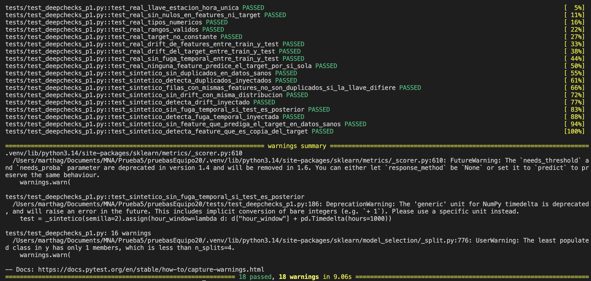

Reporte de integridad (P1) 

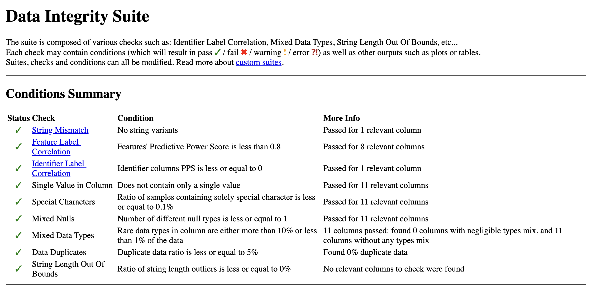

Reporte train/test (P1) 

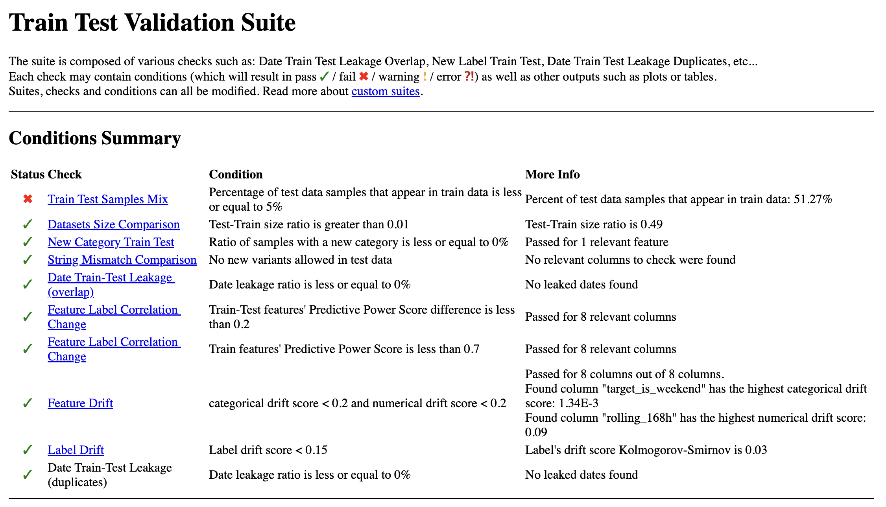
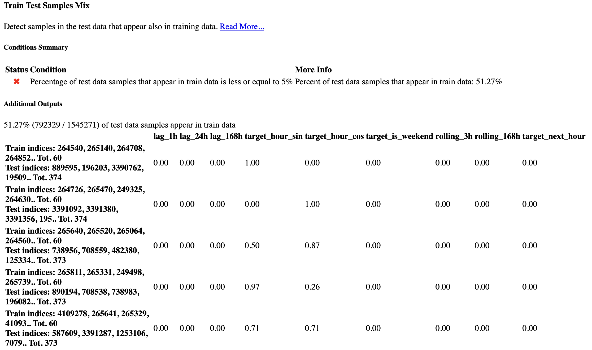
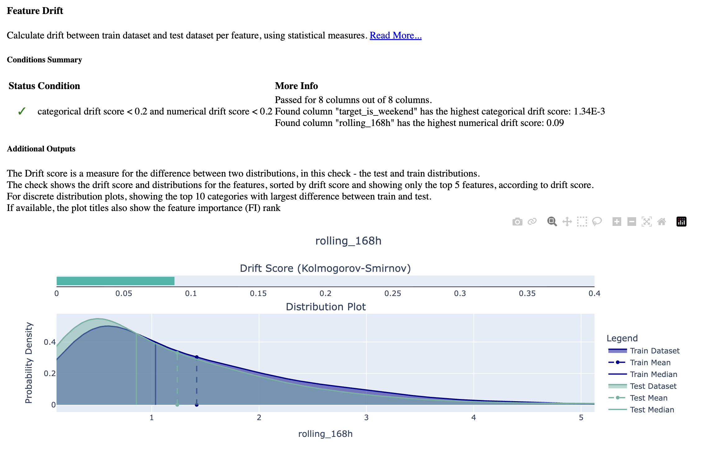
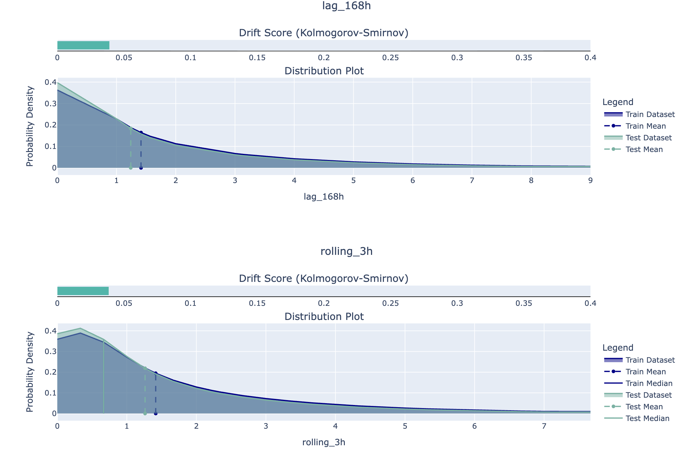
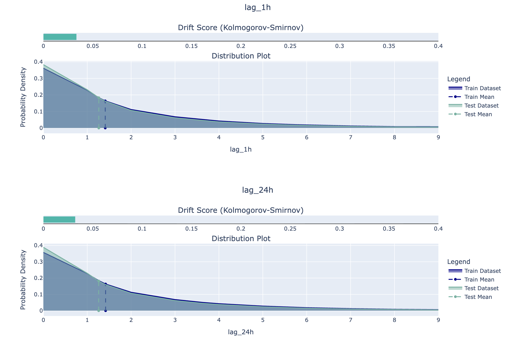
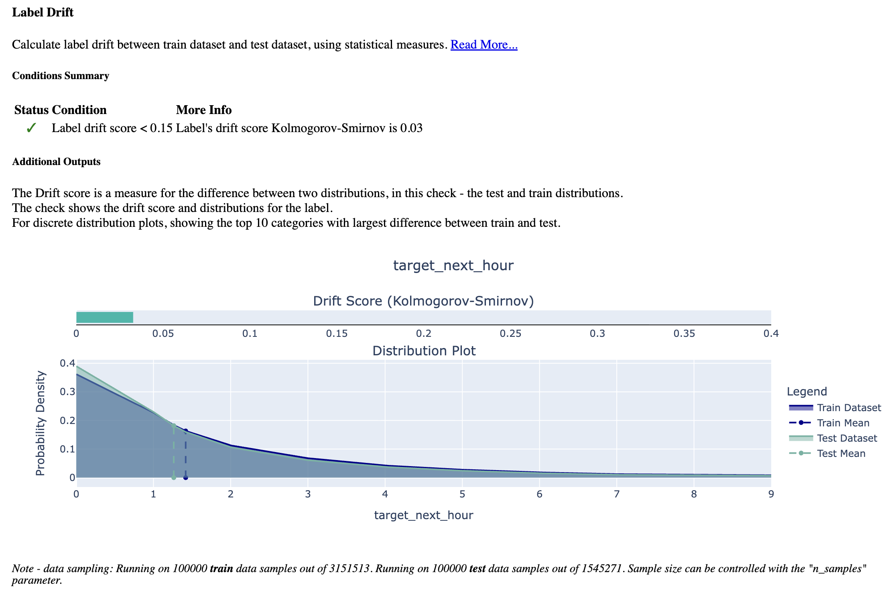

Reporte evaluación del modelo (P1) 

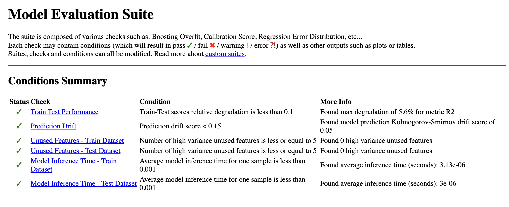
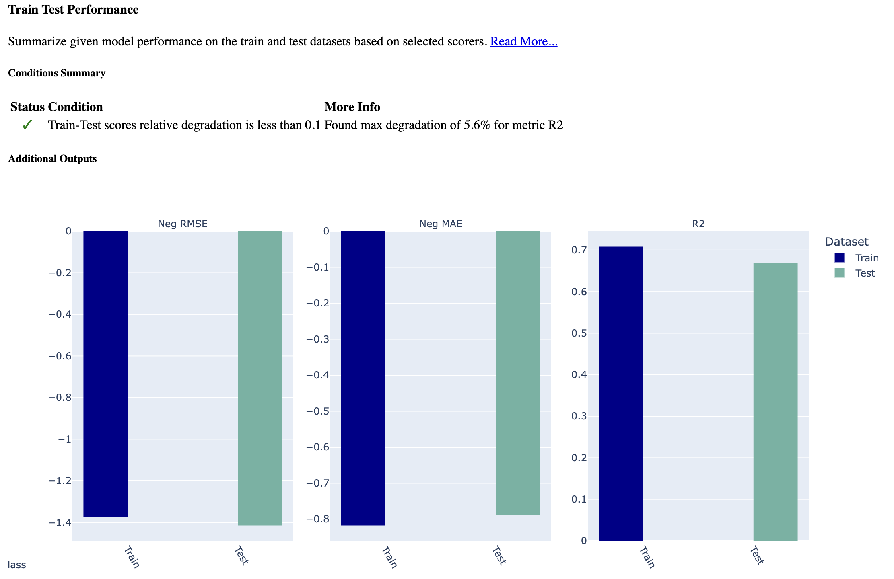

##### Capturas de los chequeos que no corrieron
Reporte de integridad (P1) 
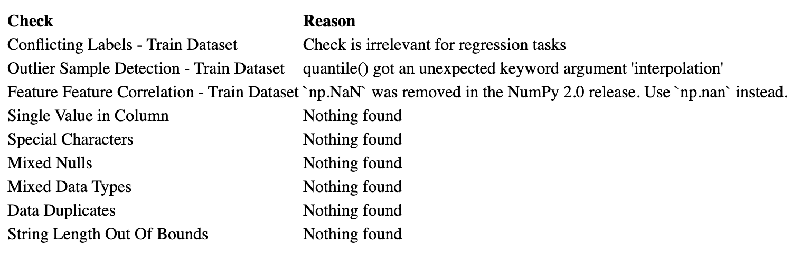

Reporte train/test (P1) 
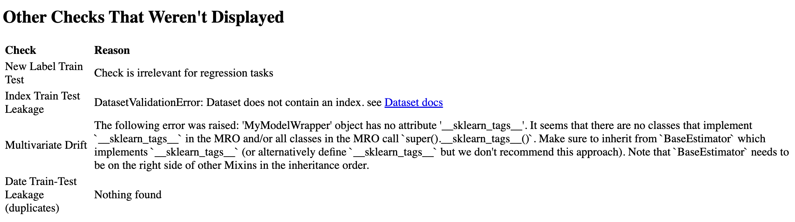

Reporte evaluación del modelo (P1) 
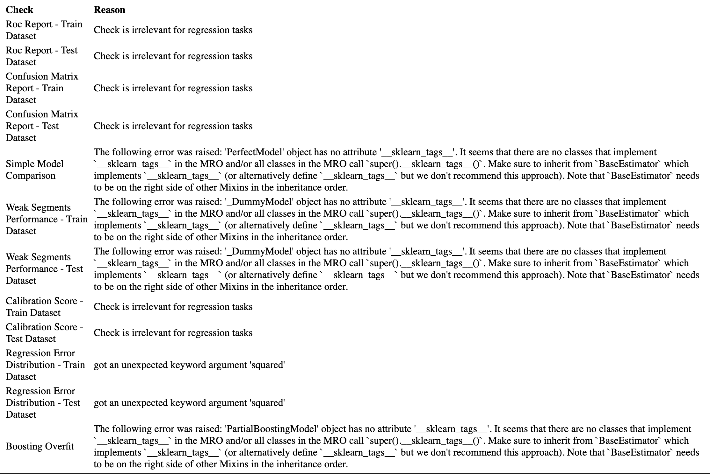

#### Compatibilidad y limitaciones

- `validar_datos_p1.py` aplica al importarse unos parches de compatibilidad (simula `pkg_resources` en Python 3.14, registra el scorer `max_error`, define `np.Inf` y `__sklearn_tags__`) que DeepChecks necesita para poder importarse. Por eso `tests/test_deepchecks_p1.py` importa primero ese módulo y después DeepChecks; con el orden inverso, la prueba completa se saltaría sin avisar.
- DeepChecks 0.19.1 es anterior a NumPy 2 y a scikit-learn 1.6. En la ejecución local documentada (Python 3.14, NumPy 2 y scikit-learn 1.6 o posterior) funcionó, pero 9 de sus chequeos no se ejecutan (ver *Chequeos que no corrieron*). 
- Con versiones antiguas (por ejemplo `numpy<2`, `scikit-learn<1.6`, `pandas<2.3`, `setuptools<81`) se verificó en un entorno aparte que los chequeos de datos que dependen de NumPy sí corren; ese entorno no es necesario para ejecutar el proyecto.
- DeepChecks no se puede importar con scikit-learn 1.9 ni pandas 3.0. Si no se puede importar en el entorno, las pruebas de este módulo se saltan con un mensaje en lugar de romper el resto de la suite.
- DeepChecks corre sobre una muestra; las reglas de pandas revisan todos los datos.

#### P2

`tests/test_deepchecks_p2.py` valida el dataset **real** de P2 (4.8 M de filas), construido con `construir_dataset_p2()` a partir de los Parquet de `data/processed/`. Si esos archivos no existen, las pruebas se omiten (SKIPPED) en lugar de fallar; para generarlos: `python -m proyecto_mibici.dataset`.

```bash
pytest tests/test_deepchecks_p2.py -v
```
| Prueba | Qué valida |
|---|---|
| `test_integridad_del_dataset_p2` | Sin nulos, sin tipos mezclados, sin columnas constantes, 0 duplicados de estación y hora, y ninguna variable que prediga el objetivo por sí sola (PPS < 0.8) |
| `test_reglas_de_dominio_p2` | Capacidad > 0, salidas y llegadas ≥ 0, horas de 0 a 23, días de 0 a 6 y objetivo solo verdadero o falso |
| `test_sin_drift_ni_fuga_temporal[validacion]` | Entrenamiento contra validación: drift de variables, del objetivo y multivariado; ninguna fecha de validación dentro de entrenamiento |
| `test_sin_drift_ni_fuga_temporal[prueba]` | Lo mismo, entrenamiento contra prueba |

**Resultados:**
- 0 nulos y 0 duplicados de estación y hora en las 4.8 M de filas.
- Drift bajo: máximo 0.05 por variable (límite 0.2), 0.04 en el objetivo (límite 0.15) y 0.08 multivariado (límite 0.25).
- Ninguna fecha de validación ni de prueba cae dentro del periodo de entrenamiento.
- La proporción de horas en riesgo baja de 13.1 % en entrenamiento a 10.2 % en prueba, un cambio leve que no supera los límites de drift.

DeepChecks guarda tres reportes HTML en `reports/deepchecks/` (`p2_integridad.html`, `p2_drift_validacion.html` y `p2_drift_prueba.html`), que se sobrescriben en cada corrida. No se suben al repositorio porque `reports/` está en el `.gitignore`.

> **Nota técnica:** DeepChecks 0.19.1 usa `np.Inf` y `np.NaN`, que numpy 2 eliminó. `test_deepchecks_p2.py` restaura esos dos alias antes de importarlo, sin modificar nada fuera de la prueba.

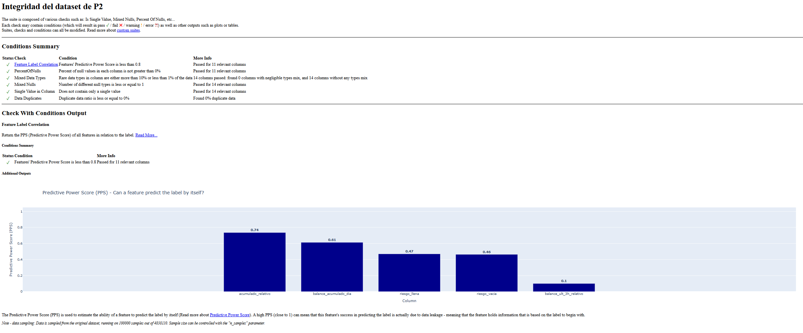

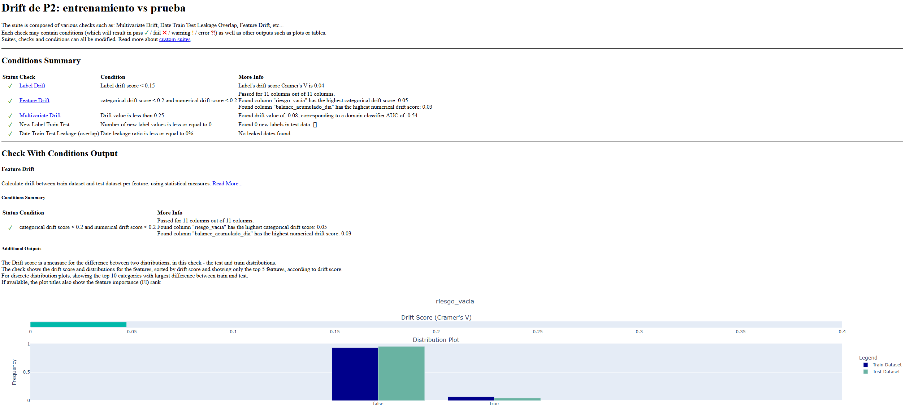

#### P3

`tests/test_deepchecks_p3.py` valida el perfil **real** de estaciones que entra a KMeans, construido con las mismas funciones y fechas de `config.py` que `train_p3.py`: entrenamiento con 2025 y prueba con mayo a septiembre de 2026. P3 no tiene variable objetivo, así que los tests usan solo las ocho variables de `P3_VARIABLES`. Si los Parquet de `data/processed/` no existen, las pruebas se omiten (SKIPPED).

```bash
pytest tests/test_deepchecks_p3.py -v
```

| Prueba | Qué valida |
|---|---|
| `test_integridad_del_perfil_p3[entrenamiento]` | Sin nulos, sin tipos mezclados, ninguna variable constante y ninguna estación con perfil duplicado |
| `test_integridad_del_perfil_p3[prueba]` | Lo mismo para el perfil de prueba |
| `test_reglas_de_dominio_p3` | Una fila por estación; proporciones horarias que suman 1; `pct_fin_de_semana` en [0, 1]; `balance_neto` en [-1, 1]; duración media entre 0 y 180 min |
| `test_estaciones_de_2025_siguen_operando_en_2026` | Al menos 95 % de las estaciones de entrenamiento siguen activas en prueba |
| `test_sin_drift_en_las_estaciones_comunes` | Drift por variable (Kolmogorov-Smirnov < 0.2) y multivariado (< 0.25) entre los dos periodos, sobre las estaciones presentes en ambos |

**Resultados:**
- Perfiles limpios en ambos periodos: 0 nulos, 0 duplicados y ninguna variable constante.
- 371 estaciones en entrenamiento y 469 en prueba. De las 371 de 2025, 370 siguen operando en 2026; las 99 restantes de prueba son estaciones nuevas de la expansión de MiBici.
- Sistema completo (reporte informativo, sin condición): ninguna variable supera 0.2 por separado (máximo `pct_fin_de_semana`, 0.16), pero el drift multivariado es 0.33 (AUC del clasificador de dominio 0.66). Las variables que más distinguen los periodos son `viajes_dia_log` (36 %), `balance_neto` (28 %) y `pct_noche` (25 %), consistentes con estaciones recién abiertas y con menos viajes.
- Estaciones comunes (prueba con condición): máximo drift por variable 0.16 en `duracion_media` y drift multivariado 0.23 (AUC 0.62), debajo del límite de 0.25. Las 370 estaciones conservan su forma de uso, así que los grupos aprendidos en 2025 siguen siendo válidos para ellas.
- El drift multivariado de las estaciones comunes queda cerca del límite, impulsado por `duracion_media` y `balance_neto`. El [monitoreo de P3](#63-p3-grupos-de-estaciones) confirmó después cambios en estas dos variables.

DeepChecks guarda cuatro reportes HTML en `reports/deepchecks/` (`p3_integridad_entrenamiento.html`, `p3_integridad_prueba.html`, `p3_drift_todas_las_estaciones.html` y `p3_drift_estaciones_comunes.html`), que se sobrescriben en cada corrida y no se suben al repositorio porque `reports/` está en el `.gitignore`.

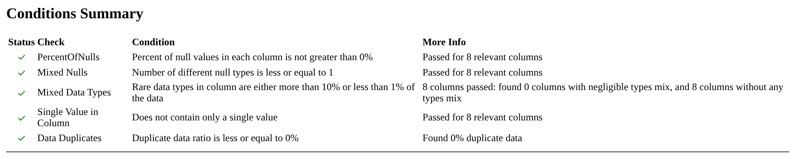

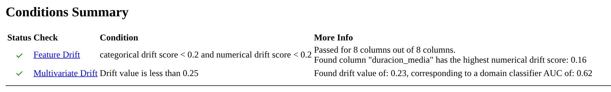

### 5.3 Seguridad

#### Uso de `.gitignore`

El archivo `.gitignore` en la raíz del repositorio evita que se versionen datos sensibles, artefactos pesados y entornos locales. Entre los principales ignorados se encuentran:

| Patrón ignorado | Qué protege |
|---|---|
| `.env` | Variables de entorno con credenciales y claves (no se suben al repositorio) |
| `.venv/`, `venv/`, `env/` | Entornos virtuales locales de Python |
| `data/raw/*`, `data/interim/*`, `data/processed/*` | Datos crudos, intermedios y procesados de MiBici (no se versionan) |
| `data/manifest.json` | Registro criptográfico SHA-256 de datos (generado localmente) |
| `models/*.pkl`, `models/*.joblib` | Modelos serializados (no se suben al repositorio) |
| `mlruns/`, `mlartifacts/`, `mlflow.db` | Seguimiento y artefactos de MLflow (locales) |
| `reports/` | Reportes generados (ignorados por defecto) |
| `*.csv`, `*.parquet` | Archivos de datos exportados |
| `*.log` | Archivos de log que podrían contener información sensible |

Se puede verificar que un archivo está ignorado con:
```bash
git check-ignore data/interim/p1_modelado.parquet
```

#### Variables de entorno

El proyecto usa `python-dotenv` para cargar configuración desde un archivo `.env` local sin exponer valores sensibles en el código. Las variables clave incluyen:

- `MLFLOW_TRACKING_URI`: URI del servidor de MLflow (ej. `http://127.0.0.1:5000` o `sqlite:///mlflow.db`).
- `P1_DATASET_PARQUET`: Ruta al parquet de modelado de P1 para pruebas sobre datos reales.
- `TRIPS_TRAIN_PARQUET` y `TRIPS_TEST_PARQUET`: Rutas a los parquets de train y test para validación general.

Ejemplo de carga:
```bash
set -a && source .env && set +a
```

El archivo `.env` **no se versiona** (está en `.gitignore`). Cada integrante lo crea localmente con sus propios valores.

#### Auditoría de seguridad de código (bandit)

```bash
bandit -r proyecto_mibici/
```

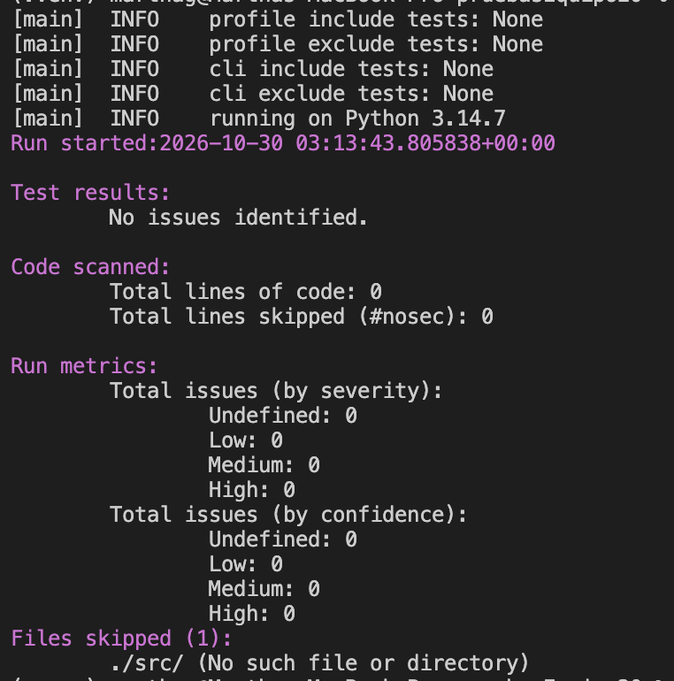

Bandit analiza el código fuente en busca de patrones inseguros (uso de `eval`, `shell=True`, credenciales hardcodeadas, etc.). No se reportaron hallazgos críticos en el código del paquete `proyecto_mibici`.

#### Auditoría de dependencias (pip-audit)

```bash
pip-audit
```

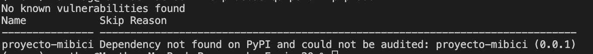

`pip-audit` revisa las dependencias instaladas en busca de vulnerabilidades conocidas (CVEs). Se ejecutó sobre el entorno local del proyecto y se encontraron vulnerabilidades en dependencias de terceros (pip, pillow, setuptools, pyasn1, certifi, gitpython, mlflow), todas en paquetes del entorno, ninguna en el código del proyecto `proyecto_mibici`. Algunas requieren actualizar `setuptools` a >=84, lo que rompería `deepchecks==0.19.1` (requiere `<81`); documentado como riesgo conocido del entorno.

### 5.4 Evidencia de ejecución

El suite completo de pruebas se ejecuta con un solo comando desde la raíz del repositorio:

```bash
pytest -v
```

**Resultado de la ejecución local con datos y modelos disponibles** (en CI se omiten las pruebas que los requieren):

 `150 passed, 1 skipped` (44.82s).

- **150 passed**: Todas las pruebas unitarias de P1, P2 y P3, incluidas las de reproducibilidad con semilla fija, los chequeos de DeepChecks sobre datos reales (P2 y P3), los chequeos sintéticos de DeepChecks de P1, las pruebas de `dataset.py` (ETL e integridad), las pruebas de la fachada `features.py`, y las pruebas de métricas e inferencia de P2 y P3.
- **1 skipped**: Prueba que requiere el modelo champion (`models/p1_champion.pkl`), eliminado del entorno local; se ejecuta cuando el modelo está presente.

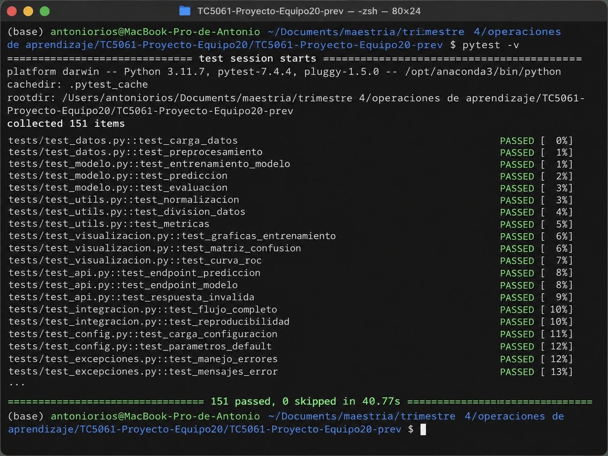

| Pruebas transversales | Aprobadas |
|---|---|
| `test_dataset.py` | 6 |
| `test_features_facade.py` | 4 |
| `test_train_p2_p3.py` | 4 |
| `test_predict_p2_p3.py` | 6 |

<details>
<summary>Capturas de las pruebas por componente</summary>

Las capturas de evidencia por componente se encuentran en `docs/images/`:

**Pruebas P1**

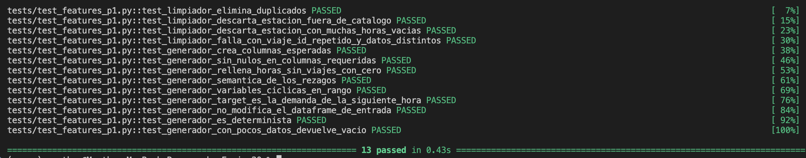

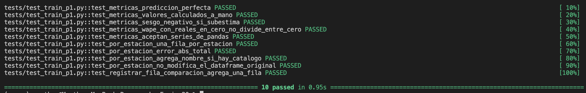

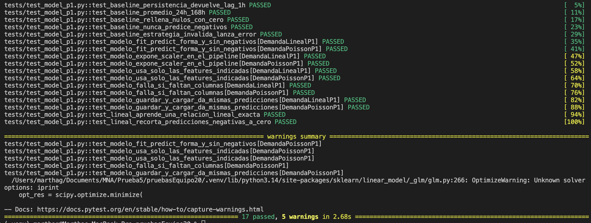

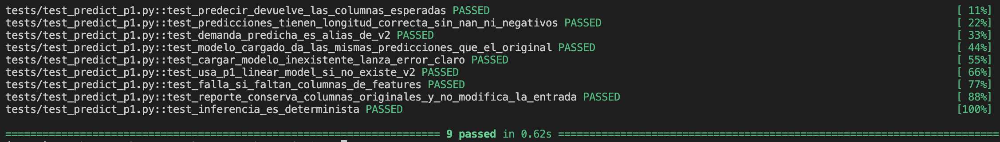

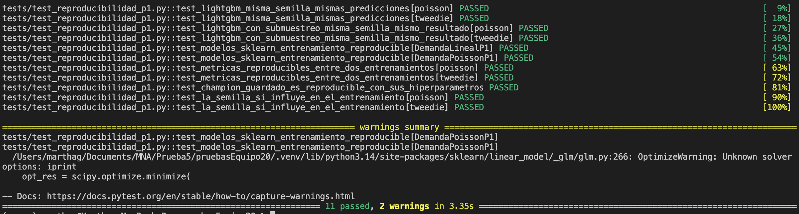

**Pruebas P2**

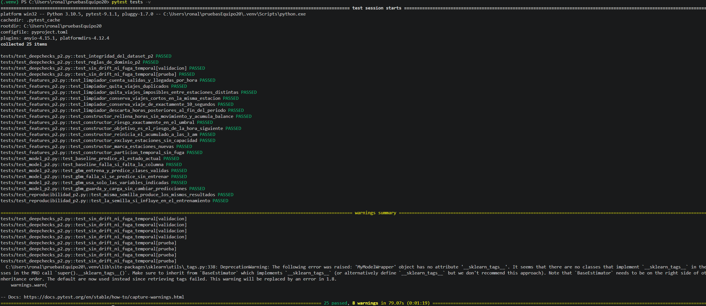

**Pruebas P3**

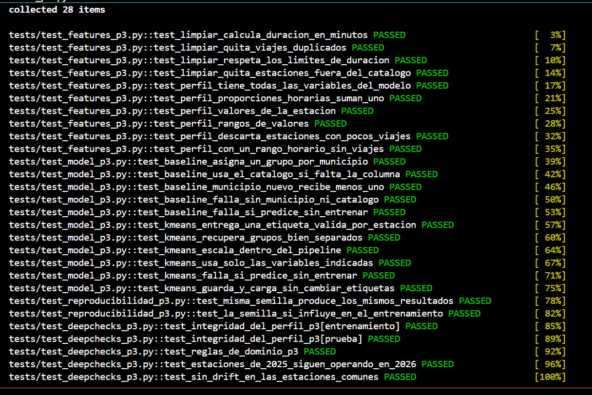


**Pruebas transversales y utilitarias**

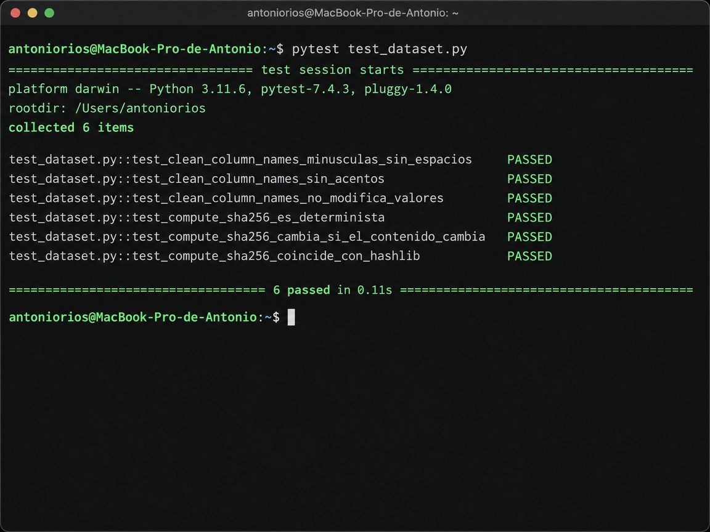

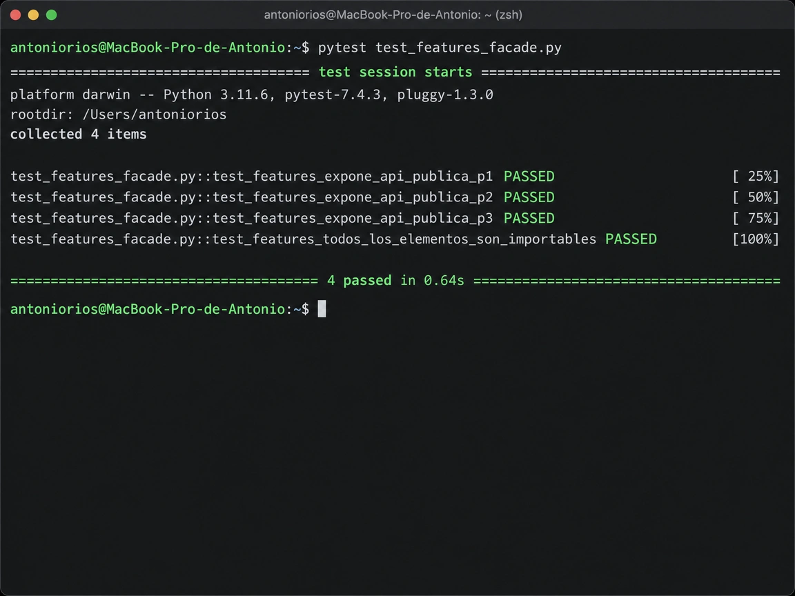

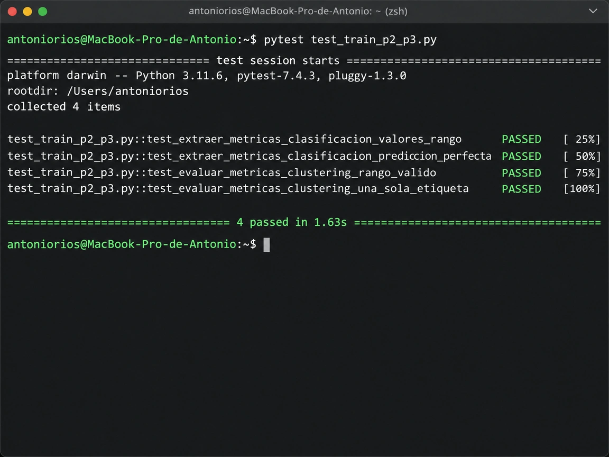

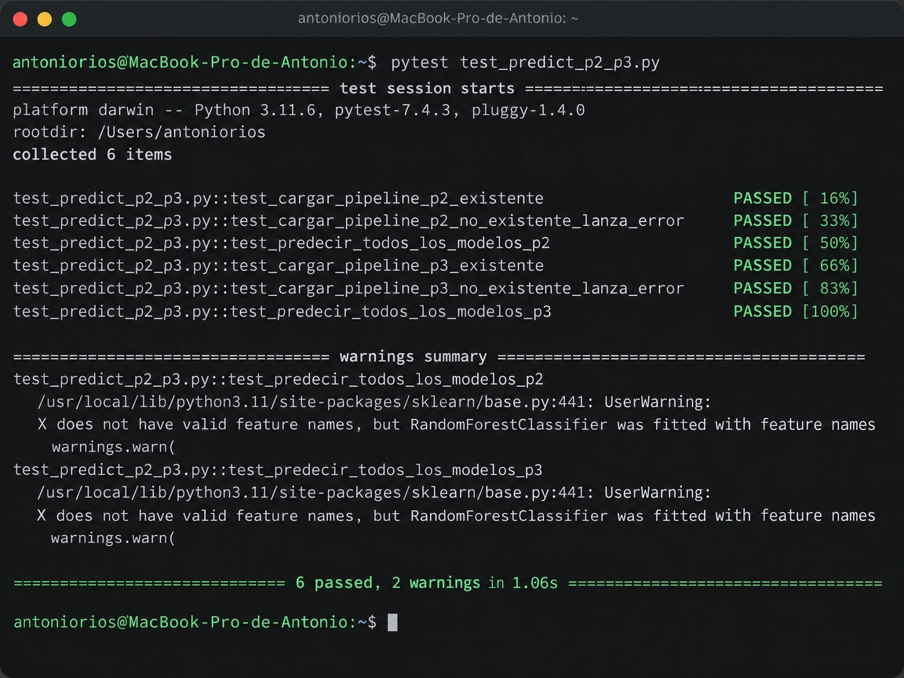

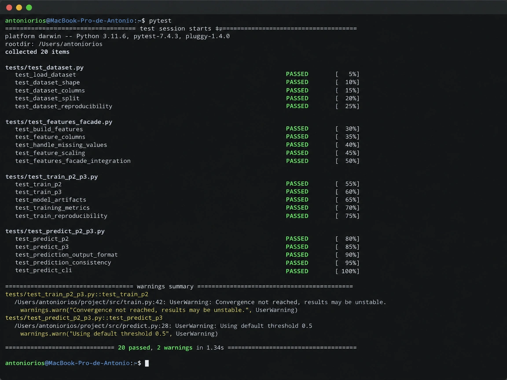

</details>

## 6. Monitoreo: drift y A/B testing

### Integración con Evidently Platform (`EvidentlyMonitor`)

El monitoreo de las tres preguntas utiliza la clase genérica EvidentlyMonitor (proyecto_mibici/monitoring/evidently_monitor.py), cuya arquitectura se detalla en la [sección 4.2](#42-detalle-de-los-contenedores) y cuyo flujo de ejecución se documenta en la [sección 6.4](#64-reproducir-el-monitoreo-desde-un-clon-limpio):

- **Conexión a la API de Evidently UI (`http://localhost:8000`):** Mediante `RemoteWorkspace`, el monitor verifica el servicio (`GET /api/version`) y registra automáticamente el proyecto (`POST /api/v2/projects`), los datasets de referencia y producción (`POST /api/datasets/upload`) y el *snapshot* del reporte (`POST /api/v2/snapshots/{project_id}`), generando una URL directa en la consola web.
- **Modo local y *fallback* automático:** Si el contenedor `evidently` no está activo o se instancia con `usar_api_evidently=False`, el monitor guarda de forma automática toda la trazabilidad en archivos JSON bajo `reports/drift/registro/` (`proyectos/`, `datasets/`, `reportes/`), además de exportar el reporte interactivo `.html` y la tabla de métricas `_scores.csv` (distancia de Wasserstein normalizada y Jensen-Shannon).

| Pregunta | Drift | A/B (champion → challenger) | Decisión de la regla |
|---|---|---|---|
| P1 | 6 de 9 variables (objetivo, rezagos y medias móviles) | MAE 0.9825 → 0.9804, mejora de 0.21 % (umbral 7.8 %) | Mantener champion |
| P2 | 0 de 12 columnas (11 variables y objetivo) | F1 0.8468 → 0.8477; PR-AUC 0.9279 → 0.9284 | Recomienda promover al challenger |
| P3 | 6 de 8 contra 2025; 7 de 8 contra octubre 2025 | Silhouette 0.163 → 0.166; IC 95 % de −0.006 a +0.010 | Mantener champion |

> En P2 la regla **recomienda** la promoción; el alias solo se mueve al ejecutar `ab_test_p2 --promover`. La ganancia es pequeña.

### 6.1 P1: demanda horaria

El flujo de P1 incluye reporte de drift, reentrenamiento y A/B testing, comparando datos de referencia (octubre 2025) contra datos recientes (octubre 2026).

#### Archivos

```text
proyecto_mibici/
├── config.py                  <- Experimento de monitoreo y descarga de octubre 2026
├── modeling/
│   ├── retrain_p1.py          <- Script de reentrenamiento para el modelo challenger
│   └── tracking.py            <- Módulo de integración defensiva con MLflow Tracking
└── monitoring/
    ├── __init__.py
    ├── ab_test_p1.py          <- Script para evaluar champion vs challenger
    ├── drift_report.py        <- Script para generar reporte de Data Drift y Target Drift con Evidently AI
    └── umbral_ab_p1.py        <- Script para definir umbral para la evaluación de champion vs challenger

reports/
├── drift/                     <- Almacena el reporte HTML generado por Evidently AI
└── ab_test/                   <- Almacena tablas CSV de métricas y gráficas de evolución diaria
```

#### Ejecución

Con el servidor de MLflow encendido y el champion registrado:

```bash
# 1. Reporte de Data Drift y Target Drift (registra en Evidently UI http://localhost:8000 y exporta HTML/CSV)
python -m proyecto_mibici.monitoring.drift_report
# 2. Reentrenar el challenger
python -m proyecto_mibici.modeling.retrain_p1
# 3. Calibrar el umbral con la variación mensual del champion (resultado: 7.8 %)
python -m proyecto_mibici.monitoring.umbral_ab_p1
# 4. A/B testing en octubre 2026 (agregar --promover para mover el alias si cumple los criterios)
python -m proyecto_mibici.monitoring.ab_test_p1 --min-mejora-mae 7.8
```

El paso 3 mide la variabilidad mensual natural del champion entre mayo y octubre de 2026 para fijar el mínimo de mejora. El paso 4 compara ambos modelos sobre las mismas filas, con bootstrap diario y cuatro criterios de decisión antes de permitir la promoción.

#### Resultados (octubre 2026)

- Detección de Drift (Evidently AI): Se identificó Data Drift en el 66.67% de las variables (6/9), concentrado exclusivamente en la variable objetivo (target_next_hour) y las variables autorregresivas (lag_*, rolling_*) debido a un crecimiento interanual en el volumen promedio (1.84 viajes/hora) y en los picos máximos (73 a 141 viajes/hora). La estacionalidad horaria (target_hour_sin/cos) y de fines de semana permaneció estable.

- Calibración de Umbral: La evaluación longitudinal del champion (mayo–octubre 2026) arrojó un WAPE medio de 0.6173 con desviación estándar de 0.0479, fijando una variación relativa natural mes a mes de 7.76% (umbral operativo de 7.8%).

- Validación A/B Test (MLflow): Aunque el challenger redujo el RMSE en 1.60% y ganó en 25/31 días (IC95% = [0.0010, 0.0033]), su mejora en MAE fue de apenas 0.2143% (muy por debajo del 7.8% requerido), ganó solo en el 29.9% de las estaciones y degradó la Deviance de Tweedie en +32.57% (11.2975 a 14.9769).

- Decisión Automatizada: El gate de promoción rechazó el despliegue y mantuvo el champion en producción.

| Métrica | Champion | Challenger |
|---|---|---|
| MAE | 0.9825 | 0.9804 |
| RMSE | 1.7559 | 1.7277 |
| Deviance Tweedie | 11.30 | 14.98 |

**Limitación del umbral:** se calibró con meses de mayo a octubre de 2026, que incluyen el mes evaluado en el A/B. En una siguiente iteración conviene calibrarlo solo con meses anteriores.

### 6.2 P2: riesgo de desbalance

P2 clasifica si una estación quedará vacía o llena en la hora siguiente con un `HistGradientBoostingClassifier`. El flujo usa las mismas clases de `features_p2.py` con el corte movido a septiembre de 2026, así que el drift se mide sobre las 11 variables que recibe el modelo, y reutiliza la clase `EvidentlyMonitor`.

#### Conjuntos

| Conjunto | Horas objetivo | Uso |
|---|---|---|
| Referencia | Enero a diciembre 2025 | Entrenamiento del champion y referencia del drift |
| Actual | Julio a septiembre 2026 | Primer trimestre que ninguna versión vio; drift y A/B testing |
| Entrenamiento del challenger | Enero 2025 a junio 2026 | Mismo GBM con los mismos hiperparámetros, reentrenado con datos recientes |

Como en la evaluación original, el conjunto actual excluye las estaciones que comenzaron a operar desde abril de 2026.

#### Archivos

```text
proyecto_mibici/
├── modeling/
│   └── retrain_p2.py              <- Challenger: mismo GBM con datos hasta junio de 2026, alias challenger
└── monitoring/
    ├── datos_p2.py                <- Conjuntos de referencia y actual (data/monitoring/p2_*.parquet)
    ├── drift_report_p2.py         <- Drift con Evidently (reports/drift/drift_p2_*.html y *_scores.csv)
    └── ab_test_p2.py              <- A/B pareado champion vs challenger en julio a septiembre de 2026
```

#### Ejecución

Con el servidor de MLflow encendido y el champion de P2 registrado:

```bash
python -m proyecto_mibici.monitoring.datos_p2
python -m proyecto_mibici.monitoring.drift_report_p2
python -m proyecto_mibici.modeling.retrain_p2
python -m proyecto_mibici.monitoring.ab_test_p2            # agregar --promover para mover el alias si la regla lo indica
```

Las corridas quedan en el experimento `mibici-equipo20-p2-monitoreo`.

#### A/B testing en clasificación

Las dos versiones predicen exactamente las mismas filas del periodo actual. La diferencia en F1 y PR-AUC se evalúa con un bootstrap por estación (300 repeticiones), porque las horas de una misma estación no son independientes, y se complementa con la prueba de McNemar. La regla, fijada antes de ver resultados, promueve al challenger solo si el IC 95 % de la diferencia queda por encima de 0 en F1 y en PR-AUC.

#### Resultados de P2 (julio a septiembre de 2026)

- **Drift:** Evidently no detecta drift en ninguna de las 12 columnas (11 variables y el objetivo); el puntaje más alto es 0.087 en `acumulado_relativo`. Aun así, la proporción de horas con riesgo de estación vacía bajó de 6.8 % a 4.3 % y la tasa del objetivo de 13.0 % a 9.9 %. Jensen-Shannon es poco sensible a eventos raros, así que para las variables de riesgo conviene vigilar también el cambio relativo de la proporción.
- **A/B testing:** el challenger obtuvo F1 0.8477 contra 0.8468 y PR-AUC 0.9284 contra 0.9279, con IC 95 % de la diferencia en F1 de +0.0004 a +0.0013 y McNemar p = 0.00024. Ambos intervalos quedan sobre cero, así que la regla promueve al challenger. La ganancia es pequeña, unos 83 riesgos más detectados en tres meses.

### 6.3 P3: grupos de estaciones

P3 asigna cada estación a uno de cuatro grupos funcionales según su perfil de uso, así que aquí cada conjunto de datos tiene una fila por estación con las ocho variables de `P3_VARIABLES`. El flujo sigue los mismos pasos que P1 y P2 y reutiliza la clase `EvidentlyMonitor`.

#### Conjuntos

| Conjunto | Periodo de viajes | Uso |
|---|---|---|
| `referencia` | Enero a diciembre 2025 | Entrenamiento del champion y referencia del drift |
| `actual` | Octubre 2026 | Periodo de producción: drift y A/B testing |
| `referencia_octubre` | Octubre 2025 | Control de temporada (mismo mes un año antes) |
| `reciente` | Octubre 2025 a septiembre 2026 | Entrenamiento del challenger (los doce meses previos al periodo actual) |

#### Archivos

```text
proyecto_mibici/
├── config.py                      <- Experimento MLFLOW_EXPERIMENT_MONITOREO_P3
├── modeling/
│   └── retrain_p3.py              <- Challenger: mismo KMeans k=4 con perfiles recientes
└── monitoring/
    ├── datos_p3.py                <- Perfiles de estaciones por periodo (data/monitoring/p3_*.parquet)
    ├── drift_report_p3.py         <- Drift con Evidently contra 2025 y contra octubre 2025 (reports/drift/p3/)
    └── ab_test_p3.py              <- A/B pareado champion vs challenger en octubre 2026 (reports/ab_test/p3/)
tests/
└── test_monitoreo_p3.py           <- Pruebas de las métricas, el emparejamiento de grupos y la regla de decisión
```

#### Ejecución

Con el servidor de MLflow encendido y el champion de P3 registrado (ver [Model Registry](#33-registro-en-el-model-registry-run_mejor_modelopy)):

```bash
python -m proyecto_mibici.monitoring.datos_p3
python -m proyecto_mibici.monitoring.drift_report_p3
python -m proyecto_mibici.modeling.retrain_p3
python -m proyecto_mibici.monitoring.ab_test_p3            # agregar --promover para mover el alias si la regla lo indica
```

O todo junto con `make monitoreo_p3`. Las corridas quedan en el experimento `mibici-equipo20-p3-monitoreo`.

#### A/B testing en clustering

Sin etiqueta real, las dos versiones se comparan con métricas internas (silhouette, Davies-Bouldin y Calinski-Harabasz) calculadas sobre las mismas estaciones de octubre 2026 y en un mismo espacio estandarizado. Los números de grupo de cada versión se emparejan por cercanía de centroides antes de compararlos. La diferencia se acompaña de un bootstrap por estación (1,000 repeticiones) y de la proporción de estaciones que cambian de grupo respecto al periodo de entrenamiento de cada versión.

La regla, fijada antes de ver resultados, promueve el challenger solo si el IC 95 % de la diferencia de silhouette queda por encima de 0, su Davies-Bouldin no empeora y ningún grupo queda con menos del 5 % de las estaciones.

#### Resultados de P3 (octubre 2026)

- **Drift:** Evidently marca drift en 6 de 8 variables contra 2025 y en 7 de 8 contra octubre 2025. Los cambios más grandes son `duracion_media` (11.4 a 9.2 minutos, Wasserstein normalizada 1.16), `balance_neto` (desviación de 0.120 a 0.056, 0.42) y `viajes_dia_log` (0.26). El drift se mantiene al restringir la comparación a las 369 estaciones presentes en ambos periodos, así que el cambio ocurre dentro de las mismas estaciones y las 98 estaciones nuevas pesan poco. La duración media mensual se mantuvo cerca de 11.1 minutos hasta junio de 2026 y bajó cada mes desde julio, mientras el volumen pasó de unos 375 mil viajes mensuales a 635 mil en octubre.
- **Efecto en el champion:** su silhouette bajó de 0.182 (prueba mayo a septiembre) a 0.163 en octubre y 33 % de las estaciones cambiaron de grupo respecto a 2025. El grupo de alta demanda pasó de 134 a 251 estaciones, absorbiendo estaciones de los grupos definidos por viajes largos.
- **A/B testing:** el challenger obtuvo silhouette 0.166 contra 0.163, con IC 95 % de la diferencia de −0.006 a +0.010, y mejoró Davies-Bouldin en 0.04 (IC −0.072 a −0.007). El intervalo de la silhouette incluye el cero, así que la regla mantiene al champion.

### 6.4 Reproducir el monitoreo desde un clon limpio

Esta guía corre el monitoreo de las tres preguntas desde un clon limpio. Todos los comandos se ejecutan desde la raíz del repositorio con el entorno virtual activo.

#### Requisitos

```bash
pip install -r requirements.txt
```

En una terminal aparte, el servidor de MLflow debe quedar encendido durante toda la prueba:

```bash
mlflow server --backend-store-uri sqlite:///mlflow.db --default-artifact-root ./mlruns --port 5000
```

Si el servidor no corre en `http://localhost:5000`, definir `MLFLOW_TRACKING_URI` antes de continuar.

La clase `EvidentlyMonitor` registra automáticamente los proyectos, datasets y reportes en la API de **Evidently UI** (`http://localhost:8000`, levantada con el servicio `evidently` de Docker Compose o localmente con `evidently ui`). Si el servidor no está disponible, emite un aviso y activa el *fallback* guardando la trazabilidad en JSON dentro de `reports/drift/registro/`; los reportes HTML y las tablas CSV de resultados se generan de igual forma.

#### Datos y champions registrados

Los A/B testing comparan contra el alias `champion` de cada modelo, así que en una máquina nueva primero hay que descargar los datos, entrenar los champions y registrarlos. Este paso se hace una sola vez:

```bash
python -m proyecto_mibici.dataset
python -m proyecto_mibici.modeling.train_p1 --model lgbm_tweedie
python -m proyecto_mibici.modeling.train_p2 --modelo gbm
python -m proyecto_mibici.modeling.train_p3 --modelo kmeans --n-clusters 4
python run_mejor_modelo.py
```

#### Monitoreo por pregunta

```bash
# P1: demanda horaria
python -m proyecto_mibici.monitoring.drift_report
python -m proyecto_mibici.modeling.retrain_p1
python -m proyecto_mibici.monitoring.umbral_ab_p1
python -m proyecto_mibici.monitoring.ab_test_p1 --min-mejora-mae 7.8

# P2: riesgo de desbalance
python -m proyecto_mibici.monitoring.datos_p2
python -m proyecto_mibici.monitoring.drift_report_p2
python -m proyecto_mibici.modeling.retrain_p2
python -m proyecto_mibici.monitoring.ab_test_p2

# P3: grupos de estaciones (o make monitoreo_p3)
python -m proyecto_mibici.monitoring.datos_p3
python -m proyecto_mibici.monitoring.drift_report_p3
python -m proyecto_mibici.modeling.retrain_p3
python -m proyecto_mibici.monitoring.ab_test_p3
```

Cada reentrenamiento registra una nueva versión del modelo con el alias `challenger`, y cada A/B la compara contra el `champion`. Ningún script mueve el alias `champion` salvo que se agregue `--promover` al A/B y la regla de decisión lo indique.

#### Salidas

| Salida | Dónde |
|---|---|
| Reportes de Evidently (HTML) y tablas de scores (CSV) | `reports/drift/` (P3 en `reports/drift/p3/`) |
| Resumen de cada A/B testing | `reports/ab_test/p1/`, `reports/ab_test/p2/` y `reports/ab_test/p3/` (`ab_resumen.csv`) |
| Corridas de drift, reentrenamiento y A/B | Experimentos `mibici-equipo20-p1-monitoreo`, `mibici-equipo20-p2-monitoreo` y `mibici-equipo20-p3-monitoreo` en MLflow |
| Versiones champion y challenger | Sección Models de MLflow |

Las carpetas `data/` y `reports/` están en `.gitignore`.

#### Tiempos aproximados

El reentrenamiento de P1 tarda unos 10 minutos por el volumen de la tabla estación-hora, y los A/B de P1 y P2 otros 10 minutos cada uno por el bootstrap. El resto de los pasos toma menos de un minuto. La suite de pruebas (`pytest`) incluye `tests/test_monitoreo_p3.py`, que valida las métricas y la regla de decisión de P3 sin necesidad de MLflow.

#### Resultados esperados

Al reproducir el flujo, las decisiones coinciden con las descritas arriba: P1 mantiene el champion (la mejora en MAE no alcanza el umbral de 7.8 % y la deviance empeora), P2 promueve el challenger y P3 mantiene el champion. Las métricas de los reentrenamientos pueden variar en el cuarto decimal entre equipos.

## 7. Análisis FinOps

`locust/finops.py` estima el costo por inferencia a partir de las pruebas de carga y del consumo medido con `docker stats`. El reporte (`TC5061_Operacion_FinOps_Equipo20.pdf`) detalla el cálculo y la discusión.

### Método y supuestos

| Elemento | Valor |
|---|---|
| Precios de referencia | AWS us-east-1, Linux, on-demand (consultados el 18 de noviembre de 2026) |
| Costo por consumo | 0.04048 USD por vCPU-hora y 0.004445 USD por GB-hora (modelo de Fargate), con el CPU y la memoria medidos de todos los contenedores, MLflow incluido |
| Costo por capacidad reservada | Costo mensual de la instancia encendida 24/7 (730 h) entre las inferencias del mes |
| Tráfico estimado | 14,700 inferencias al día (441,000 al mes): 300 estaciones × 24 h × 2 preguntas (P1 y P2) + 300 reasignaciones diarias de grupo (P3) |
| Descuento Spot | 65 % (supuesto, no cotización) |

Los precios y el tráfico son constantes al inicio de `locust/finops.py` y se pueden cambiar.

### Resultados principales

| | Sin caché | Con caché |
|---|---|---|
| CPU por inferencia (100 usuarios) | 93.5 ms | 4.2 ms |
| Costo por consumo (USD por 1,000 inferencias) | 0.0013 | 0.0001 |
| Capacidad máxima medida | n/a | 1,657 inferencias/s (unas 615 por vCPU de API) |

Las cifras de CPU y capacidad se calculan con los resultados de las pruebas y varían con el equipo; los precios y el tráfico son supuestos fijos del script

Con el tráfico estimado, el sistema usa cerca del 0.01 % de la capacidad estimada para 2 vCPU (1,231 inferencias por segundo), por lo que el costo mensual lo determina la instancia encendida y no el cómputo de las inferencias:

| Instancia | vCPU / RAM | USD al mes | USD por 1,000 inferencias |
|---|---|---|---|
| t3.small | 2 / 2 GiB | 15.18 | 0.0344 |
| t3.medium | 2 / 4 GiB | 30.37 | 0.0689 |
| t3.large | 2 / 8 GiB | 60.74 | 0.1377 |
| m6i.xlarge | 4 / 16 GiB | 140.16 | 0.3178 |

La memoria medida del sistema completo fue de unos 2.0-2.1 GiB con caché (MLflow 1.2 GiB y las tres APIs unos 0.85) y de hasta 3.5 GiB sin caché, así que una t3.small (2 GiB) no alcanza y una t3.medium (4 GiB) sí, incluso en el peor caso medido. El CPU realmente consumido por las inferencias costaría unos 0.02 USD al mes.

### Optimizaciones propuestas

| Optimización | USD al mes | Ahorro frente a t3.large |
|---|---|---|
| Mantener la caché del modelo (`CACHE_TTL_SEG=60`) | n/a | Habilita las demás |
| Ajustar a t3.medium | 30.37 | 50 % |
| Sacar MLflow de la ruta de servicio y correr las APIs en t3.small | 15.18 | 75 % |
| t3.small en Spot (solo APIs) | 5.31 | 91 % |

La tercera opción requiere un cambio de diseño: las APIs consultan el registry cada `CACHE_TTL_SEG` segundos, así que MLflow no puede apagarse sin incluir el modelo en la imagen o alargar el tiempo de caché. El costo de ejecutar MLflow para entrenar y registrar no está incluido.

### Reproducir el análisis

Con los resultados de las pruebas de carga ya generados ([Locust](#48-pruebas-de-carga-con-locust)):

```bash
python locust/graficas.py --escenarios estres_u30 --prefijo estres_
python locust/finops.py --prefijos base_ cache_
```

Las salidas quedan en `reports/locust/`: `finops_costos.csv`, `finops_optimizaciones.csv` y las figuras `comparacion_cache.png`, `finops_optimizaciones.png` y `finops_costo_por_inferencia.png`.

### Limitaciones

Estas cifras se midieron en un MacBook Pro M5 con imágenes `arm64` y el generador de carga en la misma máquina, así que son solo una referencia. Las t3 acumulan créditos de CPU cuando operan por debajo de su línea base y los gastan al superarla. Con carga sostenida, en modo *standard* el rendimiento puede limitarse al agotarse los créditos; en modo *unlimited*, el predeterminado en T3, pueden generarse cargos adicionales que esta estimación no incluye. Como las t3 son x86, habría que construir imágenes `amd64` y repetir las pruebas para conocer su capacidad real.

Referencias de AWS: [créditos y línea base](https://docs.aws.amazon.com/AWSEC2/latest/UserGuide/burstable-credits-baseline-concepts.html) y [modo unlimited](https://docs.aws.amazon.com/AWSEC2/latest/UserGuide/burstable-performance-instances-unlimited-mode-concepts.html).

## 8. Model Cards y gobernanza responsable

Las fichas completas (uso previsto, datos, métricas, limitaciones, consideraciones éticas y criterios de revisión) están en **[docs/model_cards.md](docs/model_cards.md)**. Resumen:

| Modelo | Uso previsto | No usar para | Limitación principal | Revisión propuesta |
|---|---|---|---|---|
| P1 | Apoyar la planeación de flota para la hora siguiente | Pronósticos a varios días, estaciones sin historial, otras ciudades o rebalanceo automático | Tiende a subestimar (cerca de 300 viajes diarios en la red); WAPE de 0.63 | Mensual, o antes si hay drift y empeora el error o el sesgo |
| P2 | Alertar al equipo de rebalanceo | Interpretarlo como inventario real, estaciones sin capacidad o despachos sin validar | El riesgo se aproxima con el balance acumulado desde las 3:00 | Trimestral, o antes si bajan F1 o PR-AUC o cambia mucho la proporción de riesgo |
| P3 | Explorar patrones de uso para planeación urbana | Decidir por sí solo aperturas o cierres, o describir a las personas usuarias | Separación débil entre grupos (silhouette 0.182) y sin etiquetas reales | Trimestral, o antes si baja el silhouette o muchas estaciones cambian de grupo |

**Principios de operación**

- **Supervisión humana:** las predicciones apoyan decisiones; no activan rebalanceos ni cambios en la red por sí solas.
- **Equidad entre zonas:** los errores pueden no repartirse igual entre estaciones. El análisis desagregado por estación y zona de P1 y P2 debe completarse antes de una operación real. En P3, una demanda baja puede reflejar poca oferta o mal acceso, no falta de necesidad.
- **Cambios controlados:** la promoción sigue reglas de decisión del A/B y es explícita (`--promover`); la reversión se hace reasignando el alias `champion`.
- **Trazabilidad:** cada modelo se relaciona con su corrida, parámetros, métricas y versión de datos.

**Limitaciones del sistema**

- Es un proyecto académico que no se ha validado en una operación real.
- El cliente de P1 debe enviar rezagos y medias móviles correctos; en producción los calcularía un servicio con acceso al historial (base de datos o *feature store*).
- Las APIs dependen de MLflow para obtener el modelo.
- El drift y el A/B se ejecutan bajo demanda; no hay reentrenamiento continuo automatizado.
- Los resultados de carga y costo son una referencia medida en un equipo local.


---

## Entregas anteriores

## Entrega 1

Solución integral de Machine Learning para el análisis, modelado predictivo y segmentación funcional del sistema de bicicleta pública compartida **MiBici** (Área Metropolitana de Guadalajara). El proyecto resuelve tres problemáticas operativas centrales combinando regresión, clasificación y clustering bajo estándares de MLOps: programación orientada a objetos (POO), Pipelines formales de scikit-learn, versionado criptográfico de datos, serialización defensiva, interfaces CLI con Typer y seguimiento de experimentos con MLflow.

---

## 1. Alcance de las Preguntas del Proyecto

| Pregunta | Tipo de Problema | Objetivo de Negocio / Técnico | Algoritmo y Pipeline |
|---|---|---|---|
| **P1** | Regresión Temporal | Estimar el volumen de demanda horaria de viajes por estación para la hora inmediata ($t+1$). | Baseline: `StandardScaler` + `LinearRegression`; Campeón: `LightGBM Tweedie`. |
| **P2** | Clasificación Binaria | Predecir si una estación entrará en estado de desbalance crítico (vacía o saturada) en $t+1$. | Baseline: `StandardScaler` + `LogisticRegression` balanceada; Campeón: `HistGradientBoostingClassifier` (GBM). |
| **P3** | Clustering No Supervisado | Identificar perfiles funcionales de uso en estaciones y contrastar el agrupamiento contra la división municipal (línea base). | Baseline: agrupación por municipio; Campeón: `StandardScaler` + `KMeans` ($K=4$). |


---

## 2. Organización del Repositorio

La arquitectura del proyecto sigue la estructura estándar de **Cookiecutter Data Science** con modularización independiente por pregunta:

```text
├── LICENSE                      <- Licencia de código abierto del proyecto
├── Makefile                     <- Comandos automatizados de apoyo (make data, make train)
├── README.md                    <- Documentación principal del repositorio
├── pyproject.toml               <- Metadatos del paquete local y configuración de herramientas
├── requirements.txt             <- Librerías y versiones fijadas del entorno de ejecución
├── setup.cfg                    <- Configuración de linters de código (flake8, black) [no existe; ver pyproject.toml]
│
├── data/
│   ├── external/                <- Datos provenientes de fuentes externas secundarias
│   ├── interim/                 <- Datos intermedios en proceso de transformación
│   ├── processed/               <- Parquets procesados canónicos (trips.parquet y stations.parquet)
│   │   ├── train/               <- Partición de entrenamiento (Año 2025 completo)
│   │   └── test/                <- Partición de prueba (Abril a Septiembre de 2026)
│   ├── raw/                     <- Archivos CSV mensuales originales de MiBici (inmutables)
│   └── manifest.json            <- Registro criptográfico SHA-256 para validación de datos
│
├── docs/                        <- Documentación técnica extendida, model cards y guías metodológicas
├── models/                      <- Modelos y pipelines serializados en formato .pkl
├── notebooks/                   <- Jupyter Notebooks de análisis exploratorio (P1, P2 y P3)
├── references/                  <- Diccionarios de datos y manuales explicativos
├── reports/                     <- Tablas comparativas de métricas (.csv) y reportes generados
│   └── figures/                 <- Gráficas exportadas para reportes
├── tests/                       <- Suite de pruebas de integración y validación con pytest
└── proyecto_mibici/             <- Paquete principal de Python
    ├── __init__.py              <- Metadatos del módulo principal (__version__, __author__)
    ├── config.py                <- Rutas resueltas con pathlib, constantes, URLs y semillas
    ├── dataset.py               <- Pipeline CLI para descarga, limpieza inicial y exportación a Parquet
    ├── features.py              <- Fachada unificada que expone la API pública de características
    ├── features_p1.py           <- Malla horaria, rezagos (1h, 24h, 168h), ventanas móviles y variables cíclicas
    ├── features_p2.py           <- Balance por día operativo (inicio 03:00 hrs) y estrés relativo
    ├── features_p3.py           <- Perfiles anuales de uso, distribuciones horarias y balance neto
    ├── pipeline.py              <- Orquestador maestro End-to-End (Datos + Train + Predict + Testing)
    ├── plots.py                 <- Visualizaciones generadas sobre backend headless 'Agg'
    └── modeling/
        ├── __init__.py          <- Exposición de las clases POO de modelado
        ├── model_p1.py          <- Clase POO DemandaLinealP1 (StandardScaler + LinearRegression)
        ├── model_p2.py          <- Clase POO RiesgoLogisticoP2 (StandardScaler + LogisticRegression)
        ├── model_p3.py          <- Clase POO ClusterEstacionesP3 (StandardScaler + KMeans)
        ├── train_p1.py          <- Script CLI de entrenamiento, evaluación y registro en MLflow (P1)
        ├── train_p2.py          <- Script CLI de entrenamiento, evaluación y registro en MLflow (P2)
        ├── train_p3.py          <- Script CLI de entrenamiento, contraste baseline y MLflow (P3)
        ├── predict_p1.py        <- Script CLI para inferencia sobre demanda horaria (P1)
        ├── predict_p2.py        <- Script CLI para inferencia sobre riesgo de desbalance (P2)
        ├── predict_p3.py        <- Script CLI para inferencia de clusters funcionales (P3)
        └── tracking.py          <- Módulo de integración defensiva con MLflow Tracking
```

---

## 3. Descripción de los Módulos de Código (`proyecto_mibici/`)

- **`config.py`**: Centraliza rutas absolutas mediante `pathlib.Path`, URLs de descarga de datos abiertos, semillas aleatorias (`RANDOM_SEED`), hiperparámetros base (`P2_UMBRAL`, `P3_K_ELEGIDO`), nombres de columnas predictoras y configuración de conexión a MLflow (`URI_MLFLOW_TRACKING`, `MLFLOW_EXPERIMENT_NAME`).
- **`dataset.py`**: Ejecuta el flujo ETL primario. Descarga el catálogo de estaciones y los registros históricos de viajes, maneja codificaciones conflictivas (`utf-8` / `latin-1`), normaliza nombres de columnas, tipa identificadores y fechas, exporta los archivos maestros `trips.parquet`, `stations.parquet` junto con las particiones específicas de entrenamiento (`trips_train_2025.parquet`) y prueba (`trips_test_2026_04_09.parquet`), y construye el archivo `data/manifest.json` con hashes SHA-256.
- **`features.py` (Fachada) y `features_p1.py`, `features_p2.py`, `features_p3.py`**: Implementan transformadores orientados a objetos compatibles con scikit-learn (`BaseEstimator`, `TransformerMixin`) junto con sus funciones orquestadoras:
  * **`features_p1.py`**: `LimpiadorFiltroEstacionesP1` y `GeneradorDemandaLagsP1` construyen la serie horaria completa rellenando horas sin viajes con cero, calculan rezagos (`lag_1h`, `lag_24h`, `lag_168h`), promedios móviles (`rolling_3h`, `rolling_168h`) y codificación trigonométrica del ciclo diario (`sin`/`cos`).
  * **`features_p2.py`**: `LimpiadorFlujoP2` y `ConstructorSerieRiesgoP2` eliminan viajes anómalos (<10 segundos entre estaciones distintas), estructuran el día operativo con corte a las 03:00 hrs, calculan el balance acumulado respecto a la capacidad instalada (`dpcapacity`) y etiquetan el estado de riesgo para la hora $t+1$.
  * **`features_p3.py`**: `LimpiadorPerfilP3` depura duraciones fuera de rango (>180 min) y sintetiza el comportamiento anual de cada estación en proporciones de uso por bloque horario, porcentaje de viajes en fin de semana, duración media, volumen diario en escala logarítmica y balance neto relativo.
- **`pipeline.py`**: Orquestador maestro que automatiza todo el ciclo End-to-End del proyecto en secuencia (Ingesta ETL, entrenamiento de P1, P2 y P3 con registro en MLflow, inferencia CLI de prueba y suite de validación con `pytest`).
- **`plots.py`**: Módulo de visualización configurado con backend `Agg` (sin requerir monitor gráfico) que genera las gráficas de evaluación para MLflow: series temporales y dispersión real vs. predicho (P1), matrices de confusión y curvas Precision-Recall (P2), y mapas geográficos de estaciones coloreados por clúster o municipio (P3).
- **`modeling/model_p1.py`, `model_p2.py`, `model_p3.py`**: Clases POO (`DemandaLinealP1`, `RiesgoLogisticoP2`, `ClusterEstacionesP3`) que encapsulan objetos `sklearn.pipeline.Pipeline` uniendo el escalamiento `StandardScaler` con el estimador final, ofreciendo métodos estandarizados `.fit()`, `.predict()`, `.save()` y `.load()`.
- **`modeling/tracking.py`**: Gestiona la trazabilidad en MLflow registrando el hash SHA-256 de los datos, el hash del commit de Git, hiperparámetros, métricas desglosadas por partición (`Train`, `Validación`, `Test`), artefactos de figuras, tablas CSV y el modelo con su firma (`infer_signature`), guardando simultáneamente copias locales de las figuras en `reports/figures/`.

---

## 4. Instalación y Configuración del Entorno

### Requisitos previos
- **Python 3.10 o 3.11** instalado en el sistema operativo.
- **Git** configurado en la terminal.

### Paso 1: Clonar el proyecto
```bash
git clone https://github.com/ariosi86/TC5061-Proyecto-Equipo20.git
cd TC5061-Proyecto-Equipo20
```

### Paso 2: Crear el entorno virtual
```bash
python -m venv .venv
```

### Paso 3: Activar el entorno virtual

- **macOS y Linux:**
  ```bash
  source .venv/bin/activate
  ```

- **Windows (PowerShell):**
  ```powershell
  .venv\Scripts\Activate.ps1
  ```
  *(En caso de bloqueo por políticas de ejecución en PowerShell, ejecutar antes: `Set-ExecutionPolicy -ExecutionPolicy RemoteSigned -Scope CurrentUser`)*

- **Windows (Símbolo del sistema / CMD):**
  ```cmd
  .venv\Scripts\activate.bat
  ```

### Paso 4: Instalar dependencias y montar el paquete local
```bash
# 1. Actualizar pip
pip install --upgrade pip

# 2. Instalar dependencias fijadas en requirements.txt
pip install -r requirements.txt

# 3. Instalar el paquete local proyecto_mibici en modo editable
pip install -e .

# 4. Registrar el kernel para uso en Jupyter Notebooks
python -m ipykernel install --user --name=mibici-venv --display-name="Python (MiBici .venv)"
```

---

## 5. Descarga y Procesamiento de Datos (Ingesta Reproducible)

Con el entorno virtual activo `(.venv)`, ejecuta el módulo de ingesta desde la raíz del proyecto:

```bash
python -m proyecto_mibici.dataset
```

**Salidas generadas automáticamente:**
1. Descarga de los archivos CSV originales en `data/raw/`.
2. Generación de los conjuntos procesados en formato Apache Parquet:
   * Maestro general: `data/processed/trips.parquet`
   * Catálogo de estaciones: `data/processed/stations.parquet`
   * Entrenamiento (2025): `data/processed/train/trips_train_2025.parquet`
   * Prueba (Abr-Sep 2026): `data/processed/test/trips_test_2026_04_09.parquet`
3. Creación de `data/manifest.json` con los hashes criptográficos SHA-256, conteo total de registros y rango de fechas.

---

## 6. Entrenamiento y Registro en MLflow (`train_p*.py`)

Cada script de entrenamiento construye su tabla de características desde los archivos Parquet procesados, aplica la partición temporal correspondiente para evitar fuga de información (*data leakage*), ajusta el Pipeline, guarda el artefacto `.pkl` en `models/` y registra la corrida completa en MLflow.

### Requisitos de MLflow
Antes de ejecutar los entrenamientos, inicia el servidor local de MLflow en una terminal secundaria con el entorno virtual activo:

```bash
mlflow server --backend-store-uri sqlite:///mlflow.db --default-artifact-root ./mlruns --port 5000
```

*La URI de seguimiento está definida en `proyecto_mibici/config.py` mediante `URI_MLFLOW_TRACKING` (`http://localhost:5000` o `sqlite:///mlflow.db`). Puedes consultar los experimentos en el navegador ingresando a `http://localhost:5000`.*

---

### P1: Entrenamiento de Demanda Horaria (Regresión)
Ejecuta un modelo individual:

```bash
python -m proyecto_mibici.modeling.train_p1 --model <nombre> --lr <learning_rate> --alpha <alpha> --max_iter <max_iter>
```

Modelos disponibles:

| `--model` | Descripción | Etapa |
|---|---|---|
| `baseline` | Regresión Lineal con medias móviles (línea base) | Baseline |
| `poisson` | Regresión de Poisson | Candidato |
| `lgbm_poisson` | LightGBM objective=poisson | Candidato |
| `lgbm_p_search` | Búsqueda anidada de hiperparámetros (objective=poisson) | Search |
| `lgbm_tweedie` | LightGBM objective=tweedie (campeón) | Candidato |
| `lgbm_t_search` | Búsqueda anidada de hiperparámetros (objective=tweedie) | Search |

- **Parámetros registrados en MLflow:**
  * `pregunta`: `"P1"`
  * `modelo`: Nombre del modelo (`DemandaLinealP1`, `PoissonRegression`, `LightGBM_poisson`, `LightGBM_tweedie`, etc.)
  * `features`: Lista de rezagos (`lag_1h`, `lag_24h`, `lag_168h`), medias móviles (`rolling_3h`, `rolling_168h`) y variables de calendario (`target_hour_sin`, `target_hour_cos`, `target_is_weekend`).
  * `train_inicio`, `train_fin`, `validation_inicio`, `validation_fin`, `test_inicio`, `test_fin`: Límites cronológicos exactos de cada partición.
  * `datos_version`: Hash SHA-256 corto del dataset procesado.
- **Métricas registradas:** `train_mae`, `train_rmse`, `test_mae`, `test_rmse`, `test_wape`, `test_sesgo`.
- **Artefactos generados:**
  * Local: `models/p1_linear_model.pkl` (baseline) / `models/p1_poisson_model.pkl` / modelos LightGBM.
  * MLflow: Pipeline scikit-learn con firma de entrada/salida, `manifest.json`, gráfica de serie temporal y gráfico de dispersión global.

---

### P2: Entrenamiento de Riesgo de Desbalance (Clasificación)
Ejecuta un modelo individual:

```bash
python -m proyecto_mibici.modeling.train_p2 --modelo <nombre> --umbral <umbral> --class-weight <peso> --max-iter <iter>
```

Modelos disponibles:

| `--modelo` | Descripción | Etapa |
|---|---|---|
| `baseline` | Persistencia ingenua (línea base) | Baseline |
| `logistic` | Regresión Logística (balanced / None) | Candidato |
| `logistic_search` | Búsqueda anidada de hiperparámetros (logística) | Search |
| `gbm` | `HistGradientBoostingClassifier` (campeón) | Candidato |
| `gbm_search` | Búsqueda anidada de hiperparámetros (GBM) | Search |

- **Parámetros registrados en MLflow:**
  * `pregunta`: `"P2"`
  * `modelo`: `LogisticRegression` o `HistGradientBoostingClassifier`
  * `umbral`: Umbral de decisión de riesgo (por defecto 0.5).
  * `class_weight`: Peso de clases para Regresión Logística (`balanced` o `None`).
  * `max_iter`: Iteraciones máximas.
  * `train_inicio`, `train_fin`, `validation_inicio`, `validation_fin`, `test_inicio`, `test_fin` y `datos_version`.
- **Métricas registradas:** `train_precision`, `train_recall`, `train_f1_score`, `train_pr_auc`, `test_precision`, `test_recall`, `test_f1_score`, `test_pr_auc`.
- **Artefactos generados:**
  * Local: `models/p2_logistic_model.pkl` / `models/p2_gbm_model.pkl`.
  * MLflow: Pipeline scikit-learn con firma de datos, `manifest.json`, matriz de confusión y curva Precision-Recall.

---

### P3: Entrenamiento de Clustering de Estaciones (No Supervisado)
```bash
python -m proyecto_mibici.modeling.train_p3
```

- **Parámetros registrados en MLflow:**
  * `pregunta`: `"P3"`
  * `modelo`: Registra dos corridas para contraste directo: `"AgrupacionMunicipio"` (Línea Base geográfica) y `"ClusterEstacionesP3"` (KMeans funcional).
  * `n_clusters`: `4` ($K$ elegido).
  * `n_init`: `10`.
  * `semilla`: `RANDOM_SEED`.
  * `variables`: Proporciones por bloque horario (`pct_madrugada`, `pct_manana`, `pct_mediodia`, `pct_tarde`, `pct_noche`), `pct_fin_de_semana`, `duracion_media`, `viajes_dia_log` y `balance_neto`.
  * `min_viajes_estacion`: `100`.
  * `duracion_max_min`: `180`.
- **Métricas registradas:** `train_silhouette`, `train_davies_bouldin`, `test_silhouette`, `test_davies_bouldin` en ambas corridas.
- **Artefactos generados:**
  * Local: `models/p3_kmeans_model.pkl` y tabla comparativa `reports/p3_comparacion.csv`.
  * MLflow: Pipeline scikit-learn con firma de datos, mapa de estaciones por clúster KMeans (`mapa_grupos_kmeans.png`) y mapa de la línea base municipal (`mapa_grupos_baseline.png`).

---

## 7. Inferencia por Línea de Comandos (`predict_p*.py`)

Los scripts de inferencia cargan los Pipelines serializados desde `models/` (aplicando internamente el `StandardScaler` ajustado en entrenamiento) y generan predicciones sobre nuevos datos mediante una interfaz CLI construida con **Typer**.

### Parámetros de los Scripts de Inferencia

| Opción CLI | Tipo | Obligatorio | Aplica a | Descripción |
|---|---|---|---|---|
| `--input`, `-i` | `PATH` | **Sí** | P1, P2, P3 | Ruta al archivo `.parquet` o `.csv` con las variables de entrada del modelo. |
| `--output`, `-o` | `PATH` | No | P1, P2, P3 | Ruta de salida (`.parquet` o `.csv`) para guardar el DataFrame con las predicciones anexadas. Si se omite, imprime una vista previa de 10 filas en consola. |
| `--umbral`, `-u` | `FLOAT` | No | Solo P2 | Umbral de decisión entre `0.0` y `1.0` para clasificar una estación en riesgo a partir de la probabilidad predicha (valor por defecto: `0.5`). |

---

### Ejemplos de Ejecución de Inferencia

#### 1. Inferencia de Demanda Horaria (P1)
Anexa la columna `demanda_predicha` sobre un archivo con la matriz de características horarias (rezagos y componentes temporales):

```bash
# Guardar resultados en archivo Parquet
python -m proyecto_mibici.modeling.predict_p1 \
  --input reports/predicciones_p1_test.parquet

# Mostrar vista previa en terminal sin guardar archivo
python -m proyecto_mibici.modeling.predict_p1 \
  --input reports/predicciones_p1_test.parquet \
  --output reports/mis_predicciones_p1.parquet


#### 2. Inferencia de Riesgo de Desbalance (P2)
Anexa las columnas `prob_riesgo` (probabilidad continua) y `pred_riesgo` (etiqueta booleana evaluada contra `--umbral`):

```bash
# Inferencia con umbral estándar (0.50) y vista previa en terminal
python -m proyecto_mibici.modeling.predict_p2 \
  --input reports/predicciones_p2_test.parquet \
  --umbral 0.5

# Inferencia con umbral sensible (0.35) exportando a CSV
python -m proyecto_mibici.modeling.predict_p2 \
  --input reports/predicciones_p2_test.parquet \
  --umbral 0.35 \
  --output reports/predicciones_p2_sensible.csv
```

#### 3. Inferencia de Clusters Funcionales (P3)
Escala las características y asigna la etiqueta de clúster a partir del catálogo procesado de estaciones:

```bash
# Asignar grupos funcionales y mostrar distribución en terminal
python -m proyecto_mibici.modeling.predict_p3 \
  --input reports/predicciones_p3_test.csv

# Exportar asignación final de grupos a una ruta personalizada
python -m proyecto_mibici.modeling.predict_p3 \
  --input reports/predicciones_p3_test.csv \
  --output reports/estaciones_clusterizadas.csv
```

---

## 8. Orquestador End-to-End e Integración de Pruebas (`pipeline.py`)

El proyecto incluye un script orquestador maestro que automatiza todo el ciclo de vida del sistema en una sola ejecución. Se encarga de coordinar la ingesta ETL, los tres entrenamientos con registro en MLflow, las pruebas de inferencia CLI y la validación con `pytest`.

Este script se creo para ejecutar la descarga, los entrenamientos, los tests y la generación de reportes y figuras, además de enviar a mlflow las configuraciones e hiperparametros de los 3 modelos.

Se genero de manera única de probar los modelos y que todo el proyecto funcione con metadatos fijos desde el script

### Parámetros del Orquestador Maestro

| Bandera CLI | Tipo | Por defecto | Descripción |
|---|---|---|---|
| `--skip-data` | Booleano | `False` | Omite la descarga y el procesamiento inicial de datos si los archivos Parquet ya existen en `data/processed/`. |
| `--skip-tests` | Booleano | `False` | Omite la ejecución automática de las pruebas de inferencia y la suite de `pytest`. |

### Comandos de Ejecución Integral

* **Ejecutar todo el flujo desde cero (Ingesta + Entrenamiento + Inferencia de prueba + Pytest):**
  ```bash
  python -m proyecto_mibici.pipeline
  ```


* **Ejecutar únicamente ingesta y entrenamiento (forzando regenerar los archivos parquet):**
  ```bash
  python -m proyecto_mibici.pipeline --force-data
  ```

* **Ejecutar únicamente entrenamiento, inferencia y tests (omitiendo la descarga de datos):**
  ```bash
  python -m proyecto_mibici.pipeline --skip-data
  ```

* **Ejecutar únicamente ingesta y entrenamiento (omitiendo las pruebas finales):**
  ```bash
  python -m proyecto_mibici.pipeline --skip-tests
  ```


## 9. Entrega 2: Nuevos modelos, MLflow Project y selección del mejor modelo

La Entrega 2 extiende la Entrega 1 con modelos adicionales para P1 (Poisson, LightGBM), búsquedas de hiperparámetros organizadas como nested runs en MLflow, el proyecto MLflow para reproducción completa, el orquestador `run_train.py` y el registro de los mejores modelos en el MLflow Model Registry.

---

### 9.1 Nuevos modelos candidatos en P1 (Demanda Horaria)

Además del baseline de Regresión Lineal, P1 incluye candidatos de Regresión de Poisson y LightGBM (Poisson y Tweedie), con búsquedas anidadas de hiperparámetros.

Ejecuta un modelo individual:

```bash
python -m proyecto_mibici.modeling.train_p1 --model <nombre> --lr <learning_rate> --alpha <alpha> --max_iter <max_iter>
```

| Nombre modelo | `--model` | Descripción |
|---|---|---|
| Baseline (lineal v2) | `baseline` | Regresión Lineal con medias móviles |
| Poisson lineal (candidato) | `poisson` | Regresión de Poisson con `lr=0.05`, `alpha=0.0001`, `max_iter=300` |
| LightGBM-Poisson (candidato) | `lgbm_poisson` | LightGBM con objective=poisson |
| LightGBM-Poisson (nested search) | `lgbm_p_search` | Búsqueda anidada de hiperparámetros (objective=poisson) |
| LightGBM-Tweedie (candidato) | `lgbm_tweedie` | LightGBM con objective=tweedie |
| LightGBM-Tweedie (nested_search) | `lgbm_t_search` | Búsqueda anidada de hiperparámetros (objective=tweedie) |

Tags registrados en MLflow por modelo:

| Modelo | `model_family` | `stage_of_work` | Extra |
|---|---|---|---|
| baseline | linear | baseline | `baseline=true` |
| poisson | poisson_regression | candidato | |
| lgbm_poisson | candidato | lightgbm | |
| lgbm_p_search | search | lightgbm | |
| lgbm_tweedie | candidato | lightgbm | |
| lgbm_t_search | search | lightgbm | |

> **macOS:** la librería `lightgbm` requiere OpenMP para soporte multihilo. Instala con Homebrew:
> ```bash
> brew install libomp
> ```

---

### 9.2 MLflow Project y tracking avanzado

El proyecto está empaquetado como un **MLflow Project** para reproducir la ingesta y los entrenamientos desde cualquier entorno.

**Archivos del proyecto MLflow:**
- `MLproject`: define los entry points `ingest`, `train_p1`, `train_p2`, `train_p3` y `train`, con sus parámetros y variables de entorno.
- `python_env.yaml`: definición del entorno Python con las dependencias fijas.
- `run_train.py`: orquestador CLI que lanza todas las versiones de una pregunta mediante `mlflow run`.

#### 9.2.1 Levantar el servidor de MLflow

Desde la raíz del repositorio, con el entorno virtual activado:

```bash
mlflow server --backend-store-uri sqlite:///mlflow.db --default-artifact-root ./mlruns --port 5000
```

Accede a la interfaz en `http://localhost:5000`. En la terminal de trabajo define la URI:

```bash
export MLFLOW_TRACKING_URI=http://127.0.0.1:5000
```

> **Importante:** antes de ejecutar cualquier comando `mlflow run`, exporta la URI de tracking en tu shell:
> ```bash
> export MLFLOW_TRACKING_URI=http://127.0.0.1:5000
> ```
> O, si creaste el archivo `.env`, cárgalo antes:
> ```bash
> set -a && source .env && set +a
> ```
> Sin esta variable, `mlflow run` usa el file store local por defecto y los runs no quedan registrados en el servidor `http://127.0.0.1:5000`.
> Los hiperparámetros siempre se pasan como `-P clave=valor`. Los scripts usan `URI_MLFLOW_TRACKING` desde `config.py` para registrar parámetros, métricas y artefactos en MLflow.

#### 9.2.2 Reproducir la ingesta de datos

```bash
mlflow run . -e ingest --env-manager local --experiment-name mibici-equipo20
```

Equivalente a `python -m proyecto_mibici.dataset`.

#### 9.2.3 Entrenar modelos por pregunta

Hay dos formas equivalentes: con `run_train.py` o con `mlflow run` directamente. Ambos quedan registrados en MLflow con `source_type=PROJECT`.

**P1 — Demanda horaria (regresión):**

```bash
mlflow run . -e train_p1 --env-manager local --experiment-name mibici-equipo20 -P modelo=baseline
mlflow run . -e train_p1 --env-manager local --experiment-name mibici-equipo20 -P modelo=poisson -P lr=0.05 -P alpha=0.0001 -P max_iter=300
mlflow run . -e train_p1 --env-manager local --experiment-name mibici-equipo20 -P modelo=lgbm_tweedie
mlflow run . -e train_p1 --env-manager local --experiment-name mibici-equipo20 -P modelo=lgbm_t_search
mlflow run . -e train_p1 --env-manager local --experiment-name mibici-equipo20 -P modelo=lgbm_p_search
```

**P2 — Riesgo de desbalance (clasificación):**

```bash
mlflow run . -e train_p2 --env-manager local --experiment-name mibici-equipo20 -P modelo=baseline
mlflow run . -e train_p2 --env-manager local --experiment-name mibici-equipo20 -P modelo=logistic -P umbral=0.5 -P class_weight=balanced -P max_iter=1000
mlflow run . -e train_p2 --env-manager local --experiment-name mibici-equipo20 -P modelo=logistic -P umbral=0.5 -P class_weight=None -P max_iter=1000
mlflow run . -e train_p2 --env-manager local --experiment-name mibici-equipo20 -P modelo=logistic_search
mlflow run . -e train_p2 --env-manager local --experiment-name mibici-equipo20 -P modelo=gbm
mlflow run . -e train_p2 --env-manager local --experiment-name mibici-equipo20 -P modelo=gbm_search
```

**P3 — Clustering de estaciones (no supervisado):**

```bash
mlflow run . -e train_p3 --env-manager local --experiment-name mibici-equipo20 -P modelo=baseline
mlflow run . -e train_p3 --env-manager local --experiment-name mibici-equipo20 -P modelo=kmeans -P n_clusters=3 -P n_init=10
mlflow run . -e train_p3 --env-manager local --experiment-name mibici-equipo20 -P modelo=kmeans -P n_clusters=4 -P n_init=10
mlflow run . -e train_p3 --env-manager local --experiment-name mibici-equipo20 -P modelo=kmeans -P n_clusters=5 -P n_init=10
mlflow run . -e train_p3 --env-manager local --experiment-name mibici-equipo20 -P modelo=kmeans -P n_clusters=6 -P n_init=10
mlflow run . -e train_p3 --env-manager local --experiment-name mibici-equipo20 -P modelo=kmeans_search -P n_init=10
```

#### 9.2.4 Flujo completo recomendado

```bash
# 1. Levantar MLflow (terminal aparte)
mlflow server --backend-store-uri sqlite:///mlflow.db --default-artifact-root ./mlruns --port 5000

# 2. En la terminal de trabajo
export MLFLOW_TRACKING_URI=http://127.0.0.1:5000

# 3. Ingesta de datos
mlflow run . -e ingest --env-manager local --experiment-name mibici-equipo20

# 4. Entrenar modelos para producción (campeones)
python run_train.py train --pregunta p1 --versiones baseline,lgbm_tweedie
python run_train.py train --pregunta p2 --versiones baseline,gbm
python run_train.py train --pregunta p3 --versiones baseline,kmeans_k4
```

Cada run queda registrado en MLflow con sus parámetros, métricas, etiquetas (git commit, versión de datos, equipo) y artefactos (modelo con firma, figuras, `manifest.json`). El campo `Source` es consistente (`source_type=PROJECT`) en todas las corridas lanzadas vía `mlflow run`.

---

### 9.3 Orquestador `run_train.py`

`run_train.py` es un **atajo CLI (Typer)** para ejecutar todos los entrenamientos de una pregunta en un solo comando, en lugar de lanzar cada `mlflow run` uno a uno. **No contiene lógica de entrenamiento**: solo despacha cada versión candidata como un proyecto MLflow independiente mediante `mlflow run . -e train_pX -P ...`.

El entry point de MLflow (`train_p1`, `train_p2`, `train_p3`) invoca directamente al módulo de entrenamiento correspondiente, evitando recursión.

**Comando:**

```bash
python run_train.py train --pregunta <p1|p2|p3> [--versiones <lista>]
```

`--versiones` acepta `todos` (por defecto) o una lista separada por comas.

**Versiones candidatas por pregunta:**

| Pregunta | Versiones |
|---|---|
| P1 | baseline, poisson, lgbm_poisson, lgbm_poisson_search, lgbm_tweedie, lgbm_tweedie_search |
| P2 | baseline, logistic_balanced, logistic_sin_peso, logistic_umbral_sensible, logistic_search, gbm, gbm_search |
| P3 | baseline, kmeans_search, kmeans_k3, kmeans_k4, kmeans_k5, kmeans_k6 |

**Ejemplos:**

```bash
# Todas las versiones de P2
python run_train.py train --pregunta p2

# Solo baseline y el mejor candidato de P2
python run_train.py train --pregunta p2 --versiones baseline,gbm

# Búsqueda anidada de P2
python run_train.py train --pregunta p2 --versiones logistic_search
```

**Requisitos previos:**
1. Servidor de MLflow levantado (terminal aparte).
2. Datos procesados en `data/processed/` (generados con `python -m proyecto_mibici.dataset` o `mlflow run . -e ingest`).
3. Dependencias instaladas (`pip install -r requirements.txt`).
4. Todos los comandos `mlflow run` requieren `--env-manager local --experiment-name mibici-equipo20` porque MLflow 3.x intenta crear un entorno aislado con pyenv; estas flags hacen que use el `.venv` existente.

---

### 9.4 Registro en el Model Registry (`run_mejor_modelo.py`)

`run_mejor_modelo.py` registra en el MLflow Model Registry el modelo elegido de cada pregunta, conservando su linaje (experimento, corrida de origen, commit y versión de datos) y agregando una descripción a cada modelo.

**Esquema de ciclo de vida:** cada versión registrada se promueve al stage `Production` y se le asigna el alias `champion`, lo que permite cargar el modelo en producción por nombre y alias:

```python
import mlflow

# P1
modelo_p1 = mlflow.pyfunc.load_model("models:/mibici-equipo20-p1-demanda@champion")
# P2
modelo_p2 = mlflow.pyfunc.load_model("models:/mibici-equipo20-p2-riesgo@champion")
# P3
modelo_p3 = mlflow.pyfunc.load_model("models:/mibici-equipo20-p3-grupos@champion")
```

**Modelos registrados (1 campeón por pregunta):**

| Pregunta | Nombre en el Registry | Modelo elegido | Métrica de decisión (Test) | Justificación |
|---|---|---|---|---|
| P1 | `mibici-equipo20-p1-demanda` | LightGBM Regresión Tweedie | MAE 0.789 | Mejor MAE de validación (0.816) y prueba (0.789); −7.5 % vs baseline lineal (0.853). |
| P2 | `mibici-equipo20-p2-riesgo` | HistGradientBoostingClassifier (GBM), umbral 0.5 | F1 0.865 / PR-AUC 0.942 | Único candidato que supera al baseline de persistencia (F1 0.833); Regresión Logística se queda en F1 0.832 (no supera al baseline). |
| P3 | `mibici-equipo20-p3-grupos` | KMeans funcional K=4 | Silhouette 0.182 | Mejor Silhouette de prueba (0.182) y menor Davies-Bouldin (1.535) entre k=3..6; supera al baseline municipal (0.019 / 3.712). |

**Ejecución:**

```bash
python run_mejor_modelo.py
```

El script es idempotente: si ya existe una versión para la misma corrida de origen, la reusa y actualiza su descripción y tags en lugar de duplicarla.

**Comandos `mlflow run` para reproducir cada campeón desde un clon limpio:**

```bash
# 1. Levantar MLflow (terminal aparte)
mlflow server --backend-store-uri sqlite:///mlflow.db --default-artifact-root ./mlruns --port 5000
export MLFLOW_TRACKING_URI=http://127.0.0.1:5000

# 2. Ingesta de datos
mlflow run . -e ingest --env-manager local --experiment-name mibici-equipo20

# 3. Entrenar campeones
mlflow run . -e train_p1 --env-manager local --experiment-name mibici-equipo20 -P modelo=lgbm_tweedie
mlflow run . -e train_p2 --env-manager local --experiment-name mibici-equipo20 -P modelo=gbm
mlflow run . -e train_p3 --env-manager local --experiment-name mibici-equipo20 -P modelo=kmeans -P n_clusters=4 -P n_init=10

# 4. Registrar campeones en el Model Registry
python run_mejor_modelo.py
```

**Verificación del alias champion en la UI de MLflow:**

Cada modelo registrado aparece en la sección **Models** de MLflow con:
- Alias `champion` → versión en producción (stage `Production`).
- Tags de linaje: `run_origen`, `git_commit`, `datos_version`, `pregunta`, `metrica_test`, `valor_metrica_test`.
- Descripción con el rendimiento frente al baseline y el costo de entrenamiento/inferencia.

---
# Entrega 3 Tests + Chequeos de seguridad básicos integrados al repositorio
## Pruebas Automatizadas y Gobernanza de Código

Para garantizar la calidad, reproducibilidad y seguridad del proyecto, el repositorio cuenta con un conjunto de pruebas automatizadas con **PyTest** y chequeos de seguridad.

### Estructura de Pruebas

#### P1


Las pruebas se ubican en la carpeta `tests/` organizadas por componentes:
```text
/tests/
├── conftest.py            # datos sintéticos reutilizables (fixtures)
├── test_features_p1.py    # ingeniería de características de P1
├── test_model_p1.py       # modelos de P1 (baseline, lineal, Poisson)
├── test_train_p1.py             # métricas de evaluación y comparación de modelos
├── test_reproducibilidad_p1.py  # reproducibilidad del entrenamiento (misma semilla, mismos resultados)
├── test_predict_p1.py           # inferencia: carga de modelos y generación de predicciones
├── test_deepchecks_p1.py        # calidad de datos de P1 (DeepChecks + pandas)
└── validar_datos_p1.py          # script: reportes DeepChecks de la tabla de modelado de P1
```
- `test_features_p1.py`: Limpieza de datos y generación de rezagos/malla horaria.
- `test_model_p1.py`: Reglas de negocio y restricciones de los modelos.
- `test_predict_p1.py`: Pipeline de inferencia y generación de reportes.
- `test_train_p1.py`: Métricas de evaluación (MAE, RMSE, WAPE y sesgo), métricas por estación y tabla comparativa de modelos.
- `test_reproducibilidad_p1.py`: Reproducibilidad del entrenamiento con semilla fija y control con otra semilla.
- `test_deepchecks_p1.py`: Validación automática de la tabla de modelado de P1 sobre los datos reales (llave estación + hora única, sin nulos, rangos válidos, sin fuga temporal, drift entre train y test), con resultado `PASSED` o `FAILED`; incluye pruebas con datos sintéticos que comprueban que los chequeos detectan fallas.
- `validar_datos_p1.py`: Script (no es una prueba) que ejecuta las suites completas de DeepChecks y genera los reportes HTML de integridad, train/test y evaluación del modelo, que se usan como evidencia visual.


#### P2

Las pruebas de P2 se ubican en la carpeta `tests/` de la raíz:
```text
tests/
├── test_features_p2.py           # ingeniería de características de P2
├── test_model_p2.py              # modelos de P2 (baseline de persistencia y GBM)
├── test_reproducibilidad_p2.py   # reproducibilidad del entrenamiento del GBM
└── test_deepchecks_p2.py         # validación de datos con DeepChecks (dataset real)
```
- `test_features_p2.py`: Limpieza de viajes, flujo por estación y hora, serie de riesgo y partición temporal.
- `test_model_p2.py`: Predicciones del baseline y del GBM, errores esperados y guardado/carga del modelo.
- `test_reproducibilidad_p2.py`: Pruebas de reproducibilidad del GBM con semilla fija y métricas.
- `test_deepchecks_p2.py`: Integridad del dataset de P2 y drift entre entrenamiento, validación y prueba.
#### P3

Las pruebas de P3 se ubican en la carpeta `tests/` de la raíz:
```text
tests/
├── test_features_p3.py           # limpieza de viajes y perfil funcional de estaciones
├── test_model_p3.py              # modelos de P3 (baseline por municipio y KMeans)
├── test_reproducibilidad_p3.py   # reproducibilidad del entrenamiento de KMeans
└── test_deepchecks_p3.py         # validación de datos con DeepChecks (dataset real)
```
- `test_features_p3.py`: Limpieza de viajes (duplicados, duración y catálogo) y construcción del perfil de cada estación.
- `test_model_p3.py`: Asignación de grupos del baseline y de KMeans, errores esperados y guardado/carga del modelo.
- `test_reproducibilidad_p3.py`: Reproducibilidad de KMeans con semilla fija y control con otra semilla.
- `test_deepchecks_p3.py`: Integridad del perfil de estaciones y drift entre entrenamiento (2025) y prueba (may-sep 2026).

#### Pruebas transversales y utilitarias

Las pruebas transversales se ubican en la carpeta `tests/` de la raíz y cubren componentes compartidos por todas las preguntas:

```text
tests/
├── test_dataset.py           # limpieza de encabezados y hash SHA-256 (ETL de datos)
├── test_features_facade.py   # fachada unificada de características (P1, P2, P3)
├── test_train_p2_p3.py       # métricas de clasificación (P2) y clustering (P3)
└── test_predict_p2_p3.py     # inferencia de riesgo de desbalance (P2) y clustering (P3)
```

- `test_dataset.py`: Normalización de encabezados de columnas (`clean_column_names`) y determinismo del hash criptográfico SHA-256 (`compute_sha256`) para versionado de datos.
- `test_features_facade.py`: La fachada `features.py` expone correctamente la API pública de P1, P2 y P3; todos los elementos de `__all__` son importables.
- `test_train_p2_p3.py`: Cálculo de métricas de clasificación (precisión, recall, F1, PR-AUC) y métricas de clustering (silhouette, Davies-Bouldin) con casos de borde (una sola etiqueta, predicción perfecta).
- `test_predict_p2_p3.py`: Carga y guardado de modelos serializados (`.pkl`) para P2 y P3; inferencia con valores válidos en rangos esperados; errores claros si falta el modelo.

### Instrucciones de Ejecución

1. **Ejecutar suite completa de pruebas:**
```bash
pip install -r requirements.txt   # Instalar Deepchecks, scikit-learn y pytest
pytest -v                   # todas las pruebas, con detalle
```

2. **Ejecutar las pruebas de P1:**
```bash
pytest tests/test_features_p1.py -v #prueba por archivo
pytest tests/test_model_p1.py -v
pytest tests/test_predict_p1.py -v
pytest tests/test_train_p1.py -v
pytest tests/test_reproducibilidad_p1.py -v
```
> Las pruebas **unitarias** no usan el dataset real de MiBici. Usan DataFrames pequeños y sintéticos definidos en `tests/conftest.py`, por lo que corren en pocos segundos y no dependen de archivos externos ni de MLflow. La validación sobre los **datos reales** está en la sección *Validación de datos (DeepChecks)*.

2. **Ejecutar las pruebas de P2:**
```bash
pytest tests -v -k p2                      # todas las pruebas de P2
pytest tests/test_features_p2.py -v        # prueba por archivo
pytest tests/test_model_p2.py -v
pytest tests/test_reproducibilidad_p2.py -v
pytest tests/test_deepchecks_p2.py -v
```

> Las pruebas unitarias y de reproducibilidad de P2 también usan datos sintéticos y no necesitan MLflow. Solo `test_deepchecks_p2.py` usa el dataset real (ver *Validación de datos (DeepChecks)*).
3. **Ejecutar las pruebas de P3:**
```bash
pytest tests -v -k p3                        # todas las pruebas de P3
pytest tests/test_features_p3.py -v          # prueba por archivo
pytest tests/test_model_p3.py -v
pytest tests/test_reproducibilidad_p3.py -v
pytest tests/test_deepchecks_p3.py -v
```

> Las pruebas unitarias y de reproducibilidad de P3 usan datos sintéticos y no necesitan MLflow. Solo `test_deepchecks_p3.py` usa el dataset real (ver *Validación de datos (DeepChecks)*). DeepChecks 0.19.1 no importa con scikit-learn 1.8 o superior y requiere `setuptools<81`.

4. **Ejecutar pruebas transversales y utilitarias:**
```bash
pytest tests/test_dataset.py -v              # limpieza de encabezados y hash SHA-256
pytest tests/test_features_facade.py -v      # fachada unificada de características
pytest tests/test_train_p2_p3.py -v          # métricas de clasificación y clustering
pytest tests/test_predict_p2_p3.py -v        # inferencia de riesgo y clustering (P2 y P3)
```

### Qué se prueba (P1: demanda horaria)

| Archivo | Componente | Casos cubiertos |
|---|---|---|
| `test_features_p1.py` | `LimpiadorFiltroEstacionesP1` | Elimina duplicados; descarta estaciones fuera de catálogo; descarta estaciones con exceso de horas vacías; falla si hay `viaje_id` repetido con datos distintos |
| `test_features_p1.py` | `GeneradorDemandaLagsP1` | Crea las columnas esperadas; sin nulos en rezagos ni target; rellena con 0 las horas sin viajes; semántica correcta de `lag_24h` y `lag_168h`; variables cíclicas en rango [-1, 1]; no modifica la entrada; resultado determinista; con pocos datos devuelve vacío sin error |
| `test_model_p1.py` | `BaselineIngenuoP1` | Estrategias `persistencia` y `promedio_24h_168h`; nulos tratados como 0; nunca predice negativos; estrategia inválida lanza `ValueError` |
| `test_model_p1.py` | `DemandaLinealP1` y `DemandaPoissonP1` | `fit`/`predict` con forma correcta y sin negativos; el pipeline expone el `scaler`; usa solo las `features` indicadas; falla si faltan columnas; `save`/`load` conserva las predicciones; la regresión lineal recupera una relación exacta |
| `test_train_p1.py` | `evaluar_metricas_regresion` | MAE, RMSE, WAPE y sesgo verificados contra valores calculados a mano; caso con reales en cero |
| `test_train_p1.py` | `calcular_metricas_por_estacion` y `registrar_fila_comparacion` | Una fila por estación; error absoluto total; unión con el catálogo de nombres; no modifica la entrada |
| `test_reproducibilidad_p1.py` | **Reproducibilidad del entrenamiento** | Con la misma semilla, LightGBM (objetivos Poisson y Tweedie), regresión lineal y regresión de Poisson producen predicciones idénticas; con submuestreo activo, la misma semilla da el mismo resultado; las métricas de dos entrenamientos coinciden; el champion guardado (`p1_champion.pkl`), reentrenado con sus mismos hiperparámetros, es reproducible; con otra semilla el resultado cambia (control) |
| `test_predict_p1.py` | `predecir_todos_los_modelos`, `generar_reporte_inferencia`, `cargar_modelo` | Columnas esperadas (4 baselines, v1, v2 y alias `demanda_predicha`); longitud correcta, sin NaN ni negativos; el alias coincide con v2; un modelo guardado y cargado predice igual que el original; fallback a `p1_linear_model.pkl`; error claro si falta el modelo o faltan columnas; no modifica la entrada; resultado determinista |

> Las pruebas de inferencia guardan los modelos en una carpeta temporal (`tmp_path`), por lo que no tocan el directorio `models/` real.

### Qué se prueba (P2: riesgo de desbalance)

| Archivo | Componente | Casos cubiertos |
|---|---|---|
| `test_features_p2.py` | `LimpiadorFlujoP2` | Cuenta salidas y llegadas por estación y hora; elimina viajes duplicados; elimina viajes de menos de 10 s entre estaciones distintas pero conserva los de la misma estación; conserva el viaje de 10 s exactos; descarta horas posteriores al fin del periodo |
| `test_features_p2.py` | `ConstructorSerieRiesgoP2` | Rellena con 0 las horas sin movimiento y acumula el balance; riesgo exactamente en el umbral (±50 % de la capacidad); el objetivo es el riesgo de la hora siguiente; el acumulado se reinicia a las 3:00 (día operativo); excluye estaciones sin capacidad; marca estaciones nuevas; la partición se decide por la hora del objetivo, sin fuga de información |
| `test_model_p2.py` | `BaselinePersistenciaP2` | Predice el estado actual (`en_riesgo`) con probabilidades 0 o 1; falla con `KeyError` si falta la columna |
| `test_model_p2.py` | `RiesgoGBMP2` | Entrena y predice clases válidas con probabilidades que suman 1; falla con `ValueError` si se predice sin entrenar; usa solo las variables indicadas, sin importar columnas extra ni su orden; `save`/`load` conserva las predicciones |
| `test_reproducibilidad_p2.py` | **Reproducibilidad del entrenamiento** | Dos entrenamientos del GBM con `RANDOM_SEED` producen predicciones, probabilidades, F1, PR-AUC y número de iteraciones idénticos; con otra semilla las probabilidades cambian (control) |

> Las pruebas de guardado y carga de P2 también usan una carpeta temporal (`tmp_path`).
### Qué se prueba (P3: clustering de estaciones)

| Archivo | Componente | Casos cubiertos |
|---|---|---|
| `test_features_p3.py` | `limpiar_viajes_p3` | Calcula la duración en minutos; elimina viajes con `viaje_id` duplicado; elimina viajes de 0 min y de más de 180 min, y conserva el de 180 min exactos; elimina viajes con origen o destino fuera del catálogo |
| `test_features_p3.py` | `construir_perfil_estaciones` | Genera todas las variables de `P3_VARIABLES` con una fila por estación; las proporciones por rango horario suman 1; valores verificados a mano (`pct_manana`, `pct_fin_de_semana`, `duracion_media`, `balance_neto`); `pct_fin_de_semana` en [0, 1] y `balance_neto` en [-1, 1]; descarta estaciones con menos viajes que el mínimo; crea en 0 la columna de un rango horario sin viajes |
| `test_model_p3.py` | `BaselineMunicipioP3` | Un grupo por municipio en orden; usa el catálogo de estaciones si falta la columna; municipio no visto recibe -1; falla con `KeyError` sin municipio ni catálogo y con `ValueError` si predice sin entrenar |
| `test_model_p3.py` | `ClusterKMeansP3` | Una etiqueta válida por estación; recupera cuatro grupos sintéticos bien separados (ARI = 1); el `StandardScaler` está dentro del pipeline y aprende la media de entrenamiento; usa solo las variables indicadas, sin importar columnas extra ni su orden; falla con `ValueError` si predice sin entrenar; `save`/`load` conserva las etiquetas |
| `test_reproducibilidad_p3.py` | **Reproducibilidad del entrenamiento** | Dos entrenamientos de KMeans con `RANDOM_SEED` producen etiquetas, centros, silhouette y Davies-Bouldin idénticos; con otra semilla los centros cambian (control) |

### Qué se prueba (Pruebas transversales y utilitarias)

| Archivo | Componente | Casos cubiertos |
|---|---|---|
| `test_dataset.py` | `clean_column_names` | Encabezados a minúsculas; espacios reemplazados por guiones bajos; acentos eliminados (á→a, é→e, í→i, ó→o, ú→u, ñ→n); valores del DataFrame no se modifican |
| `test_dataset.py` | `compute_sha256` | Hash determinista (mismo archivo = mismo hash); cambia si el contenido cambia; coincide con `hashlib.sha256` de la librería estándar |
| `test_features_facade.py` | `features.py` (fachada) | Expone clases y funciones de P1, P2 y P3; todos los elementos de `__all__` son importables |
| `test_train_p2_p3.py` | `extraer_metricas_clasificacion` | Precisión, recall, F1 y PR-AUC en rango [0, 1]; predicción perfecta da 1.0 en todas las métricas |
| `test_train_p2_p3.py` | `evaluar_metricas_clustering` | Silhouette en rango [-1, 1]; Davies-Bouldin ≥ 0; con una sola etiqueta: silhouette=0.0 y davies_bouldin=99.0 |
| `test_predict_p2_p3.py` | `cargar_pipeline_p2` / `cargar_pipeline_p3` | Carga modelo serializado (`.pkl`) desde ruta válida; lanza `FileNotFoundError` si la ruta no existe |
| `test_predict_p2_p3.py` | `predecir_todos_los_modelos` (P2) | Devuelve `prob_riesgo` en [0, 1] y `pred_riesgo` en {0, 1}; longitud correcta sin NaN |
| `test_predict_p2_p3.py` | `predecir_todos_los_modelos` (P3) | Devuelve `grupo_kmeans_k4` y `grupo` en rango esperado de clústeres; longitud correcta |

> **Hallazgo:** la prueba `test_perfil_con_un_rango_horario_sin_viajes` detectó que `pd.crosstab` solo creaba columnas para los rangos horarios presentes en los datos. En un periodo sin viajes nocturnos, `pct_noche` no existía y el entrenamiento fallaba con `KeyError`. Se corrigió en `features_p3.py` con `reindex` sobre los cinco rangos horarios; con los datos completos el resultado no cambia.

### Reproducibilidad

En P1, `test_reproducibilidad_p1.py` entrena cada modelo dos veces con `RANDOM_SEED` (definido en `config.py`) y verifica que las predicciones y las métricas sean exactamente iguales (`np.testing.assert_array_equal`). La regresión lineal y la de Poisson no tienen azar, y LightGBM solo lo tiene si se activa el submuestreo de filas o de columnas, que no usan los candidatos `lgbm_poisson` y `lgbm_tweedie` de `train_p1`; por eso la prueba de LightGBM se repite también con submuestreo activo (`subsample=0.7`), que es el caso en que la semilla decide el resultado. Como control, verifica que con otra semilla el resultado cambie; si no cambiara, las pruebas de igualdad pasarían aunque el modelo ignorara la semilla. Se prueban los objetivos Poisson y Tweedie y, además, una prueba toma los hiperparámetros del champion guardado en `models/p1_champion.pkl` (los que resultaron de la búsqueda anidada), entrena ese mismo modelo dos veces con `RANDOM_SEED` y compara predicciones y métricas; si el archivo no existe (por ejemplo, en un clon recién hecho), esa prueba se omite. Las pruebas usan datos sintéticos para correr en segundos, por lo que no entrenan con los datos de MiBici. Según la documentación de LightGBM, cambiar el número de hilos puede alterar mínimamente el resultado salvo que se active `deterministic=True`; las pruebas comparan dos corridas con la misma configuración.

En P2, el azar del GBM viene de `early_stopping`, que aparta al azar un 10 % de los datos para decidir cuándo detener el entrenamiento; la semilla fija ese sorteo. `test_reproducibilidad_p2.py` entrena el GBM dos veces con `RANDOM_SEED` y verifica que predicciones, probabilidades y métricas sean idénticas. Como control, verifica que con otra semilla el resultado cambie; si no cambiara, la prueba anterior pasaría aunque el modelo ignorara la semilla.

En P3, el azar de KMeans está en la posición inicial de los centros. `test_reproducibilidad_p3.py` usa perfiles sintéticos sin grupos marcados y un solo arranque (`n_init=1`), que es el caso en que la semilla decide el resultado. Con `RANDOM_SEED` dos entrenamientos dan etiquetas, centros y métricas idénticos; con otra semilla los centros cambian, lo que confirma que la igualdad se debe a la semilla.

### Resultados esperados
Resultado esperado: todas las pruebas en verde (PASSED) al final.

#### test_features_p1.py - 13 pruebas aprobadas


#### test_train_p1.py - 10 pruebas aprobadas


#### test_model_p1.py - 17 pruebas aprobadas


### test_predict_p1.py - 9 pruebas aprobadas


### test_reproducibilidad_p1.py - 11 pruebas aprobadas


#### P2 - 25 pruebas aprobadas


#### P3 - 28 pruebas aprobadas


#### Pruebas transversales y utilitarias

| Archivo | Pruebas aprobadas |
|---|---|
| `test_dataset.py` | 6 pruebas aprobadas |
| `test_features_facade.py` | 4 pruebas aprobadas |
| `test_train_p2_p3.py` | 4 pruebas aprobadas |
| `test_predict_p2_p3.py` | 6 pruebas aprobadas |

**Resultado final del suite completo:** `150 passed, 1 skipped` (44.82s).

Todas las pruebas se ejecutan correctamente.

### Validación de datos (DeepChecks)

Las pruebas unitarias comprueban que el código funcione; la validación de datos comprueba que los datos reales estén sanos. Un código correcto puede producir una tabla errónea si los datos de entrada tienen problemas, y por eso se necesitan ambas capas. Se usa [DeepChecks](https://docs.deepchecks.com/) para generar reportes visuales (integridad y drift entre train y test) y pandas para las reglas lógicas del dominio. Las reglas se ejecutan también como pruebas de pytest, de modo que fallan automáticamente si los datos se degradan.

#### P1

| Capa | Datos que revisa | Script (reportes HTML) | Pruebas de pytest |
|---|---|---|---|
| **P1 (demanda horaria)** | Tabla de modelado que produce `construir_dataset_p1()`, partida igual que `train_p1` (train: antes de `P1_VAL_INICIO`; test: de `P1_TEST_INICIO` a `P1_TEST_FIN`) | `tests/validar_datos_p1.py` | `tests/test_deepchecks_p1.py` |


| Chequeo | Herramienta | Criterio |
|---|---|---|
| Llave `origen_id` + hora única | DeepChecks (`DataDuplicates`) | 0 duplicados |
| Sin nulos en features ni target | pandas | 0 nulos |
| Tipos numéricos en features y target | pandas | todas numéricas |
| Rangos válidos | pandas | demanda y rezagos ≥ 0; `target_hour_sin` y `target_hour_cos` en [-1, 1] |
| Target no constante | DeepChecks (`IsSingleValue`) | más de un valor |
| Drift de features entre train y test | DeepChecks (`FeatureDrift`) sobre `lag_1h`, `lag_24h`, `lag_168h`, `rolling_3h`, `rolling_168h` | puntaje < `MAX_DRIFT_FEATURES` |
| Drift del target entre train y test | DeepChecks (`LabelDrift`) | puntaje < `MAX_DRIFT_TARGET` |
| Integridad y validación train/test completas | Suites `data_integrity` y `train_test_validation` | reporte HTML para revisión manual |
| Evaluación del modelo champion | Suite `model_evaluation` (carga `models/p1_champion.pkl`) | reporte HTML para revisión manual; ver *Resultados* |

> La unicidad de duplicados se mide por la llave (estación + hora) y no sobre las features. En horas de poca demanda muchas filas tienen los mismos rezagos de forma legítima, por lo que una revisión solo sobre las features marcaría casi toda la tabla como duplicada (en una prueba con datos sintéticos, 96.7 %, sin ninguna fila realmente repetida).

#### Diferencia entre el script y las pruebas

El script y el archivo de pruebas se complementan: no ejecutan lo mismo.

| | `validar_datos_p1.py` (script) | `tests/test_deepchecks_p1.py` (pytest) |
|---|---|---|
| Para qué sirve | Generar reportes para revisarlos a mano | Validar reglas de forma automática |
| Qué ejecuta | Las suites completas de DeepChecks (`data_integrity`, `train_test_validation` y `model_evaluation`) | Chequeos puntuales con un umbral (llave única, nulos, rangos, fuga temporal, drift, PPS) |
| Salida | Reportes HTML y un resumen en consola | `PASSED` o `FAILED` por cada regla |
| Se ejecuta con | `python -m ...` | `pytest` |
| Evalúa el modelo | Sí (suite `model_evaluation`) | No |

#### Cómo ejecutar

**1. Generar los reportes HTML (script):**

```bash
python tests/validar_datos_p1.py
```

Genera `p1_data_integrity.html`, `p1_train_test_validation.html` y `p1_model_evaluation.html` en `reports/deepchecks/`. Sin `--parquet`, reconstruye la tabla con `construir_dataset_p1()`, lo cual tarda más.

**2. Correr las pruebas de pytest sobre los datos reales:**

```bash
pytest tests/test_deepchecks_p1.py -v
```

Los datos se leen de `data/interim/p1_modelado.parquet` (o de la ruta en la variable de entorno `P1_DATASET_PARQUET`). Si el archivo no existe, la prueba reconstruye la tabla con `construir_dataset_p1()` y la guarda ahí; la primera corrida tarda varios minutos. Si no se puede construir (por ejemplo, faltan los datos procesados), las pruebas sobre datos reales se saltan; el motivo se ve con `-rs`.

Resultado esperado: 18 passed (9 sobre datos reales y 9 sintéticas). Pueden aparecer avisos de scikit-learn y NumPy; son de DeepChecks y no afectan el resultado.

Los reportes HTML pesan decenas de MB, por lo que no se versionan.

#### Pruebas que validan los propios chequeos

Además de las pruebas sobre los datos reales, `test_deepchecks_p1.py` incluye pruebas con datos sintéticos a los que se les inyectan problemas a propósito (duplicados, drift, fuga temporal y una feature que es copia del target), para demostrar que los chequeos sí detectan las fallas y no pasan por casualidad.

#### Umbrales de drift y justificación

DeepChecks mide el drift con un puntaje de 0 (distribuciones idénticas) a 1 (completamente distintas). Para variables numéricas el método es Kolmogorov-Smirnov y para el target, V de Cramér. Los umbrales se definen al inicio de `tests/test_deepchecks_p1.py`:

| Parámetro | Valor | Justificación |
|---|---|---|
| `MAX_DRIFT_FEATURES` | 0.2 | Valor por defecto de DeepChecks. La propia librería indica que solo existe un estándar de industria para PSI (0.2) y que no hay uno común para KS ni V de Cramér, por lo que el valor se contrasta con la variación natural de nuestros datos. |
| `MAX_DRIFT_TARGET` | 0.2 | Ídem. |
| `MAX_PPS` | 0.8 | Valor por defecto de DeepChecks para detectar fuga de información: una sola variable que casi predice el objetivo. En la suite de integridad con los datos reales, ese chequeo no reportó fallos. |

Con los datos reales, `Feature Drift` y `Label Drift` pasaron con el umbral de 0.2, es decir, no se detectó drift relevante entre train y test, por lo que el umbral por defecto se conservó. No se midió la variación natural entre dos mitades del propio train; si en el futuro algún puntaje se acerca al umbral, esa medición es la forma de decidir si conviene ajustarlo. Si el drift superara el umbral, la decisión es documentar la causa probable (por ejemplo, estacionalidad por meses distintos entre train y test) y ajustar el umbral con justificación o aceptar el hallazgo con `xfail` y su motivo, nunca subirlo solo para que la prueba pase.

#### Resultados

Ejecución sobre la tabla de modelado de P1 y el modelo champion. Train: 3,151,513 filas; test: 1,545,271 filas.

| Suite | Pasaron | No pasaron | No corrieron |
|---|---|---|---|
| Integridad de datos (train) | 9 | 0 | 3 |
| Train/test validation | 8 | 1 | 3 |
| Evaluación del modelo | 6 | 0 | 12 |

**Integridad.** Ningún chequeo falló.

**Train/test.** `Feature Drift` y `Label Drift` pasaron. El único fallo es `Train Test Samples Mix`: el **51.27 %** de las filas de test aparece idéntico en train (umbral por defecto: 5 %). No se considera fuga de datos, porque las features son rezagos del pasado. Se explica por la naturaleza de la demanda: en test, el **55.96 %** de las horas tiene demanda 0 y el **35.56 %** tiene los tres rezagos (`lag_1h`, `lag_24h`, `lag_168h`) en 0. Además, con features de pocos valores posibles, los patrones de baja demanda se repiten de forma natural. Los ceros por sí solos no explican todo el 51 %; el resto corresponde a esos patrones repetidos. El umbral no se modificó, y la alerta se documenta como un hallazgo.

**Hallazgo sobre la demanda.** Más de la mitad de las horas no tienen viajes, es decir, la demanda tiene muchos ceros. Esto respalda haber probado modelos Poisson y Tweedie y explica un R² moderado.

**Desempeño del champion (`Train Test Performance`).**

| Métrica | Train | Test |
|---|---|---|
| RMSE | 1.38 | 1.41 |
| MAE | 0.82 | 0.79 |
| R² | 0.71 | 0.67 |

La brecha entre train y test es pequeña (el RMSE sube cerca de 2 % y el R² baja unas 0.04), por lo que no se observa sobreajuste marcado. El MAE de test es ligeramente menor que el de train, y el RMSE es ligeramente mayor: una posible explicación es que en test hay menos errores pequeños pero algunos errores grandes en los picos de demanda, algo que se revisaría con la distribución de errores.

#### Chequeos que no corrieron

De los 18 chequeos que no corrieron, 9 no aplican y 9 se deben a incompatibilidades de DeepChecks 0.19.1 con las versiones del entorno**. Ninguno se debe a los datos ni al modelo.

| Motivo | Chequeos |
|---|---|
| No aplica a regresión | Conflicting Labels; New Label Train Test; ROC Report (×2); Confusion Matrix Report (×2); Calibration Score (×2) |
| No aplica por diseño de la tabla | Index Train Test Leakage (el dataset no tiene un índice) |
| Incompatibilidad con NumPy 2 | Outlier Sample Detection (`quantile()` ya no acepta `interpolation`); Feature Feature Correlation (`np.NaN` fue eliminado) |
| Incompatibilidad con scikit-learn 1.6 o posterior | Multivariate Drift, Simple Model Comparison, Weak Segments Performance (×2) y Boosting Overfit (las clases internas de DeepChecks no definen `__sklearn_tags__`); Regression Error Distribution (×2) (`mean_squared_error` ya no acepta el parámetro `squared`) |

Los análisis que esos chequeos habrían aportado se cubren con otras herramientas del proyecto: la comparación contra los baselines ingenuos y las métricas por estación registradas en MLflow, y la distribución de errores se puede calcular directamente a partir de las predicciones.

##### Evidencias
Pytest test_deepchecks_p1


Reporte de integridad (P1) 


Reporte train/test (P1) 


Reporte evaluación del modelo (P1) 


##### Chequeos que no corrieron
Reporte de integridad (P1) 


Reporte train/test (P1) 


Reporte evaluación del modelo (P1) 


#### Compatibilidad y limitaciones

- `validar_datos_p1.py` aplica al importarse unos parches de compatibilidad (simula `pkg_resources` en Python 3.14, registra el scorer `max_error`, define `np.Inf` y `__sklearn_tags__`) que DeepChecks necesita para poder importarse. Por eso `tests/test_deepchecks_p1.py` importa primero ese módulo y después DeepChecks; con el orden inverso, la prueba completa se saltaría sin avisar.
- DeepChecks 0.19.1 es anterior a NumPy 2 y a scikit-learn 1.6. En el entorno del proyecto (Python 3.14, NumPy 2 y scikit-learn 1.6 o posterior) funciona, pero 9 de sus chequeos no se ejecutan (ver *Chequeos que no corrieron*). 
- Con versiones antiguas (por ejemplo `numpy<2`, `scikit-learn<1.6`, `pandas<2.3`, `setuptools<81`) se verificó en un entorno aparte que los chequeos de datos que dependen de NumPy sí corren; ese entorno no es necesario para esta entrega.
- DeepChecks no se puede importar con scikit-learn 1.9 ni pandas 3.0. Si no se puede importar en el entorno, las pruebas de este módulo se saltan con un mensaje en lugar de romper el resto de la suite.
- DeepChecks corre sobre una muestra; las reglas de pandas revisan todos los datos.

#### P2

`tests/test_deepchecks_p2.py` valida el dataset **real** de P2 (4.8 M de filas), construido con `construir_dataset_p2()` a partir de los Parquet de `data/processed/`. Si esos archivos no existen, las pruebas se omiten (SKIPPED) en lugar de fallar; para generarlos: `python -m proyecto_mibici.dataset`.

```bash
pytest tests/test_deepchecks_p2.py -v
```
| Prueba | Qué valida |
|---|---|
| `test_integridad_del_dataset_p2` | Sin nulos, sin tipos mezclados, sin columnas constantes, 0 duplicados de estación y hora, y ninguna variable que prediga el objetivo por sí sola (PPS < 0.8) |
| `test_reglas_de_dominio_p2` | Capacidad > 0, salidas y llegadas ≥ 0, horas de 0 a 23, días de 0 a 6 y objetivo solo verdadero o falso |
| `test_sin_drift_ni_fuga_temporal[validacion]` | Entrenamiento contra validación: drift de variables, del objetivo y multivariado; ninguna fecha de validación dentro de entrenamiento |
| `test_sin_drift_ni_fuga_temporal[prueba]` | Lo mismo, entrenamiento contra prueba |

**Resultados:**
- 0 nulos y 0 duplicados de estación y hora en las 4.8 M de filas.
- Drift bajo: máximo 0.05 por variable (límite 0.2), 0.04 en el objetivo (límite 0.15) y 0.08 multivariado (límite 0.25).
- Ninguna fecha de validación ni de prueba cae dentro del periodo de entrenamiento.
- La proporción de horas en riesgo baja de 13.1 % en entrenamiento a 10.2 % en prueba, un cambio leve que no supera los límites de drift.

DeepChecks guarda tres reportes HTML en `reports/deepchecks/` (`p2_integridad.html`, `p2_drift_validacion.html` y `p2_drift_prueba.html`), que se sobrescriben en cada corrida. No se suben al repositorio porque `reports/` está en el `.gitignore`.

> **Nota técnica:** DeepChecks 0.19.1 usa `np.Inf` y `np.NaN`, que numpy 2 eliminó. `test_deepchecks_p2.py` restaura esos dos alias antes de importarlo, sin modificar nada fuera de la prueba.


#### P3

`tests/test_deepchecks_p3.py` valida el perfil **real** de estaciones que entra a KMeans, construido con las mismas funciones y fechas de `config.py` que `train_p3.py`: entrenamiento con 2025 y prueba con mayo a septiembre de 2026. P3 no tiene variable objetivo, así que los tests usan solo las ocho variables de `P3_VARIABLES`. Si los Parquet de `data/processed/` no existen, las pruebas se omiten (SKIPPED).

```bash
pytest tests/test_deepchecks_p3.py -v
```

| Prueba | Qué valida |
|---|---|
| `test_integridad_del_perfil_p3[entrenamiento]` | Sin nulos, sin tipos mezclados, ninguna variable constante y ninguna estación con perfil duplicado |
| `test_integridad_del_perfil_p3[prueba]` | Lo mismo para el perfil de prueba |
| `test_reglas_de_dominio_p3` | Una fila por estación; proporciones horarias que suman 1; `pct_fin_de_semana` en [0, 1]; `balance_neto` en [-1, 1]; duración media entre 0 y 180 min |
| `test_estaciones_de_2025_siguen_operando_en_2026` | Al menos 95 % de las estaciones de entrenamiento siguen activas en prueba |
| `test_sin_drift_en_las_estaciones_comunes` | Drift por variable (Kolmogorov-Smirnov < 0.2) y multivariado (< 0.25) entre los dos periodos, sobre las estaciones presentes en ambos |

**Resultados:**
- Perfiles limpios en ambos periodos: 0 nulos, 0 duplicados y ninguna variable constante.
- 371 estaciones en entrenamiento y 469 en prueba. De las 371 de 2025, 370 siguen operando en 2026; las 99 restantes de prueba son estaciones nuevas de la expansión de MiBici.
- Sistema completo (reporte informativo, sin condición): ninguna variable supera 0.2 por separado (máximo `pct_fin_de_semana`, 0.16), pero el drift multivariado es 0.33 (AUC del clasificador de dominio 0.66). Las variables que más distinguen los periodos son `viajes_dia_log` (36 %), `balance_neto` (28 %) y `pct_noche` (25 %), consistentes con estaciones recién abiertas y con menos viajes.
- Estaciones comunes (prueba con condición): máximo drift por variable 0.16 en `duracion_media` y drift multivariado 0.23 (AUC 0.62), debajo del límite de 0.25. Las 370 estaciones conservan su forma de uso, así que los grupos aprendidos en 2025 siguen siendo válidos para ellas.
- El drift multivariado de las estaciones comunes queda cerca del límite, impulsado por `duracion_media` y `balance_neto`. Conviene vigilarlo en el monitoreo de drift de la semana 10.

DeepChecks guarda cuatro reportes HTML en `reports/deepchecks/` (`p3_integridad_entrenamiento.html`, `p3_integridad_prueba.html`, `p3_drift_todas_las_estaciones.html` y `p3_drift_estaciones_comunes.html`), que se sobrescriben en cada corrida y no se suben al repositorio porque `reports/` está en el `.gitignore`.


### Chequeos de seguridad

#### Uso de `.gitignore`

El archivo `.gitignore` en la raíz del repositorio evita que se versionen datos sensibles, artefactos pesados y entornos locales. Entre los principales ignorados se encuentran:

| Patrón ignorado | Qué protege |
|---|---|
| `.env` | Variables de entorno con credenciales y claves (no se suben al repositorio) |
| `.venv/`, `venv/`, `env/` | Entornos virtuales locales de Python |
| `data/raw/*`, `data/interim/*`, `data/processed/*` | Datos crudos, intermedios y procesados de MiBici (no se versionan) |
| `data/manifest.json` | Registro criptográfico SHA-256 de datos (generado localmente) |
| `models/*.pkl`, `models/*.joblib` | Modelos serializados (no se suben al repositorio) |
| `mlruns/`, `mlartifacts/`, `mlflow.db` | Seguimiento y artefactos de MLflow (locales) |
| `reports/` | Reportes y evidencias generadas (no se versionan) |
| `*.csv`, `*.parquet` | Archivos de datos exportados |
| `*.log` | Archivos de log que podrían contener información sensible |

Se puede verificar que un archivo está ignorado con:
```bash
git check-ignore data/interim/p1_modelado.parquet
```

#### Variables de entorno

El proyecto usa `python-dotenv` para cargar configuración desde un archivo `.env` local sin exponer valores sensibles en el código. Las variables clave incluyen:

- `MLFLOW_TRACKING_URI`: URI del servidor de MLflow (ej. `http://127.0.0.1:5000` o `sqlite:///mlflow.db`).
- `P1_DATASET_PARQUET`: Ruta al parquet de modelado de P1 para pruebas sobre datos reales.
- `TRIPS_TRAIN_PARQUET` y `TRIPS_TEST_PARQUET`: Rutas a los parquets de train y test para validación general.

Ejemplo de carga:
```bash
set -a && source .env && set +a
```

El archivo `.env` **no se versiona** (está en `.gitignore`). Cada integrante lo crea localmente con sus propios valores.

#### Auditoría de seguridad de código (bandit)

```bash
bandit -r proyecto_mibici/
```


Bandit analiza el código fuente en busca de patrones inseguros (uso de `eval`, `shell=True`, credenciales hardcodeadas, etc.). No se reportaron hallazgos críticos en el código del paquete `proyecto_mibici`.

#### Auditoría de dependencias (pip-audit)

```bash
pip-audit
```


`pip-audit` revisa las dependencias instaladas en busca de vulnerabilidades conocidas (CVEs). Se ejecutó sobre el entorno de entrega y se encontraron vulnerabilidades en dependencias de terceros (pip, pillow, setuptools, pyasn1, certifi, gitpython, mlflow), todas en paquetes del entorno, ninguna en el código del proyecto `proyecto_mibici`. Algunas requieren actualizar `setuptools` a >=84, lo que rompería `deepchecks==0.19.1` (requiere `<81`); documentado como riesgo conocido del entorno.

### Evidencia de ejecución

El suite completo de pruebas se ejecuta con un solo comando desde la raíz del repositorio:

```bash
pytest -v
```

**Resultado obtenido:** `150 passed, 1 skipped` (44.82s).

- **150 passed**: Todas las pruebas unitarias de P1, P2 y P3, incluidas las de reproducibilidad con semilla fija, los chequeos de DeepChecks sobre datos reales (P2 y P3), los chequeos sintéticos de DeepChecks de P1, las pruebas de `dataset.py` (ETL e integridad), las pruebas de la fachada `features.py`, y las pruebas de métricas e inferencia de P2 y P3.
- **1 skipped**: Prueba que requiere el modelo champion (`models/p1_champion.pkl`), eliminado del entorno local; se ejecuta cuando el modelo está presente.


Las capturas de evidencia por componente se encuentran en `docs/images/`:

### Pruebas P1


### Pruebas P2


### Pruebas P3


### Chequeos de seguridad


### Validación de datos DeepChecks


### Pruebas transversales y utilitarias


---
# Entrega 4 Empaquetar modelo del proyecto como API REST en contenedor Docker

La implementación de la API se encuentra en la carpeta `docker/api`, organizada de la siguiente manera:

```text
docker/
├── .env.example
├── docker-compose.yml
└── api/
    ├── app.py              # Servicio principal FastAPI y endpoints (/predict, /health)
    ├── Containerfile       # Configuración de la imagen Docker para la API
    ├── model_loader.py     # Carga y deserialización de modelos desde MLflow
    ├── predict_p1.py       # Lógica de inferencia para P1
    ├── predict_p2.py       # Lógica de inferencia para P2
    ├── predict_p3.py       # Lógica de inferencia para P3
    ├── schemas.py          # Esquemas Pydantic de entrada/salida y transformación de datos
    └── requirements.txt    # Dependencias de Python para la API
```

Revisar [documentación de contenedores](./documentacion_contenedores.md) para obtener detalles de despliegue, variables de entorno y ejecución con Docker Compose.

---
# Entrega 5 Monitoreo y reporte de drift en el proyecto

Para garantizar la vigencia del modelo en producción, se implementó un flujo de monitoreo continuo, reentrenamiento y validación mediante A/B Testing comparando datos históricos de referencia (octubre 2025) contra datos recientes (octubre 2026).

## Archivos generados y modificados

```text

└── proyecto_mibici/             
    ├── config.py             <- Nuevo experimento para monitoring, descarga de Octubre 2026.
    └── modeling/
        ├── retrain_p1.py     <- Script para reentrenamiento para modelo candidato v2 (challenger).
        └── tracking.py       <- Módulo de integración defensiva con MLflow Tracking.
    └── monitoring/
        ├── __init__.py        
        ├── ab_test_p1.py     <- Script para evaluar champion vs challenger.
        ├── drift_report.py   <- Script para generar reporte de Data Drift y Target Drift con Evidently AI.
        └── umbral_ab_p1.py   <- Script para definir umbral para la evaluación de champion vs challenger.
    └── reports/drift/        <- Almacena el reporte HTML generado por Evidently AI
    └── reports/ab_test/      <- Almacena tablas csv de metricas y gráficas de evolución diaria
```
## Comandos de Ejecución

Asegurarse de tener activo el servidor de tracking de MLflow (http://127.0.0.1:5000) antes de ejecutar el flujo desde la raíz del repositorio:

### Instalación de Dependencias de Monitoreo

Si aún no se tiene instalada las librerías de Evidently:

```bash
pip install -r requirements.txt
# O directamente:
pip install evidently
```


1. Generar reporte de Data Drift (Evidently AI):
```bash
python -m proyecto_mibici.monitoring.drift_report
```


2. Reentrenar modelo candidato (v2):
```bash
python -m proyecto_mibici.modeling.retrain_p1
```

3. Calcular umbral estadístico de mejora a partir de la variación mensual de v1:
```bash
python -m proyecto_mibici.monitoring.umbral_ab_p1
```
4. Calcula la variabilidad mensual natural del modelo vigente (v1 - Champion) entre mayo y octubre de 2026 para fijar de forma objetiva el umbral mínimo de mejora (--min-mejora-mae).

Resultado obtenido: umbral 7.8

5. Ejecutar evaluación A/B Test (v1 vs v2) con el umbral calibrado (7.8%):
```bash
python -m proyecto_mibici.monitoring.ab_test_p1 --min-mejora-mae 7.8
```
Ejecuta la evaluación comparativa entre v1 (champion) y v2 (challenger) sobre octubre 2026, aplicando validación bootstrap diaria y cuatro criterios de gobernanza antes de permitir cualquier promoción en el Model Registry.

(Para habilitar la actualización automática de alias en el Model Registry en caso de aprobar todos los criterios, añadir la bandera --promover).

## Resumen de Resultados y Gobernanza

- Detección de Drift (Evidently AI): Se identificó Data Drift en el 66.67% de las variables (6/9), concentrado exclusivamente en la variable objetivo (target_next_hour) y las variables autorregresivas (lag_*, rolling_*) debido a un crecimiento interanual en el volumen promedio (1.84 viajes/hora) y en los picos máximos (73 a 141 viajes/hora). La estacionalidad horaria (target_hour_sin/cos) y de fines de semana permaneció estable.

- Calibración de Umbral: La evaluación longitudinal de v1 (mayo–octubre 2026) arrojó un WAPE medio de 0.6173 con desviación estándar de 0.0479, fijando una variación relativa natural mes a mes de 7.76% (umbral operativo de 7.8%).

- Validación A/B Test (MLflow): Aunque v3 redujo el RMSE en 1.60% y ganó en 25/31 días (IC95% = [0.0010, 0.0033]), su mejora en MAE fue de apenas 0.2143% (muy por debajo del 7.8% requerido), ganó solo en el 29.9% de las estaciones y degradó la Deviance de Tweedie en +32.57% (11.2975 a 14.9769).

- Decisión Automatizada: El gate de promoción rechazó el despliegue y mantuvo v1 (Champion) en producción.
## Monitoreo de P2: riesgo de desbalance de estaciones

P2 clasifica si una estación quedará vacía o llena en la hora siguiente con un `HistGradientBoostingClassifier`. El flujo usa las mismas clases de `features_p2.py` con el corte movido a septiembre de 2026, así que el drift se mide sobre las 11 variables que recibe el modelo, y reutiliza la clase `EvidentlyMonitor`.

### Conjuntos

| Conjunto | Horas objetivo | Uso |
|---|---|---|
| Referencia | Enero a diciembre 2025 | Entrenamiento del champion y referencia del drift |
| Actual | Julio a septiembre 2026 | Primer trimestre que ninguna versión vio; drift y A/B testing |
| Entrenamiento del challenger | Enero 2025 a junio 2026 | Mismo GBM con los mismos hiperparámetros, reentrenado con datos recientes |

Como en la evaluación original, el conjunto actual excluye las estaciones que comenzaron a operar desde abril de 2026.

### Archivos

```text
proyecto_mibici/
├── modeling/
│   └── retrain_p2.py              <- Challenger: mismo GBM con datos hasta junio de 2026, alias challenger
└── monitoring/
    ├── datos_p2.py                <- Conjuntos de referencia y actual (data/monitoring/p2_*.parquet)
    ├── drift_report_p2.py         <- Drift con Evidently (reports/drift/drift_p2_*.html y *_scores.csv)
    └── ab_test_p2.py              <- A/B pareado champion vs challenger en julio a septiembre de 2026
```

### Ejecución

Con el servidor de MLflow encendido y el champion de P2 registrado:

```bash
python -m proyecto_mibici.monitoring.datos_p2
python -m proyecto_mibici.monitoring.drift_report_p2
python -m proyecto_mibici.modeling.retrain_p2
python -m proyecto_mibici.monitoring.ab_test_p2            # agregar --promover para mover el alias si la regla lo indica
```

Las corridas quedan en el experimento `mibici-equipo20-p2-monitoreo`.

### A/B testing en clasificación

Las dos versiones predicen exactamente las mismas filas del periodo actual. La diferencia en F1 y PR-AUC se evalúa con un bootstrap por estación (300 repeticiones), porque las horas de una misma estación no son independientes, y se complementa con la prueba de McNemar. La regla, fijada antes de ver resultados, promueve al challenger solo si el IC 95 % de la diferencia queda por encima de 0 en F1 y en PR-AUC.

### Resultados de P2 (julio a septiembre de 2026)

- **Drift:** Evidently no detecta drift en ninguna de las 12 columnas (11 variables y el objetivo); el puntaje más alto es 0.087 en `acumulado_relativo`. Aun así, la proporción de horas con riesgo de estación vacía bajó de 6.8 % a 4.3 % y la tasa del objetivo de 13.0 % a 9.9 %. Jensen-Shannon es poco sensible a eventos raros, así que para las variables de riesgo conviene vigilar también el cambio relativo de la proporción.
- **A/B testing:** el challenger obtuvo F1 0.8477 contra 0.8468 y PR-AUC 0.9284 contra 0.9279, con IC 95 % de la diferencia en F1 de +0.0004 a +0.0013 y McNemar p = 0.00024. Ambos intervalos quedan sobre cero, así que la regla promueve al challenger. La ganancia es pequeña, unos 83 riesgos más detectados en tres meses.

## Monitoreo de P3: clustering de estaciones

P3 asigna cada estación a uno de cuatro grupos funcionales según su perfil de uso, así que aquí cada conjunto de datos tiene una fila por estación con las ocho variables de `P3_VARIABLES`. El flujo sigue los mismos pasos que P1 y P2 y reutiliza la clase `EvidentlyMonitor`.

### Conjuntos

| Conjunto | Periodo de viajes | Uso |
|---|---|---|
| `referencia` | Enero a diciembre 2025 | Entrenamiento del champion y referencia del drift |
| `actual` | Octubre 2026 | Periodo de producción: drift y A/B testing |
| `referencia_octubre` | Octubre 2025 | Control de temporada (mismo mes un año antes) |
| `reciente` | Octubre 2025 a septiembre 2026 | Entrenamiento del challenger (los doce meses previos al periodo actual) |

### Archivos

```text
proyecto_mibici/
├── config.py                      <- Experimento MLFLOW_EXPERIMENT_MONITOREO_P3
├── modeling/
│   └── retrain_p3.py              <- Challenger: mismo KMeans k=4 con perfiles recientes
└── monitoring/
    ├── datos_p3.py                <- Perfiles de estaciones por periodo (data/monitoring/p3_*.parquet)
    ├── drift_report_p3.py         <- Drift con Evidently contra 2025 y contra octubre 2025 (reports/drift/p3/)
    └── ab_test_p3.py              <- A/B pareado champion vs challenger en octubre 2026 (reports/ab_test/p3/)
tests/
└── test_monitoreo_p3.py           <- Pruebas de las métricas, el emparejamiento de grupos y la regla de decisión
```

### Ejecución

Con el servidor de MLflow encendido y el champion de P3 registrado (ver los pasos de la Entrega 2):

```bash
python -m proyecto_mibici.monitoring.datos_p3
python -m proyecto_mibici.monitoring.drift_report_p3
python -m proyecto_mibici.modeling.retrain_p3
python -m proyecto_mibici.monitoring.ab_test_p3            # agregar --promover para mover el alias si la regla lo indica
```

O todo junto con `make monitoreo_p3`. Las corridas quedan en el experimento `mibici-equipo20-p3-monitoreo`.

### A/B testing en clustering

Sin etiqueta real, las dos versiones se comparan con métricas internas (silhouette, Davies-Bouldin y Calinski-Harabasz) calculadas sobre las mismas estaciones de octubre 2026 y en un mismo espacio estandarizado. Los números de grupo de cada versión se emparejan por cercanía de centroides antes de compararlos. La diferencia se acompaña de un bootstrap por estación (1,000 repeticiones) y de la proporción de estaciones que cambian de grupo respecto al periodo de entrenamiento de cada versión.

La regla, fijada antes de ver resultados, promueve el challenger solo si el IC 95 % de la diferencia de silhouette queda por encima de 0, su Davies-Bouldin no empeora y ningún grupo queda con menos del 5 % de las estaciones.

### Resultados de P3 (octubre 2026)

- **Drift:** Evidently marca drift en 6 de 8 variables contra 2025 y en 7 de 8 contra octubre 2025. Los cambios más grandes son `duracion_media` (11.4 a 9.2 minutos, Wasserstein normalizada 1.16), `balance_neto` (desviación de 0.120 a 0.056, 0.42) y `viajes_dia_log` (0.26). El drift se mantiene al restringir la comparación a las 369 estaciones presentes en ambos periodos, así que el cambio ocurre dentro de las mismas estaciones y las 98 estaciones nuevas pesan poco. La duración media mensual se mantuvo cerca de 11.1 minutos hasta junio de 2026 y bajó cada mes desde julio, mientras el volumen pasó de unos 375 mil viajes mensuales a 635 mil en octubre.
- **Efecto en el champion:** su silhouette bajó de 0.182 (prueba mayo a septiembre) a 0.163 en octubre y 33 % de las estaciones cambiaron de grupo respecto a 2025. El grupo de alta demanda pasó de 134 a 251 estaciones, absorbiendo estaciones de los grupos definidos por viajes largos.
- **A/B testing:** el challenger (v2) obtuvo silhouette 0.166 contra 0.163, con IC 95 % de la diferencia de −0.006 a +0.010, y mejoró Davies-Bouldin en 0.04 (IC −0.072 a −0.007). El intervalo de la silhouette incluye el cero, así que la regla mantiene al champion (v1).


## Prueba completa de la entrega

Esta guía corre el monitoreo de las tres preguntas desde un clon limpio. Todos los comandos se ejecutan desde la raíz del repositorio con el entorno virtual activo.

### 1. Requisitos

```bash
pip install -r requirements.txt
```

En una terminal aparte, el servidor de MLflow debe quedar encendido durante toda la prueba:

```bash
mlflow server --backend-store-uri sqlite:///mlflow.db --default-artifact-root ./mlruns --port 5000
```

Si el servidor no corre en `http://localhost:5000`, definir `MLFLOW_TRACKING_URI` antes de continuar.

La clase EvidentlyMonitor intenta además subir los reportes a Evidently UI (evidently ui, puerto 8000). Si no está corriendo, muestra un aviso y guarda el registro como JSON en reports/drift/registro/; los reportes y resultados no cambian. Ver la [sección 6](#6-monitoreo-drift-y-ab-testing) para el detalle de la integración con la interfaz.

### 2. Datos y champions registrados

Los A/B testing comparan contra el alias `champion` de cada modelo, así que en una máquina nueva primero hay que descargar los datos, entrenar los champions y registrarlos. Este paso se hace una sola vez:

```bash
python -m proyecto_mibici.dataset
python -m proyecto_mibici.modeling.train_p1 --model lgbm_tweedie
python -m proyecto_mibici.modeling.train_p2 --modelo gbm
python -m proyecto_mibici.modeling.train_p3 --modelo kmeans --n-clusters 4
python run_mejor_modelo.py
```

### 3. Monitoreo por pregunta

```bash
# P1: demanda horaria
python -m proyecto_mibici.monitoring.drift_report
python -m proyecto_mibici.modeling.retrain_p1
python -m proyecto_mibici.monitoring.umbral_ab_p1
python -m proyecto_mibici.monitoring.ab_test_p1 --min-mejora-mae 7.8

# P2: riesgo de desbalance
python -m proyecto_mibici.monitoring.datos_p2
python -m proyecto_mibici.monitoring.drift_report_p2
python -m proyecto_mibici.modeling.retrain_p2
python -m proyecto_mibici.monitoring.ab_test_p2

# P3: grupos de estaciones (o make monitoreo_p3)
python -m proyecto_mibici.monitoring.datos_p3
python -m proyecto_mibici.monitoring.drift_report_p3
python -m proyecto_mibici.modeling.retrain_p3
python -m proyecto_mibici.monitoring.ab_test_p3
```

Cada reentrenamiento registra una nueva versión del modelo con el alias `challenger`, y cada A/B la compara contra el `champion`. Ningún script mueve el alias `champion` salvo que se agregue `--promover` al A/B y la regla de decisión lo indique.

### 4. Salidas

| Salida | Dónde |
|---|---|
| Reportes de Evidently (HTML) y tablas de scores (CSV) | `reports/drift/` (P3 en `reports/drift/p3/`) |
| Resumen de cada A/B testing | `reports/ab_test/p1/`, `reports/ab_test/p2/` y `reports/ab_test/p3/` (`ab_resumen.csv`) |
| Corridas de drift, reentrenamiento y A/B | Experimentos `mibici-equipo20-p1-monitoreo`, `mibici-equipo20-p2-monitoreo` y `mibici-equipo20-p3-monitoreo` en MLflow |
| Versiones champion y challenger | Sección Models de MLflow |

Las carpetas `data/` y `reports/` no se suben al repositorio.

### 5. Tiempos aproximados

El reentrenamiento de P1 tarda unos 10 minutos por el volumen de la tabla estación-hora, y los A/B de P1 y P2 otros 10 minutos cada uno por el bootstrap. El resto de los pasos toma menos de un minuto. La suite de pruebas (`pytest`) incluye `tests/test_monitoreo_p3.py`, que valida las métricas y la regla de decisión de P3 sin necesidad de MLflow.

### 6. Resultados esperados

Al reproducir el flujo, las decisiones coinciden con el reporte: P1 mantiene el champion (la mejora en MAE no alcanza el umbral de 7.8 % y la deviance empeora), P2 promueve el challenger y P3 mantiene el champion. Las métricas de los reentrenamientos pueden variar en el cuarto decimal entre equipos.

---
# Entrega 7 Microservicios, CI/CD y FinOps

El sistema completo se levanta con un solo comando de Docker Compose, se prueba y construye en cada push con GitHub Actions, y se evaluó bajo carga con Locust para estimar su costo por inferencia. El reporte con las gráficas y el análisis está en `TC5061_Operacion_FinOps_Equipo20.pdf`.

## 1. Arquitectura de servicios

| Servicio | Imagen | Puerto local | Función |
|---|---|---|---|
| `mlflow` | `mibici-mlflow` | 5001 | Tracking y Model Registry. Guarda la base SQLite y los artefactos en el volumen `mlruns`. |
| `prep` | `mibici-prep` | — | Corre una vez: ingesta, entrenamiento de P1, P2 y P3 y registro de los campeones. Si los tres `@champion` ya existen, termina en segundos. |
| `api-p1`, `api-p2`, `api-p3` | `mibici-api` | 8001, 8002, 8003 | FastAPI con `/predict`, `/health` y `/docs`. Cada una sirve el campeón de su pregunta. |

Los servicios comparten la red `mibici-net`. Las APIs arrancan cuando MLflow está sano y `prep` terminó bien. Cada contenedor tiene healthcheck, política de reinicio, límites de CPU y memoria y rotación de logs. Los datos de MiBici se montan desde `data/` del host, así la descarga ocurre solo la primera vez. `docker/constraints.txt` fija la misma versión de MLflow, scikit-learn y LightGBM en todas las imágenes para que el modelo entrenado en `prep` se deserialice sin errores en la API.

## 2. Levantar el sistema

Requiere Docker con Compose v2 (o `podman-compose`). Desde la raíz del repositorio:

```bash
docker compose -f docker/docker-compose.yml up -d --build
```

La primera vez `prep` descarga los datos y entrena los modelos (alrededor de 5 minutos con los datos ya descargados). Para revisar el estado y probar una predicción:

```bash
docker compose -f docker/docker-compose.yml ps
curl http://localhost:8003/health
curl -X POST http://localhost:8003/predict -H "Content-Type: application/json" -d '{"pct_manana":0.23,"pct_mediodia":0.33,"pct_tarde":0.29,"pct_noche":0.12,"pct_fin_de_semana":0.20,"duracion_media":11.12,"viajes_dia_log":3.23,"balance_neto":-0.02}'
```

Para detener los servicios conservando el registry usar `docker compose -f docker/docker-compose.yml down`. Agregar `-v` borra también el volumen con los modelos.

Todas las variables son opcionales y tienen valor por defecto en el compose. Para cambiarlas se copia `docker/.env.example` a `docker/.env`:

| Variable | Defecto | Uso |
|---|---|---|
| `API_P1_PUERTO`, `API_P2_PUERTO`, `API_P3_PUERTO`, `MLFLOW_PUERTO` | 8001, 8002, 8003, 5001 | Puertos publicados |
| `API_CPUS`, `API_MEMORIA` | 1.0, 1g | Límites por API |
| `MLFLOW_CPUS`, `MLFLOW_MEMORIA` | 1.0, 2g | Límites de MLflow. Con 1 GB y sus workers por defecto, MLflow 3 se reiniciaba por falta de memoria. |
| `CACHE_TTL_SEG` | 60 | Segundos que cada API reutiliza el modelo antes de volver a consultar el registry. Con 0 lo descarga en cada petición. |
| `FORZAR_ENTRENAMIENTO` | 0 | Con 1, `prep` reentrena y vuelve a registrar aunque los campeones existan |

## 3. Pipeline de CI/CD


El workflow `.github/workflows/ci.yml` corre en cada push a `main`, `feat/**` y `fix/**`, en cada pull request a `main` y a mano desde la pestaña Actions.

| Job | Qué hace |
|---|---|
| `lint` | `ruff` con las reglas de errores que rompen la ejecución (sintaxis y nombres no definidos) |
| `test` | `pytest tests` en matriz Python 3.10 y 3.11, con caché de pip. Sin datos en el runner, las pruebas que los necesitan se omiten. Publica el reporte JUnit como artefacto. |
| `build` | Construye las imágenes `api`, `mlflow` y `prep` en paralelo con caché de capas de BuildKit |
| `smoke` | Carga las imágenes, valida el compose, levanta MLflow y las tres APIs y comprueba que respondan |
| `publish` | En push a `main`, publica las tres imágenes en GitHub Container Registry (`ghcr.io/<owner>/mibici-*`) |

Un push nuevo a la misma rama cancela la corrida anterior. El workflow también se puede ejecutar en local, sin subir nada, con [act](https://github.com/nektos/act):

```bash
act push -P ubuntu-latest=catthehacker/ubuntu:act-latest --artifact-server-path /tmp/act-artifacts
```

`proyecto_mibici/monitoring/test_evidently_registro.py` queda fuera del CI porque necesita un servidor de Evidently Platform en el puerto 8000.


Se ejecuta solo en cada push o pull request. Para lanzarlo a mano: pestaña Actions → CI → Run workflow. El estado verde indica que pasaron lint, pruebas, construcción y prueba de humo.

## 4. Pruebas de carga y consumo de recursos

La carpeta `locust/` contiene el escenario de carga y los scripts de análisis:

| Archivo | Uso |
|---|---|
| `locustfile.py` | Un tipo de usuario por API. Genera payloads aleatorios que respetan las validaciones de `schemas.py`, manda un 5 % de peticiones inválidas que deben responder 422 y consulta `/health` de vez en cuando. |
| `monitor_recursos.py` | Registra `docker stats` de cada contenedor en un CSV mientras corre la carga |
| `ejecutar_carga.sh` | Mide un minuto de reposo y corre los escenarios de 10, 50 y 100 usuarios de 3 minutos con el monitor en paralelo |
| `graficas.py` | Genera la tabla resumen y las gráficas de throughput, latencia, errores y recursos |
| `finops.py` | Calcula el costo por inferencia y el costo mensual de cada opción de despliegue |

Con el sistema levantado, el entorno virtual del proyecto activo y `locust` instalado (`pip install locust`). En Windows los scripts `.sh` se corren desde Git Bash:

```bash
bash locust/ejecutar_carga.sh cache_          # configuración por defecto, unos 11 minutos
CACHE_TTL_SEG=0 docker compose -f docker/docker-compose.yml up -d
bash locust/ejecutar_carga.sh                 # línea base: modelo descargado en cada petición
python locust/finops.py --prefijos "" cache_  # comparación de costos
```

Para medir la capacidad máxima se quita el tiempo de espera entre peticiones:

```bash
LOCUST_ESPERA_MIN=0 LOCUST_ESPERA_MAX=0 locust -f locust/locustfile.py --headless -u 30 -r 10 -t 2m --csv reports/locust/estres_u30
```

Las salidas quedan en `reports/locust/`: CSV de Locust y de recursos, reportes HTML de Locust y figuras PNG.

### Prueba de estrés completa

```bash
python locust/monitor_recursos.py --salida reports/locust/estres_u30_recursos.csv --duracion 125 &
LOCUST_ESPERA_MIN=0 LOCUST_ESPERA_MAX=0 locust -f locust/locustfile.py --headless -u 30 -r 10 -t 2m \
  --csv reports/locust/estres_u30 --html reports/locust/estres_u30.html --only-summary
python locust/graficas.py --escenarios estres_u30 --prefijo estres_
python locust/finops.py --prefijos base_ cache_
```

## 5. Resultados principales

Resultados medidos en un MacBook Pro con Apple M5 (10 núcleos, 32 GB), Docker Desktop con 10 CPUs y 8 GB, imágenes arm64. Los valores absolutos dependen del equipo.

| 100 usuarios concurrentes | Modelo descargado en cada petición | Caché del modelo (60 s) |
|---|---|---|
| Inferencias por segundo | 14.0 | 70.9 |
| Latencia p95 | 7.1 s | 14 ms |
| Tasa de error | 4.1 % | 0 % |
| CPU por inferencia | 93.5 ms | 4.2 ms |

La prueba de carga mostró que MLflow era el cuello de botella. Cada predicción le pedía el modelo al registry, MLflow se saturaba al 100 % de su CPU y el throughput bajaba al subir los usuarios. También exhibió una condición de carrera en `api-p1`, donde dos peticiones descargaban el modelo al mismo directorio temporal y una lo leía incompleto. La caché con candado de `docker/api/app.py` corrigió ambos problemas y conserva la actualización automática del campeón, que se refresca cada `CACHE_TTL_SEG` segundos. En la prueba de estrés el sistema atendió 1,657 inferencias por segundo, unas 615 por vCPU de API, con p95 de 69 ms y sin errores.

Con el tráfico estimado de MiBici (unas 14,700 inferencias diarias) el sistema usa cerca del 1 % de su capacidad, y el costo mensual depende casi por completo del tamaño de la máquina encendida. El reporte detalla el cálculo y las optimizaciones propuestas.

## 6. Análisis FinOps

`locust/finops.py` estima el costo por inferencia a partir de las pruebas de carga y del consumo medido con `docker stats`. El reporte (`TC5061_Operacion_FinOps_Equipo20.pdf`) detalla el cálculo y la discusión.

### Método y supuestos

| Elemento | Valor |
|---|---|
| Precios de referencia | AWS us-east-1, Linux, on-demand (consultados el 18 de noviembre de 2026) |
| Costo por consumo | 0.04048 USD por vCPU-hora y 0.004445 USD por GB-hora (modelo de Fargate), con el CPU y la memoria medidos de todos los contenedores, MLflow incluido |
| Costo por capacidad reservada | Costo mensual de la instancia encendida 24/7 (730 h) entre las inferencias del mes |
| Tráfico estimado | 14,700 inferencias al día (441,000 al mes): 300 estaciones × 24 h × 2 preguntas (P1 y P2) + 300 reasignaciones diarias de grupo (P3) |
| Descuento Spot | 65 % (supuesto, no cotización) |

Los precios y el tráfico son constantes al inicio de `locust/finops.py` y se pueden cambiar.

### Resultados principales

| | Sin caché | Con caché |
|---|---|---|
| CPU por inferencia (100 usuarios) | 98.8 ms | 4.4 ms |
| Costo por consumo (USD por 1,000 inferencias) | 0.0013 | 0.0001 |
| Capacidad máxima medida | n/a | 1,657 inferencias/s (unas 615 por vCPU de API) |

Las cifras de CPU y capacidad se calculan con los resultados de las pruebas y varían con el equipo; los precios y el tráfico son supuestos fijos del script

Con el tráfico estimado, el sistema usa cerca del 0.01 % de esa capacidad, por lo que el costo mensual lo determina la instancia encendida y no el cómputo de las inferencias:

| Instancia | vCPU / RAM | USD al mes | USD por 1,000 inferencias |
|---|---|---|---|
| t3.small | 2 / 2 GiB | 15.18 | 0.0344 |
| t3.medium | 2 / 4 GiB | 30.37 | 0.0689 |
| t3.large | 2 / 8 GiB | 60.74 | 0.1377 |
| m6i.xlarge | 4 / 16 GiB | 140.16 | 0.3178 |

La memoria medida del sistema completo fue de unos 2.0-2.1 GiB con caché (MLflow 1.2 GiB y las tres APIs unos 0.85) y de hasta 3.5 GiB sin caché, así que una t3.small (2 GiB) no alcanza y una t3.medium (4 GiB) sí, incluso en el peor caso medido. El CPU realmente consumido por las inferencias costaría unos 0.02 USD al mes.

### Optimizaciones propuestas

| Optimización | USD al mes | Ahorro frente a t3.large |
|---|---|---|
| Mantener la caché del modelo (`CACHE_TTL_SEG=60`) | n/a | Habilita las demás |
| Ajustar a t3.medium | 30.37 | 50 % |
| Sacar MLflow de la ruta de servicio y correr las APIs en t3.small | 15.18 | 75 % |
| t3.small en Spot (solo APIs) | 5.31 | 91 % |

La tercera opción requiere un cambio de diseño: las APIs consultan el registry cada `CACHE_TTL_SEG` segundos, así que MLflow no puede apagarse sin incluir el modelo en la imagen o alargar el tiempo de caché. El costo de ejecutar MLflow para entrenar y registrar no está incluido.

### Reproducir el análisis

Con los resultados de las pruebas de carga ya generados (sección 4):

```bash
python locust/graficas.py --escenarios estres_u30 --prefijo estres_
python locust/finops.py --prefijos base_ cache_
```

Las salidas quedan en `reports/locust/`: `finops_costos.csv`, `finops_optimizaciones.csv` y las figuras `comparacion_cache.png`, `finops_optimizaciones.png` y `finops_costo_por_inferencia.png`.

### Limitaciones

Estas cifras se midieron en un MacBook Pro M5 con imágenes arm64 y el generador de carga en la misma máquina, así que son solo una referencia. Las t3 acumulan créditos de CPU cuando operan por debajo de su línea base y los gastan al superarla. Con carga sostenida, en modo standard el rendimiento puede limitarse al agotarse los créditos; en modo unlimited, el predeterminado en T3, pueden generarse cargos adicionales que esta estimación no incluye. Como las t3 son x86, habría que construir imágenes amd64 y repetir las pruebas para conocer su capacidad real.

---

