# TC5061 - Proyecto MiBici (Equipo 20)

Solución integral de Machine Learning para el análisis, modelado predictivo y segmentación funcional del sistema de bicicleta pública compartida **MiBici** (Área Metropolitana de Guadalajara). El proyecto resuelve tres problemáticas operativas centrales combinando regresión, clasificación y clustering bajo estándares de MLOps: programación orientada a objetos (POO), Pipelines formales de scikit-learn, versionado criptográfico de datos, serialización defensiva, interfaces CLI con Typer y seguimiento de experimentos con MLflow.

---

## 1. Alcance de las Preguntas del Proyecto

| Pregunta | Tipo de Problema | Objetivo de Negocio / Técnico | Algoritmo y Pipeline |
|---|---|---|---|
| **P1** | Regresión Temporal | Estimar el volumen de demanda horaria de viajes por estación para la hora inmediata ($t+1$). | Baseline: `StandardScaler` + `LinearRegression`; Campeón: `LightGBM Tweedie`. |
| **P2** | Clasificación Binaria | Predecir si una estación entrará en estado de desbalance crítico (vacía o saturada) en $t+1$. | Baseline: `StandardScaler` + `LogisticRegression` balanceada; Campeón: `HistGradientBoostingClassifier` (GBM). |
| **P3** | Clustering No Supervisado | Identificar perfiles funcionales de uso en estaciones y contrastar el agrupamiento contra la división municipal (línea base). | Baseline: agrupación por municipio; Campeón: `StandardScaler` + `KMeans` ($K=4$). |

---

## 2. Organización del Repositorio

La arquitectura del proyecto sigue la estructura estándar de **Cookiecutter Data Science** con modularización independiente por pregunta:

```text
├── LICENSE                      <- Licencia de código abierto del proyecto
├── Makefile                     <- Comandos automatizados de apoyo (make data, make train)
├── README.md                    <- Documentación principal del repositorio
├── pyproject.toml               <- Metadatos del paquete local y configuración de herramientas
├── requirements.txt             <- Librerías y versiones fijadas del entorno de ejecución
├── setup.cfg                    <- Configuración de linters de código (flake8, black) [no existe; ver pyproject.toml]
│
├── data/
│   ├── external/                <- Datos provenientes de fuentes externas secundarias
│   ├── interim/                 <- Datos intermedios en proceso de transformación
│   ├── processed/               <- Parquets procesados canónicos (trips.parquet y stations.parquet)
│   │   ├── train/               <- Partición de entrenamiento (Año 2025 completo)
│   │   └── test/                <- Partición de prueba (Abril a Septiembre de 2026)
│   ├── raw/                     <- Archivos CSV mensuales originales de MiBici (inmutables)
│   └── manifest.json            <- Registro criptográfico SHA-256 para validación de datos
│
├── docs/                        <- Documentación técnica extendida, model cards y guías metodológicas
├── models/                      <- Modelos y pipelines serializados en formato .pkl
├── notebooks/                   <- Jupyter Notebooks de análisis exploratorio (P1, P2 y P3)
├── references/                  <- Diccionarios de datos y manuales explicativos
├── reports/                     <- Tablas comparativas de métricas (.csv) y reportes generados
│   └── figures/                 <- Gráficas exportadas para reportes
│
├── tests/                       <- Suite de pruebas de integración y validación con pytest
│   └── test_pipeline.py         <- Pruebas unitarias de artefactos, modelos y pipelines
│
└── proyecto_mibici/             <- Paquete principal de Python
    ├── __init__.py              <- Metadatos del módulo principal (__version__, __author__)
    ├── config.py                <- Rutas resueltas con pathlib, constantes, URLs y semillas
    ├── dataset.py               <- Pipeline CLI para descarga, limpieza inicial y exportación a Parquet
    ├── features.py              <- Fachada unificada que expone la API pública de características
    ├── features_p1.py           <- Malla horaria, rezagos (1h, 24h, 168h), ventanas móviles y variables cíclicas
    ├── features_p2.py           <- Balance por día operativo (inicio 03:00 hrs) y estrés relativo
    ├── features_p3.py           <- Perfiles anuales de uso, distribuciones horarias y balance neto
    ├── pipeline.py              <- Orquestador maestro End-to-End (Datos + Train + Predict + Testing)
    ├── plots.py                 <- Visualizaciones generadas sobre backend headless 'Agg'
    └── modeling/
        ├── __init__.py          <- Exposición de las clases POO de modelado
        ├── model_p1.py          <- Clase POO DemandaLinealP1 (StandardScaler + LinearRegression)
        ├── model_p2.py          <- Clase POO RiesgoLogisticoP2 (StandardScaler + LogisticRegression)
        ├── model_p3.py          <- Clase POO ClusterEstacionesP3 (StandardScaler + KMeans)
        ├── train_p1.py          <- Script CLI de entrenamiento, evaluación y registro en MLflow (P1)
        ├── train_p2.py          <- Script CLI de entrenamiento, evaluación y registro en MLflow (P2)
        ├── train_p3.py          <- Script CLI de entrenamiento, contraste baseline y MLflow (P3)
        ├── predict_p1.py        <- Script CLI para inferencia sobre demanda horaria (P1)
        ├── predict_p2.py        <- Script CLI para inferencia sobre riesgo de desbalance (P2)
        ├── predict_p3.py        <- Script CLI para inferencia de clusters funcionales (P3)
        └── tracking.py          <- Módulo de integración defensiva con MLflow Tracking
```

---

## 3. Descripción de los Módulos de Código (`proyecto_mibici/`)

- **`config.py`**: Centraliza rutas absolutas mediante `pathlib.Path`, URLs de descarga de datos abiertos, semillas aleatorias (`RANDOM_SEED`), hiperparámetros base (`P2_UMBRAL`, `P3_K_ELEGIDO`), nombres de columnas predictoras y configuración de conexión a MLflow (`URI_MLFLOW_TRACKING`, `MLFLOW_EXPERIMENT_NAME`).
- **`dataset.py`**: Ejecuta el flujo ETL primario. Descarga el catálogo de estaciones y los registros históricos de viajes, maneja codificaciones conflictivas (`utf-8` / `latin-1`), normaliza nombres de columnas, tipa identificadores y fechas, exporta los archivos maestros `trips.parquet`, `stations.parquet` junto con las particiones específicas de entrenamiento (`trips_train_2025.parquet`) y prueba (`trips_test_2026_04_09.parquet`), y construye el archivo `data/manifest.json` con hashes SHA-256.
- **`features.py` (Fachada) y `features_p1.py`, `features_p2.py`, `features_p3.py`**: Implementan transformadores orientados a objetos compatibles con scikit-learn (`BaseEstimator`, `TransformerMixin`) junto con sus funciones orquestadoras:
  * **`features_p1.py`**: `LimpiadorFiltroEstacionesP1` y `GeneradorDemandaLagsP1` construyen la serie horaria completa rellenando horas sin viajes con cero, calculan rezagos (`lag_1h`, `lag_24h`, `lag_168h`), promedios móviles (`rolling_3h`, `rolling_168h`) y codificación trigonométrica del ciclo diario (`sin`/`cos`).
  * **`features_p2.py`**: `LimpiadorFlujoP2` y `ConstructorSerieRiesgoP2` eliminan viajes anómalos (<10 segundos entre estaciones distintas), estructuran el día operativo con corte a las 03:00 hrs, calculan el balance acumulado respecto a la capacidad instalada (`dpcapacity`) y etiquetan el estado de riesgo para la hora $t+1$.
  * **`features_p3.py`**: `LimpiadorPerfilP3` depura duraciones fuera de rango (>180 min) y sintetiza el comportamiento anual de cada estación en proporciones de uso por bloque horario, porcentaje de viajes en fin de semana, duración media, volumen diario en escala logarítmica y balance neto relativo.
- **`pipeline.py`**: Orquestador maestro que automatiza todo el ciclo End-to-End del proyecto en secuencia (Ingesta ETL, entrenamiento de P1, P2 y P3 con registro en MLflow, inferencia CLI de prueba y suite de validación con `pytest`).
- **`plots.py`**: Módulo de visualización configurado con backend `Agg` (sin requerir monitor gráfico) que genera las gráficas de evaluación para MLflow: series temporales y dispersión real vs. predicho (P1), matrices de confusión y curvas Precision-Recall (P2), y mapas geográficos de estaciones coloreados por clúster o municipio (P3).
- **`modeling/model_p1.py`, `model_p2.py`, `model_p3.py`**: Clases POO (`DemandaLinealP1`, `RiesgoLogisticoP2`, `ClusterEstacionesP3`) que encapsulan objetos `sklearn.pipeline.Pipeline` uniendo el escalamiento `StandardScaler` con el estimador final, ofreciendo métodos estandarizados `.fit()`, `.predict()`, `.save()` y `.load()`.
- **`modeling/tracking.py`**: Gestiona la trazabilidad en MLflow registrando el hash SHA-256 de los datos, el hash del commit de Git, hiperparámetros, métricas desglosadas por partición (`Train`, `Validación`, `Test`), artefactos de figuras, tablas CSV y el modelo con su firma (`infer_signature`), guardando simultáneamente copias locales de las figuras en `reports/figures/`.

---

## 4. Instalación y Configuración del Entorno

### Requisitos previos
- **Python 3.10 o 3.11** instalado en el sistema operativo.
- **Git** configurado en la terminal.

### Paso 1: Clonar el proyecto
```bash
git clone https://github.com/ariosi86/TC5061-Proyecto-Equipo20.git
cd TC5061-Proyecto-Equipo20
```

### Paso 2: Crear el entorno virtual
```bash
python -m venv .venv
```

### Paso 3: Activar el entorno virtual

- **macOS y Linux:**
  ```bash
  source .venv/bin/activate
  ```

- **Windows (PowerShell):**
  ```powershell
  .venv\Scripts\Activate.ps1
  ```
  *(En caso de bloqueo por políticas de ejecución en PowerShell, ejecutar antes: `Set-ExecutionPolicy -ExecutionPolicy RemoteSigned -Scope CurrentUser`)*

- **Windows (Símbolo del sistema / CMD):**
  ```cmd
  .venv\Scripts\activate.bat
  ```

### Paso 4: Instalar dependencias y montar el paquete local
```bash
# 1. Actualizar pip
pip install --upgrade pip

# 2. Instalar dependencias fijadas en requirements.txt
pip install -r requirements.txt

# 3. Instalar el paquete local proyecto_mibici en modo editable
pip install -e .

# 4. Registrar el kernel para uso en Jupyter Notebooks
python -m ipykernel install --user --name=mibici-venv --display-name="Python (MiBici .venv)"
```

---

## 5. Descarga y Procesamiento de Datos (Ingesta Reproducible)

Con el entorno virtual activo `(.venv)`, ejecuta el módulo de ingesta desde la raíz del proyecto:

```bash
python -m proyecto_mibici.dataset
```

**Salidas generadas automáticamente:**
1. Descarga de los archivos CSV originales en `data/raw/`.
2. Generación de los conjuntos procesados en formato Apache Parquet:
   * Maestro general: `data/processed/trips.parquet`
   * Catálogo de estaciones: `data/processed/stations.parquet`
   * Entrenamiento (2025): `data/processed/train/trips_train_2025.parquet`
   * Prueba (Abr-Sep 2026): `data/processed/test/trips_test_2026_04_09.parquet`
3. Creación de `data/manifest.json` con los hashes criptográficos SHA-256, conteo total de registros y rango de fechas.

---

## 6. Entrenamiento y Registro en MLflow (`train_p*.py`)

Cada script de entrenamiento construye su tabla de características desde los archivos Parquet procesados, aplica la partición temporal correspondiente para evitar fuga de información (*data leakage*), ajusta el Pipeline, guarda el artefacto `.pkl` en `models/` y registra la corrida completa en MLflow.

### Requisitos de MLflow
Antes de ejecutar los entrenamientos, inicia el servidor local de MLflow en una terminal secundaria con el entorno virtual activo:

```bash
mlflow server --backend-store-uri sqlite:///mlflow.db --default-artifact-root ./mlruns --port 5000
```

*La URI de seguimiento está definida en `proyecto_mibici/config.py` mediante `URI_MLFLOW_TRACKING` (`http://localhost:5000` o `sqlite:///mlflow.db`). Puedes consultar los experimentos en el navegador ingresando a `http://localhost:5000`.*

---

### P1: Entrenamiento de Demanda Horaria (Regresión)
Ejecuta un modelo individual:

```bash
python -m proyecto_mibici.modeling.train_p1 --model <nombre> --lr <learning_rate> --alpha <alpha> --max_iter <max_iter>
```

Modelos disponibles:

| `--model` | Descripción | Etapa |
|---|---|---|
| `baseline` | Regresión Lineal con medias móviles (línea base) | Baseline |
| `poisson` | Regresión de Poisson | Candidato |
| `lgbm_poisson` | LightGBM objective=poisson | Candidato |
| `lgbm_p_search` | Búsqueda anidada de hiperparámetros (objective=poisson) | Search |
| `lgbm_tweedie` | LightGBM objective=tweedie (campeón) | Candidato |
| `lgbm_t_search` | Búsqueda anidada de hiperparámetros (objective=tweedie) | Search |

- **Parámetros registrados en MLflow:**
  * `pregunta`: `"P1"`
  * `modelo`: Nombre del modelo (`DemandaLinealP1`, `PoissonRegression`, `LightGBM_poisson`, `LightGBM_tweedie`, etc.)
  * `features`: Lista de rezagos (`lag_1h`, `lag_24h`, `lag_168h`), medias móviles (`rolling_3h`, `rolling_168h`) y variables de calendario (`target_hour_sin`, `target_hour_cos`, `target_is_weekend`).
  * `train_inicio`, `train_fin`, `validation_inicio`, `validation_fin`, `test_inicio`, `test_fin`: Límites cronológicos exactos de cada partición.
  * `datos_version`: Hash SHA-256 corto del dataset procesado.
- **Métricas registradas:** `train_mae`, `train_rmse`, `test_mae`, `test_rmse`, `test_wape`, `test_sesgo`.
- **Artefactos generados:**
  * Local: `models/p1_linear_model.pkl` (baseline) / `models/p1_poisson_model.pkl` / modelos LightGBM.
  * MLflow: Pipeline scikit-learn con firma de entrada/salida, `manifest.json`, gráfica de serie temporal y gráfico de dispersión global.

---

### P2: Entrenamiento de Riesgo de Desbalance (Clasificación)
Ejecuta un modelo individual:

```bash
python -m proyecto_mibici.modeling.train_p2 --modelo <nombre> --umbral <umbral> --class-weight <peso> --max-iter <iter>
```

Modelos disponibles:

| `--modelo` | Descripción | Etapa |
|---|---|---|
| `baseline` | Persistencia ingenua (línea base) | Baseline |
| `logistic` | Regresión Logística (balanced / None) | Candidato |
| `logistic_search` | Búsqueda anidada de hiperparámetros (logística) | Search |
| `gbm` | `HistGradientBoostingClassifier` (campeón) | Candidato |
| `gbm_search` | Búsqueda anidada de hiperparámetros (GBM) | Search |

- **Parámetros registrados en MLflow:**
  * `pregunta`: `"P2"`
  * `modelo`: `LogisticRegression` o `HistGradientBoostingClassifier`
  * `umbral`: Umbral de decisión de riesgo (por defecto 0.5).
  * `class_weight`: Peso de clases para Regresión Logística (`balanced` o `None`).
  * `max_iter`: Iteraciones máximas.
  * `train_inicio`, `train_fin`, `validation_inicio`, `validation_fin`, `test_inicio`, `test_fin` y `datos_version`.
- **Métricas registradas:** `train_precision`, `train_recall`, `train_f1_score`, `train_pr_auc`, `test_precision`, `test_recall`, `test_f1_score`, `test_pr_auc`.
- **Artefactos generados:**
  * Local: `models/p2_logistic_model.pkl` / `models/p2_gbm_model.pkl`.
  * MLflow: Pipeline scikit-learn con firma de datos, `manifest.json`, matriz de confusión y curva Precision-Recall.

---

### P3: Entrenamiento de Clustering de Estaciones (No Supervisado)
```bash
python -m proyecto_mibici.modeling.train_p3
```

- **Parámetros registrados en MLflow:**
  * `pregunta`: `"P3"`
  * `modelo`: Registra dos corridas para contraste directo: `"AgrupacionMunicipio"` (Línea Base geográfica) y `"ClusterEstacionesP3"` (KMeans funcional).
  * `n_clusters`: `4` ($K$ elegido).
  * `n_init`: `10`.
  * `semilla`: `RANDOM_SEED`.
  * `variables`: Proporciones por bloque horario (`pct_madrugada`, `pct_manana`, `pct_mediodia`, `pct_tarde`, `pct_noche`), `pct_fin_de_semana`, `duracion_media`, `viajes_dia_log` y `balance_neto`.
  * `min_viajes_estacion`: `100`.
  * `duracion_max_min`: `180`.
- **Métricas registradas:** `train_silhouette`, `train_davies_bouldin`, `test_silhouette`, `test_davies_bouldin` en ambas corridas.
- **Artefactos generados:**
  * Local: `models/p3_kmeans_model.pkl` y tabla comparativa `reports/p3_comparacion.csv`.
  * MLflow: Pipeline scikit-learn con firma de datos, mapa de estaciones por clúster KMeans (`mapa_grupos_kmeans.png`) y mapa de la línea base municipal (`mapa_grupos_baseline.png`).

---

## 7. Inferencia por Línea de Comandos (`predict_p*.py`)

Los scripts de inferencia cargan los Pipelines serializados desde `models/` (aplicando internamente el `StandardScaler` ajustado en entrenamiento) y generan predicciones sobre nuevos datos mediante una interfaz CLI construida con **Typer**.

### Parámetros de los Scripts de Inferencia

| Opción CLI | Tipo | Obligatorio | Aplica a | Descripción |
|---|---|---|---|---|
| `--input`, `-i` | `PATH` | **Sí** | P1, P2, P3 | Ruta al archivo `.parquet` o `.csv` con las variables de entrada del modelo. |
| `--output`, `-o` | `PATH` | No | P1, P2, P3 | Ruta de salida (`.parquet` o `.csv`) para guardar el DataFrame con las predicciones anexadas. Si se omite, imprime una vista previa de 10 filas en consola. |
| `--umbral`, `-u` | `FLOAT` | No | Solo P2 | Umbral de decisión entre `0.0` y `1.0` para clasificar una estación en riesgo a partir de la probabilidad predicha (valor por defecto: `0.5`). |

---

### Ejemplos de Ejecución de Inferencia

#### 1. Inferencia de Demanda Horaria (P1)
Anexa la columna `demanda_predicha` sobre un archivo con la matriz de características horarias (rezagos y componentes temporales):

```bash
# Guardar resultados en archivo Parquet
python -m proyecto_mibici.modeling.predict_p1 \
  --input reports/predicciones_p1_test.parquet

# Mostrar vista previa en terminal sin guardar archivo
python -m proyecto_mibici.modeling.predict_p1 \
  --input reports/predicciones_p1_test.parquet \
  --output reports/mis_predicciones_p1.parquet


#### 2. Inferencia de Riesgo de Desbalance (P2)
Anexa las columnas `prob_riesgo` (probabilidad continua) y `pred_riesgo` (etiqueta booleana evaluada contra `--umbral`):

```bash
# Inferencia con umbral estándar (0.50) y vista previa en terminal
python -m proyecto_mibici.modeling.predict_p2 \
  --input reports/predicciones_p2_test.parquet \
  --umbral 0.5

# Inferencia con umbral sensible (0.35) exportando a CSV
python -m proyecto_mibici.modeling.predict_p2 \
  --input reports/predicciones_p2_test.parquet \
  --umbral 0.35 \
  --output reports/predicciones_p2_sensible.csv
```

#### 3. Inferencia de Clusters Funcionales (P3)
Escala las características y asigna la etiqueta de clúster a partir del catálogo procesado de estaciones:

```bash
# Asignar grupos funcionales y mostrar distribución en terminal
python -m proyecto_mibici.modeling.predict_p3 \
  --input reports/predicciones_p3_test.csv

# Exportar asignación final de grupos a una ruta personalizada
python -m proyecto_mibici.modeling.predict_p3 \
  --input reports/predicciones_p3_test.csv \
  --output reports/estaciones_clusterizadas.csv
```

---

## 8. Orquestador End-to-End e Integración de Pruebas (`pipeline.py`)

El proyecto incluye un script orquestador maestro que automatiza todo el ciclo de vida del sistema en una sola ejecución. Se encarga de coordinar la ingesta ETL, los tres entrenamientos con registro en MLflow, las pruebas de inferencia CLI y la validación con `pytest`.

Este script se creo para ejecutar la descarga, los entrenamientos, los tests y la generación de reportes y figuras, además de enviar a mlflow las configuraciones e hiperparametros de los 3 modelos.

Se genero de manera única de probar los modelos y que todo el proyecto funcione con metadatos fijos desde el script

### Parámetros del Orquestador Maestro

| Bandera CLI | Tipo | Por defecto | Descripción |
|---|---|---|---|
| `--skip-data` | Booleano | `False` | Omite la descarga y el procesamiento inicial de datos si los archivos Parquet ya existen en `data/processed/`. |
| `--skip-tests` | Booleano | `False` | Omite la ejecución automática de las pruebas de inferencia y la suite de `pytest`. |

### Comandos de Ejecución Integral

* **Ejecutar todo el flujo desde cero (Ingesta + Entrenamiento + Inferencia de prueba + Pytest):**
  ```bash
  python -m proyecto_mibici.pipeline
  ```


* **Ejecutar únicamente ingesta y entrenamiento (forzando regenerar los archivos parquet):**
  ```bash
  python -m proyecto_mibici.pipeline --force-data
  ```

* **Ejecutar únicamente entrenamiento, inferencia y tests (omitiendo la descarga de datos):**
  ```bash
  python -m proyecto_mibici.pipeline --skip-data
  ```

* **Ejecutar únicamente ingesta y entrenamiento (omitiendo las pruebas finales):**
  ```bash
  python -m proyecto_mibici.pipeline --skip-tests
  ```


## 9. Entrega 2: Nuevos modelos, MLflow Project y selección del mejor modelo

La Entrega 2 extiende la Entrega 1 con modelos adicionales para P1 (Poisson, LightGBM), búsquedas de hiperparámetros organizadas como nested runs en MLflow, el proyecto MLflow para reproducción completa, el orquestador `run_train.py` y el registro de los mejores modelos en el MLflow Model Registry.

---

### 9.1 Nuevos modelos candidatos en P1 (Demanda Horaria)

Además del baseline de Regresión Lineal, P1 incluye candidatos de Regresión de Poisson y LightGBM (Poisson y Tweedie), con búsquedas anidadas de hiperparámetros.

Ejecuta un modelo individual:

```bash
python -m proyecto_mibici.modeling.train_p1 --model <nombre> --lr <learning_rate> --alpha <alpha> --max_iter <max_iter>
```

| Nombre modelo | `--model` | Descripción |
|---|---|---|
| Baseline (lineal v2) | `baseline` | Regresión Lineal con medias móviles |
| Poisson lineal (candidato) | `poisson` | Regresión de Poisson con `lr=0.05`, `alpha=0.0001`, `max_iter=300` |
| LightGBM-Poisson (candidato) | `lgbm_poisson` | LightGBM con objective=poisson |
| LightGBM-Poisson (nested search) | `lgbm_p_search` | Búsqueda anidada de hiperparámetros (objective=poisson) |
| LightGBM-Tweedie (candidato) | `lgbm_tweedie` | LightGBM con objective=tweedie |
| LightGBM-Tweedie (nested_search) | `lgbm_t_search` | Búsqueda anidada de hiperparámetros (objective=tweedie) |

Tags registrados en MLflow por modelo:

| Modelo | `model_family` | `stage_of_work` | Extra |
|---|---|---|---|
| baseline | linear | baseline | `baseline=true` |
| poisson | poisson_regression | candidato | |
| lgbm_poisson | candidato | lightgbm | |
| lgbm_p_search | search | lightgbm | |
| lgbm_tweedie | candidato | lightgbm | |
| lgbm_t_search | search | lightgbm | |

> **macOS:** la librería `lightgbm` requiere OpenMP para soporte multihilo. Instala con Homebrew:
> ```bash
> brew install libomp
> ```

---

### 9.2 MLflow Project y tracking avanzado

El proyecto está empaquetado como un **MLflow Project** para reproducir la ingesta y los entrenamientos desde cualquier entorno.

**Archivos del proyecto MLflow:**
- `MLproject`: define los entry points `ingest`, `train_p1`, `train_p2`, `train_p3` y `train`, con sus parámetros y variables de entorno.
- `python_env.yaml`: definición del entorno Python con las dependencias fijas.
- `run_train.py`: orquestador CLI que lanza todas las versiones de una pregunta mediante `mlflow run`.

#### 9.2.1 Levantar el servidor de MLflow

Desde la raíz del repositorio, con el entorno virtual activado:

```bash
mlflow server --backend-store-uri sqlite:///mlflow.db --default-artifact-root ./mlruns --port 5000
```

Accede a la interfaz en `http://localhost:5000`. En la terminal de trabajo define la URI:

```bash
export MLFLOW_TRACKING_URI=http://127.0.0.1:5000
```

> **Importante:** antes de ejecutar cualquier comando `mlflow run`, exporta la URI de tracking en tu shell:
> ```bash
> export MLFLOW_TRACKING_URI=http://127.0.0.1:5000
> ```
> O, si creaste el archivo `.env`, cárgalo antes:
> ```bash
> set -a && source .env && set +a
> ```
> Sin esta variable, `mlflow run` usa el file store local por defecto y los runs no quedan registrados en el servidor `http://127.0.0.1:5000`.
> Los hiperparámetros siempre se pasan como `-P clave=valor`. Los scripts usan `URI_MLFLOW_TRACKING` desde `config.py` para registrar parámetros, métricas y artefactos en MLflow.

#### 9.2.2 Reproducir la ingesta de datos

```bash
mlflow run . -e ingest --env-manager local --experiment-name mibici-equipo20
```

Equivalente a `python -m proyecto_mibici.dataset`.

#### 9.2.3 Entrenar modelos por pregunta

Hay dos formas equivalentes: con `run_train.py` o con `mlflow run` directamente. Ambos quedan registrados en MLflow con `source_type=PROJECT`.

**P1 — Demanda horaria (regresión):**

```bash
mlflow run . -e train_p1 --env-manager local --experiment-name mibici-equipo20 -P modelo=baseline
mlflow run . -e train_p1 --env-manager local --experiment-name mibici-equipo20 -P modelo=poisson -P lr=0.05 -P alpha=0.0001 -P max_iter=300
mlflow run . -e train_p1 --env-manager local --experiment-name mibici-equipo20 -P modelo=lgbm_tweedie
mlflow run . -e train_p1 --env-manager local --experiment-name mibici-equipo20 -P modelo=lgbm_t_search
mlflow run . -e train_p1 --env-manager local --experiment-name mibici-equipo20 -P modelo=lgbm_p_search
```

**P2 — Riesgo de desbalance (clasificación):**

```bash
mlflow run . -e train_p2 --env-manager local --experiment-name mibici-equipo20 -P modelo=baseline
mlflow run . -e train_p2 --env-manager local --experiment-name mibici-equipo20 -P modelo=logistic -P umbral=0.5 -P class_weight=balanced -P max_iter=1000
mlflow run . -e train_p2 --env-manager local --experiment-name mibici-equipo20 -P modelo=logistic -P umbral=0.5 -P class_weight=None -P max_iter=1000
mlflow run . -e train_p2 --env-manager local --experiment-name mibici-equipo20 -P modelo=logistic_search
mlflow run . -e train_p2 --env-manager local --experiment-name mibici-equipo20 -P modelo=gbm
mlflow run . -e train_p2 --env-manager local --experiment-name mibici-equipo20 -P modelo=gbm_search
```

**P3 — Clustering de estaciones (no supervisado):**

```bash
mlflow run . -e train_p3 --env-manager local --experiment-name mibici-equipo20 -P modelo=baseline
mlflow run . -e train_p3 --env-manager local --experiment-name mibici-equipo20 -P modelo=kmeans -P n_clusters=3 -P n_init=10
mlflow run . -e train_p3 --env-manager local --experiment-name mibici-equipo20 -P modelo=kmeans -P n_clusters=4 -P n_init=10
mlflow run . -e train_p3 --env-manager local --experiment-name mibici-equipo20 -P modelo=kmeans -P n_clusters=5 -P n_init=10
mlflow run . -e train_p3 --env-manager local --experiment-name mibici-equipo20 -P modelo=kmeans -P n_clusters=6 -P n_init=10
mlflow run . -e train_p3 --env-manager local --experiment-name mibici-equipo20 -P modelo=kmeans_search -P n_init=10
```

#### 9.2.4 Flujo completo recomendado

```bash
# 1. Levantar MLflow (terminal aparte)
mlflow server --backend-store-uri sqlite:///mlflow.db --default-artifact-root ./mlruns --port 5000

# 2. En la terminal de trabajo
export MLFLOW_TRACKING_URI=http://127.0.0.1:5000

# 3. Ingesta de datos
mlflow run . -e ingest --env-manager local --experiment-name mibici-equipo20

# 4. Entrenar modelos para producción (campeones)
python run_train.py train --pregunta p1 --versiones baseline,lgbm_tweedie
python run_train.py train --pregunta p2 --versiones baseline,gbm
python run_train.py train --pregunta p3 --versiones baseline,kmeans_k4
```

Cada run queda registrado en MLflow con sus parámetros, métricas, etiquetas (git commit, versión de datos, equipo) y artefactos (modelo con firma, figuras, `manifest.json`). El campo `Source` es consistente (`source_type=PROJECT`) en todas las corridas lanzadas vía `mlflow run`.

---

### 9.3 Orquestador `run_train.py`

`run_train.py` es un **atajo CLI (Typer)** para ejecutar todos los entrenamientos de una pregunta en un solo comando, en lugar de lanzar cada `mlflow run` uno a uno. **No contiene lógica de entrenamiento**: solo despacha cada versión candidata como un proyecto MLflow independiente mediante `mlflow run . -e train_pX -P ...`.

El entry point de MLflow (`train_p1`, `train_p2`, `train_p3`) invoca directamente al módulo de entrenamiento correspondiente, evitando recursión.

**Comando:**

```bash
python run_train.py train --pregunta <p1|p2|p3> [--versiones <lista>]
```

`--versiones` acepta `todos` (por defecto) o una lista separada por comas.

**Versiones candidatas por pregunta:**

| Pregunta | Versiones |
|---|---|
| P1 | baseline, poisson, lgbm_poisson, lgbm_poisson_search, lgbm_tweedie, lgbm_tweedie_search |
| P2 | baseline, logistic_balanced, logistic_sin_peso, logistic_umbral_sensible, logistic_search, gbm, gbm_search |
| P3 | baseline, kmeans_search, kmeans_k3, kmeans_k4, kmeans_k5, kmeans_k6 |

**Ejemplos:**

```bash
# Todas las versiones de P2
python run_train.py train --pregunta p2

# Solo baseline y el mejor candidato de P2
python run_train.py train --pregunta p2 --versiones baseline,gbm

# Búsqueda anidada de P2
python run_train.py train --pregunta p2 --versiones logistic_search
```

**Requisitos previos:**
1. Servidor de MLflow levantado (terminal aparte).
2. Datos procesados en `data/processed/` (generados con `python -m proyecto_mibici.dataset` o `mlflow run . -e ingest`).
3. Dependencias instaladas (`pip install -r requirements.txt`).
4. Todos los comandos `mlflow run` requieren `--env-manager local --experiment-name mibici-equipo20` porque MLflow 3.x intenta crear un entorno aislado con pyenv; estas flags hacen que use el `.venv` existente.

---

### 9.4 Registro en el Model Registry (`run_mejor_modelo.py`)

`run_mejor_modelo.py` registra en el MLflow Model Registry el modelo elegido de cada pregunta, conservando su linaje (experimento, corrida de origen, commit y versión de datos) y agregando una descripción a cada modelo.

**Esquema de ciclo de vida:** cada versión registrada se promueve al stage `Production` y se le asigna el alias `champion`, lo que permite cargar el modelo en producción por nombre y alias:

```python
import mlflow

# P1
modelo_p1 = mlflow.pyfunc.load_model("models:/mibici-equipo20-p1-demanda@champion")
# P2
modelo_p2 = mlflow.pyfunc.load_model("models:/mibici-equipo20-p2-riesgo@champion")
# P3
modelo_p3 = mlflow.pyfunc.load_model("models:/mibici-equipo20-p3-grupos@champion")
```

**Modelos registrados (1 campeón por pregunta):**

| Pregunta | Nombre en el Registry | Modelo elegido | Métrica de decisión (Test) | Justificación |
|---|---|---|---|---|
| P1 | `mibici-equipo20-p1-demanda` | LightGBM Regresión Tweedie | MAE 0.789 | Mejor MAE de validación (0.816) y prueba (0.789); −7.5 % vs baseline lineal (0.853). |
| P2 | `mibici-equipo20-p2-riesgo` | HistGradientBoostingClassifier (GBM), umbral 0.5 | F1 0.865 / PR-AUC 0.942 | Único candidato que supera al baseline de persistencia (F1 0.833); Regresión Logística se queda en F1 0.832 (no supera al baseline). |
| P3 | `mibici-equipo20-p3-grupos` | KMeans funcional K=4 | Silhouette 0.182 | Mejor Silhouette de prueba (0.182) y menor Davies-Bouldin (1.535) entre k=3..6; supera al baseline municipal (0.019 / 3.712). |

**Ejecución:**

```bash
python run_mejor_modelo.py
```

El script es idempotente: si ya existe una versión para la misma corrida de origen, la reusa y actualiza su descripción y tags en lugar de duplicarla.

**Comandos `mlflow run` para reproducir cada campeón desde un clon limpio:**

```bash
# 1. Levantar MLflow (terminal aparte)
mlflow server --backend-store-uri sqlite:///mlflow.db --default-artifact-root ./mlruns --port 5000
export MLFLOW_TRACKING_URI=http://127.0.0.1:5000

# 2. Ingesta de datos
mlflow run . -e ingest --env-manager local --experiment-name mibici-equipo20

# 3. Entrenar campeones
mlflow run . -e train_p1 --env-manager local --experiment-name mibici-equipo20 -P modelo=lgbm_tweedie
mlflow run . -e train_p2 --env-manager local --experiment-name mibici-equipo20 -P modelo=gbm
mlflow run . -e train_p3 --env-manager local --experiment-name mibici-equipo20 -P modelo=kmeans -P n_clusters=4 -P n_init=10

# 4. Registrar campeones en el Model Registry
python run_mejor_modelo.py
```

**Verificación del alias champion en la UI de MLflow:**

Cada modelo registrado aparece en la sección **Models** de MLflow con:
- Alias `champion` → versión en producción (stage `Production`).
- Tags de linaje: `run_origen`, `git_commit`, `datos_version`, `pregunta`, `metrica_test`, `valor_metrica_test`.
- Descripción con el rendimiento frente al baseline y el costo de entrenamiento/inferencia.

---
# Entrega 3 Tests + Chequeos de seguridad básicos integrados al repositorio
## Pruebas Automatizadas y Gobernanza de Código

Para garantizar la calidad, reproducibilidad y seguridad del proyecto, el repositorio cuenta con un conjunto de pruebas automatizadas con **PyTest** y chequeos de seguridad.

### Estructura de Pruebas

#### P1


Las pruebas se ubican en la carpeta `tests/` organizadas por componentes:
```text
/tests/
├── conftest.py            # datos sintéticos reutilizables (fixtures)
├── test_features_p1.py    # ingeniería de características de P1
├── test_model_p1.py       # modelos de P1 (baseline, lineal, Poisson)
├── test_train_p1.py             # métricas de evaluación y comparación de modelos
├── test_reproducibilidad_p1.py  # reproducibilidad del entrenamiento (misma semilla, mismos resultados)
├── test_predict_p1.py           # inferencia: carga de modelos y generación de predicciones
├── validar_datos_p1.py          # script: reportes DeepChecks de la tabla de modelado de P1
```
- `test_features_p1.py`: Limpieza de datos y generación de rezagos/malla horaria.
- `test_model_p1.py`: Reglas de negocio y restricciones de los modelos.
- `test_predict_p1.py`: Pipeline de inferencia y generación de reportes.
- `test_train_p1.py`: Métricas de evaluación (MAE, RMSE, WAPE y sesgo), métricas por estación y tabla comparativa de modelos.
- `test_reproducibilidad_p1.py`: Reproducibilidad del entrenamiento con semilla fija y control con otra semilla.

#### P2

Las pruebas de P2 se ubican en la carpeta `tests/` de la raíz:
```text
tests/
├── test_features_p2.py           # ingeniería de características de P2
├── test_model_p2.py              # modelos de P2 (baseline de persistencia y GBM)
├── test_reproducibilidad_p2.py   # reproducibilidad del entrenamiento del GBM
└── test_deepchecks_p2.py         # validación de datos con DeepChecks (dataset real)
```
- `test_features_p2.py`: Limpieza de viajes, flujo por estación y hora, serie de riesgo y partición temporal.
- `test_model_p2.py`: Predicciones del baseline y del GBM, errores esperados y guardado/carga del modelo.
- `test_reproducibilidad_p2.py`: Pruebas de reproducibilidad del GBM con semilla fija y métricas.
- `test_deepchecks_p2.py`: Integridad del dataset de P2 y drift entre entrenamiento, validación y prueba.
#### P3

Las pruebas de P3 se ubican en la carpeta `tests/` de la raíz:
```text
tests/
├── test_features_p3.py           # limpieza de viajes y perfil funcional de estaciones
├── test_model_p3.py              # modelos de P3 (baseline por municipio y KMeans)
├── test_reproducibilidad_p3.py   # reproducibilidad del entrenamiento de KMeans
└── test_deepchecks_p3.py         # validación de datos con DeepChecks (dataset real)
```
- `test_features_p3.py`: Limpieza de viajes (duplicados, duración y catálogo) y construcción del perfil de cada estación.
- `test_model_p3.py`: Asignación de grupos del baseline y de KMeans, errores esperados y guardado/carga del modelo.
- `test_reproducibilidad_p3.py`: Reproducibilidad de KMeans con semilla fija y control con otra semilla.
- `test_deepchecks_p3.py`: Integridad del perfil de estaciones y drift entre entrenamiento (2025) y prueba (may-sep 2026).

#### Pruebas transversales y utilitarias

Las pruebas transversales se ubican en la carpeta `tests/` de la raíz y cubren componentes compartidos por todas las preguntas:

```text
tests/
├── test_dataset.py           # limpieza de encabezados y hash SHA-256 (ETL de datos)
├── test_features_facade.py   # fachada unificada de características (P1, P2, P3)
├── test_train_p2_p3.py       # métricas de clasificación (P2) y clustering (P3)
└── test_predict_p2_p3.py     # inferencia de riesgo de desbalance (P2) y clustering (P3)
```

- `test_dataset.py`: Normalización de encabezados de columnas (`clean_column_names`) y determinismo del hash criptográfico SHA-256 (`compute_sha256`) para versionado de datos.
- `test_features_facade.py`: La fachada `features.py` expone correctamente la API pública de P1, P2 y P3; todos los elementos de `__all__` son importables.
- `test_train_p2_p3.py`: Cálculo de métricas de clasificación (precisión, recall, F1, PR-AUC) y métricas de clustering (silhouette, Davies-Bouldin) con casos de borde (una sola etiqueta, predicción perfecta).
- `test_predict_p2_p3.py`: Carga y guardado de modelos serializados (`.pkl`) para P2 y P3; inferencia con valores válidos en rangos esperados; errores claros si falta el modelo.

### Instrucciones de Ejecución

1. **Ejecutar suite completa de pruebas:**
```bash
pip install pytest          # (o: pip install -r requirements.txt)
pytest -v                   # todas las pruebas, con detalle
```

2. **Ejecutar las pruebas de P1:**
```bash
pytest tests/test_features_p1.py -v #prueba por archivo
pytest tests/test_model_p1.py -v
pytest tests/test_predict_p1.py -v
pytest tests/test_train_p1.py -v
pytest tests/test_reproducibilidad_p1.py -v
```
> Las pruebas **unitarias** no usan el dataset real de MiBici. Usan DataFrames pequeños y sintéticos definidos en `tests/conftest.py`, por lo que corren en pocos segundos y no dependen de archivos externos ni de MLflow. La validación sobre los **datos reales** está en la sección *Validación de datos (DeepChecks)*.

2. **Ejecutar las pruebas de P2:**
```bash
pip install pytest deepchecks==0.19.1     # (o: pip install -r requirements.txt)
pytest tests -v -k p2                      # todas las pruebas de P2
pytest tests/test_features_p2.py -v        # prueba por archivo
pytest tests/test_model_p2.py -v
pytest tests/test_reproducibilidad_p2.py -v
pytest tests/test_deepchecks_p2.py -v
```

> Las pruebas unitarias y de reproducibilidad de P2 también usan datos sintéticos y no necesitan MLflow. Solo `test_deepchecks_p2.py` usa el dataset real (ver *Validación de datos (DeepChecks)*).
3. **Ejecutar las pruebas de P3:**
```bash
pip install deepchecks==0.19.1 "scikit-learn>=1.5.1,<1.6" "setuptools<81"
pytest tests -v -k p3                        # todas las pruebas de P3
pytest tests/test_features_p3.py -v          # prueba por archivo
pytest tests/test_model_p3.py -v
pytest tests/test_reproducibilidad_p3.py -v
pytest tests/test_deepchecks_p3.py -v
```

> Las pruebas unitarias y de reproducibilidad de P3 usan datos sintéticos y no necesitan MLflow. Solo `test_deepchecks_p3.py` usa el dataset real (ver *Validación de datos (DeepChecks)*). DeepChecks 0.19.1 no importa con scikit-learn 1.8 o superior y requiere `setuptools<81`.

4. **Ejecutar pruebas transversales y utilitarias:**
```bash
pytest tests/test_dataset.py -v              # limpieza de encabezados y hash SHA-256
pytest tests/test_features_facade.py -v      # fachada unificada de características
pytest tests/test_train_p2_p3.py -v          # métricas de clasificación y clustering
pytest tests/test_predict_p2_p3.py -v        # inferencia de riesgo y clustering (P2 y P3)
```

### Qué se prueba (P1: demanda horaria)

| Archivo | Componente | Casos cubiertos |
|---|---|---|
| `test_features_p1.py` | `LimpiadorFiltroEstacionesP1` | Elimina duplicados; descarta estaciones fuera de catálogo; descarta estaciones con exceso de horas vacías; falla si hay `viaje_id` repetido con datos distintos |
| `test_features_p1.py` | `GeneradorDemandaLagsP1` | Crea las columnas esperadas; sin nulos en rezagos ni target; rellena con 0 las horas sin viajes; semántica correcta de `lag_24h` y `lag_168h`; variables cíclicas en rango [-1, 1]; no modifica la entrada; resultado determinista; con pocos datos devuelve vacío sin error |
| `test_model_p1.py` | `BaselineIngenuoP1` | Estrategias `persistencia` y `promedio_24h_168h`; nulos tratados como 0; nunca predice negativos; estrategia inválida lanza `ValueError` |
| `test_model_p1.py` | `DemandaLinealP1` y `DemandaPoissonP1` | `fit`/`predict` con forma correcta y sin negativos; el pipeline expone el `scaler`; usa solo las `features` indicadas; falla si faltan columnas; `save`/`load` conserva las predicciones; la regresión lineal recupera una relación exacta |
| `test_train_p1.py` | `evaluar_metricas_regresion` | MAE, RMSE, WAPE y sesgo verificados contra valores calculados a mano; caso con reales en cero |
| `test_train_p1.py` | `calcular_metricas_por_estacion` y `registrar_fila_comparacion` | Una fila por estación; error absoluto total; unión con el catálogo de nombres; no modifica la entrada |
| `test_reproducibilidad_p1.py` | **Reproducibilidad del entrenamiento** | Con la misma semilla, LightGBM (objetivos Poisson y Tweedie), regresión lineal y regresión de Poisson producen predicciones idénticas; con submuestreo activo, la misma semilla da el mismo resultado; las métricas de dos entrenamientos coinciden; el champion guardado (`p1_champion.pkl`), reentrenado con sus mismos hiperparámetros, es reproducible; con otra semilla el resultado cambia (control) |
| `test_predict_p1.py` | `predecir_todos_los_modelos`, `generar_reporte_inferencia`, `cargar_modelo` | Columnas esperadas (4 baselines, v1, v2 y alias `demanda_predicha`); longitud correcta, sin NaN ni negativos; el alias coincide con v2; un modelo guardado y cargado predice igual que el original; fallback a `p1_linear_model.pkl`; error claro si falta el modelo o faltan columnas; no modifica la entrada; resultado determinista |

> Las pruebas de inferencia guardan los modelos en una carpeta temporal (`tmp_path`), por lo que no tocan el directorio `models/` real.

### Qué se prueba (P2: riesgo de desbalance)

| Archivo | Componente | Casos cubiertos |
|---|---|---|
| `test_features_p2.py` | `LimpiadorFlujoP2` | Cuenta salidas y llegadas por estación y hora; elimina viajes duplicados; elimina viajes de menos de 10 s entre estaciones distintas pero conserva los de la misma estación; conserva el viaje de 10 s exactos; descarta horas posteriores al fin del periodo |
| `test_features_p2.py` | `ConstructorSerieRiesgoP2` | Rellena con 0 las horas sin movimiento y acumula el balance; riesgo exactamente en el umbral (±50 % de la capacidad); el objetivo es el riesgo de la hora siguiente; el acumulado se reinicia a las 3:00 (día operativo); excluye estaciones sin capacidad; marca estaciones nuevas; la partición se decide por la hora del objetivo, sin fuga de información |
| `test_model_p2.py` | `BaselinePersistenciaP2` | Predice el estado actual (`en_riesgo`) con probabilidades 0 o 1; falla con `KeyError` si falta la columna |
| `test_model_p2.py` | `RiesgoGBMP2` | Entrena y predice clases válidas con probabilidades que suman 1; falla con `ValueError` si se predice sin entrenar; usa solo las variables indicadas, sin importar columnas extra ni su orden; `save`/`load` conserva las predicciones |
| `test_reproducibilidad_p2.py` | **Reproducibilidad del entrenamiento** | Dos entrenamientos del GBM con `RANDOM_SEED` producen predicciones, probabilidades, F1, PR-AUC y número de iteraciones idénticos; con otra semilla las probabilidades cambian (control) |

> Las pruebas de guardado y carga de P2 también usan una carpeta temporal (`tmp_path`).
### Qué se prueba (P3: clustering de estaciones)

| Archivo | Componente | Casos cubiertos |
|---|---|---|
| `test_features_p3.py` | `limpiar_viajes_p3` | Calcula la duración en minutos; elimina viajes con `viaje_id` duplicado; elimina viajes de 0 min y de más de 180 min, y conserva el de 180 min exactos; elimina viajes con origen o destino fuera del catálogo |
| `test_features_p3.py` | `construir_perfil_estaciones` | Genera todas las variables de `P3_VARIABLES` con una fila por estación; las proporciones por rango horario suman 1; valores verificados a mano (`pct_manana`, `pct_fin_de_semana`, `duracion_media`, `balance_neto`); `pct_fin_de_semana` en [0, 1] y `balance_neto` en [-1, 1]; descarta estaciones con menos viajes que el mínimo; crea en 0 la columna de un rango horario sin viajes |
| `test_model_p3.py` | `BaselineMunicipioP3` | Un grupo por municipio en orden; usa el catálogo de estaciones si falta la columna; municipio no visto recibe -1; falla con `KeyError` sin municipio ni catálogo y con `ValueError` si predice sin entrenar |
| `test_model_p3.py` | `ClusterKMeansP3` | Una etiqueta válida por estación; recupera cuatro grupos sintéticos bien separados (ARI = 1); el `StandardScaler` está dentro del pipeline y aprende la media de entrenamiento; usa solo las variables indicadas, sin importar columnas extra ni su orden; falla con `ValueError` si predice sin entrenar; `save`/`load` conserva las etiquetas |
| `test_reproducibilidad_p3.py` | **Reproducibilidad del entrenamiento** | Dos entrenamientos de KMeans con `RANDOM_SEED` producen etiquetas, centros, silhouette y Davies-Bouldin idénticos; con otra semilla los centros cambian (control) |

### Qué se prueba (Pruebas transversales y utilitarias)

| Archivo | Componente | Casos cubiertos |
|---|---|---|
| `test_dataset.py` | `clean_column_names` | Encabezados a minúsculas; espacios reemplazados por guiones bajos; acentos eliminados (á→a, é→e, í→i, ó→o, ú→u, ñ→n); valores del DataFrame no se modifican |
| `test_dataset.py` | `compute_sha256` | Hash determinista (mismo archivo = mismo hash); cambia si el contenido cambia; coincide con `hashlib.sha256` de la librería estándar |
| `test_features_facade.py` | `features.py` (fachada) | Expone clases y funciones de P1, P2 y P3; todos los elementos de `__all__` son importables |
| `test_train_p2_p3.py` | `extraer_metricas_clasificacion` | Precisión, recall, F1 y PR-AUC en rango [0, 1]; predicción perfecta da 1.0 en todas las métricas |
| `test_train_p2_p3.py` | `evaluar_metricas_clustering` | Silhouette en rango [-1, 1]; Davies-Bouldin ≥ 0; con una sola etiqueta: silhouette=0.0 y davies_bouldin=99.0 |
| `test_predict_p2_p3.py` | `cargar_pipeline_p2` / `cargar_pipeline_p3` | Carga modelo serializado (`.pkl`) desde ruta válida; lanza `FileNotFoundError` si la ruta no existe |
| `test_predict_p2_p3.py` | `predecir_todos_los_modelos` (P2) | Devuelve `prob_riesgo` en [0, 1] y `pred_riesgo` en {0, 1}; longitud correcta sin NaN |
| `test_predict_p2_p3.py` | `predecir_todos_los_modelos` (P3) | Devuelve `grupo_kmeans_k4` y `grupo` en rango esperado de clústeres; longitud correcta |

> **Hallazgo:** la prueba `test_perfil_con_un_rango_horario_sin_viajes` detectó que `pd.crosstab` solo creaba columnas para los rangos horarios presentes en los datos. En un periodo sin viajes nocturnos, `pct_noche` no existía y el entrenamiento fallaba con `KeyError`. Se corrigió en `features_p3.py` con `reindex` sobre los cinco rangos horarios; con los datos completos el resultado no cambia.

### Reproducibilidad

En P1, `test_reproducibilidad_p1.py` entrena cada modelo dos veces con `RANDOM_SEED` (definido en `config.py`) y verifica que las predicciones y las métricas sean exactamente iguales (`np.testing.assert_array_equal`). La regresión lineal y la de Poisson no tienen azar, y LightGBM solo lo tiene si se activa el submuestreo de filas o de columnas, que no usan los candidatos `lgbm_poisson` y `lgbm_tweedie` de `train_p1`; por eso la prueba de LightGBM se repite también con submuestreo activo (`subsample=0.7`), que es el caso en que la semilla decide el resultado. Como control, verifica que con otra semilla el resultado cambie; si no cambiara, las pruebas de igualdad pasarían aunque el modelo ignorara la semilla. Se prueban los objetivos Poisson y Tweedie y, además, una prueba toma los hiperparámetros del champion guardado en `models/p1_champion.pkl` (los que resultaron de la búsqueda anidada), entrena ese mismo modelo dos veces con `RANDOM_SEED` y compara predicciones y métricas; si el archivo no existe (por ejemplo, en un clon recién hecho), esa prueba se omite. Las pruebas usan datos sintéticos para correr en segundos, por lo que no entrenan con los datos de MiBici. Según la documentación de LightGBM, cambiar el número de hilos puede alterar mínimamente el resultado salvo que se active `deterministic=True`; las pruebas comparan dos corridas con la misma configuración.

En P2, el azar del GBM viene de `early_stopping`, que aparta al azar un 10 % de los datos para decidir cuándo detener el entrenamiento; la semilla fija ese sorteo. `test_reproducibilidad_p2.py` entrena el GBM dos veces con `RANDOM_SEED` y verifica que predicciones, probabilidades y métricas sean idénticas. Como control, verifica que con otra semilla el resultado cambie; si no cambiara, la prueba anterior pasaría aunque el modelo ignorara la semilla.

En P3, el azar de KMeans está en la posición inicial de los centros. `test_reproducibilidad_p3.py` usa perfiles sintéticos sin grupos marcados y un solo arranque (`n_init=1`), que es el caso en que la semilla decide el resultado. Con `RANDOM_SEED` dos entrenamientos dan etiquetas, centros y métricas idénticos; con otra semilla los centros cambian, lo que confirma que la igualdad se debe a la semilla.

### Resultados esperados
Resultado esperado: todas las pruebas en verde (PASSED) al final.

#### test_features_p1.py - 13 pruebas aprobadas

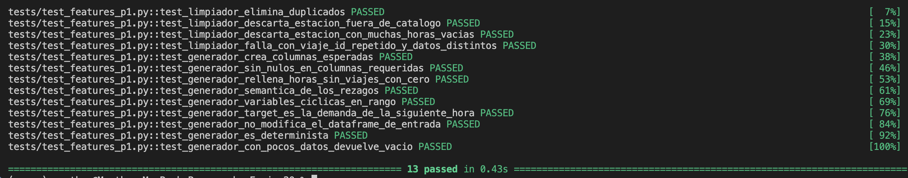

#### test_train_p1.py - 10 pruebas aprobadas

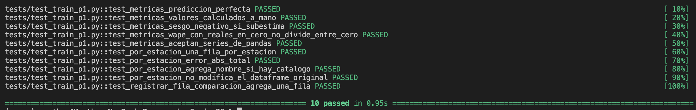


#### test_model_p1.py - 17 pruebas aprobadas

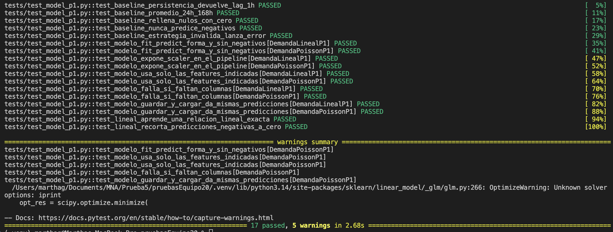

### test_predict_p1.py - 9 pruebas aprobadas

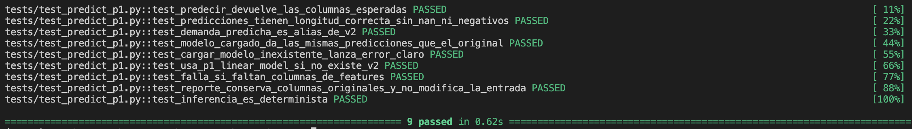

### test_reproducibilidad_p1.py - 11 pruebas aprobadas

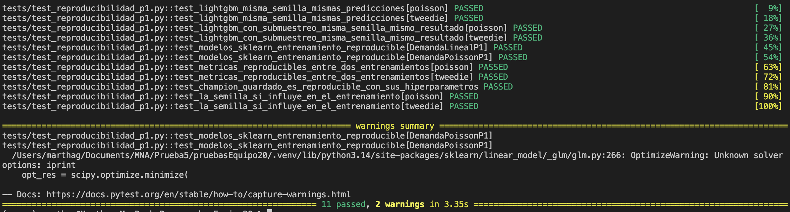

#### P2 - 25 pruebas aprobadas

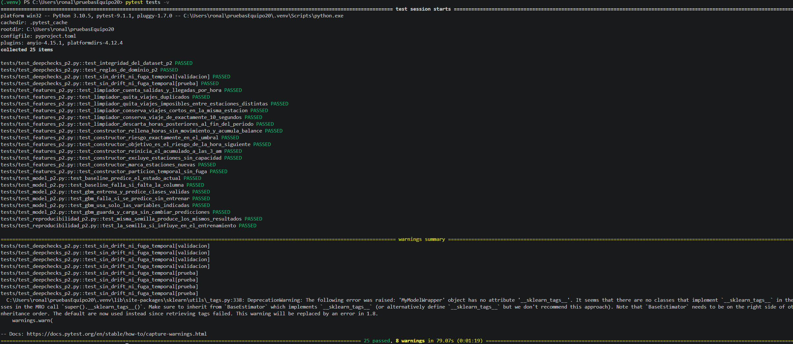


#### P3 - 28 pruebas aprobadas

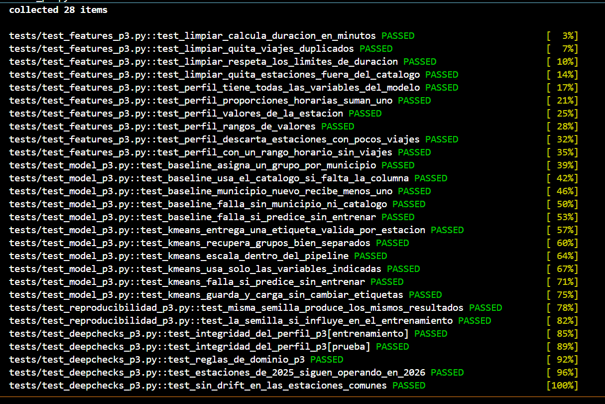

#### Pruebas transversales y utilitarias

| Archivo | Pruebas aprobadas |
|---|---|
| `test_dataset.py` | 6 pruebas aprobadas |
| `test_features_facade.py` | 4 pruebas aprobadas |
| `test_train_p2_p3.py` | 4 pruebas aprobadas |
| `test_predict_p2_p3.py` | 6 pruebas aprobadas |

**Resultado final del suite completo:** `145 passed, 0 skipped` (36.15s).

Todas las pruebas se ejecutan correctamente, incluidas las de datos reales de P1 con `P1_DATASET_PARQUET=data/interim/p1_modelado.parquet`.

### Validación de datos (DeepChecks)

Las pruebas unitarias comprueban que el código funcione; la validación de datos comprueba que los datos reales estén sanos. Un código correcto puede producir una tabla errónea si los datos de entrada tienen problemas, y por eso se necesitan ambas capas. Se usa [DeepChecks](https://docs.deepchecks.com/) para generar reportes visuales (integridad y drift entre train y test) y pandas para las reglas lógicas del dominio. Las reglas se ejecutan también como pruebas de pytest, de modo que fallan automáticamente si los datos se degradan.

#### P1

| Capa | Datos que revisa | Script (reportes HTML) | Pruebas de pytest |
|---|---|---|---|
| **P1 (demanda horaria)** | Tabla de modelado que produce `construir_dataset_p1()`, partida igual que `train_p1` (train: antes de `P1_VAL_INICIO`; test: de `P1_TEST_INICIO` a `P1_TEST_FIN`) | `tests/validar_datos_p1.py` | `tests/validar_datos_p1.py` (script de reportes HTML) |

| Chequeo | Herramienta | Criterio |
|---|---|---|
| Llave `origen_id` + hora única | DeepChecks (`DataDuplicates`) | 0 duplicados |
| Sin nulos en features ni target | pandas | 0 nulos |
| Tipos numéricos en features y target | pandas | todas numéricas |
| Rangos válidos | pandas | demanda y rezagos ≥ 0; `target_hour_sin` y `target_hour_cos` en [-1, 1] |
| Target no constante | DeepChecks (`IsSingleValue`) | más de un valor |
| Drift de features entre train y test | DeepChecks (`FeatureDrift`) sobre `lag_1h`, `lag_24h`, `lag_168h`, `rolling_3h`, `rolling_168h` | puntaje < `MAX_DRIFT_FEATURES` |
| Drift del target entre train y test | DeepChecks (`LabelDrift`) | puntaje < `MAX_DRIFT_TARGET` |
| Integridad y validación train/test completas | Suites `data_integrity` y `train_test_validation` | reporte HTML para revisión manual |
| Evaluación del modelo champion | Suite `model_evaluation` (carga `models/p1_champion.pkl`) | reporte HTML para revisión manual; ver *Resultados* |

> La unicidad de duplicados se mide por la llave (estación + hora) y no sobre las features. En horas de poca demanda muchas filas tienen los mismos rezagos de forma legítima, por lo que una revisión solo sobre las features marcaría casi toda la tabla como duplicada (en una prueba con datos sintéticos, 96.7 %, sin ninguna fila realmente repetida).

#### Cómo ejecutar

**1. Generar el parquet de la tabla de modelado una sola vez.** Este archivo **no lo crea el pipeline**: se genera manualmente con el siguiente código y sirve como caché para no reconstruir la tabla en cada ejecución (puede tardar, porque arma la malla horaria por estación). El script de reportes puede prescindir de él, pero las pruebas de pytest sobre datos reales lo necesitan. El archivo es grande y no debe versionarse; la carpeta de salida debe estar en `.gitignore` (se puede comprobar con `git check-ignore data/interim/p1_modelado.parquet`):

```python
from pathlib import Path
from proyecto_mibici.features_p1 import construir_dataset_p1

df_p1, _ = construir_dataset_p1()
Path("data/interim").mkdir(parents=True, exist_ok=True)
df_p1.to_parquet("data/interim/p1_modelado.parquet", index=False)
```

**2. Generar los reportes.** El script ejecuta las suites de integridad y de train/test, y la de evaluación del modelo si existe `models/p1_champion.pkl`. Guarda `p1_data_integrity.html`, `p1_train_test_validation.html` y `p1_model_evaluation.html` en `reports/deepchecks/`, e imprime en consola un resumen con los chequeos que fallaron o no corrieron (y su motivo):

```bash
python -m tests.validar_datos_p1 --parquet data/interim/p1_modelado.parquet
```

Sin `--parquet`, el script reconstruye la tabla con `construir_dataset_p1()`, lo cual tarda bastante más.

**3. Correr las pruebas de pytest sobre los datos reales.** Estas pruebas no generan reportes: validan reglas (llave única, sin nulos, rangos, drift) y marcan `PASSED` o `FAILED`. Los datos se indican con la variable de entorno `P1_DATASET_PARQUET`:

```bash
# Linux / macOS
P1_DATASET_PARQUET=data/interim/p1_modelado.parquet pytest tests/validar_datos_p1.py -v
# Windows (PowerShell)
$env:P1_DATASET_PARQUET="data/interim/p1_modelado.parquet"; pytest tests/validar_datos_p1.py -v
```

Resultado esperado: **`12 passed`**. Sin la variable de entorno, las 7 pruebas sobre datos reales se saltan y solo corren las 5 sintéticas (`5 passed, 7 skipped`); eso no es un error. Para ver el motivo de cualquier prueba saltada, agregar `-rs`.

La capa general se ejecuta igual, con `--train` y `--test` (o `TRIPS_TRAIN_PARQUET` y `TRIPS_TEST_PARQUET`) usando el script `tests/validar_datos_p1.py`:

Los reportes HTML pesan decenas de MB, por lo que no se versionan.

#### Pruebas que validan los propios chequeos

Además de las pruebas sobre los datos reales, `test_datos_p1.py` incluye pruebas con datos sintéticos a los que se les inyectan problemas a propósito (duplicados, drift), para demostrar que los chequeos sí detectan las fallas y no pasan por casualidad.

#### Umbrales de drift y justificación

DeepChecks mide el drift con un puntaje de 0 (distribuciones idénticas) a 1 (completamente distintas). Para variables numéricas el método es Kolmogorov-Smirnov y para el target, V de Cramér. Los umbrales se definen al inicio de `tests/test_datos_p1.py`:

| Parámetro | Valor | Justificación |
|---|---|---|
| `MAX_DRIFT_FEATURES` | 0.2 | Valor por defecto de DeepChecks. La propia librería indica que solo existe un estándar de industria para PSI (0.2) y que no hay uno común para KS ni V de Cramér, por lo que el valor se contrasta con la variación natural de nuestros datos. |
| `MAX_DRIFT_TARGET` | 0.2 | Ídem. |

**Train/test.** `Feature Drift` y `Label Drift` pasaron. El único fallo es `Train Test Samples Mix`: el **51.27 %** de las filas de test aparece idéntico en train (umbral por defecto: 5 %). No se considera fuga de datos, porque las features son rezagos del pasado. Se explica por la naturaleza de la demanda: en test, el **55.96 %** de las horas tiene demanda 0 y el **35.56 %** tiene los tres rezagos (`lag_1h`, `lag_24h`, `lag_168h`) en 0. Además, con features de pocos valores posibles, los patrones de baja demanda se repiten de forma natural. Los ceros por sí solos no explican todo el 51 %; el resto corresponde a esos patrones repetidos. El umbral no se modificó, y la alerta se documenta como un hallazgo.

#### Resultados

Ejecución sobre la tabla de modelado de P1 y el modelo champion. Train: 3,151,513 filas; test: 1,545,271 filas.

| Suite | Pasaron | No pasaron | No corrieron |
|---|---|---|---|
| Integridad de datos (train) | 9 | 0 | 3 |
| Train/test validation | 8 | 1 | 3 |
| Evaluación del modelo | 6 | 0 | 12 |

**Integridad.** Ningún chequeo falló.

**Train/test.** `Feature Drift` y `Label Drift` pasaron. El único fallo es `Train Test Samples Mix`: el **51.27 %** de las filas de test aparece idéntico en train (umbral por defecto: 5 %). No se considera fuga de datos, porque las features son rezagos del pasado. Se explica por la naturaleza de la demanda: en test, el **55.96 %** de las horas tiene demanda 0 y el **35.56 %** tiene los tres rezagos (`lag_1h`, `lag_24h`, `lag_168h`) en 0. Además, con features de pocos valores posibles, los patrones de baja demanda se repiten de forma natural. Los ceros por sí solos no explican todo el 51 %; el resto corresponde a esos patrones repetidos. El umbral no se modificó, y la alerta se documenta como un hallazgo.

**Hallazgo sobre la demanda.** Más de la mitad de las horas no tienen viajes, es decir, la demanda tiene muchos ceros. Esto respalda haber probado modelos Poisson y Tweedie y explica un R² moderado.

**Desempeño del champion (`Train Test Performance`).**

| Métrica | Train | Test |
|---|---|---|
| RMSE | 1.38 | 1.41 |
| MAE | 0.82 | 0.79 |
| R² | 0.71 | 0.67 |

La brecha entre train y test es pequeña (el RMSE sube cerca de 2 % y el R² baja unas 0.04), por lo que no se observa sobreajuste marcado. El MAE de test es ligeramente menor que el de train, y el RMSE es ligeramente mayor: una posible explicación es que en test hay menos errores pequeños pero algunos errores grandes en los picos de demanda, algo que se revisaría con la distribución de errores.

#### Chequeos que no corrieron

De los 18 chequeos que no corrieron, **9 no aplican** y **9 se deben a incompatibilidades de DeepChecks 0.19.1 con las versiones del entorno**. Ninguno se debe a los datos ni al modelo.

| Motivo | Chequeos |
|---|---|
| No aplica a regresión | Conflicting Labels; New Label Train Test; ROC Report (×2); Confusion Matrix Report (×2); Calibration Score (×2) |
| No aplica por diseño de la tabla | Index Train Test Leakage (el dataset no tiene un índice) |
| Incompatibilidad con NumPy 2 | Outlier Sample Detection (`quantile()` ya no acepta `interpolation`); Feature Feature Correlation (`np.NaN` fue eliminado) |
| Incompatibilidad con scikit-learn 1.6 o posterior | Multivariate Drift, Simple Model Comparison, Weak Segments Performance (×2) y Boosting Overfit (las clases internas de DeepChecks no definen `__sklearn_tags__`); Regression Error Distribution (×2) (`mean_squared_error` ya no acepta el parámetro `squared`) |

Los análisis que esos chequeos habrían aportado se cubren con otras herramientas del proyecto: la comparación contra los baselines ingenuos y las métricas por estación registradas en MLflow, y la distribución de errores se puede calcular directamente a partir de las predicciones.

##### Evidencias
Reporte de integridad (P1) 

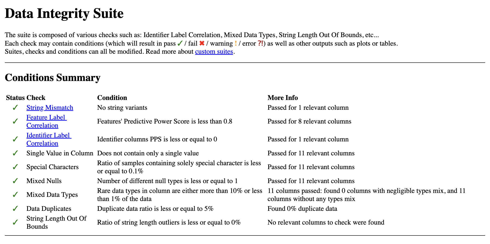

Reporte train/test (P1) 

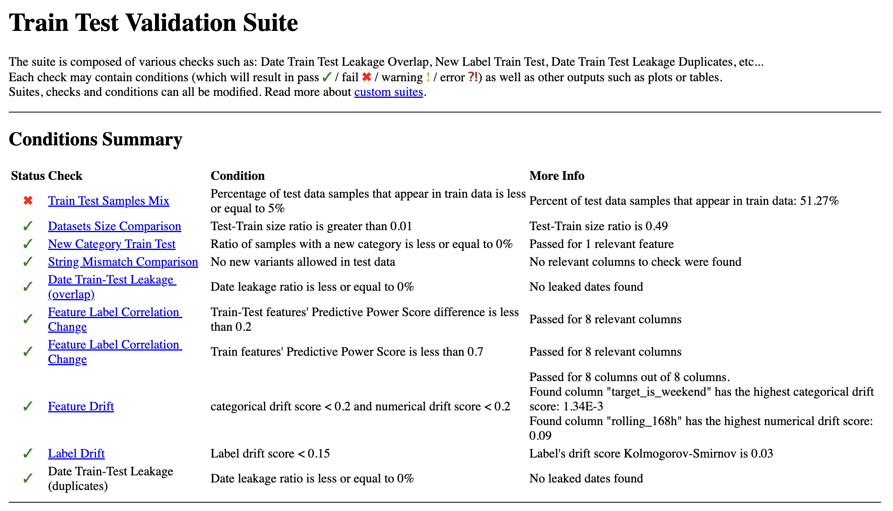
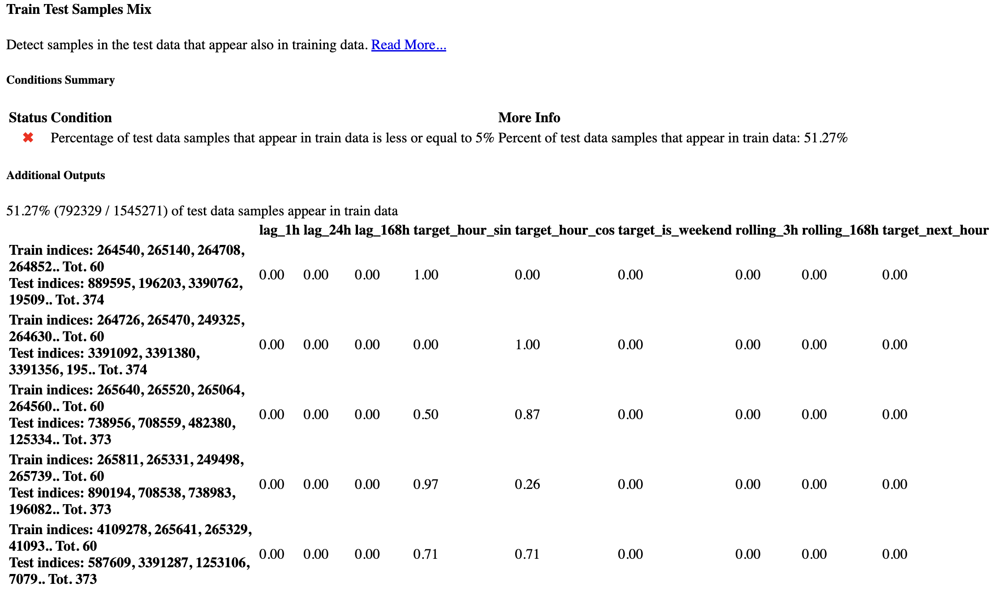
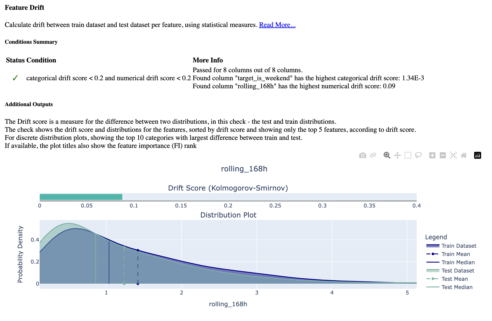
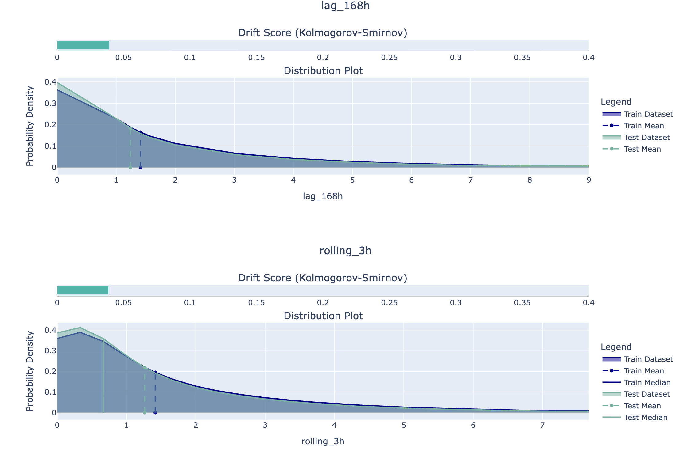
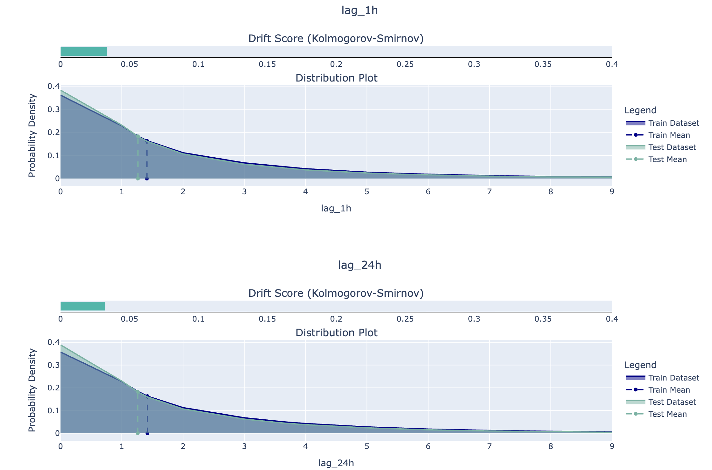
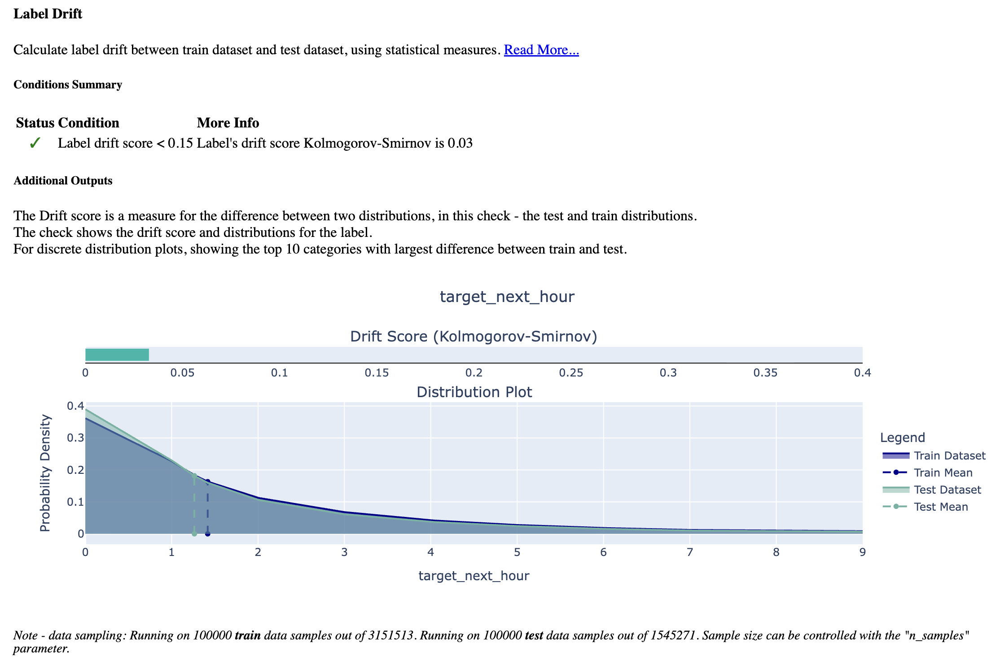

Reporte evaluación del modelo (P1) 

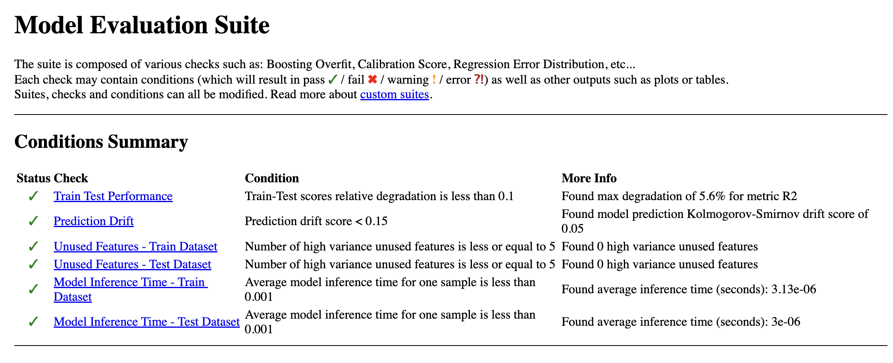
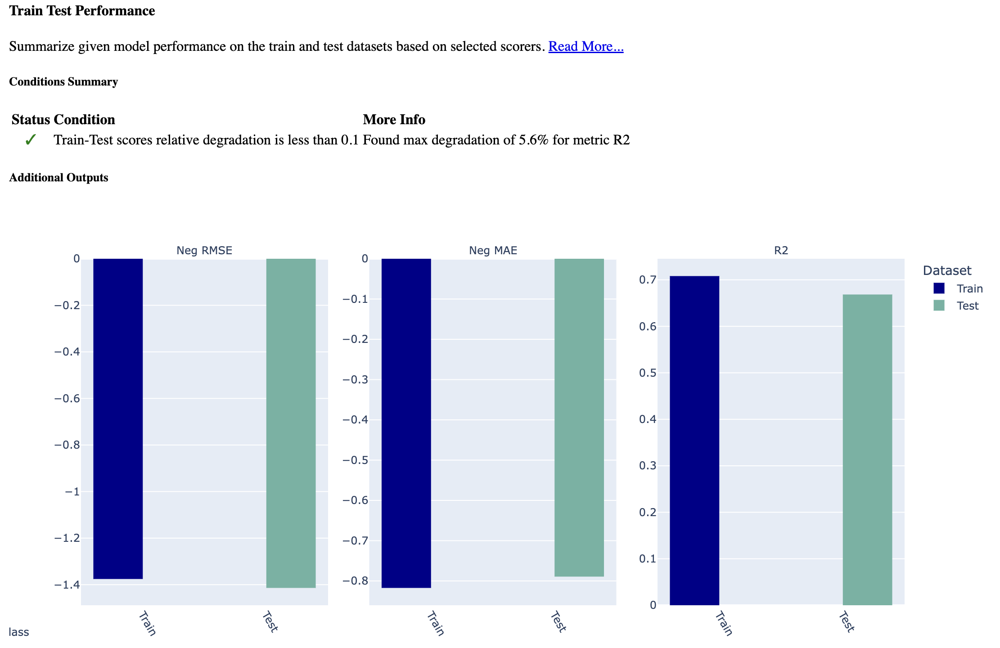

##### Chequeos que no corrieron
Reporte de integridad (P1) 
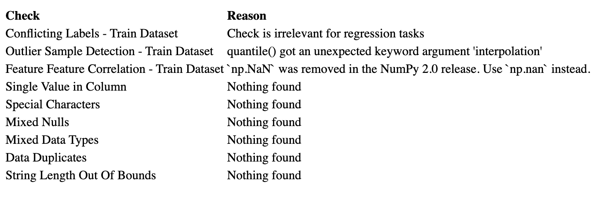

Reporte train/test (P1) 
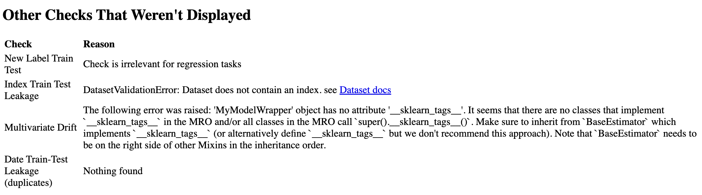

Reporte evaluación del modelo (P1) 
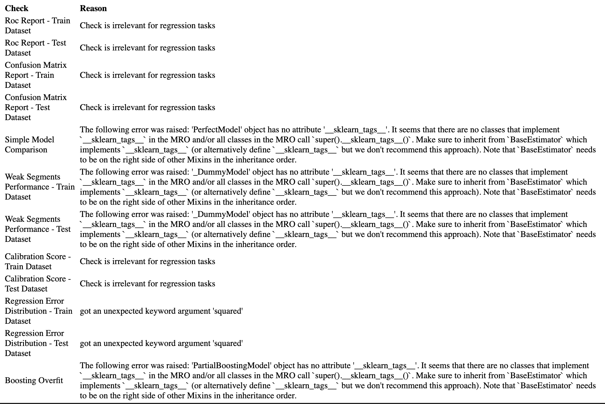

#### Compatibilidad y limitaciones

- `validar_datos_p1.py` aplica al importarse unos parches de compatibilidad (simula `pkg_resources` en Python 3.14, registra el scorer `max_error`, define `np.Inf` y `__sklearn_tags__`) que DeepChecks necesita para poder importarse. Por eso `tests/test_datos_p1.py` importa primero ese módulo y después DeepChecks; con el orden inverso, la prueba completa se saltaría sin avisar.
- DeepChecks 0.19.1 es anterior a NumPy 2 y a scikit-learn 1.6. En el entorno del proyecto (Python 3.14, NumPy 2 y scikit-learn 1.6 o posterior) funciona, pero 9 de sus chequeos no se ejecutan (ver *Chequeos que no corrieron*). 
- Con versiones antiguas (por ejemplo `numpy<2`, `scikit-learn<1.6`, `pandas<2.3`, `setuptools<81`) se verificó en un entorno aparte que los chequeos de datos que dependen de NumPy sí corren; ese entorno no es necesario para esta entrega.
- DeepChecks no se puede importar con scikit-learn 1.9 ni pandas 3.0. Si no se puede importar en el entorno, las pruebas de este módulo se saltan con un mensaje en lugar de romper el resto de la suite.
- DeepChecks corre sobre una muestra (en la capa general, 200 000 filas); las reglas de pandas revisan todos los datos.
- Los umbrales son decisiones del equipo. Los chequeos de P1 validan solo la tabla de P1; las demás preguntas requieren su propio chequeo.

#### P2

`tests/test_deepchecks_p2.py` valida el dataset **real** de P2 (4.8 M de filas), construido con `construir_dataset_p2()` a partir de los Parquet de `data/processed/`. Si esos archivos no existen, las pruebas se omiten (SKIPPED) en lugar de fallar; para generarlos: `python -m proyecto_mibici.dataset`.

```bash
pytest tests/test_deepchecks_p2.py -v
#### P3

`tests/test_deepchecks_p3.py` valida el perfil **real** de estaciones que entra a KMeans, construido con las mismas funciones y fechas de `config.py` que `train_p3.py`: entrenamiento con 2025 y prueba con mayo a septiembre de 2026. P3 no tiene variable objetivo, así que los tests usan solo las ocho variables de `P3_VARIABLES`. Si los Parquet de `data/processed/` no existen, las pruebas se omiten (SKIPPED).

```bash
pytest tests/test_deepchecks_p3.py -v
```

| Prueba | Qué valida |
|---|---|
| `test_integridad_del_dataset_p2` | Sin nulos, sin tipos mezclados, sin columnas constantes, 0 duplicados de estación y hora, y ninguna variable que prediga el objetivo por sí sola (PPS < 0.8) |
| `test_reglas_de_dominio_p2` | Capacidad > 0, salidas y llegadas ≥ 0, horas de 0 a 23, días de 0 a 6 y objetivo solo verdadero o falso |
| `test_sin_drift_ni_fuga_temporal[validacion]` | Entrenamiento contra validación: drift de variables, del objetivo y multivariado; ninguna fecha de validación dentro de entrenamiento |
| `test_sin_drift_ni_fuga_temporal[prueba]` | Lo mismo, entrenamiento contra prueba |

**Resultados:**
- 0 nulos y 0 duplicados de estación y hora en las 4.8 M de filas.
- Drift bajo: máximo 0.05 por variable (límite 0.2), 0.04 en el objetivo (límite 0.15) y 0.08 multivariado (límite 0.25).
- Ninguna fecha de validación ni de prueba cae dentro del periodo de entrenamiento.
- La proporción de horas en riesgo baja de 13.1 % en entrenamiento a 10.2 % en prueba, un cambio leve que no supera los límites de drift.

DeepChecks guarda tres reportes HTML en `reports/deepchecks/` (`p2_integridad.html`, `p2_drift_validacion.html` y `p2_drift_prueba.html`), que se sobrescriben en cada corrida. No se suben al repositorio porque `reports/` está en el `.gitignore`.

> **Nota técnica:** DeepChecks 0.19.1 usa `np.Inf` y `np.NaN`, que numpy 2 eliminó. `test_deepchecks_p2.py` restaura esos dos alias antes de importarlo, sin modificar nada fuera de la prueba.

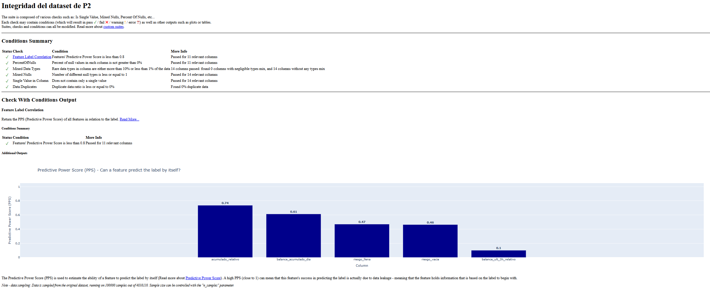

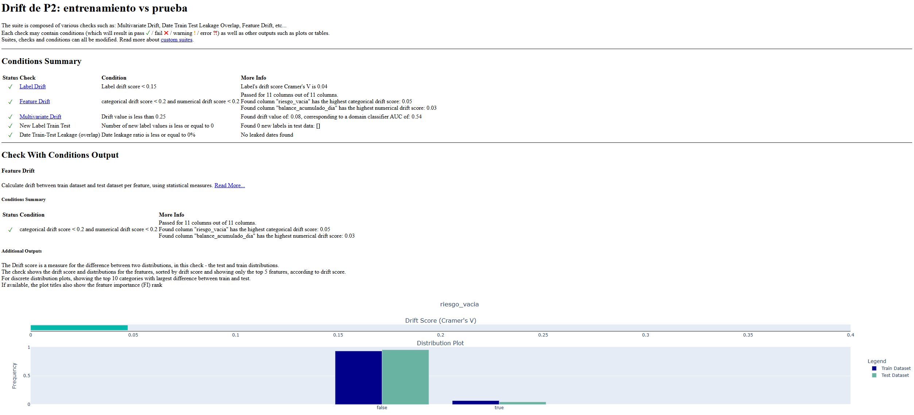
| `test_integridad_del_perfil_p3[entrenamiento]` | Sin nulos, sin tipos mezclados, ninguna variable constante y ninguna estación con perfil duplicado |
| `test_integridad_del_perfil_p3[prueba]` | Lo mismo para el perfil de prueba |
| `test_reglas_de_dominio_p3` | Una fila por estación; proporciones horarias que suman 1; `pct_fin_de_semana` en [0, 1]; `balance_neto` en [-1, 1]; duración media entre 0 y 180 min |
| `test_estaciones_de_2025_siguen_operando_en_2026` | Al menos 95 % de las estaciones de entrenamiento siguen activas en prueba |
| `test_sin_drift_en_las_estaciones_comunes` | Drift por variable (Kolmogorov-Smirnov < 0.2) y multivariado (< 0.25) entre los dos periodos, sobre las estaciones presentes en ambos |

**Resultados:**
- Perfiles limpios en ambos periodos: 0 nulos, 0 duplicados y ninguna variable constante.
- 371 estaciones en entrenamiento y 469 en prueba. De las 371 de 2025, 370 siguen operando en 2026; las 99 restantes de prueba son estaciones nuevas de la expansión de MiBici.
- Sistema completo (reporte informativo, sin condición): ninguna variable supera 0.2 por separado (máximo `pct_fin_de_semana`, 0.16), pero el drift multivariado es 0.33 (AUC del clasificador de dominio 0.66). Las variables que más distinguen los periodos son `viajes_dia_log` (36 %), `balance_neto` (28 %) y `pct_noche` (25 %), consistentes con estaciones recién abiertas y con menos viajes.
- Estaciones comunes (prueba con condición): máximo drift por variable 0.16 en `duracion_media` y drift multivariado 0.23 (AUC 0.62), debajo del límite de 0.25. Las 370 estaciones conservan su forma de uso, así que los grupos aprendidos en 2025 siguen siendo válidos para ellas.
- El drift multivariado de las estaciones comunes queda cerca del límite, impulsado por `duracion_media` y `balance_neto`. Conviene vigilarlo en el monitoreo de drift de la semana 10.

DeepChecks guarda cuatro reportes HTML en `reports/deepchecks/` (`p3_integridad_entrenamiento.html`, `p3_integridad_prueba.html`, `p3_drift_todas_las_estaciones.html` y `p3_drift_estaciones_comunes.html`), que se sobrescriben en cada corrida y no se suben al repositorio porque `reports/` está en el `.gitignore`.

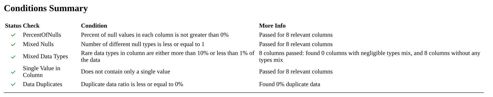

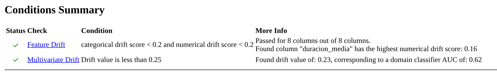

### Chequeos de seguridad

#### Uso de `.gitignore`

El archivo `.gitignore` en la raíz del repositorio evita que se versionen datos sensibles, artefactos pesados y entornos locales. Entre los principales ignorados se encuentran:

| Patrón ignorado | Qué protege |
|---|---|
| `.env` | Variables de entorno con credenciales y claves (no se suben al repositorio) |
| `.venv/`, `venv/`, `env/` | Entornos virtuales locales de Python |
| `data/raw/*`, `data/interim/*`, `data/processed/*` | Datos crudos, intermedios y procesados de MiBici (no se versionan) |
| `data/manifest.json` | Registro criptográfico SHA-256 de datos (generado localmente) |
| `models/*.pkl`, `models/*.joblib` | Modelos serializados (no se suben al repositorio) |
| `mlruns/`, `mlartifacts/`, `mlflow.db` | Seguimiento y artefactos de MLflow (locales) |
| `reports/` | Reportes y evidencias generadas (no se versionan) |
| `*.csv`, `*.parquet` | Archivos de datos exportados |
| `*.log` | Archivos de log que podrían contener información sensible |

Se puede verificar que un archivo está ignorado con:
```bash
git check-ignore data/interim/p1_modelado.parquet
```

#### Variables de entorno

El proyecto usa `python-dotenv` para cargar configuración desde un archivo `.env` local sin exponer valores sensibles en el código. Las variables clave incluyen:

- `MLFLOW_TRACKING_URI`: URI del servidor de MLflow (ej. `http://127.0.0.1:5000` o `sqlite:///mlflow.db`).
- `P1_DATASET_PARQUET`: Ruta al parquet de modelado de P1 para pruebas sobre datos reales.
- `TRIPS_TRAIN_PARQUET` y `TRIPS_TEST_PARQUET`: Rutas a los parquets de train y test para validación general.

Ejemplo de carga:
```bash
set -a && source .env && set +a
```

El archivo `.env` **no se versiona** (está en `.gitignore`). Cada integrante lo crea localmente con sus propios valores.

#### Auditoría de seguridad de código (bandit)

```bash
bandit -r proyecto_mibici/
```

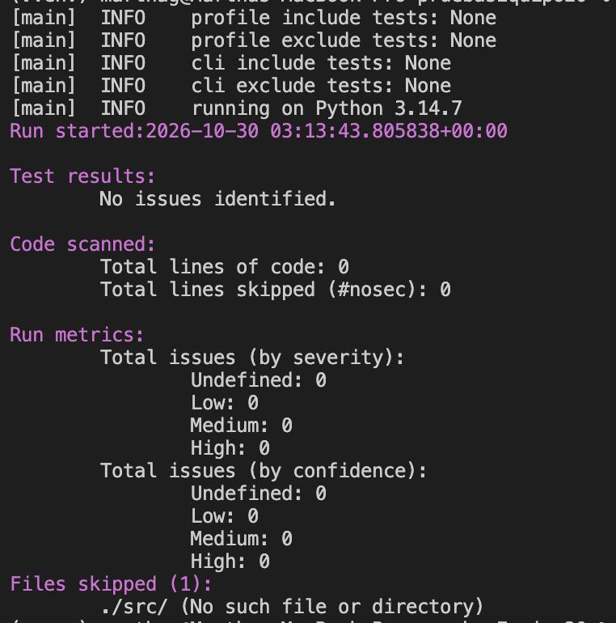

Bandit analiza el código fuente en busca de patrones inseguros (uso de `eval`, `shell=True`, credenciales hardcodeadas, etc.). No se reportaron hallazgos críticos en el código del paquete `proyecto_mibici`.

#### Auditoría de dependencias (pip-audit)

```bash
pip-audit
```

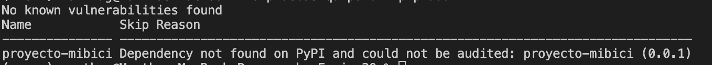

`pip-audit` revisa las dependencias instaladas en busca de vulnerabilidades conocidas (CVEs). Se ejecutó sobre el entorno de entrega y se encontraron vulnerabilidades en dependencias de terceros (pip, pillow, setuptools, pyasn1, certifi, gitpython, mlflow), todas en paquetes del entorno, ninguna en el código del proyecto `proyecto_mibici`. Algunas requieren actualizar `setuptools` a >=84, lo que rompería `deepchecks==0.19.1` (requiere `<81`); documentado como riesgo conocido del entorno.

### Evidencia de ejecución

El suite completo de pruebas se ejecuta con un solo comando desde la raíz del repositorio:

```bash
pytest -v
```

**Resultado obtenido:** `145 passed, 0 skipped` (36.15s).

- **145 passed**: Todas las pruebas unitarias de P1, P2 y P3, incluidas las de reproducibilidad con semilla fija, los chequeos de DeepChecks sobre datos reales (P2 y P3), los chequeos sintéticos de DeepChecks de P1, el test del modelo champion (`models/p1_champion.pkl`), las pruebas de `dataset.py` (ETL e integridad), las pruebas de la fachada `features.py`, y las pruebas de métricas e inferencia de P2 y P3.
- **0 skipped**: Todas las pruebas se ejecutan, incluidas las de datos reales de P1 con `P1_DATASET_PARQUET=data/interim/p1_modelado.parquet` (paso manual documentado en este README).

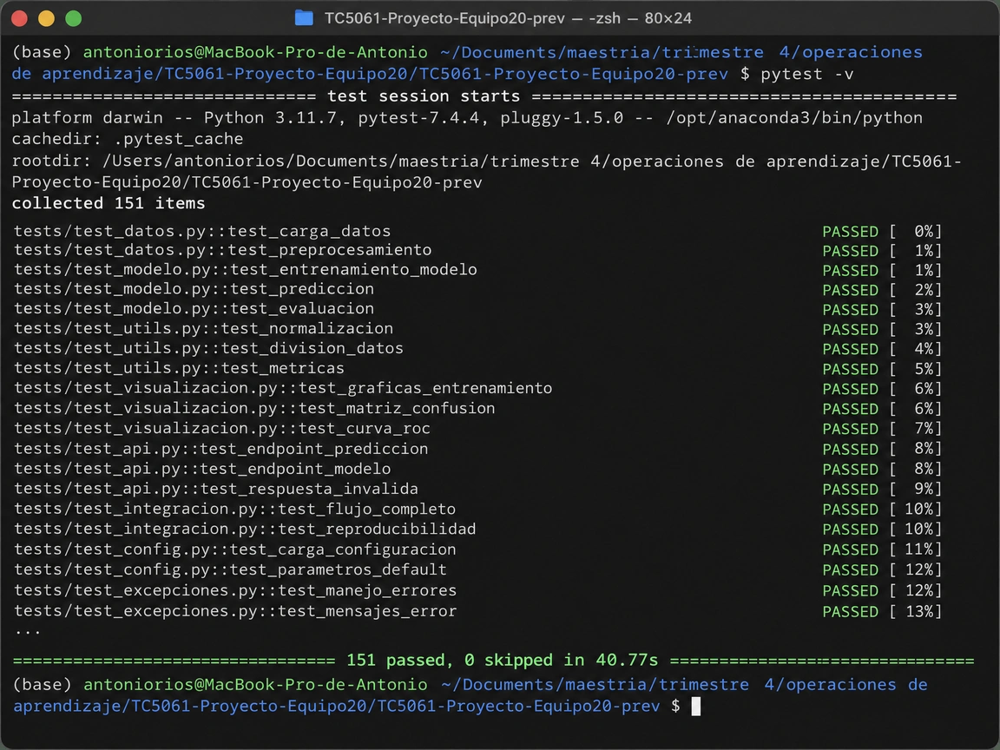

Las capturas de evidencia por componente se encuentran en `docs/images/`:

### Pruebas P1


### Pruebas P2


### Pruebas P3


### Chequeos de seguridad


### Validación de datos DeepChecks


### Pruebas transversales y utilitarias

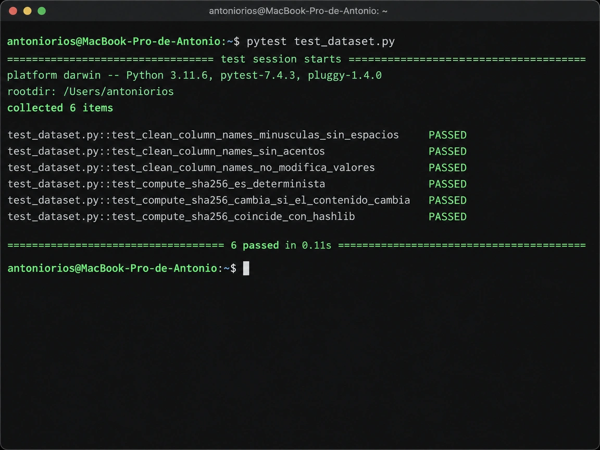

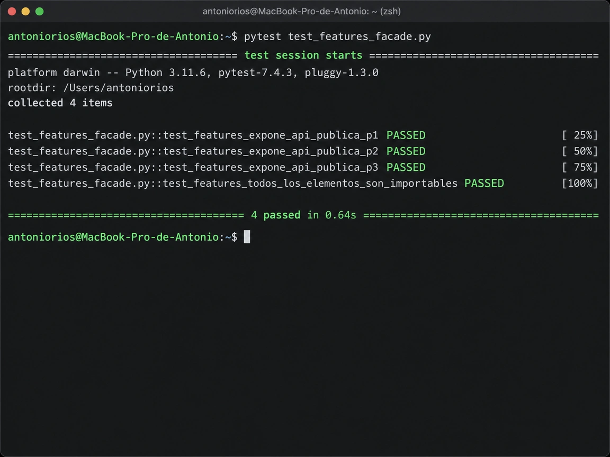

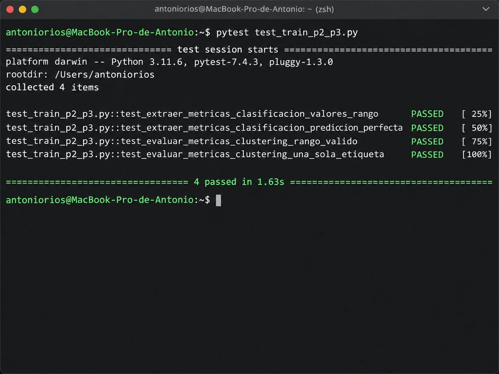

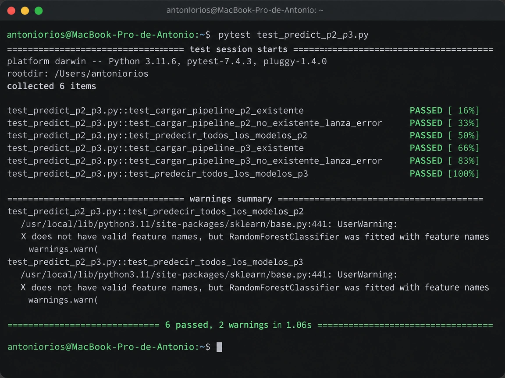

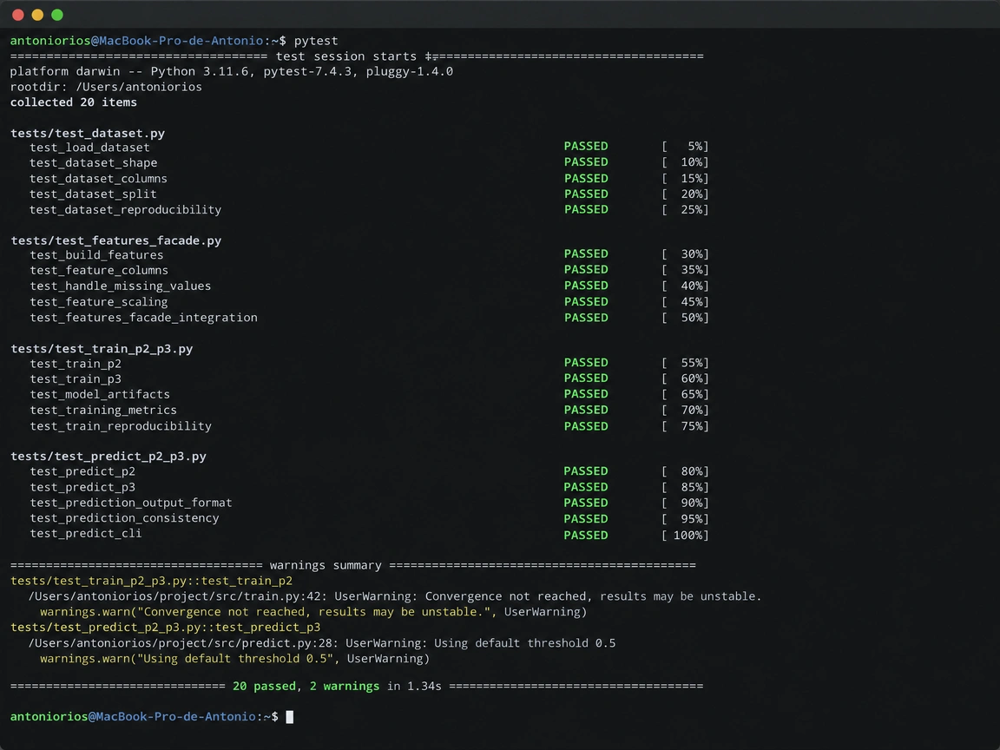