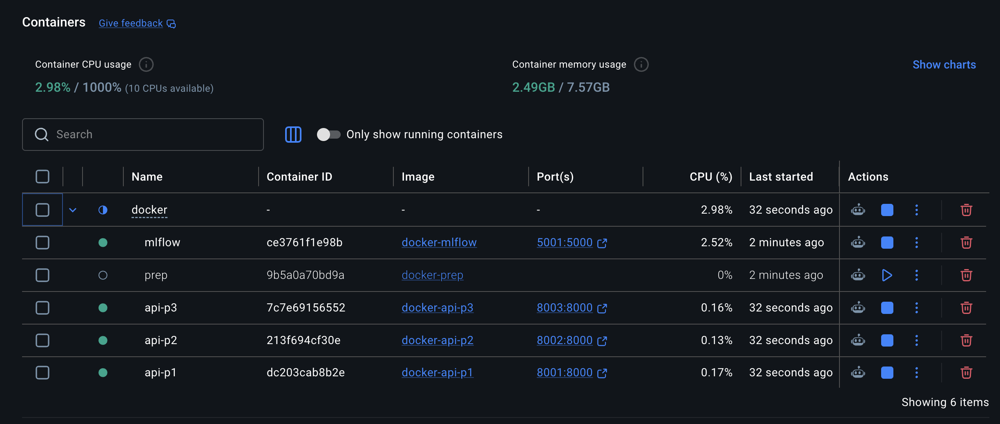
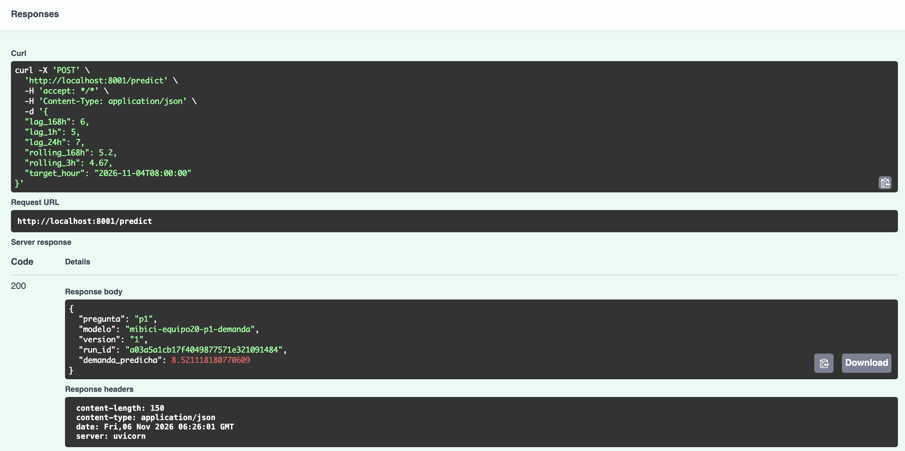
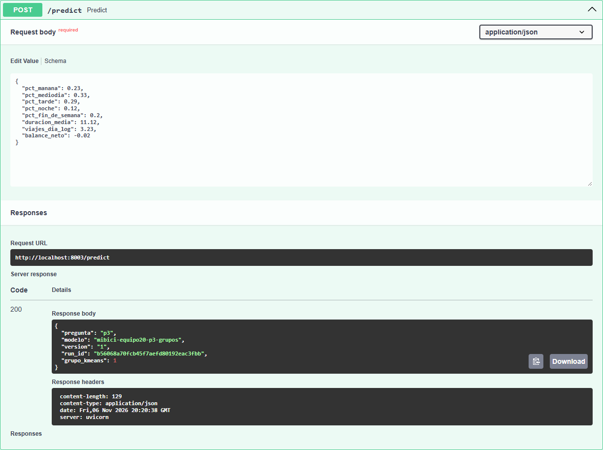

# Documentación de Contenedores — TC5061 Proyecto MiBici (Equipo 20)

Despliegue con **Docker Compose** de la API REST de predicción MiBici con **FastAPI** como servidor de aplicaciones y **MLflow** como servidor de tracking y Model Registry, y **3 contenedores de API** (uno por pregunta: P1, P2, P3).

---

## 1. Arquitectura y puertos

| Servicio | Contenedor | Puerto host | Puerto interno | Descripción |
|----------|-----------|-------------|----------------|-------------|
| **mlflow** | `mlflow` | `5001` | `5000` | Servidor de tracking + Model Registry |
| **prep** | `prep` | — | — | Job: ingesta → entrenamientos P1/P2/P3 → registro de campeones |
| **api-p1** | `api-p1` | `8001` | `8000` | API P1: demanda horaria (regresión) — FastAPI + uvicorn |
| **api-p2** | `api-p2` | `8002` | `8000` | API P2: riesgo de desbalance (clasificación) — FastAPI + uvicorn |
| **api-p3** | `api-p3` | `8003` | `8000` | API P3: clustering de estaciones (no supervisado) — FastAPI + uvicorn |

Toda la comunicación entre contenedores usa la red interna `mibici-net`.  
Desde tu máquina (host), accedes a MLflow por `http://localhost:5001` y a cada API por su puerto correspondiente.

> El puerto `5000` de tu host puede estar ocupado por macOS (Control Center). Por eso MLflow se mapea a `5001:5000`.

---

## 1.1 Detalle de cada contenedor

### mlflow — Servidor de tracking y Model Registry

| Aspecto | Detalle |
|---------|---------|
| **Qué es** | Servidor MLflow que expone la API de tracking y el Model Registry. |
| **Qué hace** | Recibe runs de entrenamiento (parámetros, métricas, tags, artefactos), almacena los modelos registrados y los pone a disposición de las APIs a través del alias `@champion`. |
| **Cómo lo hace** | Ejecuta `mlflow server --backend-store-uri sqlite:///mlflow.db --default-artifact-root ./mlruns --host 0.0.0.0 --port 5000 --serve-artifacts`. Los artefactos (modelos `.pkl`) se guardan en el volumen compartido `mlruns`. El healthcheck consulta `http://localhost:5000`. |

### prep — Job de entrenamiento y registro de campeones

| Aspecto | Detalle |
|---------|---------|
| **Qué es** | Contenedor de un solo uso (job) que ejecuta todo el flujo de entrenamiento. |
| **Qué hace** | 1) Espera a que MLflow esté disponible. 2) Ejecuta `proyecto_mibici.dataset` para descargar y procesar datos de MiBici. 3) Entrena los 3 modelos (P1, P2, P3). 4) Registra los campeones en el Model Registry con alias `@champion` mediante `run_mejor_modelo.py`. |
| **Cómo lo hace** | Su `entrypoint.sh` ejecuta secuencialmente: `python -m proyecto_mibici.dataset` → `train_p1.py` → `train_p2.py` → `train_p3.py` → `run_mejor_modelo.py`. Termina con código 0 cuando finaliza. Las APIs dependen de que este contenedor termine con éxito (`service_completed_successfully`). |

### api-p1 — API de demanda horaria (P1)

| Aspecto | Detalle |
|---------|---------|
| **Qué es** | API REST con FastAPI para predicción de demanda horaria de bicicletas. |
| **Qué hace** | Expone `GET /health` (verifica que el modelo esté cargado) y `POST /predict` (recibe features de entrada y devuelve la demanda predicha). |
| **Cómo lo hace** | En cada petición, descarga el modelo desde MLflow Model Registry usando `mlflow.artifacts.download_artifacts()` + `joblib.load()`, ejecuta `modelo.predict(df)` con los datos de entrada y devuelve el resultado en JSON. Se sirve con `uvicorn app:app --host 0.0.0.0 --port 8000`. Variables de entorno: `PREGUNTA=p1`, `MODELO_REGISTRY=mibici-equipo20-p1-demanda@champion`, `MLFLOW_TRACKING_URI=http://mlflow:5000`. |

### api-p2 — API de riesgo de desbalance (P2)

| Aspecto | Detalle |
|---------|---------|
| **Qué es** | API REST con FastAPI para predicción de riesgo de desbalance de estaciones. |
| **Qué hace** | Expone `GET /health` y `POST /predict`. Devuelve probabilidad de riesgo y clasificación binaria (0/1). |
| **Cómo lo hace** | Igual que api-p1: descarga el modelo desde MLflow en cada petición, ejecuta `modelo.predict(df)` y `modelo.predict_proba(df)[:, 1]`, y devuelve `prob_riesgo` y `pred_riesgo`. Se sirve con `uvicorn app:app`. Variables de entorno: `PREGUNTA=p2`, `MODELO_REGISTRY=mibici-equipo20-p2-riesgo@champion`, `MLFLOW_TRACKING_URI=http://mlflow:5000`. |

### api-p3 — API de clustering de estaciones (P3)

| Aspecto | Detalle |
|---------|---------|
| **Qué es** | API REST con FastAPI para clustering funcional de estaciones. |
| **Qué hace** | Expone `GET /health` y `POST /predict`. Devuelve el número de grupo (cluster) al que pertenece una estación. |
| **Cómo lo hace** | Igual que las demás APIs: descarga el modelo KMeans desde MLflow en cada petición, ejecuta `modelo.predict(df)` y devuelve `grupo_kmeans`. Se sirve con `uvicorn app:app`. Variables de entorno: `PREGUNTA=p3`, `MODELO_REGISTRY=mibici-equipo20-p3-grupos@champion`, `MLFLOW_TRACKING_URI=http://mlflow:5000`. |

---


## 2. Requisitos previos

- **Docker** instalado (versión 20.10+)
- **Docker Compose** (v2)
- Puerto **5001** libre en tu host (para MLflow)
- Puertos **8001, 8002, 8003** libres en tu host (para las APIs)

---

## 3. Comandos de Docker Compose

Ejecutar siempre desde la **raíz del repositorio**.

### 3.1 Construir todas las imágenes

```bash
docker compose -f docker/docker-compose.yml build
```

Esto construye 5 servicios: `mlflow`, `prep`, `api-p1`, `api-p2` y `api-p3`. 

Las tres APIs comparten la misma imagen (`docker/api/Containerfile`) y se diferencian por la variable
`PREGUNTA`. El equivalente para construir solo la imagen de la API, desde la raíz del
repositorio, es:

```bash
docker build -f docker/api/Containerfile -t mibici-api .
```

### 3.2 Levantar todo el flujo

```bash
docker compose -f docker/docker-compose.yml up -d
```

Secuencia automática:
1. `mlflow` se levanta y pasa el healthcheck.
2. `prep` espera a MLflow, ejecuta **ingesta → entrenamiento P1/P2/P3 → registro de campeones** en MLflow, y termina.
3. `api-p1`, `api-p2`, `api-p3` esperan a que `prep` termine (`service_completed_successfully`) y cargan los campeones del Model Registry.

#### Contenedores en ejecución


### 3.3 Ver estado de los contenedores

```bash
docker compose -f docker/docker-compose.yml ps
```

Ejemplo esperado:

```
NAME         STATUS
mlflow       Up (healthy)
prep         Exited (0)
api-p1       Up
api-p2       Up
api-p3       Up
```

### 3.4 Ver logs

```bash
# Todos los servicios
docker compose -f docker/docker-compose.yml logs

# Un servicio específico
docker compose -f docker/docker-compose.yml logs mlflow
docker compose -f docker/docker-compose.yml logs prep
docker compose -f docker/docker-compose.yml logs api-p1
docker compose -f docker/docker-compose.yml logs api-p2
docker compose -f docker/docker-compose.yml logs api-p3
```

### 3.5 Detener y eliminar

```bash
# Detener contenedores (mantiene volúmenes e imágenes)
docker compose -f docker/docker-compose.yml down

# Detener y eliminar también los volúmenes nombrados (borra datos de MLflow)
docker compose -f docker/docker-compose.yml down -v
```

### 3.6 Reconstruir desde cero

Si hiciste cambios en el código de la API (por ejemplo, en `docker/api/model_loader.py`) y Docker los sirve desde caché, fuerza una reconstrucción sin caché:

```bash
docker compose -f docker/docker-compose.yml down -v
docker compose -f docker/docker-compose.yml build --no-cache api-p1 api-p2 api-p3
docker compose -f docker/docker-compose.yml up -d
```

---

## 4. Endpoints de las APIs

Todas las APIs están construidas con **FastAPI** y exponen los mismos endpoints:

| Método | Endpoint | Descripción |
|--------|----------|-------------|
| `GET` | `/docs` | Documentación interactiva (Swagger UI) con el esquema de entrada y salida de la pregunta de ese contenedor |
| `POST` | `/predict` | Recibe JSON con features, devuelve predicción |

El modelo se carga **en cada petición** desde el Model Registry de MLflow (descarga del artefacto + `joblib.load`), no va empaquetado en la imagen.

**Validación de entradas y salidas.** `POST /predict` valida el cuerpo con modelos Pydantic
(`docker/api/schemas.py`) **antes** de consultar MLflow. Si la entrada no cumple el esquema,
responde `422 Unprocessable Entity` indicando el campo y el motivo en `detail`. La respuesta
también se valida contra el esquema de salida de la pregunta.

---

### 4.1 API P1 — Demanda horaria (puerto 8001)

Modelo: `mibici-equipo20-p1-demanda@champion` (LightGBM Tweedie). Predice la demanda de
viajes de la **hora siguiente** para una estación.

**Health:**
```bash
curl http://localhost:8001/health
```

**Parámetros de entrada (`POST /predict`):**

| Parámetro | Tipo | Restricción | Descripción | Ejemplo |
|-----------|------|-------------|-------------|---------|
| `target_hour` | datetime ISO 8601 | sin zona horaria | Hora a predecir (hora local) | `"2026-11-04T08:00:00"` |
| `lag_1h` | int | ≥ 0 | Demanda de la última hora observada | `5` |
| `lag_24h` | float | ≥ 0, finito | Demanda 24 h antes de la hora objetivo | `7.0` |
| `lag_168h` | float | ≥ 0, finito | Demanda 168 h (una semana) antes de la hora objetivo | `6.0` |
| `rolling_3h` | float | ≥ 0, finito | Media de la demanda de las últimas 3 horas | `4.67` |
| `rolling_168h` | float | ≥ 0, finito | Media de la demanda de las últimas 168 horas | `5.2` |

El modelo usa 8 variables. Las 3 restantes (`target_hour_sin`, `target_hour_cos` y
`target_is_weekend`) **no se envían**: la API las calcula a partir de `target_hour`. Así el
cliente no puede mandar valores de calendario incoherentes entre sí. Los campos que no
pertenecen al esquema se rechazan.

**Ejemplo de predicción P1:**
```bash
curl -X POST http://localhost:8001/predict \
  -H "Content-Type: application/json" \
  -d '{
    "target_hour": "2026-11-04T08:00:00",
    "lag_1h": 5,
    "lag_24h": 7.0,
    "lag_168h": 6.0,
    "rolling_3h": 4.67,
    "rolling_168h": 5.2
  }'
```

**Respuesta (200):**
```json
{
  "pregunta": "p1",
  "modelo": "mibici-equipo20-p1-demanda",
  "version": "1",
  "run_id": "9a8af9367f7b4422bb215723181a3eed",
  "demanda_predicha": 8.521118180773497
}
```

`demanda_predicha` es el número esperado de viajes (≥ 0) en la hora objetivo.

---

### 4.2 API P2 — Riesgo de desbalance (puerto 8002)

Modelo: `mibici-equipo20-p2-riesgo@champion` (HistGradientBoostingClassifier)

**Health:**
```bash
curl http://localhost:8002/health
```

**Parámetros de entrada (`POST /predict`):**

| Parámetro | Tipo | Rango | Descripción | Ejemplo |
|-----------|------|-------|-------------|---------|
| `hora_del_dia` | int | 0–23 | Hora del día | `14` |
| `dia_semana` | int | 0–6 | Día de la semana | `2` |
| `fin_de_semana` | int | 0/1 | 1 si es fin de semana | `0` |
| `capacidad` | float | > 0 | Capacidad de la estación | `30` |
| `salidas` | float | ≥ 0 | Salidas acumuladas | `45` |
| `llegadas` | float | ≥ 0 | Llegadas acumuladas | `40` |
| `balance_acumulado_dia` | float | — | Balance acumulado del día | `5` |
| `acumulado_relativo` | float | — | Acumulado relativo | `0.2` |
| `balance_ult_3h_relativo` | float | — | Balance últimas 3h relativo | `0.1` |
| `riesgo_vacia` | int | 0/1 | Riesgo de vacía | `0` |
| `riesgo_llena` | int | 0/1 | Riesgo de llena | `0` |

**Ejemplo de predicción P2:**
```bash
curl -X POST http://localhost:8002/predict \
  -H "Content-Type: application/json" \
  -d '{
    "hora_del_dia": 14,
    "dia_semana": 2,
    "fin_de_semana": 0,
    "capacidad": 30,
    "salidas": 45,
    "llegadas": 40,
    "balance_acumulado_dia": 5,
    "acumulado_relativo": 0.2,
    "balance_ult_3h_relativo": 0.1,
    "riesgo_vacia": 0,
    "riesgo_llena": 0
  }'
```

**Respuesta esperada:**
```json
{
  "pregunta": "p2",
  "modelo": "mibici-equipo20-p2-riesgo",
  "version": "1",
  "run_id": "...",
  "prob_riesgo": 0.0526,
  "pred_riesgo": 0
}
```

---

### 4.3 API P3 — Clustering de estaciones (puerto 8003)

Modelo: `mibici-equipo20-p3-grupos@champion` (Pipeline de sklearn: StandardScaler + KMeans K=4).
Asigna a una estación uno de los cuatro grupos funcionales según su perfil de uso.

**Health:**
```bash
curl http://localhost:8003/health
```

**Parámetros de entrada (`POST /predict`):**

| Parámetro | Tipo | Restricción | Descripción | Ejemplo |
|-----------|------|-------------|-------------|---------|
| `pct_manana` | float | 0–1, finito | Fracción de salidas entre 6 y 10 h | `0.23` |
| `pct_mediodia` | float | 0–1, finito | Fracción de salidas entre 10 y 16 h | `0.33` |
| `pct_tarde` | float | 0–1, finito | Fracción de salidas entre 16 y 20 h | `0.29` |
| `pct_noche` | float | 0–1, finito | Fracción de salidas entre 20 y 24 h | `0.12` |
| `pct_fin_de_semana` | float | 0–1, finito | Fracción de salidas en sábado o domingo | `0.20` |
| `duracion_media` | float | > 0 y ≤ 180, finito | Duración media del viaje en minutos | `11.12` |
| `viajes_dia_log` | float | ≥ 0, finito | log(1 + viajes promedio por día que salen de la estación) | `3.23` |
| `balance_neto` | float | −1 a 1, finito | (llegadas − salidas) / (llegadas + salidas) | `-0.02` |

La suma `pct_manana + pct_mediodia + pct_tarde + pct_noche` puede quedar por debajo de 1,
porque la madrugada (0 a 6 h) no entra al modelo, pero nunca pasar de 1. El tope de 180
minutos en `duracion_media` es el mismo que se aplicó en entrenamiento. Los campos que no
pertenecen al esquema se rechazan.

**Ejemplo de predicción P3** (estación mediana del conjunto de entrenamiento):
```bash
curl -X POST http://localhost:8003/predict \
  -H "Content-Type: application/json" \
  -d '{
    "pct_manana": 0.23,
    "pct_mediodia": 0.33,
    "pct_tarde": 0.29,
    "pct_noche": 0.12,
    "pct_fin_de_semana": 0.20,
    "duracion_media": 11.12,
    "viajes_dia_log": 3.23,
    "balance_neto": -0.02
  }'
```

**Respuesta (200):**
```json
{
  "pregunta": "p3",
  "modelo": "mibici-equipo20-p3-grupos",
  "version": "1",
  "run_id": "b56068a70fcb45f7aefd80192eac3fbb",
  "grupo_kmeans": 1
}
```

`grupo_kmeans` es el grupo funcional asignado, entre 0 y 3.

---

## 5. MLflow UI

Accede a la interfaz de MLflow desde tu navegador:

```
http://localhost:5001
```

Allí puedes ver:
- Experimentos y runs de entrenamiento
- Modelos registrados en el Model Registry con alias `@champion`
- Parámetros, métricas y artefactos de cada corrida

---

## 6. Solución de problemas comunes

| Problema | Causa probable | Solución |
|----------|---------------|----------|
| `mlflow` no está `healthy` | Puerto 5001 ocupado o error de SQLite | `docker compose logs mlflow` |
| `prep` no conecta a MLflow | Red interna de Docker no resuelve `mlflow:5000` | `docker compose logs prep` |
| API devuelve `"Modelo no disponible"` (503) | `prep` aún no terminó de registrar campeones | Esperar a que `prep` termine (`Exited 0`) |
| API devuelve 403 en MLflow | Host header no permitido | Verificar `--allowed-hosts` en `docker/mlflow/Containerfile` |
| `/predict` falla tras cambio de código | Capa `COPY` servida desde caché de Docker | `build --no-cache api-p1 api-p2 api-p3` |
| `/predict` responde `422` | La entrada no cumple el esquema | Revisar `detail[].loc` (campo) y `detail[].msg` (motivo) en la respuesta |
---

## 7. Notas importantes

- Las APIs están construidas con **FastAPI** y se sirven con **uvicorn** (`uvicorn app:app --host 0.0.0.0 --port 8000`).
- Los campeones se registran en MLflow con el alias **`@champion`**. Cada vez que `prep` se ejecuta, vuelve a registrar y promover a Production/champion.
- El modelo se carga **en cada petición** desde el Model Registry de MLflow, no se empaqueta en la imagen de la API.
- Los volúmenes nombrados (`mlruns`) persisten entre reinicios. Usa `down -v` para limpiarlos completamente.
- Puerto de MLflow en host: `5001` (interno `5000`). Puertos de API: `8001`, `8002`, `8003`.

---

## 8. Pruebas realizadas (P1)

Pruebas contra `http://localhost:8001/predict` con los contenedores levantados mediante
Docker Compose. Parten de la petición válida de la sección 4.1 y cambian un solo dato.

### 8.1 Petición válida desde el contenedor



### 8.2 Validación de entradas

| # | Caso | Cambio al JSON válido | Código esperado | Evidencia |
|---|------|-----------------------|-----------------|-----------|
| 1 | Campo faltante | quitar `lag_24h` | 422 | [Ver captura](docs/images/API_prueba2_P1.png)|
| 2 | Valor negativo | `"lag_1h": -3` | 422 | [Ver captura](docs/images/API_prueba3_P1.png)|
| 3 | Entero con decimales | `"lag_1h": 5.7` | 422 | [Ver captura](docs/images/API_prueba4_P1.png)|
| 4 | Tipo incorrecto | `"lag_24h": "abc"` | 422 | [Ver captura](docs/images/API_prueba5_P1.png)|
| 5 | Hora con zona horaria | `"target_hour": "2026-11-04T08:00:00Z"` | 422 | [Ver captura](docs/images/API_prueba6_P1.png)|
| 6 | Campo desconocido | agregar `"campo_extra": 1` | 422 | [Ver captura](docs/images/API_prueba7_P1.png) |
| 7 | Valor `NaN` (con `curl`) | `"lag_24h": NaN` | 422 |[Ver captura](docs/images/API_prueba8_P1.png) |

Ejemplo de respuesta ante una entrada inválida (caso 2):

```json
{
  "detail": [
    {
      "type": "greater_than_equal",
      "loc": [
        "body",
        "lag_1h"
      ],
      "msg": "Input should be greater than or equal to 0",
      "input": -3,
      "ctx": {
        "ge": 0
      }
    }
  ]
}
```

---
## 9. Pruebas realizadas (P3)
---

## 10. Pruebas realizadas (P3)

Pruebas contra `http://localhost:8003/predict` con los contenedores levantados mediante
Docker Compose. Parten de la petición válida de la sección 4.3 y cambian un solo dato.

### 10.1 Petición válida desde el contenedor



### 10.2 Validación de entradas

| # | Caso | Cambio al JSON válido | Código esperado | Evidencia |
|---|------|-----------------------|-----------------|-----------|
| 1 | Campo faltante | quitar `pct_tarde` | 422 | [Ver captura](docs/images/API_prueba2_P3.png) |
| 2 | Fracción fuera de rango | `"pct_noche": 1.5` | 422 | [Ver captura](docs/images/API_prueba3_P3.png) |
| 3 | Franjas horarias suman más de 1 | `"pct_manana": 0.5` | 422 | [Ver captura](docs/images/API_prueba4_P3.png) |
| 4 | Tipo incorrecto | `"duracion_media": "abc"` | 422 | [Ver captura](docs/images/API_prueba5_P3.png) |
| 5 | Campo desconocido | agregar `"campo_extra": 1` | 422 | [Ver captura](docs/images/API_prueba6_P3.png) |
| 6 | Valor `NaN` | `"viajes_dia_log": NaN` | 422 | [Ver captura](docs/images/API_prueba7_P3.png) |
| 7 | Duración fuera de rango | `"duracion_media": 500` | 422 | [Ver captura](docs/images/API_prueba8_P3.png) |

Ejemplo de respuesta ante una entrada inválida (caso 3). La regla revisa cuatro campos a la
vez, por eso `loc` señala el cuerpo completo y el mensaje indica la suma recibida:

```json
{
  "detail": [
    {
      "type": "value_error",
      "loc": [
        "body"
      ],
      "msg": "Value error, pct_manana + pct_mediodia + pct_tarde + pct_noche suman 1.240; no pueden pasar de 1"
    }
  ]
}
```

---

## 11. Justificación de decisiones de despliegue

**Inferencia en tiempo real.** La API responde una predicción por petición. El caso de uso
(anticipar la demanda de la próxima hora por estación) es sensible al tiempo, cada
predicción usa una sola fila de variables y el modelo es ligero. Una inferencia por lotes
sería preferible para planear todas las estaciones a la vez, y podría construirse sobre los
mismos modelos del Registry.

**P3: segmentación por lotes y asignación en tiempo real.** La segmentación completa de
las estaciones se calcula por lotes. El job `prep` reentrena el Pipeline (StandardScaler +
KMeans K=4) con el histórico y registra el nuevo campeón, y basta con repetirlo cada cierto
tiempo, porque los grupos cambian cuando cambian los patrones de uso de la red y eso ocurre
a lo largo de semanas o meses. La API de P3 atiende el caso de una estación nueva o de una
estación cuyo perfil se actualizó. Le asigna grupo en el momento con los centroides del
campeón vigente, y el reentrenamiento queda para el siguiente lote. Cada petición procesa
una sola fila de ocho variables.

**Modelo cargado desde el Model Registry (y no empaquetado en la imagen).** Las APIs
resuelven el alias `@champion` mediante `MLFLOW_TRACKING_URI` y `MODELO_REGISTRY`.
- Ventaja: el Registry es la única fuente de verdad. Si `prep` promueve un nuevo champion,
  las APIs lo toman sin reconstruir la imagen.
- Costo: el servicio depende de que MLflow esté disponible (si no lo está, `/health` y
  `/predict` responden `503`) y el modelo se descarga en cada petición. No se ha medido la
  latencia que esto añade.
- Mejora futura: cachear el modelo por `run_id`, consultando solo el alias en cada petición.

**Una imagen, tres servicios.** `api-p1`, `api-p2` y `api-p3` usan la misma imagen y se
configuran con `PREGUNTA`, de modo que el código es único y cada contenedor documenta en
`/docs` el esquema de su pregunta.

**Docker Compose.** El flujo necesita coordinar cinco servicios (MLflow, el job de
entrenamiento y tres APIs), con orden de arranque (`healthcheck` y
`service_completed_successfully`) y un volumen compartido (`mlruns`) para los artefactos.
Compose lo reproduce con un solo comando en cualquier máquina.

**Esquemas Pydantic y validación.** FastAPI valida el cuerpo antes de consultar MLflow:
rechaza campos faltantes, tipos incorrectos, valores negativos, `NaN`, horas con zona
horaria y campos desconocidos (`422`), y la respuesta se valida contra el esquema de salida
(`demanda_predicha ≥ 0`). En P1 el cliente envía `target_hour` y la API deriva las
variables de calendario, lo que evita entradas incoherentes.

En P3 el esquema exige además que las cuatro franjas horarias sumen como máximo 1 y que
`duracion_media` quede entre 0 y 180 minutos, el mismo tope usado en entrenamiento. La
salida restringe `grupo_kmeans` al rango de 0 a 3.

**Limitación actual.** El cliente debe enviar los rezagos y medias móviles recientes para P1. En un
entorno productivo, un servicio con acceso al historial de viajes (base de datos o feature
store) los calcularía a partir de solo la estación y la hora.